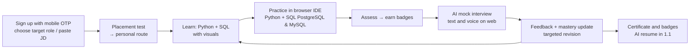

# Skillora Learning — MVP Scope, Roadmap & Delivery Plan

## 1. THE PROBLEM THIS DOCUMENT SOLVES

The combined specifications describe a platform comparable to several mature products at once (LMS, coding platform, AI interviewer, resume builder, credential issuer, commerce/SaaS engine, admin suite, web + mobile). Building all of it before launching is the **largest risk to the project** — more than any technical risk. The specs are intentionally complete; **delivery must be ruthlessly sequenced.**

Principle: *launch a narrow, excellent loop; build the platform foundations that make everything else cheap to add; expand by evidence.*

## 2. THE WEDGE (RECOMMENDED)

> **"Get interview-ready for a software job in India — personalised, in your language, affordable."**

Core loop to perfect first:

Why this wedge: highest demand and clearest value in India (placements and job switches), directly uses Skillora's differentiators, maps to the premium features that will later monetise (Interview module, Resume Studio, certificates), and needs only a small, deep content set.

Alternatives to consider consciously (decide with market research): DSA/placement-first (crowded: GfG, Coding Ninjas), GenAI-engineering-first (high interest, faster-changing content), or college-channel-first (B2B2C). The wedge is a **business decision for the founder**, recorded as an ADR.

## 2A. PORTFOLIO SCOPE (CURRENT vs FUTURE)

- **Current target: Skillora Learning only, launching with basic features first.** Everything in this roadmap's MVP applies to Learning.
- **Future scope (not built now):** (a) *Learning for Business* — corporate upskilling (`04_Future_Scope/Enterprise_Upskilling/`); (b) **Skillora Screen** — a **separate product** for recruiters/TA with fully separated data and enterprise-grade architecture (`02_Skillora_Screen/`).
- Boundaries and sequencing: `00_Portfolio/Skillora_Portfolio_and_Product_Boundaries.md`.

### Launch-scope tiers inside Skillora Learning (recommendation — confirm)

| Tier | Contents |
|---|---|
| **1.0 Web-only launch (must ship)** | **Web only: Learner Portal + Admin Portal.** Accounts (email + Google), profile + consent; placement test + personalised route; **founder-driven curriculum for Senior Python Backend / AI Engineer (Tracks A, B, C — see Release 1.0 doc)**; Python + SQL (PostgreSQL & MySQL) IDE; assessments; **Interview Master with text AND voice (web), full adaptive engine, advanced system-design canvas with auto-evaluation, last-minute mode, company-pack library (MNCs + Big 4), JD-driven prep, reports;** placement test includes DSA + system design; skill/module badges + course certificate with public verification + **Public Profile Lite (opt-in public profile, share images, embeddable badges; confirmed 2026-10-22)**; AI tutor (quota-limited); Admin Portal (RBAC, content studio, question bank, interview/rubric/prompt/voice config, templates, flags, basic analytics); entitlements with plans and quotas + metering; **Billing Lite (hosted checkout for Sprint, Pro 90 and Pro Annual passes and voice credit packs, GST invoices, coupons, admin refunds, reconciliation) and a 7-day free trial extendable to 14 (confirmed 2026-10-22; see Billing Lite and Trial Specification)** |
| **1.1 Fast follow** | **Resume Studio (R1–R3); Android app (offline, data-lite) and iOS app; mobile OTP login (DLT); LinkedIn share polish; additional tracks** |
| **1.2+ (Next)** | Recurring billing and subscriptions (UPI AutoPay/e-mandate), bundles and cohorts, mobile/store billing, organisation billing; WhatsApp journeys; Hindi UI; referral; community. (Billing Lite passes and the free trial are in 1.0.) |

**Decisions (confirmed):** 1.0 is **web only** (learner + admin portals). Interview Master is in 1.0 with **voice mode included**. Advanced system-design canvas, last-minute mode, company packs and the full adaptive engine are **also in 1.0**. Resume Studio, mobile apps and other items are in **1.1**. Full detail: `../../05_Release_1_0/01_Scope/Skillora_Learning_Release_1_0_Web_Scope_and_Founder_Curriculum.md` (**takes precedence over §3.1 below where they differ**). 1.0 ships only the hooks it needs: profile data model, entitlement flag `resume.ai_generate` (hidden), and verified-skills/credential export fields.
## 3. SCOPE TIERS

### 3.1 MVP — "Skillora Launch" (must have)

| Area | In MVP | Deliberately deferred |
|---|---|---|
| **Accounts & compliance** | Email + Google login (mobile OTP moves to 1.1); profile; **adult-only eligibility gate (18+, Higher Secondary completed; no guardian flow)**; DPDP consents, rights, retention basics; terms/privacy; grievance officer | SSO, tenants UI |
| **Content** | **Tracks A (Senior Python Backend), B (AI Engineer), C (Interview Craft)** per the Release 1.0 doc (supersedes the earlier '2–3 flagship tracks'); fully authored with hero visuals, step-throughs, assessments, badges, certificate | Full catalogue (GenAI, DevOps, Cloud, full DSA) |
| **Learning engine** | Sequential modules, mastery check, revision loop, level switch (L1/L3 variants), route map, progress | Skip-ahead acceleration, knowledge-graph explorer UI, cohort drip |
| **Coding IDE** | Python + SQL (PostgreSQL & MySQL) workspaces, visible/hidden tests, Learn/Practice/Interview modes, secure sandbox | JavaScript, framework multi-file tasks (system-design canvas is in 1.0, see Interview Master) |
| **Assessments** | MCQ, code output, short answer, coding, SQL, mini assessments | Code review, debugging suites beyond basics |
| **Interview Master** | Text **and voice** mock interviews (web); **full adaptive engine; advanced system-design canvas with auto-evaluation; last-minute mode; company-pack library (MNCs + Big 4)**; scoring, PASS/reveal, JD-driven prep, final report, project-claim questions; senior technical + India HR/behavioural bank | Mobile voice (1.1), company packs beyond the first set, group/peer interviews |
| **Resume Studio** | **Not in 1.0 (moves to 1.1).** 1.0 keeps only the profile data model and a hidden `resume.ai_generate` entitlement flag | All of Resume Studio R1–R3 (profile→resume, ATS-safe templates, AI drafting with truthfulness guard, JD tailoring, ATS check, PDF/DOCX export) in 1.1; cover letters, template marketplace later |
| **Credentials** | Skill/module badges, course completion + mastery certificates, public verification, **Public Profile Lite (profile page, share images, embeds)** | LinkedIn add-to-profile polish, Interview-ready credential, wallet passes, Open Badges export |
| **Admin Portal** | RBAC + MFA + audit; content studio with draft→review→publish + versioning + preview-as-learner; question bank + coding/SQL challenge builder; badge/certificate templates; settings/feature flags; learner list; basic analytics; provider/prompt config | Knowledge-graph editor, advanced imports, simulations, tenants, experiments |
| **SaaS foundations** | Tenant-ready schema, **entitlement service + feature registry + plans and quotas (Launch-Free, Free, Trial, Sprint, Pro 90, Pro Annual)**, usage metering, AI Gateway with paid and trial budget pools; **Billing Lite** (hosted checkout, one-time passes and credit packs, GST invoices, coupons, refunds, reconciliation) and the 7+7 day free trial | Recurring billing and mandates, subscriptions, bundles, cohorts, vouchers, referral credits, mobile/store billing, organisation billing |
| **Web + mobile** | **Web only in 1.0** (learner + admin portals, responsive, PWA-capable) | **Android (offline packs, data-lite) and iOS in 1.1**;  Full parity of every advanced workspace on mobile |
| **Quality & ops** | SLOs, observability, CI/CD, load test, VAPT, backup drill, support desk, runbooks | Multi-region active-active |
| **Localisation** | English; Hinglish tutor mode; i18n framework in place | Full Indic UI translations |

### 3.2 "Next" — first 3–6 months after launch

Release 1.1: Resume Studio, Android + iOS, mobile OTP, extra tracks. Then: subscriptions and recurring billing (UPI AutoPay/e-mandate; passes, GST invoices, coupons and refunds are already in 1.0 via Billing Lite); tuning Pro quotas and prices using paid-beta data; cohort/drip schedules and live sessions; WhatsApp journeys; referral programme; community Q&A; campus/TPO dashboards; Hindi UI; interview-ready credential.

### 3.3 "Later" — platform scale-out

**Enterprise upskilling (Learning for Business, future scope)** per `Skillora_Learning_Competitive_Landscape_and_Enterprise_Strategy.md` and `Skillora_Learning_Enterprise_Upskilling_Specification.md` (design-partner pilots E1 roughly 3–6 months after consumer launch; enterprise essentials E2 after proven pilots), full tenants/white-label/SSO, bundles/programs/role-tracks storefront, experiments platform, knowledge-graph explorer and advanced imports, DevOps/Cloud/AI-infrastructure branches, mentor marketplace, employer/job-board features, Open Badges/VC export, more Indian languages, more cloud providers, partner API.

## 4. RELEASE TRAINS

```mermaid
gantt
    title Release 1.0 (web only) - indicative relative months
    dateFormat  X
    axisFormat  M%s
    section Foundations
    ADRs, design system, repo/CI/CD/IaC                       :0, 2
    Auth (email+Google), profile, consent, entitlements, AI gateway :1, 3
    Admin shell, RBAC, audit, content studio MVP              :2, 4
    section Learning core
    Course engine, player, visuals, route map                 :3, 6
    Python+SQL IDE and sandbox (hardened)                     :3, 6
    Assessments, question bank, badges, certificates          :5, 8
    section Interview Master
    Text interview engine, scoring, JD analyser, reports      :5, 8
    Voice mode (STT/TTS streaming, barge-in, replay)          :7, 10
    Interview admin config, rubrics, calibration              :7, 10
    System-design canvas + auto-evaluation                    :6, 10
    Adaptive engine, last-minute mode, company packs          :7, 11
    section Content
    Track A and C authoring and review                        :2, 9
    Company packs content and legal review                    :7, 11
    Track B authoring and review                              :4, 10
    section Hardening and launch
    Web performance, accessibility, PWA                       :8, 10
    Load test, VAPT, DR drill, compliance review              :9, 11
    Closed beta (founder first, then small invite cohort)     :10, 12
    Public launch 1.0 (gated, see section 9)                  :12, 13
    section Release 1.1
    Resume Studio, Android, iOS, OTP login                    :13, 17
```

Closed beta with real learners (a few colleges + communities) should start **before** all features are finished (around month 8–9) to learn what actually matters.

## 5. TEAM SHAPE (INDICATIVE FOR THE MVP)

| Role | Count (min) | Notes |
|---|---|---|
| Product/UX lead + designer | 1–2 | Design system, learner research, visual language |
| Backend engineers | 3–4 | Core, sandbox/AI gateway, admin APIs |
| Frontend (web + admin) | 2–3 | |
| Mobile | 0 in 1.0 (web only); 1–2 join for 1.1 | Android first in 1.1 |
| AI/ML engineer (+ speech/voice specialist) | 2 | Voice pipeline (STT/TTS/latency), evaluation harness, prompts, interview scoring; resume pipeline in 1.1 |
| DevOps/SRE + security | 1 | Plus external VAPT |
| QA/SDET | 1–2 | Device matrix, automation |
| **Content lead + SME authors/reviewers** | 3–5 | Often the real bottleneck |
| Support/community + compliance counsel (part-time) | 1 + advisory | |

Fewer people → narrower scope or longer timeline; do not skip content, QA or security staffing.

## 6. RISKS AND MITIGATIONS

| Risk | Impact | Mitigation |
|---|---|---|
| Scope creep / spec-driven over-building | Never launches | Hold to MVP cut; every addition replaces something; monthly scope review |
| Content volume & quality | Weak learning outcomes | 2–3 flagship tracks first; AI-assisted drafting with SME review; code samples auto-verified |
| AI cost vs low ARPU | Negative margins | FinOps levers, quotas, tiered models, usage data during free launch |
| Voice quality for Indian accents/networks | Poor interview experience | Provider bake-off on Indian speech; text-first; fallbacks |
| Sandbox security incident | Severe | Hardened design, separate infra, VAPT, kill switch |
| Regulatory misstep (DPDP, dark patterns, claims) | Fines, trust loss | Compliance checklist gates, counsel review, ad-copy approval workflow |
| Voice latency/accuracy (Indian English, technical terms) | Unnatural interviews, churn | Provider bake-off early, latency budgets in CI, text fallback, custom vocabulary |
| Android performance on low-end devices (1.1) | Churn | Device-lab budgets in CI, spike early (framework decision) |
| Free launch trains users not to pay | Weak conversion | **Updated 2026-10-22:** no open-ended free launch; a capped 7+7 day trial then a useful Free tier, paid passes from the paid beta, founder pricing for the first 100 buyers, value-based quotas tuned from usage data |
| Competitor response / price war | Pressure | Differentiate on personalisation + loop + credentials; stay lean |
| Dependency on single AI/payment vendor | Outage/lock-in | Adapters, fallbacks, contract tests |
| Team burnout / key-person risk | Delay | Documentation, ADRs, modular boundaries |

## 7. SUCCESS METRICS AND GATES

| Gate | Criteria to proceed |
|---|---|
| **G1 – Closed beta ready** | Core loop (incl. voice interview) works end to end on web; SLO dashboards live; VAPT critical issues closed; consent flows reviewed |
| **G2 – Public launch (free)** | Beta activation ≥ target (e.g. ≥ 50% start a lesson within 24 h), D7 retention ≥ target (set from beta baseline), crash-free ≥ 99.5%, p95 budgets met, cost/active user within cap, ≥ 1 flagship track with strong completion and positive learner ratings |
| **G4 – Scale-out** | Healthy retention and unit economics; B2B pipeline; platform SLOs stable |

Targets in brackets are placeholders: set them from beta data, not from this document.

## 8. DECISIONS REQUIRED FROM THE FOUNDER (BLOCKERS)

1. **Wedge and first audience** (§2) — freshers/campus vs experienced job seekers vs career switchers.
2. **Flagship tracks** to author first (and who authors/reviews them).
3. **Mobile framework** — React Native vs Flutter (after spike).
4. **Cloud/vendor choices** — AWS India region assumption; LLM, STT/TTS, payment gateway, messaging providers.
5. **Free-launch duration and fair-use quotas**, and the first features to gate later.
6. **Legal entity, GST registration, counsel** for DPDP/consumer law/contracts.
7. **Budget and team size** → confirms whether the timeline is realistic.
8. **Brand and domain confirmation** (Skillora / skilloralearning.com) and trademark search.
9. **Content licensing policy** for imported material and AI-generated content.
10. **Data residency stance** (India-only processing vs allowed cross-border processors, e.g. for LLM/STT).

## 9. HOW THE SPEC SET MAPS TO THE ROADMAP

| Spec | MVP use | Later |
|---|---|---|
| Master Specification v2 | Principles, learning model, interview engine (text + voice), adaptive engine, system design, JD, coding/SQL | Mobile voice, further adaptive upgrades |
| Master Product Prompt | Curriculum for flagship tracks; tutor behaviour; data model | Remaining branches (seed as admin content, not code) |
| Visual Learning System | Design tokens, renderer (pre-rendered SVG), route/module maps, level switch, lesson templates | Algorithm animators, what-if toggles |
| Admin Portal | A0–A5 core (+ part of A3/A4), basic A9 | A6+ (advanced AI, learning rules simulation), A10 |
| SaaS & Monetization | S0, S3 (entitlements, plans and quotas, metering) and a **Billing Lite subset of S4** (hosted checkout, one-time passes and credit packs, invoices, coupons, refunds, reconciliation) | S1–S2 (offerings, schedules), recurring/subscription part of S4, S5, S7+ |
| Resume Studio | Hooks only in 1.0; R1–R3 in 1.1 | R4–R6 |
| Credentials | C1–C2 (+ part of C4) | C3, C5, C6 |
| India Market & Compliance | All of §7 compliance basics, §3–5 localisation/device/auth; **§6 payments for one-time passes (UPI, cards, GST-inclusive invoices, consumer-law refund terms) at the paid beta** | Recurring payments and e-mandate (§6) with subscriptions; campus/B2B (§9) |
| Engineering, Quality & Operations | Entire spec (scaled to MVP) | — |
