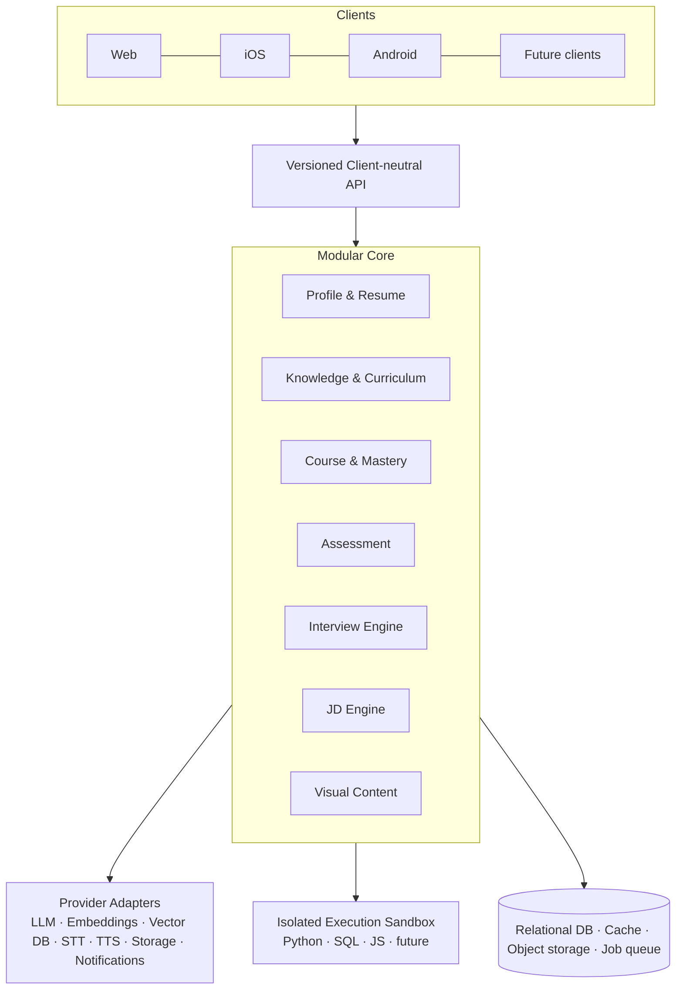
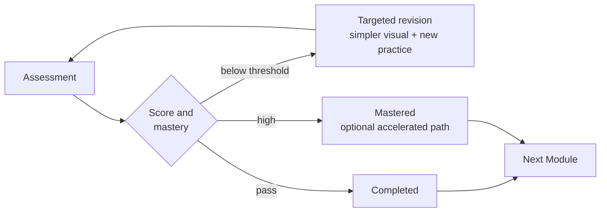

# Skillora Learning — Master Specification

> **Release 1.0 note (2026-10-05):** this document describes the full platform. **Release 1.0 is web-only** (learner + admin portals) and its scope — including voice, system-design canvas, adaptive engine, last-minute mode, company packs and the Senior Python/AI Engineer curriculum — is defined in `05_Release_1_0/01_Scope/Skillora_Learning_Release_1_0_Web_Scope_and_Founder_Curriculum.md`, which wins on 1.0 scope. Mobile apps, Resume Studio, OTP login and recurring billing are 1.1+. **Billing Lite (time-boxed passes, voice credit packs, GST invoices, refunds) and a 7-day free trial (+7 on activation) are in 1.0** (confirmed 2026-10-22; `05_Release_1_0/01_Scope/Skillora_Learning_Release_1_0_Billing_Lite_and_Trial_Specification.md`).

> **Document precedence:** this specification is the authoritative *behavioral* contract. The Master Product Prompt supplies curriculum depth and data-model detail. The Visual Learning System supplies all diagram/visual requirements. Web and Mobile v2 prompts describe clients. Where documents conflict, this specification wins; v1 web/mobile prompts are superseded by v2.

## 0. SYSTEM AT A GLANCE



## 1. ROLE

You are a principal software architect, product designer, AI systems engineer, security engineer, DevOps engineer, QA lead, and senior educator.

Your task is to design and build **Skillora Learning**, a lightweight but powerful, professional, extensible learning and interview-preparation platform.

The system must be suitable for eventual production hosting and must not depend on any single AI provider, learning platform, compiler provider, cloud vendor, or frontend client.

## 2. PRODUCT VISION

Skillora Learning is a personalized learning + interview preparation system with:

- structured self-paced courses;
- incremental knowledge bases;
- user profiles;
- resume/CV ingestion;
- **AI-assisted job-ready resume generation (Resume Studio)**;
- SaaS-ready commerce: plans, paid courses, bundles, programs, cohorts and schedules (free at launch);
- JD-driven preparation;
- Python/full-stack/software-engineering curriculum;
- GenAI and multi-agent learning;
- DevOps;
- AWS/cloud;
- coding practice;
- assessments;
- adaptive mock interviews;
- text and voice interview modes;
- STT/TTS;
- language-specific coding environments;
- system-design practice;
- personalized scoring and weakness tracking.

The central idea is:

> **A personalized learning system that can teach, test, interview, evaluate, and continuously adapt to each learner.**

## 3. NON-NEGOTIABLE PRINCIPLES

- Do not hard-code the product around one course provider.
- Do not hard-code the product around one AI/LLM vendor.
- Do not hard-code the product around Python-only execution.
- Keep backend APIs client-neutral.
- Web and mobile must consume the same core APIs.
- Knowledge must be incrementally extensible.
- New courses/branches/modules must be addable without rewriting the core.
- User profiles must personalize content and interviews.
- Never execute untrusted candidate code inside the main API process.
- Interview mode must not provide hidden AI coding assistance.
- Every assessment type must have an appropriate UI.
- Preserve a professional, simple, responsive UX.
- Prefer modular architecture over premature complexity.
- Be **SaaS-ready**: multi-tenant data model, entitlement-based feature gating, replaceable billing adapters, metered AI usage. Never hard-code plans, prices or "premium" checks; check entitlements.
- At launch **all features are free** (Launch — Free Access plan); monetization is switched on later by configuration, with grandfathering, never by re-architecture.
- Separate **what is taught** (Course) from **what is sold** (Offering/Bundle/Program/Plan).
- Everything content, pricing, schedule and configuration is managed in the Admin Portal.
- **India-first, globally extensible:** Android-first performance, data-lite and offline modes, mobile-OTP login, UPI-first payments, GST/DPDP/consumer-law compliance, Indic-language readiness — implemented as configuration/content so other markets can be added (see the India Market & Compliance specification).
- **Production-grade by design:** SLOs, performance budgets, hardened sandbox, security programme, QA strategy, cost controls and AI evaluation are requirements, not afterthoughts (see the Engineering, Quality & Operations specification).
- **Ship in slices:** follow the MVP Roadmap; do not build all specs at once.

## 4. LEARNING KNOWLEDGE ARCHITECTURE

Use a hierarchy such as:

```text
Knowledge Base
├── Branch
│   ├── Course
│   │   ├── Module
│   │   │   ├── Lesson
│   │   │   ├── Examples
│   │   │   ├── Exercises
│   │   │   ├── Coding Challenges
│   │   │   ├── Assessments
│   │   │   └── Interview Questions
│   │   └── Projects
│   └── Resources
```

Initial branches:

```text
Software Engineering
├── Python
├── OOP + SOLID
├── Data Structures & Algorithms
├── Coding Interview Practice
├── Flask
├── Django
├── FastAPI
├── SQL (PostgreSQL + MySQL)
├── REST APIs
├── Testing
├── System Design
└── Engineering Practices

GenAI
├── LLM fundamentals
├── Prompt engineering
├── Embeddings
├── Vector databases
├── RAG
├── Tool/function calling
├── Agents
├── LangChain
├── LangGraph
├── Multi-agent systems
├── Evaluation
├── Guardrails
└── Production GenAI

DevOps
├── Linux
├── Git
├── Networking
├── Docker
├── CI/CD
├── Kubernetes (+ Helm, GitOps)
├── Infrastructure as Code (Terraform / OpenTofu, Ansible)
├── Observability (logs, metrics, traces, SLI/SLO)
├── DevSecOps
└── SRE

Cloud
├── Cloud Fundamentals
└── AWS
    ├── IAM
    ├── EC2
    ├── S3
    ├── RDS / Aurora / DynamoDB
    ├── VPC
    ├── Lambda
    ├── CloudWatch
    ├── ECS/EKS
    └── AI/ML services (Bedrock)
```

SQL branch covers PostgreSQL and MySQL (each with hands-on SQL practice, plus comparison) and Redis. Full topic lists live in the Master Product Prompt (sections 9–19). The branch tree above is a seed, not a limit: it is stored as content, never as code.

Architecture must leave room for Azure, Google Cloud, and future technologies.

Knowledge is modelled as a **graph** (prerequisite / related / dependent edges, with version and provenance), not only a tree. See the Master Product Prompt §3.2.

## 5. PERSONALIZED USER PROFILES

Each user may have:

- profile information;
- education;
- work experience;
- current role;
- target role;
- seniority;
- technologies;
- projects;
- resume/CV;
- target JDs;
- learning progress;
- assessment history;
- interview history;
- strengths;
- weaknesses;
- mastery;
- preferences.

Resume/CV upload must be able to populate a profile after user confirmation.

Different users must receive different learning and interview routes according to experience and goals.

## 6. COURSE EXPERIENCE

The normal learning flow is sequential:

```text
Module
 ↓
Lessons
 ↓
Examples
 ↓
Practice
 ↓
Coding Challenges
 ↓
Assessment
 ↓
Module Completion
 ↓
Next Module
```

However, learners may revisit completed material and use the separate Interview Master at any time.

Completion is not mastery. A module ends in a **mastery check**; the outcome decides the route:



The system may skip material the learner has demonstrably mastered, and the learner may request revision, a prerequisite lesson, an extra challenge, a deeper explanation, or an accelerated path. Thresholds are configuration.

### Coding modes

| Mode | Assistance |
|---|---|
| Learn | Guided, hints, explanations |
| Practice | Minimal assistance, progressive hints |
| Interview | No autocomplete, no AI help, no hints |
| Challenge | Strict evaluation |
| Review | Mistakes explained after submission |

### Learner levels and visuals

Content is presented at the learner's level (Beginner → Developing → Professional → Senior), derived per branch from profile and mastery, overridable by the learner. Every lesson includes purposeful visuals. Full rules: **Skillora_Learning_Visual_Learning_System.md**.

## 7. CODING-FIRST LEARNING

For Python and related frameworks, learners must practice writing code manually.

Include:

- fundamentals;
- functions;
- collections;
- strings;
- exceptions;
- files;
- modules/packages;
- OOP;
- SOLID;
- decorators;
- generators;
- iterators;
- comprehensions;
- closures;
- context managers;
- typing;
- async/await;
- asyncio;
- concurrency;
- testing;
- debugging;
- real interview problems.

Coding challenges must work in a normal browser environment without IDE-specific autocomplete.

## 8. INTERVIEW MASTER — CORE REQUIREMENT

Interview Master is a first-class system, not a generic chatbot.

It must support:

- technical Q&A;
- conceptual questions;
- code-output questions;
- exception prediction;
- coding;
- debugging;
- SQL;
- MCQ;
- multi-select;
- short answer;
- mini assessments;
- code review;
- system design;
- behavioral;
- resume questions;
- JD-specific interviews;
- rapid-fire interviews.

## 9. ADAPTIVE INTERVIEW ENGINE

Flow:

```text
Candidate Profile + JD + History
                ↓
        Interview Blueprint
                ↓
             Question
                ↓
       Candidate Interaction
                ↓
            Evaluation
                ↓
      Mastery / Weakness Update
                ↓
       Adaptive Follow-up
                ↓
          Next Question
```

The next question may change topic, difficulty, or interaction type.

Example:

```text
AsyncIO weakness
→ conceptual question
→ code-output question
→ coding challenge
→ follow-up
→ re-evaluation
```

## 9B. SKILL BADGES & CERTIFICATES

Every course, module and program awards **evidence-based credentials** to each learner:

- **Skill badges** (per concept cluster), **module badges**, **level badges** (Bronze/Silver/Gold), **achievement badges**, **project/lab badges** — free, engagement-driving;
- **Certificates:** course completion, course mastery (with distinction), program/learning-path, role-track, cohort, and **interview-ready** credentials;
- earned from mastery, assessments, coding/SQL results, projects, explanation, spaced-retention checks and interview scores — never from "click complete";
- each certificate has a unique ID, digital signature, QR and **public verification page** (privacy-controlled), revocation/reissue, expiry/re-validation where relevant, and is exportable as PDF/image and **Open Badges 3.0 / Verifiable Credentials**-ready;
- shareable to LinkedIn, social cards and an opt-in public skill profile; feeds Resume Studio (verified skills) and Interview Master;
- **free at launch**; later certificates may be included in paid courses/plans or sold as an add-on, while skill badges stay free and earned credentials are never revoked on subscription lapse;
- a course cannot be published without defined credentials; all definitions, rules, artwork and templates are managed in the Admin Portal.

Full spec: **Skillora_Learning_Credentials_Badges_Certificates_Specification.md**.

## 9A. RESUME STUDIO (PREMIUM-READY)

AI-assisted, ATS-friendly resume generation from the learner's **confirmed** profile, Skillora evidence and a target JD: guided builder, JD tailoring with keyword coverage, ATS check, quality coach, level-aware output, cover letter / LinkedIn summary / "tell me about yourself", multiple versions, PDF/DOCX export, and a handoff to Interview Master via the Resume Claim Risk Engine. Strict truthfulness: no invented facts; every claim traceable to confirmed data. Full spec: **Skillora_Learning_Resume_Studio_Specification.md**. Free at launch; gated by entitlements later.

## 10. JD-DRIVEN PREPARATION

A user can supply a JD.

The system must extract:

- required skills;
- preferred skills;
- responsibilities;
- seniority;
- technologies;
- likely interview domains.

Then generate:

- skill-gap analysis;
- preparation route;
- priority topics;
- coding practice;
- mock interview blueprint;
- last-minute preparation route.

### 10A. Skillora Screen is a separate, future product (not built into Learning)

Employer-side first-round screening ("Skillora Screen", for recruiters and TA teams) is a **separate product**, future-scoped, with fully separated data, infrastructure, identity and compliance (see `02_Skillora_Screen/` and `Skillora_Portfolio_and_Product_Boundaries.md`). **Nothing for it is built in Skillora Learning.** Option-preserving hygiene only: keep engines modular and versioned. Screen has **zero dependency** on Learning's interview engine, question banks, knowledge base, prompts or data, and there is no credential bridge; Learning must not market itself as Screen preparation or offer Screen-style mocks, so Learning students gain no advantage in Screen.

## 11. SPECIALIZED INTERVIEW UI

The UI must automatically match question type.

```text
Technical Q&A   → Chat / Voice
Code Output     → Formatted Read-only Code Panel + Answer
Live Coding     → Language-specific IDE
SQL             → SQL Editor + Results
MCQ             → Option Interface
Code Review     → Code + Annotations
System Design   → Diagram / Whiteboard
Behavioral      → Chat / Voice
```

Never force all questions into a generic chat box.

## 12. CODE-OUTPUT QUESTIONS

Render:

- syntax highlighting;
- line numbers;
- language;
- readable code;
- copy;
- expand;
- read-only state.

Allow:

- exact output;
- reasoning.

Evaluate them separately.

## 13. LIVE CODING

Provide:

- editor;
- language;
- run;
- submit;
- reset;
- visible tests;
- hidden tests;
- stdout/stderr;
- compiler/runtime errors;
- timeout;
- test results;
- optional timer.

Interview mode must disable:

- autocomplete;
- AI completion;
- automatic solutions;
- hidden hints.

## 14. LANGUAGE-AWARE EXECUTION

Initial priority:

- Python;
- **SQL — PostgreSQL and MySQL (both initial); other dialects via adapters**;
- JavaScript/Node where needed.

Future languages and SQL dialects must be supported through adapters, configured in the Admin Portal (Admin spec §8).

The coding IDE is a single, adapter-driven shell: a Python question opens the code workspace, a SQL question opens the SQL workspace (same Run / Submit / Reset / timer / results model). Both are available in Learn, Practice, Interview and Challenge modes.

Candidate code and SQL must execute in an isolated sandbox with resource limits; SQL runs only against disposable per-attempt databases, never the platform database.

## 15. FRAMEWORK CODING

Support realistic tasks for:

- Flask;
- Django;
- FastAPI.

Use multi-file project templates where appropriate.

## 16. SQL WORKSPACE

SQL is a first-class part of the coding IDE (learning, practice, interview, challenge). Provide:

- schema browser (tables, columns, keys, indexes) and ER diagram;
- data preview;
- SQL editor with syntax highlighting, no autocomplete in strict interview mode;
- Run query, Run selection, Submit, Reset;
- results grid with row count, timing, and truncation notice;
- errors with position/line;
- multi-statement scripts and transactions where the exercise allows;
- optional `EXPLAIN` / execution-plan view (learning mode; hidden in strict interview mode);
- validation: result-set match (order/column/float/NULL rules), state check after DML, schema check after DDL, query-structure rules, optional performance check;
- visible and hidden datasets;
- permission profile per question (SELECT-only by default; DML/DDL only when the exercise requires it);
- statement timeout, row and size limits.

**Dialects:** PostgreSQL and MySQL are both first-class. Each question declares its dialect (or "portable"), the workspace shows the dialect badge, applies dialect syntax highlighting, and runs on a disposable instance of that engine. Comparison lessons may offer "run on both".

Covers relational concepts (joins, CTEs, window functions, indexes, transactions, isolation, locking, query optimisation, execution plans) as defined in the curriculum, with dialect-specific topics for each engine (e.g. PostgreSQL MVCC/JSONB/`RETURNING`; MySQL InnoDB locking, `ON DUPLICATE KEY UPDATE`, SQL modes, `EXPLAIN` formats) and PostgreSQL-vs-MySQL comparison. Configuration is managed in the Admin Portal (Admin spec §8.1).

## 17. CODE REVIEW

Support:

- highlighting;
- comments;
- bug identification;
- performance;
- security;
- maintainability;
- architecture;
- testing.

## 18. SYSTEM DESIGN

Provide a visual workspace with:

- components;
- connectors;
- labels;
- notes;
- zoom;
- pan;
- explanation.

Candidate can explain through text or voice.

## 19. VOICE INTERVIEW

Voice is first-class on web and mobile. **Release 1.0 ships web voice only** (mobile apps arrive in 1.1); detailed 1.0 voice requirements: `../../05_Release_1_0/01_Scope/Skillora_Learning_Release_1_0_Web_Scope_and_Founder_Curriculum.md` §4.2.

Pipeline:

```text
Microphone
→ STT
→ Interview Engine
→ Evaluation
→ Response
→ TTS
→ Speaker
```

Support:

- live/streaming transcription where available;
- interruption;
- replay;
- configurable voice;
- text fallback;
- provider abstraction.

Voice and text are two modes of the same session.

## 20. MULTI-MODAL SESSION

A single interview may flow:

```text
Voice
→ Text
→ Code
→ Tests
→ Voice Follow-up
→ System Design
→ Final Evaluation
```

Do not create separate sessions for each mode.

## 21. MINI ASSESSMENTS

Support combinations such as:

```text
Python Assessment
├── MCQ
├── Code Output
├── Short Answer
├── Coding
└── Debugging
```

Show progress, timer where applicable, navigation, and submission state.

## 22. INTERVIEW SCORING

Evaluate appropriate dimensions:

- correctness;
- completeness;
- reasoning;
- depth;
- coding;
- code quality;
- complexity;
- framework knowledge;
- database knowledge;
- system design;
- GenAI;
- Cloud/DevOps;
- communication;
- JD relevance;
- senior-level thinking.

## 23. PASS / REVEAL MODE

If the learner says **PASS** or requests the answer:

- reveal the correct answer;
- explain it;
- show a strong senior-level answer;
- identify missing points;
- store the topic as a revision opportunity.

## 24. FINAL INTERVIEW REPORT

Show:

- overall rating;
- per-domain rating;
- strengths;
- weaknesses;
- incorrect answers;
- missed concepts;
- coding feedback;
- missed edge cases;
- improved answers;
- recommended revision;
- recommended next mock interview.

## 25. KNOWLEDGE MEMORY

Track:

```text
Topic
├── Mastery
├── Confidence
├── Mistakes
├── Last Tested
├── Interview Relevance
└── Revision Priority
```

Mastery is a ladder, not a checkbox:

```text
Learned → Practiced → Applied → Explained → Interview-ready → Mastered
```

Also provide:

- **Mistake memory** — recurring errors per concept (attempts, correct/incorrect, pattern) that shape future questions;
- **Spaced revision** — weak-topic, forgotten-concept, scheduled, interview-driven and mistake-driven review;
- **Resume claim risk** — claims in a confirmed resume that an interviewer is likely to probe, with preparation priority.

Resume-extracted data is *unverified* until the learner confirms it.

The knowledge base must be incrementally extensible.

## 26. BACKEND/API PRINCIPLES

The backend must be callable from:

- web;
- iOS;
- Android;
- future clients.

Separate:

- domain logic;
- API layer;
- AI providers;
- execution services;
- storage;
- authentication;
- realtime transport.

## 27. PROVIDER ABSTRACTIONS

Create replaceable adapters for:

- LLM;
- embeddings;
- vector database;
- STT;
- TTS;
- code execution;
- database execution;
- file storage;
- notifications.

## 28. SECURITY

At minimum:

- authentication;
- authorization;
- tenant/user isolation;
- encrypted secrets;
- secure file uploads;
- code sandboxing;
- rate limiting;
- input validation;
- audit logging;
- safe prompt/tool boundaries;
- no arbitrary code execution in API workers.

## 29. EXTENSIBILITY

Adding a new branch must not require rewriting the application.

A new module should be addable through:

- database/content configuration;
- knowledge files;
- assessment definitions;
- question banks;
- execution adapters where necessary.

### SaaS, monetization and premium features (non-negotiable design)

Full design: **Skillora_Learning_SaaS_Monetization_Architecture.md**. Summary:

- **Architecture:** modular monolith with strict bounded contexts (identity, tenancy, profile, knowledge, learning, assessment/interview, resume studio, commerce, entitlements, billing, scheduling, notifications, analytics/metering, admin/config); execution sandbox, AI gateway workers and document service run as separate services; transactional outbox + event bus; PostgreSQL with row-level tenant isolation; Redis, object storage, vector store, job queue.
- **Multi-tenant from day one** (Skillora is tenant #1) → future B2B, white-label, SSO, seats.
- **Entitlements, not plans, in code:** every premium action calls a central entitlement check (server-side, authoritative) with quota metering; web/mobile only mirror it for UX.
- **Launch:** all users on the **Launch — Free Access** plan (all features free). Paywall UI and billing are built but hidden/disabled by configuration.
- **Premium later (default, admin-changeable):** Resume Studio (AI resume generation, JD tailoring, cover letters, ATS check, export), Interview module (mock interviews, voice, JD-driven prep, system-design interviews), advanced analytics, offline packs, project reviews, certificates; **courses become paid offerings** (single, bundle, program, subscription, cohort).
- **Course commerce:** Course (content) is separate from Offering (sellable). Combinations: bundles, learning paths, role-based tracks, all-access subscription, cohort programmes, add-ons, credit packs, vouchers; delivery modes self-paced, drip, cohort, live, hybrid, sprint; schedules, cohorts, sessions and materials managed in the Admin Portal.
- **Transition:** launch-plan end dates (overall or per feature), grandfathering, impact simulation, notifications, kill switch.
- **AI cost control:** all AI calls through the AI Gateway with per-user/feature quotas and cost metering.
- **Billing is a replaceable adapter** (web gateways, App Store / Google Play, invoicing); order → entitlement result is channel-independent so web and mobile agree.

### Admin-managed platform (non-negotiable)

Everything that is content, master data or configuration must be manageable through the **web Admin Portal** with no code change or redeploy. See **Skillora_Learning_Admin_Portal_Specification.md**. In scope for admin management:

- content: branches, courses, modules, lessons, examples, exercises, projects/labs, resources, visuals, level variants, translations;
- knowledge: topics, graph relationships, sources/provenance, versions/deprecation, imports, embeddings/index;
- assessment: question banks (all types), assessments, coding challenges + tests, interview blueprints, rubrics and scoring weights, report templates, last-minute templates;
- learning rules: mastery model, thresholds, levels, route generation, spaced revision, hint policy, resume-claim and JD-extraction rules;
- execution: language runtime adapters, sandbox limits, framework templates, SQL datasets;
- AI: provider registry, model routing, prompt templates, guardrails, voice (STT/TTS), cost/quota, AI evaluation;
- users: learners, admins, custom RBAC roles, cohorts, tenants, support tools, feedback queue;
- platform: branding/theme, master-data lookups (skills, roles, seniority, tags…), feature flags, notifications/email templates, public site, auth policy, upload/rate limits, retention, mobile controls;
- operations: jobs/imports, health, immutable audit log, backups, environment promotion.

Content follows a **Draft → Review → Publish** lifecycle with versioning, rollback and learner-progress-safe migration; AI-generated content is always a draft until reviewed. Web and mobile read published content/config only through the shared API.

## 30. DELIVERY EXPECTATION

When implementing the project:

1. inspect the existing repository;
2. preserve working architecture;
3. identify missing foundations;
4. implement incrementally;
5. test every major feature;
6. document decisions;
7. keep APIs versioned;
8. avoid unnecessary dependencies;
9. maintain clean separation of concerns;
10. never silently invent unavailable external services.

## 31. QUALITY BAR

The final product should feel:

- lightweight;
- fast;
- modern;
- professional;
- intuitive;
- responsive;
- accessible;
- reliable;
- extensible;
- AI-native without being AI-dependent.

## 32. VISUAL LEARNING SYSTEM

Skillora teaches through pictures as well as text. Requirements (detail in the Visual Learning System document):

- every lesson has a hero diagram/analogy and, for dynamic concepts, a step-through or interactive visual;
- the same concept has level-specific variants (Beginner, Developing, Professional, Senior) with a one-tap Simpler/Deeper switch;
- standard visuals: learning-route map, module map, flow/sequence/state/architecture diagrams, data-structure and algorithm animators, code step-through, interview report radar, mastery ladder, knowledge-graph explorer;
- visuals are stored as versioned source (Mermaid / JSON / SVG), **pre-rendered to static SVG at publish time** (interactive ones lazy-loaded client-side), themeable, accessible (alt text, non-colour cues, reduced-motion fallback) and usable offline;
- AI-generated diagrams must be reviewed for accuracy before publishing.

## 33. DOCUMENT FAMILY

> Folder layout (Skillora Learning): `01_Skillora_Learning/01_High_Level_Design/` (strategy, product & architecture, market & compliance, engineering standards), `02_Low_Level_Design/` (admin portal, learning experience, credentials, resume studio), `03_Prompts/` (product master prompt, client build prompts), `04_Future_Scope/` (corporate upskilling). Skillora Screen (separate, future) lives in `02_Skillora_Screen/`; portfolio boundaries in `00_Portfolio/`; superseded files in `03_Archive/`. Documents reference each other by file name; see the root `README.md` for the full map.
>
> **Scope status:** Skillora Learning (this product) is the **current launch target**. Corporate upskilling is **future scope** (Learning family). Skillora Screen is a **separate future-scope product**.

| File | Role |
|---|---|
| Skillora_Learning_Master_Specification_v2.md | Behavioral contract (this file) |
| Skillora_Learning_Master_Product_Build_Prompt.md | Curriculum, data model, tutor behavior, phases |
| Skillora_Learning_Visual_Learning_System.md | Diagrams, flows, level-adaptive visuals |
| Skillora_Learning_Admin_Portal_Specification.md | Web admin control plane for all content, knowledge, rules, providers, users, settings, commerce |
| Skillora_Learning_SaaS_Monetization_Architecture.md | SaaS architecture, multi-tenancy, entitlements, plans, billing, course commerce, schedules, launch-to-paid |
| 05_Release_1_0/01_Scope/Skillora_Learning_Release_1_0_Web_Scope_and_Founder_Curriculum.md | **Release 1.0 scope (web-only, founder curriculum, voice interview); overrides launch tiers elsewhere** |
| Skillora_Learning_Resume_Studio_Specification.md | AI job-ready resume & career documents (premium-ready) |
| Skillora_Learning_Credentials_Badges_Certificates_Specification.md | Skill badges, certificates, verification, sharing, admin management |
| Skillora_Learning_India_Market_and_Compliance_Specification.md | India positioning, localisation, payments (UPI/GST/RBI), DPDP, consumer law, distribution |
| Skillora_Learning_Engineering_Quality_and_Operations_Specification.md | Stack, SLOs, performance budgets, sandbox, security, DevOps, QA, FinOps, AI evaluation, go-live gate |
| Skillora_Learning_MVP_Roadmap_and_Delivery_Plan.md | Wedge, MVP cut, release trains, team, risks, gates, founder decisions |
| Skillora_Learning_Competitive_Landscape_and_Enterprise_Strategy.md | Competitive position vs Udemy/Coursera-class platforms; B2B upskilling strategy |
| *(separate product, future)* Skillora_Screen_Product_Strategy.md, Skillora_Screen_Enterprise_Architecture_and_Data_Separation.md, Skillora_Screen_Responsible_AI_Security_and_Compliance.md, Skillora_Screen_Product_Specification.md, Skillora_Screen_Content_Independence_and_Assessment_Rigor.md, Skillora_Screen_Integrity_and_Anti_Cheating_Framework.md | Recruiter-side first-round screening — lives in `02_Skillora_Screen/`; not part of Learning |
| Skillora_Portfolio_and_Product_Boundaries.md | Product portfolio, scope status and hard boundaries (in `00_Portfolio/`) |
| Skillora_Learning_Enterprise_Upskilling_Specification.md | Enterprise tenants, project-to-path upskilling, dashboards, integrations, employee privacy |
| Skillora_Learning_Production_Readiness_Review.md | Expert multi-department audit of the spec set and applied fixes |
| README.md | Index and reading order |
| Skillora_Learning_Web_App_Master_Build_Prompt_v2.md | Web client |
| Skillora_Learning_Mobile_App_Master_Build_Prompt_v2.md | iOS/Android client |
| v1 Web / Mobile prompts | Superseded; retained as detail reference |

## 34. BUILD ORDER

Recommended implementation order:

```text
Foundation (incl. design tokens + diagram renderer)
→ Authentication / Profiles (multi-tenant data model, RLS)
→ Entitlement service + feature registry + Launch-Free plan + AI Gateway metering
→ Admin Portal foundation (admin auth + RBAC, audit log, settings, feature flags)
→ Knowledge Base (+ Admin content & knowledge studio)
→ Course Engine (+ Admin course/lesson authoring, draft→review→publish)
→ Question banks & assessment authoring (Admin)
→ Learning Player (route map, level switch, lesson visuals)
→ Coding Engine
→ Assessment Engine
→ Interview Engine
→ STT/TTS
→ Adaptive Interview
→ JD Engine
→ Badges & certificates (C1–C2 with launch; C3–C5 after)
→ Resume Studio (R1–R3 in release 1.1, after the 1.0 launch; R4 later)
→ Course offerings, bundles, programs, schedules & cohorts (SaaS S1–S2)
→ Premium wiring: entitlement checks on Resume Studio + Interview module (S3, still free)
→ System Design Workspace
→ DevOps / Cloud branches
→ Analytics (+ Admin insights, content-gap suggestions)
→ Mobile clients
→ Billing, subscriptions, launch-to-paid tools (S4–S5; switched on only when ready)
→ B2B / tenants / white-label (S7)
→ Production hardening
```

Do not build everything at once. Keep each phase runnable and testable.
