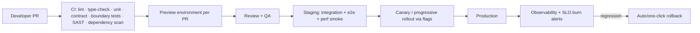

# Skillora Learning — Engineering, Quality & Operations Specification

> **Release 1.0 addendum (2026-10-05):** Release 1.0 ships **web only**. Apply every budget, SLO, accessibility, security and operations requirement to the **web learner app and web Admin Portal**; mobile/Android/iOS items (framework choice, device farm, store checklist, offline packs) are deferred to **1.1**. 1.0 **adds** real-time voice requirements (latency budgets, reconnect, provider fallback, cost caps), canvas/adaptive-engine evaluation quality gates, and scoring calibration checks — see `05_Release_1_0/`. Stack decisions are tracked as ADRs in `05_Release_1_0/02_Engineering_Kickoff/`.

## 1. PURPOSE

The feature specs say *what* Skillora does. This document says **how well and how safely** it must do it, and how the team builds, ships, runs and pays for it. Without these, a feature-complete product can still fail on speed, outages, security incidents, or cost.

## 2. RECOMMENDED STACK (DECISION PROPOSALS — CONFIRM VIA ADR)

| Layer | Recommendation | Rationale / alternatives |
|---|---|---|
| **Backend core** | **Python, Django + Django REST Framework (or Django Ninja) modular monolith** | Mature ORM/migrations/auth/admin tooling, fits the content-heavy and admin-heavy nature, large hiring pool in India; team already works in Django. Alternative: FastAPI everywhere (faster async, less batteries) |
| **Realtime / AI / voice services** | **FastAPI (async) services** for AI Gateway, voice interview streaming (WebSocket), sandbox orchestrator | Async I/O, streaming, independent scaling |
| **Database** | **PostgreSQL** (row-level security for tenants), read replicas later | Core relational model, JSONB for flexible content, extensions (pgvector optional for early vector search) |
| **Cache / queue** | **Redis** (cache, rate limits, ephemeral state) + **queue** (Celery/Arq or a managed queue) + transactional outbox | Reliable async jobs |
| **Search** | PostgreSQL full-text first → OpenSearch/Meilisearch when needed | Avoid early over-engineering |
| **Vector store** | pgvector initially; dedicated vector DB behind the adapter when scale/latency demands | Provider abstraction already required |
| **Object storage / CDN** | S3-compatible + CDN, signed URLs for paid media | Global standard |
| **Web learner app + marketing site** | **TypeScript, React with Next.js** (SSR/SSG for SEO pages, SPA behaviour for app) | SEO for public course pages; shared TS types with mobile |
| **Admin Portal** | Same React stack, separate bundle/route, schema-driven forms | Reuse design system and API client |
| **Code editor (web & mobile)** | CodeMirror 6 (lightweight, mobile-capable; in WebView on mobile if needed) rather than Monaco | Monaco is heavy and desktop-oriented |
| **Diagram rendering** | **Render Mermaid/JSON to static SVG at publish time** (server-side), store both source and SVG; use client-side rendering only for interactive visuals | Avoids shipping a heavy renderer to low-end phones; faster, deterministic |
| **Code/SQL execution** | Isolated sandbox service (see §5) | Security-critical |
| **Cloud** | **AWS, India primary region (Mumbai, ap-south-1) with DR in Hyderabad (ap-south-2)**; containers on ECS/Fargate to start (Kubernetes only when justified); sandbox nodes on dedicated instances | Latency + data-residency posture; small-team operability |
| **IaC / CI/CD** | Terraform/OpenTofu; GitHub Actions; environments dev/staging/prod; preview environments for PRs | Repeatability |
| **Observability** | OpenTelemetry → metrics/logs/traces stack (managed or Grafana stack), Sentry for errors | Standard |
| **Feature flags & config** | Built-in config service (Admin spec) + flag SDK | Already specified |

## 3. NON-FUNCTIONAL REQUIREMENTS (PROPOSED TARGETS)

### 3.1 Availability & reliability

| Area | Target |
|---|---|
| Core learner services (auth, learning, progress) | 99.9% monthly availability |
| Interview realtime and sandbox | 99.5% initially (degrade gracefully to text/queue) |
| Admin Portal | 99.5% |
| **RPO / RTO** | RPO ≤ 15 min, RTO ≤ 4 h (initial); tighten after growth |
| Backups | Automated, encrypted, cross-region copy; **restore tested quarterly** |
| Degradation | Each dependency failure has a defined fallback (LLM down → fallback model/cached answers/clear message; STT/TTS down → text mode; sandbox saturated → queue with ETA; payment gateway down → alternate method) |

### 3.2 Performance budgets

| Surface | Budget (on mid-range Android, 4G) |
|---|---|
| Web LCP (public/course pages) | ≤ 2.5 s; INP ≤ 200 ms; CLS ≤ 0.1 |
| Web app initial JS (learner shell) | ≤ 200 KB gzip critical path; heavy modules (editor, whiteboard) lazy-loaded |
| Mobile cold start | ≤ 3 s on 3 GB RAM device |
| Mobile install size | Target ≤ 40 MB download (AAB split); no large bundled assets |
| Lesson open (cached) | ≤ 500 ms; (network) ≤ 1.5 s p75 |
| API latency | read p95 ≤ 300 ms, write p95 ≤ 600 ms (excluding AI/sandbox) |
| AI tutor first token | ≤ 2 s p75; full short answer ≤ 8 s |
| Code run (Python) | p95 ≤ 3 s queue+run; SQL p95 ≤ 2 s |
| Voice interview turn (end of speech → start of reply audio) | target ≤ 2 s p75; always show "thinking" state; text fallback |
| Data usage | Data-lite mode: lesson session ≤ 5 MB typical; video, if any, adaptive with low-bitrate profile |

### 3.3 Scalability and capacity

- Design for **spiky traffic** (campus placement season, exam-result periods, marketing pushes, interview-date rushes): autoscaling web/API, queue-backed AI and sandbox work, per-user and per-tenant rate limits, load shedding for non-essential features.
- Initial capacity planning: model concurrency of sandbox runs and voice sessions (the costliest/most constrained resources); load test to 5–10× expected launch peak before go-live.
- Stateless services, idempotent endpoints, connection pooling, read replicas and cache before sharding.

### 3.4 Accessibility, compatibility, privacy

- WCAG 2.2 AA target for web; mobile screen-reader support; RTL not required but Indic script rendering verified.
- Browser support: last 2 versions of Chrome/Edge/Firefox/Safari + Samsung Internet; Android 8+ (confirm via analytics), iOS current−2.
- Privacy by design per India spec §7 (DPDP).

### 3.5 Future high-stakes workloads (proctored certifications)

If Skillora Learning later offers proctored/strict certifications: reserve capacity per exam window, load-test at ≥ 2× expected concurrency, use server-authoritative timers and autosave, define fallback sections if the sandbox degrades, and run an exam-day runbook. (Recruiter-side screening is a separate product with its own, stricter architecture: `02_Skillora_Screen/`.) Keep the sandbox runner, queue and scoring framework modular so they can be vendored as libraries by other products.

## 4. ARCHITECTURE QUALITY RULES

- Strict bounded contexts; modules communicate via interfaces/events; no cross-module table access; architectural tests (import-boundary linting) in CI.
- Every external provider behind an adapter with contract tests and a **fake adapter** for tests/local dev.
- Idempotency keys on payment, entitlement, credential issuance and webhook handlers; transactional outbox for events; dead-letter queues.
- Backward-compatible API versioning (`/api/v1`), deprecation policy, OpenAPI as contract, generated typed clients for web/mobile; mobile must tolerate old app versions (minimum-version control in Admin).
- Database: migrations are backward-compatible (expand → migrate → contract), no long locks, indexes reviewed, **N+1 detection in CI**, query budgets per endpoint, partitioning plan for events/usage tables.
- Caching strategy documented per resource (CDN for public content, Redis for effective-entitlements/config, ETags for content).

## 5. CODE & SQL EXECUTION SANDBOX (HIGHEST-RISK COMPONENT)

Threats: sandbox escape, resource exhaustion, crypto-mining, network abuse, data exfiltration between learners, hidden-test leakage, denial of service via queue flooding.

Design requirements:

- **Isolation:** run untrusted code in microVM or user-space-kernel sandboxes (e.g. Firecracker or gVisor-class isolation) or hardened containers with seccomp, no root, read-only root filesystem, dropped capabilities, cgroups (CPU, memory, pids, I/O), per-run ephemeral filesystem, no outbound network (allow-list only where an exercise requires it), strict wall-time and output-size limits.
- **Separate infrastructure:** dedicated nodes/VPC subnets with no access to production data stores or secrets; sandbox cannot reach the metadata service; scoped credentials only for result return.
- **Warm pools** of pre-initialised sandboxes per runtime to meet latency targets; scale on queue depth; cap per-user concurrency and per-tenant quotas.
- **SQL (PostgreSQL & MySQL):** per-attempt isolated schema or ephemeral database from a template/snapshot, least-privileged role, statement timeouts, blocked dangerous commands per dialect (Admin spec §8.1), pooled database instances with resource limits; destroy and verify cleanup after each attempt; never connect to the platform database.
- **Judge integrity:** hidden tests never sent to the client; results compared server-side; deterministic seeds; flaky-test detection; similarity checks for credential-bearing assessments.
- **Observability and abuse detection:** per-run metrics, anomaly alerts (CPU spikes, repeated timeouts, banned syscalls), kill switch per runtime.
- **Build vs buy:** an open-source judge engine can accelerate the MVP, but must be wrapped by the same isolation, quota and observability requirements; security review before exposing to the internet.

## 6. SECURITY PROGRAMME

### 6.1 Threat model (STRIDE) — first set of mandatory scenarios

| Asset | Key threats | Required controls |
|---|---|---|
| Learner accounts | Credential stuffing, OTP abuse/SMS pumping, session theft | Rate limits, OTP throttling and cost caps, device/session management, breached-password checks, MFA option |
| Resume/transcripts/voice | IDOR, mass export, insider access | Tenant/user RLS, object-level auth tests, encryption, access-reason logging, short retention |
| Payments/entitlements | Webhook forgery/replay, price tampering, coupon abuse | Signature verification, idempotency, server-side pricing only, usage limits, reconciliation |
| Admin Portal | Account takeover, privilege escalation, malicious content (XSS in lessons) | MFA/step-up, IP allow-list option, RBAC tests, sanitisation, CSP, separate origin |
| AI features | Prompt injection via resumes/JDs/documents, data leakage across users, jailbreaks in interview mode | Untrusted-data handling, tool permissions, output validation, per-user context isolation, red-team tests |
| Sandbox | Escape, noisy neighbour | §5 |
| Content | Piracy/scraping of paid content | Signed URLs, watermarking for premium video/files (later), rate limits, bot detection |
| Infrastructure | Misconfiguration, leaked secrets, supply chain | IaC scanning, secrets manager, SBOM, dependency scanning, image signing |

### 6.2 Controls and process

- Secure SDLC: threat modelling for new features, code review, SAST/DAST/dependency/secret scanning in CI, container scanning, signed builds.
- **Pre-launch VAPT by an independent party**, fixes verified; periodic re-test; bug-bounty/vulnerability-disclosure policy later.
- WAF, DDoS protection, bot management, API rate limiting; security headers (CSP, HSTS), CSRF/XSS defences; secure cookies/tokens; mobile: certificate pinning option, secure storage, jailbreak/root signals as risk input (not sole control).
- Secrets in a managed vault with rotation; least-privilege IAM; production access via audited just-in-time access.
- Centralised, tamper-evident audit logs; **log retention aligned with Indian requirements** (India spec §7.3).
- Incident response: severity matrix, on-call, runbooks, breach-notification workflow (DPDP + CERT-In), post-incident reviews.
- Privacy engineering: data inventory, field-level classification, retention jobs, DSAR automation, processor register.

## 7. DEVOPS & RELEASE ENGINEERING

- Trunk-based development, small PRs, feature flags for incomplete work, database migrations decoupled from deploys.
- Environments: dev, staging (prod-like, anonymised data), production; infra as code; reproducible local dev (containers) with fake adapters.
- **Mobile release:** staged rollouts, crash-free-sessions gate (e.g. ≥ 99.5%), over-the-air updates for JS-level fixes where policy allows, forced-update control via Admin, store-review lead time in plans.
- Content release is separate from code release (Admin publish workflow) with its own rollback.
- Cost-aware autoscaling and environment shutdown schedules for non-prod.

## 8. QUALITY ENGINEERING (QA STRATEGY)

| Layer | Practice |
|---|---|
| **Unit/contract** | Domain logic, adapters (contract tests vs fake + sandbox accounts), mastery/credential/entitlement rule engines (property-based tests) |
| **Integration** | API + DB + queue; migration tests; permission matrices (every role × resource) |
| **End-to-end** | Critical journeys: signup/OTP → profile/resume → route → lesson → coding/SQL → assessment → credential → JD → mock interview → resume export → (when on) checkout → entitlement; run on web and mobile |
| **Device & browser matrix** | Real-device farm incl. low-end Android and Android Go-class; iOS; network throttling (3G/4G/flaky) |
| **Performance/load** | Baseline and spike tests for API, sandbox queue, voice sessions; soak tests; budgets enforced in CI (Lighthouse/Web Vitals, bundle size, app size) |
| **Security** | Automated scans, manual pen tests, authorization fuzzing, prompt-injection suite |
| **Accessibility** | Automated + manual screen-reader audits each release train |
| **Content QA** | Technical accuracy review (SME), code samples executed in CI against the sandbox, diagram accuracy review, broken-link and alt-text checks, accessibility checks on visuals |
| **AI evaluation** | See §10 |
| **Chaos/resilience** | Failure-injection for providers (LLM, STT/TTS, payment, sandbox) to verify fallbacks |
| **Release gates** | No P0/P1 defects open; budgets met; migration rehearsal passed; rollback verified |

Definition of "production-ready" per feature = feature DoD (in each spec) **plus** tests, dashboards, alerts, runbook, rollback and capacity note.

## 9. COST ENGINEERING (FINOPS) & UNIT ECONOMICS

India's low ARPU makes AI/voice/sandbox cost control a survival issue.

- **Per-active-user cost model** tracked monthly: LLM tokens, STT/TTS minutes, sandbox CPU-seconds, SQL instances, storage/CDN, messaging (SMS/WhatsApp), payment fees, support.
- **Levers:** model tiering and routing (small/fast model for routine tutoring and drafting; larger models only for evaluation and final scoring), prompt/response caching and semantic caching, retrieval before generation, short outputs, batching, quotas per plan, per-user budgets, auto-degrade, pre-computed content (explanations, diagrams, model answers) instead of live generation, off-peak batch jobs, spot capacity for non-critical workers.
- **Voice** is the costliest feature: quota in minutes, silence detection, text-first fallback, cheaper STT for practice and higher-quality only for assessed sessions.
- **Guardrails:** cost-per-user alerts, global spend caps, kill switches (Admin), margin dashboard by plan/segment, pricing decisions from data (SaaS spec §8).
- **Launch-free phase**: enforce fair-use quotas even when everything is free so costs stay bounded; track free-to-paid conversion potential by feature.

## 10. AI QUALITY, SAFETY & GOVERNANCE

- **Evaluation harness** (Admin AI evaluation suite): golden datasets for tutor answers, interview scoring, resume claim-tracing, JD extraction, retrieval relevance; regression runs on every prompt/model change; thresholds block deploy.
- **Hallucination controls:** retrieval-grounded answers with citations to knowledge-base sources, "I don't know" behaviour, truth labels (verified/inferred/uncertain), code answers verified by executing in the sandbox where possible.
- **Interview scoring reliability:** rubric-based scoring with calibration sets, inter-rater (human SME) agreement tracking, consistency tests (same answer → stable score), variance reporting; show reasoning; allow appeals.
- **Fairness:** monitor score differences across accents/ASR quality, language fluency, college tier, gender-coded language; separate communication score from technical correctness.
- **Safety:** prompt-injection defence for uploaded/pasted content, output filters, jailbreak resistance in strict interview mode, PII redaction in logs and prompts, no learner-data training, provider data-processing terms enforced.
- **Governance:** prompt registry with versions/approvals, model change log, provider fallback tests, human-in-the-loop review for AI-generated curriculum before publish.
- **Transparency:** AI-generated labels, explanation of limits, disclosure of AI use in consent notices.

## 11. DATA, ANALYTICS & EXPERIMENTATION

- **Event taxonomy** (versioned, documented): `signup`, `onboarding_step`, `lesson_started/completed`, `visual_interacted`, `code_run/submitted`, `sql_run/submitted`, `assessment_started/submitted`, `credential_earned/shared/verified`, `jd_added`, `resume_generated/exported`, `interview_started/completed`, `paywall_hit`, `upgrade_clicked`, `purchase_completed`, `churn_signal`, with `tenant_id`, pseudonymous user id, language, device class, network class.
- **North-star and guardrail metrics:**
  - North star: *weekly active learners who complete a meaningful learning action* and *mastery gained per learner per week*.
  - Learning: lesson→module completion, mastery gain, retention (spaced-review pass rate), time-to-first-credential.
  - Career: resumes exported, JDs analysed, mock interviews completed, interview-score improvement, self-reported interview/job outcomes (opt-in, never marketed as guaranteed).
  - Quality: crash-free sessions, API/AI/sandbox SLO attainment, support ticket rate, NPS/CSAT.
- **Warehouse and BI:** event pipeline into a warehouse; privacy-safe (pseudonymised, consent-aware; adult-only audience, so no under-18 profiling case); dashboards in Admin Insights.
- **Experimentation:** feature flags + A/B framework with guardrails (no experiments on pricing transparency or dark-pattern-adjacent flows; ethics review for learning-affecting tests).

## 12. SUPPORT, CONTENT & BUSINESS OPERATIONS

- **Content operations** are the real production bottleneck: define author/reviewer capacity, content throughput targets, style guide, SME review SLAs, version cadence, tooling for AI-assisted drafting with mandatory human review; start with a small number of flagship tracks (Roadmap doc).
- **Support operations:** ticketing, macros, SLA tiers, escalation, knowledge base, consent-based learner-context view, refund workflow, grievance officer process.
- **Runbooks** for top failure modes (provider outage, queue backlog, payment webhook delays, sandbox saturation, content rollback, data-subject request, breach).
- **On-call and incident management** from the first public launch, even if small.
- **Vendor management:** SLAs, data-processing agreements, exit plans for LLM/STT/TTS/payment/messaging vendors.

## 13. ENGINEERING GOVERNANCE

- **Architecture Decision Records (ADR)** for: backend framework, mobile framework, cloud/region, sandbox technology, vector store, LLM/STT/TTS vendors, payment gateway(s), analytics stack, tenancy model.
- **Technical-debt budget** per release; refactoring allowed inside bounded contexts.
- **Documentation:** OpenAPI, module READMEs, runbooks, data dictionary, architecture diagrams kept in repo and updated in PRs.
- **Engineering definition of done** (adds to every feature DoD): tests, metrics, logs, alerts, runbook, feature flag, security review (when applicable), accessibility check, i18n check, performance budget check, docs.

## 14. PRODUCTION READINESS CHECKLIST (GO-LIVE GATE)

- [ ] SLOs defined, dashboards and burn-rate alerts live; on-call and runbooks ready.
- [ ] Load test at 5–10× expected peak passed; autoscaling verified; sandbox and AI queues protected by quotas.
- [ ] Backups restored successfully in a drill; DR failover rehearsed.
- [ ] Independent VAPT complete, critical/high fixed; WAF and DDoS protection on; secrets rotated.
- [ ] DPDP consent, rights, retention, breach and age-gating flows implemented and reviewed by counsel; processor register complete.
- [ ] Payments (when enabled): UPI/cards/e-mandate flows, GST invoices, refunds, reconciliation tested end to end; dark-pattern review passed.
- [ ] Android low-end device and low-bandwidth tests passed; app/web budgets met; store listings, privacy/data-safety forms and policy compliance ready.
- [ ] AI evaluation thresholds met; fairness checks run; fallbacks tested; cost caps in place.
- [ ] Content: SME-reviewed flagship tracks published with visuals, badges and certificate rules; all code samples verified by execution.
- [ ] Support desk, grievance officer, refund policy, terms and privacy pages live.
- [ ] Analytics and consent-aware tracking verified; experiment guardrails set.
- [ ] Rollback plans verified for code, data migrations and content.
