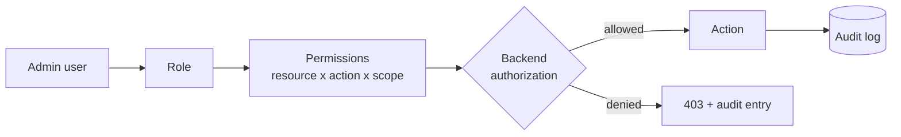
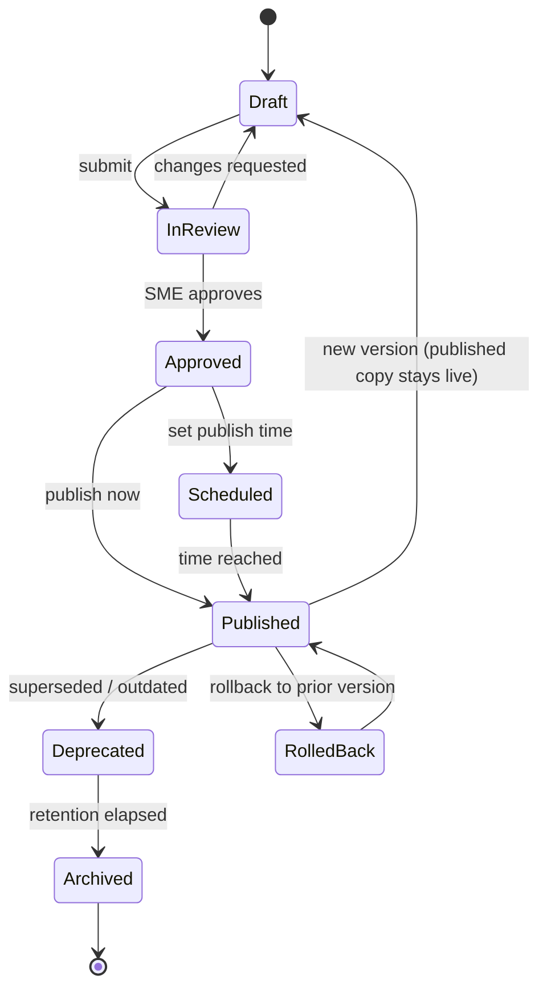
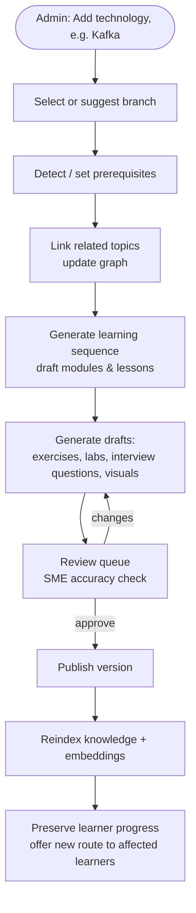
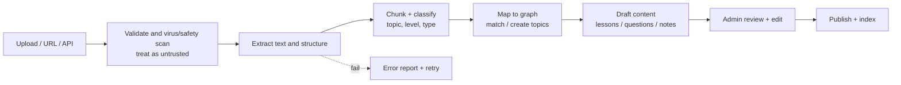
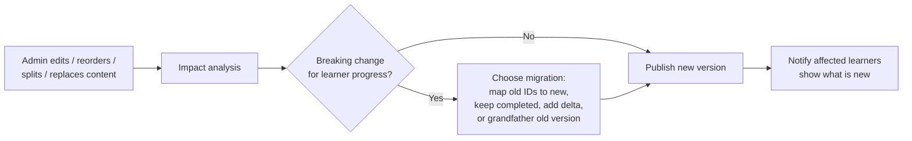
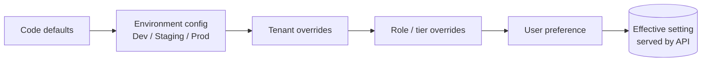
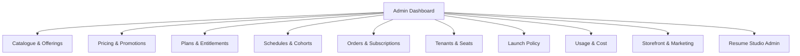

# Skillora Learning — Admin Portal Specification

## 1. PURPOSE & PRINCIPLES

The Admin Portal is the **control plane** of Skillora. Learners consume the platform; admins shape it. Everything the source documents describe as "content", "configuration", "master data" or "extensible" must be manageable here.

**Golden rule:** *Adding or changing a branch, course, module, lesson, question, rubric, language runtime, provider, threshold, label, notification, or feature must never require a code change or redeploy.* Code provides engines; the portal provides data.

Principles:

1. **Everything is data.** Content, rules and settings are stored, versioned, and served via the same client-neutral API used by web and mobile.
2. **Incremental by design.** New knowledge is added in small pieces, linked into the graph, and released safely without disturbing learner progress.
3. **Draft → Review → Publish.** No content reaches learners without passing a workflow; AI-generated content is always a draft.
4. **Safe change.** Every edit is versioned, diffable, auditable and reversible. Learner progress survives content change.
5. **Least privilege.** Fine-grained roles; sensitive learner data is hidden by default.
6. **Preview before release.** Admins can preview any content *as a learner* at any level and on web or mobile width.
7. **Provider-neutral.** The portal configures adapters (LLM, STT, TTS, etc.), never hard-wires a vendor.
8. **Same API.** The portal is a client of the shared backend (`/api/v1/admin/...`); no admin-only business logic in the frontend. Backend authorization is authoritative.

## 2. ADMIN ROLES & PERMISSIONS (RBAC)

Roles are data too: admins can create custom roles by combining permissions.

| Role | Scope |
|---|---|
| **Super Admin** | Everything incl. roles, providers, secrets references, platform settings |
| **Platform Admin** | Settings, feature flags, branding, notifications, system health, jobs |
| **Content Admin** | Knowledge base, courses, questions, visuals, imports, publishing |
| **Content Author** | Create/edit drafts in assigned branches; cannot publish |
| **Reviewer / Subject-Matter Expert** | Review technical accuracy; approve/reject; cannot edit scope outside branch |
| **Assessment Designer** | Question banks, assessments, rubrics, interview blueprints, coding challenges |
| **Commerce / Catalogue Manager** | Offerings, bundles, programs, collections, schedules, cohorts, pricing drafts, promotions (publishing prices may require Finance approval) |
| **Finance Admin** | Orders, subscriptions, refunds, invoices, tax settings, payment provider config, revenue reports |
| **Tenant Admin** (future B2B) | Manages only their tenant: seats, teams, private content, branding |
| **Support Admin** | View learner status, resolve issues, impersonate *with audit and consent rules* |
| **Analyst (read-only)** | Dashboards and exports, no learner PII |
| **Auditor (read-only)** | Audit logs and change history |

Permission model: `resource × action × scope` (e.g. `question:publish:branch=python`). Scopes: global, branch, course, tenant.

Requirements: MFA for all admin roles; short admin sessions; IP/device allow-listing option; every privileged action audited; two-person approval (optional) for destructive actions or production-wide settings.

## 3. ADMIN PORTAL MAP

```mermaid
flowchart TB
    AD[Admin Dashboard] --> CNT
    AD --> KNW
    AD --> ASM
    AD --> LRN
    AD --> EXE
    AD --> AIS
    AD --> USR
    AD --> PLT
    AD --> ANA
    AD --> OPS
    subgraph CNT[Content Studio]
        c1[Branches & courses] --- c2[Modules & lessons] --- c3[Visual library] --- c4[Projects & labs]
    end
    subgraph KNW[Knowledge Manager]
        k1[Topics & graph] --- k2[Sources & provenance] --- k3[Versions & deprecation] --- k4[Import & extension]
    end
    subgraph ASM[Assessment & Interview Studio]
        a1[Question banks] --- a2[Coding challenges] --- a3[Assessments] --- a4[Interview blueprints & rubrics]
    end
    subgraph LRN[Learning Rules]
        l1[Mastery & thresholds] --- l2[Levels & routes] --- l3[Revision rules]
    end
    subgraph EXE[Execution Config]
        e1[Language runtimes] --- e2[Sandbox limits] --- e3[Framework templates] --- e4[SQL datasets]
    end
    subgraph AIS[AI & Providers]
        i1[Providers & models] --- i2[Prompt templates] --- i3[Voice STT/TTS] --- i4[Cost & guardrails]
    end
    subgraph USR[Users & Access]
        u1[Learners] --- u2[Admins & roles] --- u3[Tenants/orgs] --- u4[Support tools]
    end
    subgraph PLT[Platform Settings]
        p1[Branding & theme] --- p2[Feature flags] --- p3[Notifications & email] --- p4[Public site & legal]
    end
    subgraph ANA[Insights]
        n1[Content analytics] --- n2[Learner analytics] --- n3[Feedback queue] --- n4[AI quality & cost]
    end
    subgraph OPS[Operations]
        o1[Jobs & imports] --- o2[Health] --- o3[Audit log] --- o4[Backups & data requests]
    end
```

Admin Dashboard home: items awaiting review, failed jobs/imports, content flagged by learners, feature-flag state, provider health, AI spend vs budget, recent publishes, and quick "Add" actions.

## 4. CONTENT STUDIO — COURSES & LEARNING MATERIAL

Manages the hierarchy `Knowledge Base → Branch → Course → Module → Lesson → (Examples, Exercises, Coding Challenges, Assessments, Interview Questions) + Projects + Resources`.

### 4.1 Capabilities

| Area | Admin can |
|---|---|
| **Branches** | Create, reorder, enable/disable, set icon/colour/description, parent/child, default level, visibility (public / enrolled / hidden), prerequisites between branches |
| **Courses** | Create, clone, assign to branches, define audience level (Beginner → Senior), estimated duration, target roles, tags, completion/mastery rules |
| **Modules** | Create, reorder (drag-and-drop), set prerequisites, unlock rules, thresholds, optional/required, skip-ahead (placement) rules |
| **Credentials** | Attach badges and a certificate rule to each concept cluster, module, course and program (publish is blocked until defined); preview earned-state for sample learners |
| **Lessons** | Rich editor (Markdown + blocks): objective, prerequisites, concept, mental model, example, code, walkthrough, common mistakes, production, security, performance, practice, summary — per the curriculum content format |
| **Level variants** | Author L1–L4 variants of explanation and visual for the same concept; mark which are required |
| **Exercises & challenges** | Attach to lessons; configure type, difficulty, hints (progressive), time/memory limits, visible + hidden tests |
| **Projects & labs** | Guided lab → partially guided → independent → production-style; requirements, architecture diagram, milestones, rubric |
| **Resources** | Links, files, cheat-sheets, downloadable material; tag by topic |
| **Localization** | Translations per lesson/field; fallback language rules |

### 4.2 Lesson editor requirements

- block-based, with live **preview as learner** (choose level, theme, web/mobile width);
- code blocks with language, runnable flag, read-only flag, expected output, step-through script;
- insert from **Visual Library**; create diagram inline (Mermaid/JSON/SVG) with live render;
- required-field checks (hero visual, alt text, objective, mastery check) before submit-for-review — mirrors the Visual Definition of Done;
- autosave drafts; concurrent-edit protection; comments and @mentions;
- bulk operations: move, clone, retag, change difficulty, archive.

### 4.3 Content lifecycle (applies to every content type)

Rules:
- A published item is **never edited in place**; edits create a new version (draft) while the live version keeps serving.
- Deprecated content stays visible to learners who already started it, with a migration note; it is hidden from new learners. Historical knowledge is never silently erased.
- Learner progress is keyed to stable concept/lesson IDs, so re-ordering, splitting, merging or replacing content preserves progress (see §11).
- Every state change records who, when, why (reason) and diff.

## 5. KNOWLEDGE MANAGER — EXTENSIBLE KNOWLEDGE BASE

Manages the **knowledge graph**, not just folders.

### 5.1 Entities

- **Topic / KnowledgeItem** — title, description, difficulty, tags, interview relevance, coding relevance, production relevance, career relevance, applicable technologies, version.
- **Relationships** — prerequisite, related, dependent, part-of, replaces/replaced-by, with strength/weight. Visual graph editor (drag to connect).
- **Source & provenance** — source type (official docs, uploaded PDF/book, user notes, Markdown, permitted web research, course material, internal doc), date, version, reliability level, applicable technologies, licence/usage notes.
- **Truth label** — verified source / official documentation / imported / established / model inference / uncertain; shown to learners where relevant.
- **Version & deprecation** — technology version, deprecated feature, current best practice, migration guide, version comparison.
- **Embeddings & index state** — chunking config, embedding model used, last indexed, reindex action, retrieval test ("search as learner").

### 5.2 Knowledge Extension Protocol (portal flow)

Implements the Master Product Prompt's "Add Kafka / Add Azure" behaviour as a guided wizard; supported actions: *Add Branch, Add Module, Add Technology, Add Framework, Add Cloud Provider, Add Tool, Add Topic, Expand Module, Update Module, Replace Deprecated Technology, Add Project, Add Coding Challenge, Add Interview Domain, Import Knowledge, Import Documentation, Import Curriculum.*

The wizard shows a **dry-run impact report** before publishing: new nodes/edges, affected courses, affected learners' routes, items that would be deprecated.

### 5.3 Import pipeline

Sources: PDF, DOCX, Markdown, TXT, URL (where permitted), official docs, books, user notes, curriculum files (CSV/JSON), question banks.

Requirements: every imported item retains provenance; duplicate detection; mapping preview before commit; per-import rollback; resumable large imports; malicious-document handling and prompt-injection safeguards.

### 5.4 Knowledge quality tools

Orphan and unreachable topics, missing prerequisites, circular dependencies, stale items (older than N months), items with no assessment, items with low retrieval score, duplicate detection, "ask the knowledge base" test console showing retrieved chunks and sources.

## 6. ASSESSMENT & INTERVIEW STUDIO

### 6.1 Question bank

One question model, many types; the type drives the learner UI (as in the specification's question-type → interface mapping).

| Type | Admin configures |
|---|---|
| MCQ / multi-select | Options, correct set, per-option feedback, shuffle, partial credit |
| Code output | Read-only code, language, exact expected output, reasoning rubric, optional trace (shown after answering) |
| Short answer / conceptual | Model answer, key points, accepted terms, rubric |
| Coding | Language, starter code, visible + hidden tests, limits, hints, complexity expectation, reference solution, follow-ups |
| Debugging | Buggy code, failing tests, expected fix, bug taxonomy |
| SQL | SQL adapter/dialect (PostgreSQL, MySQL, or portable), dataset (schema + seed data), hidden datasets, expected result or state check, validation mode (order/column/float/NULL rules, query-structure rules, plan/performance check), permission profile (SELECT / DML / DDL / transactions), limits, reference solution, hints |
| Code review | Code, seeded issues with category (bug, performance, security, maintainability, architecture, testing), expected comments |
| System design | Prompt, constraints, reference architecture diagram, rubric (components, scaling, failure, trade-offs) |
| Behavioral | Competency, STAR rubric, follow-ups |
| Resume / JD-driven | Templates with variables filled at runtime |

Common metadata: branch/topic links, difficulty, level, seniority fit, estimated time, tags, interview relevance, JD skill mapping, version, status, author, usage and performance stats (difficulty calibration from learner data).

### 6.2 Assessments & mini assessments

Compose from questions or from rules (e.g. "5 MCQ + 2 code output + 1 coding from topic X, difficulty 2–3"). Configure: timer, navigation (free/forward-only), shuffle, attempts, pass mark, mastery impact, review mode, retake policy, adaptive on/off.

### 6.3 Interview blueprints & modes

- **Blueprint templates:** by role, seniority, JD domain, duration, rapid-fire, last-minute, behavioral-only, system-design-only, framework-specific (Flask / Django / FastAPI).
- **Blueprint rules:** domain weights, difficulty ramp, allowed question types, follow-up policy, how weakness triggers type/topic/difficulty change (adaptive rules), max questions/time.
- **Interview modes:** strict (no autocomplete, no AI help, no hints), practice, learning; PASS/reveal behaviour; what the candidate sees about scoring.
- **Rubrics & scoring dimensions:** correctness, completeness, reasoning, depth, coding, code quality, complexity, framework / database / system design / GenAI / cloud-DevOps knowledge, communication, JD relevance, senior-level thinking; weights **per seniority**; overall score formula.
- **Report templates:** which sections and charts appear in the final interview report.
- **Last-minute mode templates:** time-budget allocation per available hours.

### 6.4 Coding challenge builder

Works for **every runtime including SQL** (for SQL: dataset manager, expected-result/state checks, validation modes). Test case manager (visible/hidden, weights, timeouts), run-against-reference-solution check, flaky-test detector, plagiarism/duplicate similarity (optional), sandbox dry-run inside the portal ("Run in sandbox") using the **same isolated execution service** — never inside the API process.

## 7. LEARNING RULES & PERSONALIZATION

| Setting | Notes |
|---|---|
| Mastery model | Ladder stages (Learned → Practiced → Applied → Explained → Interview-ready → Mastered), what evidence advances a stage, weights of assessment/coding/explanation/application/retention/interview |
| Thresholds | Module completion and mastery cut-offs (default 60 / 85), per branch override |
| Skip / accelerate | Placement tests, skip-ahead rules, accelerated-path eligibility |
| Learner levels | Level definitions (Beginner → Senior), how levels are derived from profile + mastery, per-branch default |
| Route generation | Rules for personalized routes (experience, target role, JD gaps, career switcher mapping) |
| Spaced revision | Intervals, decay curves, triggers (forgotten, mistake-driven, interview-driven), daily caps |
| Mistake memory | Repeat-error thresholds, recurring-issue labels |
| Resume claim risk | Claim patterns and generated question templates, risk scoring weights |
| JD engine | Extraction taxonomy (required/preferred skills, domains), skill-synonym dictionary, gap-priority formula |
| Hints | Progressive-hint policy per mode (Learn / Practice / Interview / Challenge / Review) |

All rule changes are versioned and can be **simulated** against anonymised sample learners before activation.

## 8. EXECUTION CONFIGURATION

- **Language runtimes (adapters):** **Python, SQL (PostgreSQL and MySQL), JavaScript/Node** initially; add Go, Rust, Java, TypeScript, SQLite, SQL Server, etc. by registering an adapter — name, kind (`program` or `sql`), runtime image/version, file extensions, editor mode, run/test command templates, supported question types, enable/disable per environment. The coding IDE is **one IDE driven by the adapter**: choosing a SQL question opens the SQL workspace in the same IDE shell, choosing Python opens the code workspace.
- **Sandbox limits:** CPU, memory, wall-time, output size, process count, filesystem and network restrictions; defaults and per-question overrides within hard ceilings.
- **Framework project templates:** multi-file Flask, Django, FastAPI templates; file tree, editable vs locked files, test harness.
- **Execution health:** queue depth, average run time, failure rate, sandbox image versions, cleanup status — shown per adapter (including SQL).

### 8.1 SQL execution configuration

SQL is a first-class runtime, not an add-on. Admin manages:

| Area | Configuration |
|---|---|
| **SQL adapter / dialect** | **PostgreSQL and MySQL (both initial)**, then SQLite, SQL Server, etc.; engine version (e.g. MySQL 8.x, PostgreSQL 16+); storage engine (InnoDB for MySQL); SQL mode (e.g. `ONLY_FULL_GROUP_BY`, `STRICT_TRANS_TABLES`); charset/collation; enable per environment; editor syntax mode, keyword set and formatter per dialect |
| **Dialect awareness** | A question declares its dialect (or "portable ANSI SQL" to run on several). Dialect-specific content is tagged so learners get the right workspace: PostgreSQL (CTEs, window functions, `RETURNING`, arrays/JSONB, partial indexes, MVCC) vs MySQL (`LIMIT`/`AUTO_INCREMENT`, `ON DUPLICATE KEY UPDATE`, `JSON` type, InnoDB locking/gap locks, isolation-level defaults, `EXPLAIN` output format) |
| **Cross-dialect comparison** | Optional "run on both" mode for comparison lessons (PostgreSQL vs MySQL differences in types, null/ordering, group-by rules, upserts, locking, plans); expected result may differ per dialect |
| **Dialect-specific plan view** | `EXPLAIN` / `EXPLAIN ANALYZE` (PostgreSQL) and `EXPLAIN` / `EXPLAIN ANALYZE` / `EXPLAIN FORMAT=TREE` (MySQL) parsed into a common plan diagram |
| **Isolated database instances** | Per-attempt ephemeral database or schema created from a template and destroyed afterwards; never the platform database; no network egress; no shared state between learners |
| **Schemas & datasets** | Schema DDL, seed data (versioned), ER diagram (auto-generated and editable visual), sample-data size, reusable across questions and lessons, import from SQL/CSV |
| **Permission profile** | Which statements are allowed per question/mode: `SELECT` only (default), DML (`INSERT/UPDATE/DELETE`), DDL (`CREATE/ALTER/DROP`), transactions, functions/procedures, extensions allow-list; role is least-privileged, with blocked dangerous commands per dialect (PostgreSQL: `COPY ... PROGRAM`, file/OS access, `pg_*` admin functions, `DROP DATABASE`; MySQL: `LOAD DATA`, `SELECT ... INTO OUTFILE/DUMPFILE`, `FILE` privilege, `SET GLOBAL`, user/grant management, `DROP DATABASE`) |
| **Limits** | Statement timeout, max rows returned, max result size, memory, concurrent sessions, max statements per run, lock timeout; defaults with per-question overrides within hard ceilings |
| **Validation modes** | Result-set match (exact or order-insensitive, column order/name rules, float tolerance, NULL handling), state-based check (query tables after DML), schema check (after DDL), query-structure rules (e.g. must use window function / must not use subquery), **performance check** (compare `EXPLAIN` plan or cost / index used) |
| **Execution-plan view** | Enable `EXPLAIN` / `EXPLAIN ANALYZE` display for learners (learning mode) and hide in strict interview mode |
| **Multi-statement & transactions** | Allow multi-statement scripts, explicit `BEGIN/COMMIT/ROLLBACK`, isolation-level exercises (for transaction/locking lessons) |
| **Hidden test datasets** | Separate hidden data to defeat hard-coded answers; multiple dataset variants per question |
| **Assistance policy** | Autocomplete / schema-aware completion / AI help on or off per mode (always off in strict interview mode) |
| **Learner experience options** | Show/hide schema panel, data preview, ER diagram, table row limit, result export |

SQL question authoring (Assessment Studio) uses these building blocks: choose adapter + dataset → write starter query/prompt → define expected result and validation mode → add hidden datasets → set permission profile and limits → "Run in sandbox" dry-run against the reference solution before submit-for-review.

Safety constraint: the portal can *lower* but never *raise above hard ceilings* defined in deployment config; no setting may enable execution inside the API process, and SQL runs only against disposable sandbox databases.

## 9. AI, PROVIDERS & VOICE

| Area | Admin manages |
|---|---|
| **Provider registry** | LLM, embeddings, vector DB, STT, TTS, code execution, DB execution, file storage, notifications, email, auth — each as a replaceable adapter with environment-scoped settings |
| **Secrets** | Stored encrypted in a secrets manager; portal shows *references and masked status*, never plaintext; rotation reminders |
| **Model routing** | Which model for which task (tutor, evaluator, interview, JD analysis, visual drafting), fallback chain, per-task temperature/limits |
| **Prompt templates** | Versioned system prompts for tutor, interviewer, evaluator, JD extractor, resume extractor, content drafter; variables; test console; A/B variants; rollback |
| **Guardrails** | Interview-mode restrictions (no hidden coding help), prompt-injection filters, tool permissions, output validation rules, blocked topics |
| **Voice** | STT/TTS provider, voice list and defaults, speech rate, language, interruption behaviour, fallback to text |
| **Cost & quota** | Token budgets per user/tier/feature, monthly spend alerts, rate limits |
| **Evaluation suite** | Run AI quality tests: hallucination, retrieval correctness, answer relevance, scoring consistency, prompt-injection, profile leakage; compare prompt/model versions |

## 10. USERS, TENANTS & SUPPORT

- **Learners:** search/list, status, enrolments, current route, level per branch, progress and mastery summary, subscription/tier (if any), assign/unassign courses, reset a module attempt, grant extra attempts. Private data (resume, answers, interview transcripts) is **hidden by default**; access needs a specific permission, a stated reason, and is audited.
- **Admins & roles:** invite, deactivate, assign roles, custom roles, MFA status.
- **Tenants / organisations (future-ready):** isolated data and content scoping, custom branding, private branches/courses, tenant admins.
- **Cohorts & assignments:** groups of learners, assign courses with due dates, team dashboards.
- **Support tools:** consent-based impersonation (time-limited, banner shown, fully audited), resend verification, force logout, data export and deletion requests (privacy compliance).
- **Learner feedback queue:** "Was this clear?" signals, flagged content/visuals ("confusing", "wrong"), reported questions; triage, assign, resolve, link to the content item that was fixed.

## 11. LEARNER-PROGRESS SAFETY ON CONTENT CHANGE

Rules: stable IDs; progress and mastery attach to concept IDs; merge/split provides explicit mapping; learners mid-lesson finish on their version unless an admin forces migration.

## 12. PLATFORM SETTINGS & CONFIGURABLE ITEMS

| Group | Examples |
|---|---|
| **Branding & theme** | Logo, name, colours (design tokens), typography, light/dark defaults, favicon, per-tenant themes |
| **Navigation & layout** | Which sections appear for which role/tier, ordering, labels |
| **Master data / lookups** | Skills & technologies catalogue, skill synonyms, roles/job titles, seniority levels, industries, companies list, certifications, difficulty scales, tags, languages, countries/time zones, question types, interview domains |
| **Feature flags** | Per feature, environment, role, tenant, percentage rollout (e.g. voice, system design workspace, new branches, beta features) |
| **Notifications** | Templates (in-app, email, push), triggers (study reminder, revision due, interview reminder, milestone), quiet hours, frequency caps, channel defaults |
| **Email / messaging** | Verification, reset, invite, digest templates |
| **Public site** | Landing, features, about, privacy/security, terms, SEO metadata, sitemap/robots, announcements, maintenance banner |
| **Auth** | Enabled login methods/OAuth providers, password policy, session lengths, MFA policy |
| **Uploads & limits** | Allowed file types, max size, scan policy, retention |
| **Rate limits** | Per endpoint class, per tier |
| **Retention & privacy** | Retention periods for answers, recordings/transcripts, audit logs; consent text; data export/delete workflows |
| **Mobile control** | Minimum supported app version, forced-update message, store links, deep-link domains, push provider settings, mobile feature flags, offline content packs (which lessons are downloadable) |
| **Localization** | Supported languages, UI strings, content translation workflow |
| **Gamification (optional, restrained)** | Streak rules, badges — never pressure-style leaderboards |

### 12.1 Configuration model

Every setting has: key, type, validation, default, scope(s), description, last-changed-by, version history, and "requires restart?" (should be rare). Changes propagate to web and mobile through the config API with cache invalidation; clients never hard-code these values. Sensitive or risky settings can require two-person approval and are previewable in staging before production.

## 13. VISUAL LIBRARY (ADMIN)

Central store for all diagrams, animations and illustrations defined in the Visual Learning System:

- create/edit Mermaid, JSON-scene and SVG sources with live preview in light/dark and mobile width;
- tag by concept, type, level (L1–L4); reuse across lessons;
- required fields: title, alt text, long description, reduced-motion fallback;
- AI-draft assistant → **must** pass reviewer accuracy check before publish;
- usage map (where is this visual used), clarity score and flags from learners;
- bulk validation (broken syntax, missing alt text, low contrast).

## 14. INSIGHTS & ANALYTICS

| Dashboard | Shows |
|---|---|
| **Content** | Most/least used lessons, drop-off points, completion rate, average time, question difficulty calibration, items with high failure or flag rate, content with no visuals/assessments |
| **Learner** | Active learners, progress by branch, mastery distribution, weak-topic heatmap, revision adherence, interview-readiness distribution |
| **Interview** | Sessions, completion, score distributions per dimension, most-missed concepts, PASS-rate by topic |
| **JD / career** | Most common target roles and JD skills, top skill gaps — guides what content to add next |
| **AI quality & cost** | Token usage, latency, model cost per feature, retrieval quality, hallucination/consistency test results, failure rates |
| **Engineering** | API latency, errors, execution queue, provider uptime |

Privacy: aggregated by default; avoid collecting unnecessary personal data; exports require permission and are audited. A "**Content gap suggestions**" panel turns analytics (JD skills not covered, repeated failures) into proposed new modules for the Extension wizard.

## 15. OPERATIONS & GOVERNANCE

- **Jobs & queues:** imports, reindexing, embedding generation, report generation, notification sends, AI drafts; status, retry, cancel, logs.
- **System health:** API, database, cache, vector store, sandbox, STT/TTS, LLM providers.
- **Audit log:** immutable record of admin actions (who, what, before/after, when, IP/device, reason); searchable and exportable; retention configurable.
- **Backups & recovery:** status, last restore test, disaster-recovery runbook links, content snapshot/export (full or per-branch) and import to another environment.
- **Environment promotion:** export content/config bundle from Staging → import to Production with diff preview.
- **Maintenance mode** with learner-facing message; read-only mode.

## 16. ADMIN UX REQUIREMENTS

- Professional, calm, dense-but-clear UI consistent with the web design system; keyboard-first for power users; accessible (WCAG-minded).
- Global search across content, learners, settings; saved views and filters; bulk actions with confirmation and undo window where possible.
- Every list: sort, filter, pagination/virtualisation, column chooser, CSV/JSON export (permission-gated).
- Every form: validation, inline help, unsaved-changes guard, version history side panel, diff view.
- **Preview as learner** and **simulate as persona** (Beginner / Career-switcher / Senior) on every content type.
- Guided wizards for complex tasks (Add technology, Import curriculum, Create interview blueprint, Add language runtime, Add provider).
- Dangerous actions (delete, archive, bulk publish, change thresholds) show impact and require confirmation; reversible where possible.
- Responsive for tablet; full admin is desktop-first, but **critical admin tasks (approve review, view alerts, toggle feature flag, maintenance mode) work on mobile web**. A native mobile admin app is out of scope initially.
- Contextual help and templates (starter lesson template, question templates, blueprint templates) so non-technical content staff can work without developer help.

## 17. API & DATA REQUIREMENTS

- Admin endpoints are versioned (`/api/v1/admin/...`), role-checked server-side, rate-limited, audited.
- Content is served to learners from **published versions only**; clients receive versioned content and ETags for caching/offline packs.
- Bulk import/export APIs use asynchronous jobs.
- Webhooks/events for content published, import finished, flag created (for integrations).
- Soft delete + archive; hard delete only via governed retention process.
- Data model additions: `Role`, `Permission`, `AdminUser`, `ContentVersion`, `ReviewTask`, `AuditEntry`, `ImportJob`, `Setting`, `FeatureFlag`, `ProviderConfig`, `PromptTemplate`, `RuntimeAdapter`, `Rubric`, `InterviewBlueprint`, `NotificationTemplate`, `Tenant`, `Cohort`, `FeedbackItem`, `MasterDataLookup`, `Translation`; plus the commerce/SaaS entities in the SaaS & Monetization spec §11 (Plan, Feature, Entitlement, Offering, Bundle, PriceBook, Coupon, Order, Subscription, CohortRun, Session, Enrolment, UsageEvent, LaunchPolicy, GrandfatherRule…).

## 18. SECURITY

- MFA, short sessions, step-up auth for sensitive actions; least-privilege RBAC; optional IP allow-list.
- Admin portal isolated route/subdomain (e.g. `admin.` or `/admin` with separate bundle) not loaded by learners.
- No plaintext secrets in UI, logs or exports; secret references only.
- All admin input validated and sanitised; rich-content rendering guarded against XSS; uploads scanned and treated as untrusted.
- Impersonation and learner-data access are consent-based, time-boxed, audited.
- Content/prompt changes that affect interview strictness or sandbox limits are reviewed and logged.
- Tenant and learner isolation enforced server-side in every admin query.

## 19. EXTENSIBILITY OF THE PORTAL ITSELF

- New content types, question types, settings groups and lookups are registered through **schema-driven forms** (field definitions stored as data), so the portal UI grows without frontend rewrites for each new field.
- New provider types and runtime adapters appear automatically in the registry UI once their adapter manifest is installed.
- Custom fields on branches, modules, questions, learners (admin-defined, validated, searchable).
- Plugin/extension points for importers, validators, exporters.

## 20. BUILD PHASING

Do not build all of this at once. Each phase must be runnable and testable.

| Phase | Admin deliverable |
|---|---|
| **A0 Foundation** | Admin shell, auth + MFA, RBAC, audit log, settings store, feature flags |
| **A1 Content core** | Branches/courses/modules/lessons CRUD, rich lesson editor, draft→review→publish workflow, versioning, preview-as-learner |
| **A2 Knowledge** | Topics, graph editor, sources/provenance, versions/deprecation, imports (Markdown/PDF/DOCX), reindex, retrieval test console |
| **A3 Assessment** | Question bank (all types), assessments, coding challenge builder, sandbox dry-run, rubrics |
| **A4 Interview** | Blueprints, modes, scoring dimensions per seniority, report templates, last-minute templates |
| **A5 Visuals & levels** | Visual library, level variants, validators, accessibility checks |
| **A6 AI & providers** | Provider registry, model routing, prompt templates, voice config, cost/guardrails, AI evaluation suite |
| **A7 Users & support** | Learner management, cohorts, tenants, feedback queue, consent-based support tools |
| **A8 Learning rules** | Mastery/threshold/revision/route settings with simulation |
| **A9 Insights** | Content, learner, interview, AI-cost dashboards; content-gap suggestions |
| **A10 Hardening** | Environment promotion, backups, two-person approval, performance, accessibility audit, localization |

## 21. DEFINITION OF DONE (ADMIN FEATURE)

A feature is complete only when:

- [ ] manageable entirely through the portal (no code/redeploy);
- [ ] versioned, diffable, reversible; draft→review→publish where applicable;
- [ ] RBAC permission defined and enforced server-side;
- [ ] every change is audited;
- [ ] learner progress safety / impact analysis considered;
- [ ] preview-as-learner (and mobile width) works;
- [ ] validation, loading, empty, error states, undo/confirm for destructive actions;
- [ ] schema-driven where the entity may gain fields;
- [ ] consumed identically by web and mobile through the shared API;
- [ ] tests exist (unit, integration, permission, end-to-end for the key workflow);
- [ ] secrets and learner PII protected;
- [ ] documentation updated.

## 22. COMMERCE, SaaS & MONETIZATION (SUMMARY)

The portal also manages the SaaS layer defined in **Skillora_Learning_SaaS_Monetization_Architecture.md** and the premium **Resume Studio** (Skillora_Learning_Resume_Studio_Specification.md). See §23 for the admin areas. Launch default: all features free via the **Launch — Free Access** plan; monetization is switched on by configuration, not code.

## 23. COMMERCE & SaaS ADMIN AREAS

### 23.1 Catalogue & Offerings
- Create **offerings** over courses: single course, **bundle** (any combination, nestable), **program / learning path** (ordered, prerequisites, certificate, capstone), **role-based track**, **subscription (all-access or tagged subset)**, **cohort programme**, **add-ons** (certificate, mentor, project review, resume review), **credit packs**, free/lead-magnet, corporate pack, voucher/gift.
- An offering contains items: course | module | bundle | add-on | credit; a course may sit in many offerings; module-level sales supported.
- Offering fields: title, slug, description, outcomes, level, audience, delivery mode, duration, thumbnail/media, SEO, FAQ, instructor(s), prerequisites, access window (lifetime / N months), certificate rule, visibility (public/hidden/private link/tenant-only), status (draft→review→published) with the standard lifecycle.
- Landing-page builder: syllabus auto-generated from modules, preview lessons, reviews, schedule, price block.

### 23.2 Pricing & promotions
- Price books by **currency and region**; interval (one-time, monthly, annual, instalments); tax-inclusive/exclusive display; scheduled price changes (versioned); price-lock for existing subscribers.
- Coupons, sales windows, early-bird, bundle/volume rules, referral rewards, student/regional discounts, vouchers; limits (per user/code/total), stackability, eligibility (new users, segment, tenant).
- Trials (time or usage based, card required or not) and conversion rules.
- Refund and cancellation policy templates per offering.

### 23.3 Plans & entitlements
- **Feature registry:** register feature keys (e.g. `resume.ai_generate`, `interview.mock`, `interview.voice`, `interview.jd_prep`, `course.access:{id}`), description, category, default gating.
- **Plan builder:** name, billing periods, price links, feature grants with limits and reset periods, upgrade/downgrade paths, visibility, tenant scope.
- **Feature ↔ plan matrix** (grid view): toggle features per plan, set quotas, simulate effect.
- Manual **grants/revocations** to a user/org with reason, expiry, audit.
- Entitlement inspector: "why can/can't this user use feature X?" (shows sources: plan, purchase, promo, org seat, grandfathering).

### 23.4 Schedules & cohorts
- Schedule templates (self-paced, drip, cohort, live, hybrid, bootcamp, sprint).
- Cohort runs: dates, time zone, capacity, enrolment window, waitlist, instructors/mentors, deadlines/extensions, pauses/holidays.
- Session calendar: live session links, recordings, materials, attendance; drip rules (unlock day N / date); bulk reminders; ICS feed; learner-calendar preview.
- Course **materials per schedule/cohort**: attach lessons, files, assignments, resources and release dates; override content version per cohort; add cohort-only material.

### 23.5 Orders, subscriptions & finance
- Orders list/detail, payment status, retries, refunds (full/partial) with policy and approval, chargeback handling.
- Subscriptions: status, trial, renewals, cancel/pause/resume, plan change, proration preview, dunning status and settings.
- Invoices/credit notes, tax settings, payment-provider configuration (references only), reconciliation report, revenue and MRR/ARR, churn, LTV dashboards, accounting export.
- Mobile store billing config per platform/region (which channel/price is shown).

### 23.6 Tenants & seats (SaaS / B2B)

> Enterprise upskilling consoles (project & skills-framework manager, path builder/approvals, tenant-scoped private content studio, reports builder, customer-success tools, DPA/sub-processor registers) are specified in `Skillora_Learning_Enterprise_Upskilling_Specification.md` §11.

- Create/suspend tenants, domains, branding tokens, enabled features and content shares, private branches/courses.
- Organisations, seat packs, team assignments, SSO config (SAML/OIDC), contract terms and entitlement mapping, usage and billing per tenant.

### 23.7 Launch policy (free → paid control)
- **Launch plan** control: active/inactive, end date overall or **per feature**.
- **Grandfathering rules** (feature, duration, discount, segment — e.g. users who joined before date D).
- **Simulation:** impact preview (users/segments affected per feature) before applying.
- Pre-announcement notifications, in-app banners, "free during launch" badge toggle, **kill switch** to re-open features.
- Paywall visibility toggle (hidden at launch), upsell frequency caps.

### 23.8 Usage & cost
- Metered usage by feature/user/segment/course; AI cost per feature and per plan; quota configuration; fair-use limits during launch; budget alerts and auto-degrade rules; credit ledger viewer.

### 23.9 Storefront & marketing
- Collections/shelves ("Featured", "New", "Interview-focused", "Career switch", "Free to start") with ordering, scheduling and audience targeting; badges (New, Popular, Cohort starts soon, Launch offer); recommendation rules; A/B experiments on titles, thumbnails, prices, order.
- Banners/announcements, waitlists, referral programme, lifecycle journeys (email/push), UTM/attribution reports, review moderation, SEO pages.

### 23.9A Credentials: badges & certificates (admin)

Full spec: **Skillora_Learning_Credentials_Badges_Certificates_Specification.md** (§9). Admin manages: badge library and designer; no-code **criteria/rule builder** (mastery, assessments, coding incl. SQL dialect, projects, explanation, retention, interview, attendance) with simulation; certificate templates (layout, signatories, seals, languages, disclaimer); assigning credentials to concepts, modules, courses, programs, tracks and cohorts; **publish check** (a course needs module/skill badges and a certificate rule); issuance console (evidence, reissue, revoke with reason, bulk/manual award, review queue); verification and privacy defaults; signing-key references and Open Badges/VC export toggles; credential analytics and fraud flags; commerce mapping (`certificate.issue` as plan feature or paid add-on). The Knowledge Extension wizard (§5.2) also drafts the credential set for new courses/technologies.

### 23.10 Resume Studio admin
- Templates, section/phrase libraries, ATS rules and keyword dictionaries, prompt templates, quotas via Entitlements, safety rules, usage and quality analytics (details in Resume Studio spec §9).

### 23.11 Phasing (admin)

| Phase | Admin deliverable |
|---|---|
| **A11** | Feature registry, plan builder, entitlement matrix, Launch-Free plan, entitlement inspector, usage dashboards |
| **A12** | Offerings/bundles/programs, collections, landing-page builder |
| **A13** | Schedule templates, cohorts, sessions, drip rules, learner-calendar preview |
| **A14** | Pricing, promotions, orders, subscriptions, refunds, invoices, provider config |
| **A15** | Launch policy tools: end dates, grandfathering, simulation, kill switch, notifications |
| **A16** | Tenants, seats, white-label, SSO, per-tenant billing |
| **A17** | Experiments, referral, lifecycle journeys, regional pricing analytics |

## 23A. COMPLIANCE & TRUST ADMIN (INDIA-READY)

Full requirements: **Skillora_Learning_India_Market_and_Compliance_Specification.md**. Admin must manage:

- **Consent management:** versioned consent notices per purpose and language, consent records, withdrawal handling, eligibility-statement records (18+ and education level), the underage response queue (suspend, verify, delete, refund), marketing/analytics/voice/resume-processing consent toggles per user view (consent-based access).
- **Data subject requests (DSAR) queue:** access, correction, erasure, grievance, nomination — with SLA timers, assignment, audit, automated export/deletion jobs.
- **Retention policies:** per data class (resume, voice, transcripts, answers, logs) with automated purge jobs; legal-hold exceptions.
- **Processor & cross-border transfer registry**, breach log and notification workflow (Data Protection Board, affected users, CERT-In where applicable).
- **Claims & advertising review workflow:** every public claim, outcome statistic, testimonial and ad/landing copy is approved by Compliance before publish; testimonial consent records; banned-phrase lint (e.g. "guaranteed placement"); mandatory fee/duration/refund fields on paid offerings.
- **Dark-pattern guard:** checkout/paywall copy templates reviewed against a checklist; no pre-selected add-ons, no fake urgency.
- **Messaging templates & channels:** WhatsApp/SMS (DLT)/push/email templates, per-channel consent, quiet hours, language variants.
- **Campaigns & campus programmes:** campaign codes, UTM, campus/partner tenants, ambassador and referral tracking.
- **Support desk integration:** tickets, SLAs, refund approvals, grievance officer workflow.
- **Language/translation management** for Indic locales and glossary.
- **Tax & invoicing settings:** GSTIN, SAC, place-of-supply rules, invoice series, tax-inclusive display, GST report exports (Finance Admin).

## 24. OUTCOME

An operations team with no engineering help can:

1. add a new technology branch (e.g. Kafka or Azure) with modules, lessons, diagrams, questions and labs;
2. import a book, PDF or documentation set and turn it into reviewed, linked, versioned content;
3. design an interview blueprint and rubric for a specific role or JD domain;
4. add a language runtime, switch an LLM or voice provider, or roll back a bad prompt;
5. tune mastery thresholds and revision rules and simulate the effect first;
6. switch features on for 5% of users, or for one tenant;
7. see exactly which content confuses learners and fix it;
8. do all of the above without losing any learner's progress;
9. create a bundle, a learning path or a cohort programme from existing courses, set prices per region, schedule it, and feature it on the storefront;
10. define badges and a certificate for every course, with evidence-based rules, branded templates, verification and revocation, and later turn certificates into paid add-ons;
11. keep everything free at launch, then move any feature (e.g. AI resume, mock interviews) behind a plan, with grandfathering, simulation and notifications — all by configuration.
