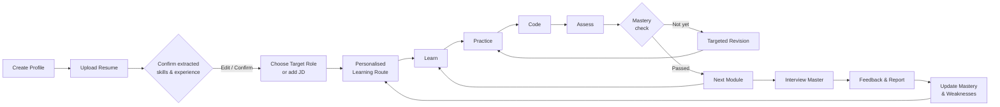
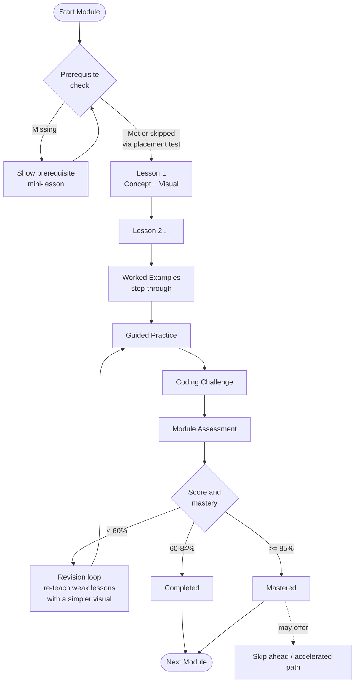
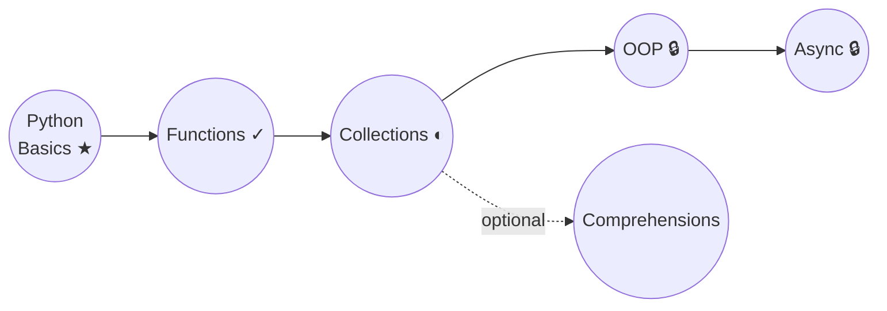
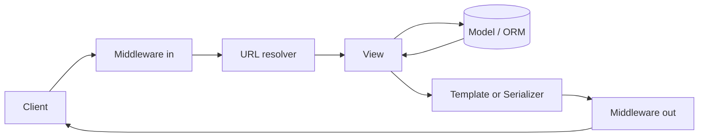
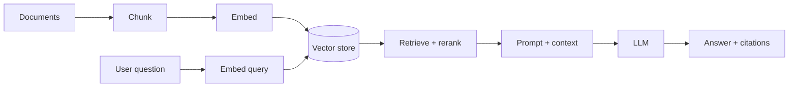
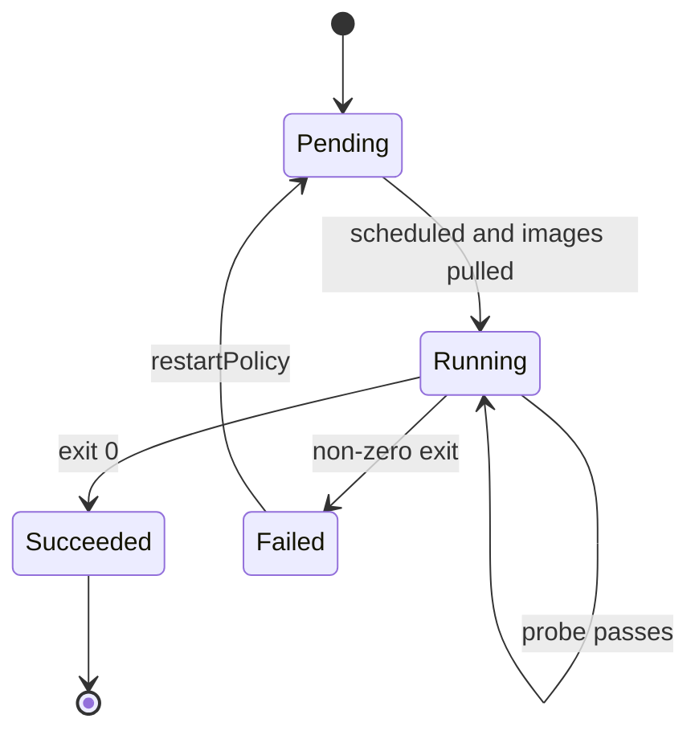
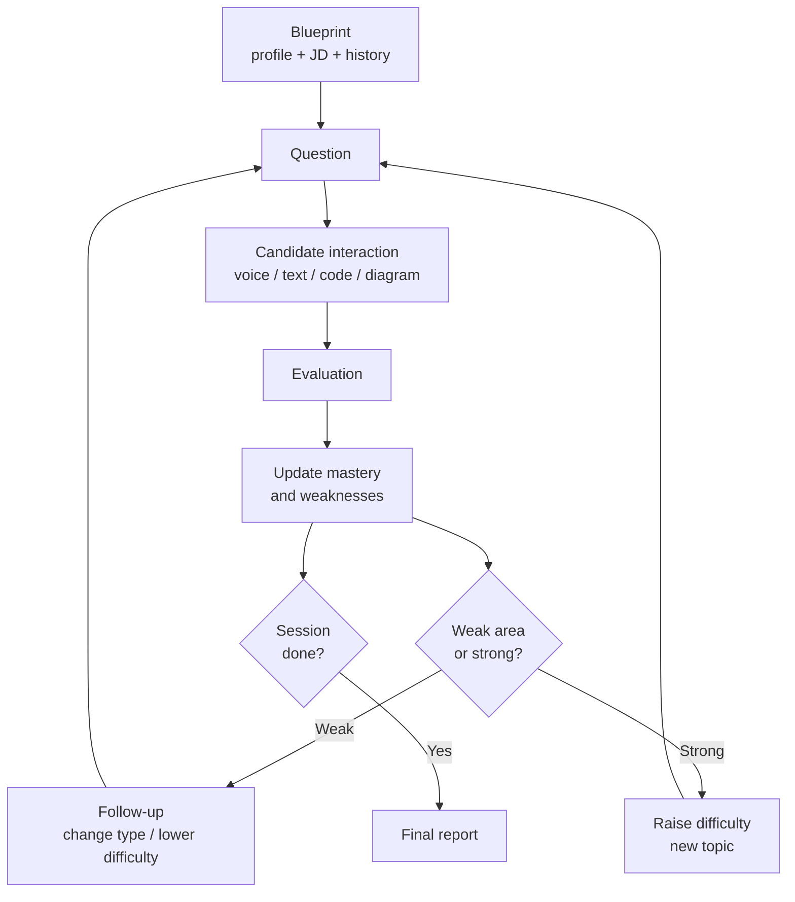
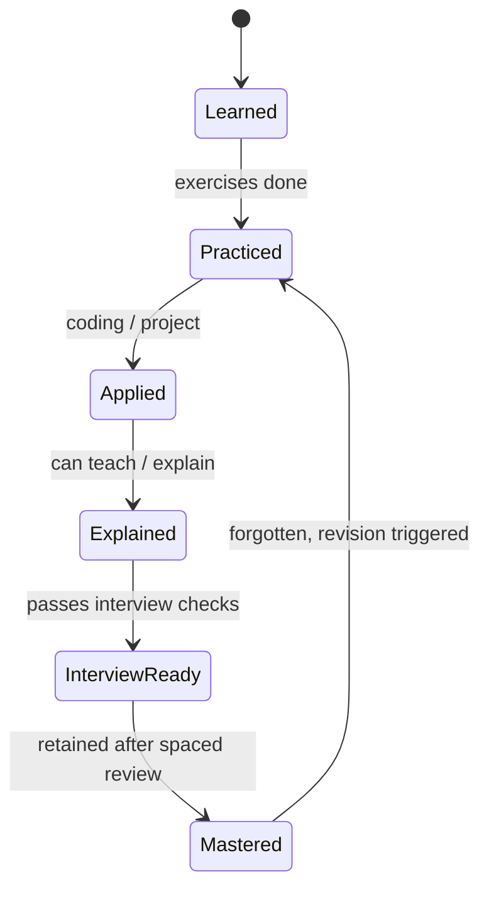
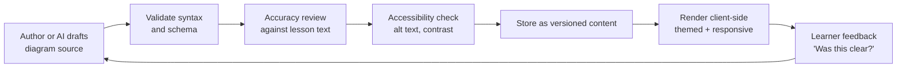

# Skillora Learning — Visual Learning & Diagram System

## 1. PURPOSE

Skillora teaches technical concepts that are abstract (event loops, MRO, transactions, Kubernetes scheduling, RAG pipelines). Text alone is the slowest way to learn them.

**Rule:** every lesson must show the concept, not only describe it. A lesson without at least one purposeful visual fails the Definition of Done (section 12).

Visuals must be:

- **purposeful** — they explain a mechanism, not decorate a page;
- **level-aware** — the same concept is drawn differently for a beginner and a senior;
- **accessible** — every visual has a text alternative and works without colour alone;
- **authored as data** — diagrams are stored as source (Mermaid / JSON / SVG), not baked PNGs, so they are versionable, themeable, translatable and extensible.

## 2. LEARNER LEVELS

Level is taken from the profile (confirmed experience, target role, mastery history) and can be overridden by the learner at any time ("Show me simpler / deeper").

| Level | Who | Visual style | Text:visual balance |
|---|---|---|---|
| **L1 Beginner** | New to programming or to this topic | Analogies, large icons, one idea per diagram, step-by-step animation, minimal jargon, labelled arrows | 30 : 70 |
| **L2 Developing** | Knows basics, building fluency | Annotated flow charts, code ↔ diagram side-by-side, "what happens line by line" traces, comparison tables | 50 : 50 |
| **L3 Professional** | Mid-level, works with the tech | Architecture diagrams, sequence diagrams, state machines, failure paths, trade-off matrices | 60 : 40 |
| **L4 Senior / Architect** | Senior engineer or career switcher with strong adjacent skills | Dense system diagrams, scaling/failure/security overlays, decision trees, capacity and cost views, "what breaks at 10x" | 70 : 30 |

Rules:

1. Default level is derived per **branch**, not globally. A senior in Python can be L1 in Kubernetes.
2. The player offers a one-tap **Level switch** (Simpler ◀ ▶ Deeper) on every visual. The choice is stored as a preference and fed to mastery.
3. Level never changes *correctness*; only depth, density and vocabulary.
4. When mastery of a concept rises, the next lesson on a related concept automatically steps up one visual level.

## 3. THE LEARNING JOURNEY — MASTER FLOW

Shown on the Dashboard as "Your Route" and on the public landing page.



**UI form:** a horizontal "route map" on desktop and a vertical stepper on mobile. Current step highlighted, completed steps ticked, locked steps greyed with the prerequisite shown.

## 4. SEQUENTIAL COURSE MODULE FLOW

This is the fixed, learner-facing shape of every module.



Thresholds (60 / 85) are configuration, not code.

### 4.1 Module status badges (consistent everywhere)

| State | Icon | Colour (plus shape, never colour alone) |
|---|---|---|
| Locked | padlock | grey |
| Not started | empty circle | neutral |
| In progress | half circle | blue |
| Completed | tick | green |
| Needs revision | circular arrow | amber |
| Mastered | star | gold |

### 4.2 Course map

The Academy page shows each branch as a **progress map**, not a flat list:



Nodes show status, duration, difficulty and interview relevance on hover/tap. Unlocked optional side-branches appear as dotted nodes.

## 5. LESSON VISUAL TEMPLATE

Every lesson uses this structure (extends the existing curriculum content format). Each row names its visual slot.

| Section | Required visual |
|---|---|
| Learning objective | Checklist card ("By the end you can…") |
| Prerequisites | Mini prerequisite chain with mastery dots |
| Mental model | **Hero diagram or analogy illustration** (mandatory) |
| Concept explanation | Annotated diagram, labelled parts |
| Example + code | Code ↔ diagram side-by-side; line-by-line step-through |
| Walkthrough | Animated trace (variables, memory, stack, flow) |
| Common mistakes | "Wrong vs Right" two-panel visual |
| Production use | Architecture or sequence diagram (L3+) |
| Security / performance | Overlay on the diagram (threat points, bottlenecks) |
| Practice | Interactive widget (drag-order, fill-blank, predict-output) |
| Summary | One-screen cheat-sheet / concept map |
| Mastery check | Progress ring + concept checklist |

Minimum per lesson: **1 hero diagram + 1 interactive or step-through visual.** A single lesson may not exceed 5 diagrams (cognitive load); split the lesson instead.

## 6. VISUAL TYPE CATALOGUE

Choose the visual by what the concept *is*.

| Concept shape | Use | Examples |
|---|---|---|
| A process or algorithm | **Flow chart** | Binary search, request lifecycle, CI/CD pipeline |
| Things talking over time | **Sequence diagram** | Auth/JWT flow, RAG query, distributed transaction |
| Things with states | **State diagram** | Order status, Pod lifecycle, TCP handshake, mastery state |
| Structure / relationships | **Class / ER / component diagram** | OOP hierarchy, SOLID refactor, DB schema, microservices |
| Data structures | **Animated structure view** | Linked list, tree, heap, graph, hash table buckets |
| Memory and execution | **Stack / heap / frame diagram** | Mutable vs immutable, closures, GC, LEGB scope |
| Concurrency | **Timeline / swimlane** | GIL, threads vs asyncio, event loop |
| Hierarchy | **Tree / mind map** | Knowledge base, branches, HTTP status classes |
| Comparison | **Matrix / table with icons** | Flask vs Django vs FastAPI, SQL vs NoSQL |
| Decision | **Decision tree** | "Which database?", "Which cloud service?" |
| Infrastructure | **Architecture diagram** | VPC, EKS cluster, multi-AZ, Kubernetes control plane |
| Quantities | **Chart** | Complexity growth curves, latency percentiles |
| Dependencies | **Knowledge graph** | AsyncIO ↔ FastAPI ↔ PostgreSQL |

### 6.1 Worked examples (reference quality bar)

**Python — how `asyncio.gather` actually runs (L2/L3 sequence)**

```mermaid
sequenceDiagram
    participant Main as main()
    participant Loop as Event Loop
    participant A as fetch(A)
    participant B as fetch(B)
    Main->>Loop: gather(fetch(A), fetch(B))
    Loop->>A: schedule as Task
    Loop->>B: schedule as Task
    A-->>Loop: await I/O (yield control)
    B-->>Loop: await I/O (yield control)
    Loop-->>A: I/O ready, resume
    Loop-->>B: I/O ready, resume
    A-->>Main: result A
    B-->>Main: result B
```

**Beginner version (L1):** same idea as a *restaurant analogy* illustration — one waiter (loop) taking orders for many tables (tasks) instead of waiting at one table.

**Django request lifecycle (L3 flow)**



**RAG pipeline (GenAI branch)**



**Kubernetes pod lifecycle (state diagram)**



## 7. INTERACTIVE & ANIMATED VISUALS

Static diagrams are the baseline; these are the high-value interactive types. Each is a reusable component driven by lesson data.

| Component | What the learner does |
|---|---|
| **Code step-through** | Press Next to execute one line at a time; variables, stack and output update beside the code |
| **Memory / scope viewer** | See names pointing to objects; watch aliasing, copy vs deepcopy, closures capture |
| **Data-structure animator** | Insert / delete / search on a tree, heap, hash table; compare operations and complexity |
| **Algorithm visualiser** | Play / pause / scrub sorting, BFS/DFS, DP table filling; show comparisons and recursion tree |
| **Request tracer** | Click through a request across browser → DNS → LB → API → DB → back, with latency per hop |
| **Complexity plot** | Slide N and see O(1)/O(log n)/O(n)/O(n²) curves diverge against *their* code |
| **Predict-then-reveal** | Learner predicts output / diagram first, then sees the real trace (feeds code-output questions) |
| **Drag-to-order & drag-to-label** | Arrange pipeline steps; label an architecture diagram |
| **Spot-the-bug overlay** | Tap lines or components on a diagram to mark faults |
| **What-if toggles** | "Kill this node", "add cache", "10x traffic" and watch the architecture change (L3/L4) |

Rules: animations must be **pausable, step-able and skippable**, respect reduced-motion (falls back to static step images), and never autoplay with sound.

## 8. LEVEL-ADAPTIVE PRESENTATION — WORKED EXAMPLE

Concept: **"What is an API?"** / **"Database index"** across levels.

| | L1 Beginner | L2 Developing | L3 Professional | L4 Senior |
|---|---|---|---|---|
| Index | Book index analogy picture | B-tree diagram, lookup path | Index scan vs seq scan plan, write cost | Composite/partial index design, selectivity, bloat, planner trade-offs |
| Visual | Illustrated analogy | Annotated tree | Query-plan diagram | Plan + load graph + failure/maintenance overlay |
| Practice | Match term to picture | Read the plan | Fix a slow query | Design indexing for a workload |

The lesson stores **one concept with multiple visual variants** (`visual_level: L1..L4`). The player chooses the variant for the learner's level and exposes the switch.

## 9. ASSESSMENT & INTERVIEW VISUALS

| Screen | Visual support |
|---|---|
| Assessment header | Progress bar, question dots (answered / flagged / current), timer ring |
| Code-output question | Optional **trace view revealed only after answering** (learning mode); hidden in strict interview mode |
| System design | Canvas with component palette, connectors, notes; **reference diagram shown in the report** for comparison |
| Interview report | Skill **radar chart**, per-domain bars, strengths / weaknesses split, timeline of the session |
| Mistake review | Side-by-side "your answer vs model answer" with differences highlighted |
| JD analyzer | Match gauge, **strong / partial / missing** skill chips, priority ladder |

Adaptive interview engine, shown to the learner after the session (not during, unless the mode allows):



## 10. PROGRESS, MASTERY & REVISION VISUALS

| Surface | Visual |
|---|---|
| Dashboard | "Where am I?" route map, today's focus card, readiness ring, weak-topic heat strip |
| Concept mastery | 6-step ladder: Learned → Practiced → Applied → Explained → Interview-ready → Mastered |
| Skill overview | Radar chart per branch; heatmap grid (rows = topics, columns = recent attempts) |
| Mistake memory | Per-concept attempt strip (✓ ✓ ✗ ✓ ✗ ✗) with recurring-issue note |
| Revision | Calendar / timeline of due items, spaced-repetition curve with next review date |
| Consistency | Simple streak strip — never leaderboard-style pressure |
| Knowledge Explorer | Interactive graph; click a node to see prerequisites, dependents, and *your* mastery colour on it |

Mastery ladder:



## 11. PLATFORM RULES

### 11.1 Web
- Side-by-side layout: lesson text | diagram | code, resizable panels.
- Full-screen / pop-out for large diagrams, zoom and pan.
- Keyboard: ←/→ step, Space play/pause, +/− zoom.

### 11.2 Mobile
- Diagrams are **vertical-first**: redraw wide flows as top-to-bottom, or provide pinch-zoom with a fit-to-width default.
- Large diagrams open in a full-screen viewer (rotate to landscape).
- Step-through uses big Next / Back buttons in the thumb zone.
- Heavy animations load on demand; cache lightweight static fallbacks for offline lessons.
- Offline lessons must include their diagram sources so visuals render without network.

### 11.3 Both
- **Performance budget:** a lesson's visuals must fit the data-lite budget (Engineering spec §3.2): static SVGs small and compressed; interactive components lazy-loaded; no autoplay; **data-lite mode** substitutes static step images for animations.
- Light/dark themes: diagrams use theme tokens, never hard-coded colours.
- Colour-blind safe palette; every status uses shape/icon + label too.
- Every diagram has: title, short **text alternative** (what it shows), and a **long description** for screen readers; interactive visuals are keyboard operable.
- Diagrams never rely on tiny fonts: minimum readable size at default zoom.

## 12. AUTHORING, STORAGE & RENDERING

Visuals are created, reviewed, versioned and published in the **Admin Portal Visual Library** (see Skillora_Learning_Admin_Portal_Specification.md §13), including live light/dark/mobile preview, validators for alt text and syntax, and the learner "Was this clear?" flag queue.

### 12.1 Authoring formats (stored as content, not code)

| Format | Use |
|---|---|
| Mermaid text | Flow, sequence, state, class, ER, Gantt — default for most diagrams |
| JSON scene (lightweight) | Architecture canvases, step-through traces, structure animations |
| SVG | Hand-crafted analogy illustrations and icons |
| Data series | Charts (complexity, latency) |

Each visual record:

```text
Visual
├── id, version
├── concept_id / lesson_id
├── type (flow | sequence | state | architecture | trace | chart | illustration ...)
├── level (L1..L4)
├── source (mermaid | json | svg)
├── title
├── alt_text / long_description
├── interactive (bool) + interaction_config
├── reduced_motion_fallback
└── provenance (author, date, reviewed_by)
```

### 12.2 Pipeline



Rules:
1. AI-generated diagrams are **never published unreviewed**; they must pass the accuracy check (a wrong diagram is worse than none).
2. **Render at publish time (performance rule for low-end Android and slow networks):** convert Mermaid/JSON sources to themed, accessible **static SVG on the server when published**, store source + SVG, and ship only the SVG to clients (small, fast, offline-friendly, identical everywhere). Use **client-side rendering only for interactive visuals** (step-through, animators, what-if), lazy-loaded on demand. Theme variants (light/dark) are produced from design tokens at publish time.
3. Static SVG is the default and the offline/data-lite fallback; animations are optional enhancements.
4. New branches/technologies reuse the same visual types — no new rendering code per topic.
5. Learners can flag a visual ("confusing", "wrong"); flags feed the author queue and the level-switch signal.

## 13. ONBOARDING VISUALS

- **First run:** a 3-screen visual tour (Learn → Practice → Interview) with the route map.
- **Placement quiz:** short, picture-based where possible, sets starting levels per branch.
- **Resume confirmation:** visual card per detected item — *Detected → Confirm / Edit / Delete* — with confidence indicator.
- **Empty states:** illustrated, with one clear next action.
- **Contextual hints:** one-time coach marks on first use of the step-through, code viewer, or canvas.

## 14. DEFINITION OF DONE — VISUALS

A lesson, module or screen is complete only when:

- [ ] it has a hero diagram or analogy illustration;
- [ ] at least one interactive or step-through visual exists where the concept is dynamic;
- [ ] L1–L4 variants exist for core concepts (at minimum L1 and L3, others derived);
- [ ] every visual has alt text and a long description;
- [ ] colour is never the only signal;
- [ ] works in light and dark theme, on mobile width and offline cache;
- [ ] reduced-motion fallback exists;
- [ ] diagram accuracy was reviewed;
- [ ] visuals are stored as versioned source, not images only;
- [ ] a "Was this clear?" signal is wired.

## 15. IMPLEMENTATION PHASING

Aligned with the existing build order; do not build all visuals at once.

| Phase | Visual deliverable |
|---|---|
| Foundation | Design tokens, diagram renderer component (Mermaid + SVG), alt-text fields, status badges |
| Course Engine / Learning Player | Route map, module map, lesson template slots, level switch |
| Coding Engine | Code step-through, code-output trace reveal, complexity plot |
| Assessment Engine | Progress dots, timer ring, result summary |
| Interview Engine | Report radar, per-domain bars, JD match gauge, session flow |
| System Design Workspace | Canvas components, reference diagram comparison |
| Analytics / Mastery | Mastery ladder, heatmap, revision timeline, knowledge-graph explorer |
| Production hardening | Offline diagram cache, performance budget, accessibility audit |
