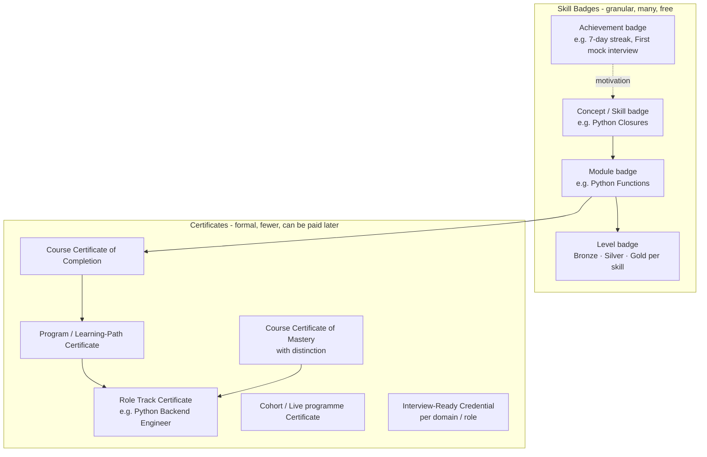
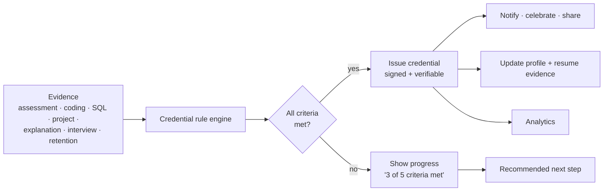

# Skillora Learning — Skill Badges & Certificates Specification

## 1. PURPOSE

Give every learner **recognised, verifiable proof** of what they have learned and can do — at every scale, from a single concept to a full career programme. Credentials motivate progress, power the Resume Studio ("proven skills"), support interviews and become a marketing and trust engine.

Principle: **credentials are earned by evidence, not by clicking "complete".** They are driven by the mastery model (Learned → Practiced → Applied → Explained → Interview-ready → Mastered), assessments, coding results, projects and interview performance.

## 2. CREDENTIAL TYPES



| Type | Granularity | Earned by | Default cost |
|---|---|---|---|
| **Skill badge** | One skill/concept (e.g. `asyncio.gather`, SQL window functions, Docker multi-stage builds) | Mastery stage ≥ configured level on that concept: assessment + coding/application evidence | Free |
| **Module badge** | One module | Module passed at/above mastery threshold | Free |
| **Level badge** (Bronze / Silver / Gold) | A skill area across modules (e.g. Python Fundamentals) | Cumulative mastery %, coding challenges, spaced-retention check | Free |
| **Achievement badge** | Behaviour/milestone | Streaks, first coding challenge, first mock interview, revision consistency, helping flag content, project submitted | Free |
| **Course certificate — Completion** | Whole course | All required modules complete + final assessment passed | Free at launch; **paid add-on / included in plan later** |
| **Course certificate — Mastery (with distinction)** | Whole course | High mastery %, hidden-test coding, capstone, retention check | As above |
| **Program / path certificate** | Multi-course program | All courses in program + capstone | Paid later |
| **Role-track certificate** | Curated role track | Track completion + interview-readiness evidence | Paid later |
| **Cohort / live certificate** | Cohort programme | Attendance + deadlines + final project | Paid later |
| **Interview-ready credential** | Domain/role (e.g. "Python Backend — Interview Ready") | Score thresholds across mock interviews in strict mode, recency-limited | Premium later |
| **Project / lab badge** | Guided → independent → production-style projects | Reviewed submission meets rubric | Free / premium review later |

Every course must define its credentials: **at least one skill badge per core concept cluster, one module badge per module, one course certificate**, plus optional level and project badges. The Admin Portal enforces this at publish time (see §9).

## 3. EARNING RULES (EVIDENCE-BASED)



Rule building blocks (configured in Admin, not code):

- **Mastery criteria:** concept/module mastery stage or score ≥ threshold;
- **Assessment criteria:** pass mark, attempts, proctoring/strictness level;
- **Coding criteria:** N challenges passed, hidden tests, language (Python / SQL-PostgreSQL / SQL-MySQL / JS), complexity bounds;
- **Project criteria:** rubric score, review status;
- **Explanation criteria:** explain-it-back (voice/text) scored by the evaluator;
- **Retention criteria:** pass a spaced re-check N days after completion (prevents "cram and forget");
- **Interview criteria:** score ≥ X in strict-mode mock interview for a domain;
- **Attendance/deadline criteria:** for cohorts;
- **Time/validity:** expiry or "re-validate every N months" for fast-moving topics (e.g. GenAI, cloud);
- **Prerequisite credentials:** requires other badges first.

Anti-cheating: strict assessment modes, randomised question draws, hidden tests, similarity checks, attempt limits, identity re-confirmation for certificates, admin review queue for flagged earnings, revocation workflow.

## 4. LEVELS & ADAPTIVE LEARNER EXPERIENCE

- Badges map to the learner levels (Beginner → Senior): beginners see more frequent, smaller badges (momentum); seniors see fewer, higher-bar credentials (distinction, interview-ready).
- Badge visuals follow the Visual Learning System: shape + icon + label (never colour alone), light/dark safe, alt text, reduced-motion fallback for celebrations.
- Each badge has a **mastery ladder tie-in** ("Practiced → Applied → …") so learners see exactly what unlocks the next one.
- **Progress surfaces:** "Next badge" card on the dashboard, badge criteria checklist on each module/course page, locked-badge silhouettes with requirements.

## 5. CERTIFICATE CONTENT & DESIGN

A certificate shows:

- learner name (as confirmed in profile; legal-name option);
- course/program/track title, level, hours of learning, skills covered;
- grade type (Completion / Mastery with distinction) and optional score band;
- issue date, optional expiry/valid-until;
- issuer (Skillora or tenant for white-label), authorised signatory/signature image;
- **unique credential ID, QR code and verification URL**;
- skills & competencies list (maps to the knowledge graph topics);
- optional: capstone/project title, cohort/schedule dates, instructor.

Design requirements: print-quality **PDF**, shareable **image** (social card), and web page; multiple templates (admin-managed, per course/program/tenant); localisation; accessibility (tagged PDF, text alternatives); brand tokens; no unsupported claims (no "guaranteed job", no implied accreditation unless a real accreditor exists — a configurable disclaimer line is included).

### 5.1 Legal and trust guardrails (India)

- Certificates must carry a configurable disclaimer (e.g. "Awarded by Skillora Learning for demonstrated skills; not a university degree or government-recognised qualification" unless a real accreditation exists) and **no placement/job guarantee or unverified outcome claims** (CCPA coaching-ad guidelines).
- Learner name and public visibility follow DPDP consent. **The platform is adult-only (18+; Higher Secondary completed), so no minors' private-by-default rule or guardian consent applies** (Audience and Eligibility Policy, 2026-10-22).
- Verification pages minimise personal data and honour deletion/withdrawal requests (the credential record remains verifiable as "valid" without exposing personal details if the learner opts out).
- Credential marketing copy and any statistics are approved through the Admin claims-review workflow (Admin spec §23A).

## 6. VERIFICATION & STANDARDS

- **Public verification page** (`/verify/{credential_id}`) showing issuer, learner (privacy setting respected), credential, date, status (valid / expired / revoked), and criteria summary; QR code on certificate resolves to it. Machine-readable endpoint for employers/ATS.
- **Open standards-ready:** model credentials so they can be exported as **Open Badges 3.0 / W3C Verifiable Credentials** (signed, issuer DID/keys managed by the platform), enabling wallets and third-party verification. Start with the internal model and signed verification URL; add standards export in a later phase without changing the data model.
- **Tamper-evidence:** credentials are digitally signed; revocation list; audit trail of issue/revoke/reissue.
- **Privacy:** learner controls visibility (private / link-only / public), can hide score, can delete public page; verification shows only what the learner allows plus mandatory validity fields.
- **Revocation & reissue:** admin can revoke (reason, audit), reissue after name correction, or mark superseded by a newer version when content major-versions change.

## 7. SHARING & CAREER INTEGRATION

| Channel | Behaviour |
|---|---|
| **Add to LinkedIn profile** (deep-link with prefilled certification fields) | One-click share with credential ID + URL |
| **Social share cards** | Auto-generated image + text (LinkedIn, X, WhatsApp, etc.), opt-in |
| **Public skill profile** | Opt-in page listing badges, certificates, mastery chart, projects ("proof of skills") |
| **Resume Studio** | Proven skills/certifications pulled into resume with "verified" markers and verification links (learner chooses what to include) |
| **Interview Master** | Credentials inform the interview blueprint (what the learner claims/has proven); credential-claim questions generated like resume claims |
| **Email / download** | PDF, image, shareable link; email delivery with template |
| **Wallet (mobile)** | Save to device (Apple Wallet / Google Wallet pass) where feasible; in-app credential wallet with offline view of earned credentials |
| **Employer / team view (B2B)** | Tenant admins see employees' credentials, expiry and gaps |

## 8. ENTITLEMENT & MONETIZATION BEHAVIOUR

Aligned with the SaaS & Monetization Architecture:

- **Launch:** all badges free; **all certificates free** (Launch-Free plan grants `certificate.issue`), with the "Certificate — premium later" label optional.
- **Future defaults (admin-changeable):**
  - skill/module/achievement badges stay **free** (engagement & marketing);
  - course certificates: included in paid courses/plans, or a **paid add-on** per course for free courses;
  - program/track/cohort/interview-ready credentials: premium or included in the program price;
  - public verification and sharing remain free for any issued credential (verification must keep working forever).
- **Never revoke earned credentials** because a subscription lapses; downgrade affects *new* issuance only.
- Grandfathering: credentials earned during launch stay valid; optional "founder" achievement badge for early learners.
- Credential issuance emits `UsageEvent`/analytics events (viewed, earned, shared, verified) for conversion and marketing analysis.

## 9. ADMIN PORTAL — CREDENTIAL MANAGEMENT

Added to the Admin Portal (Content Studio + Assessment Studio + Commerce):

| Area | Admin can |
|---|---|
| **Badge library** | Create badge definitions: name, description, skills (knowledge-graph links), level (Bronze/Silver/Gold), artwork (SVG/PNG with alt text), category, tags, criteria rules, prerequisites, visibility, validity/expiry, localisation |
| **Badge designer** | Template-based artwork builder (shape, colour tokens, icon, ribbon), per-branch visual style, preview light/dark and small sizes |
| **Criteria builder** | No-code rule builder over mastery, assessments, coding (incl. SQL dialect), projects, explanation, retention, interview, attendance; test against sample learners; simulation ("how many learners would earn this today?") |
| **Certificate templates** | Layout designer, fields, signatories and signature uploads, seals, languages, disclaimer text, per-course/program/tenant templates, PDF/image preview with sample data |
| **Assign credentials to content** | Attach badges/certificates to concepts, modules, courses, programs, tracks, cohorts; **publish check:** a course cannot be published without a certificate rule and module/skill badges (configurable strictness) |
| **Issuance console** | Search issued credentials, view evidence behind each, reissue, revoke (reason + audit), bulk issue (e.g. cohort completion after review), manual award with reason, issue queue for items needing review |
| **Verification settings** | Public verification page content, privacy defaults, signing keys (references only), standards export (Open Badges / VC) toggles |
| **Credential analytics** | Earn rates, time-to-earn, drop-off before the certificate, shares/verifications, badge difficulty calibration, fraud flags |
| **Commerce link** | Map `certificate.issue` and credential features to plans/add-ons; certificate as add-on product; price per course certificate |
| **Versioning** | Credential definitions are versioned; changing criteria creates a new version; earlier holders keep what they earned (or migration rules) |
| **Templates for non-technical staff** | Pre-built badge families (e.g. "Python skill ladder") cloned per new technology via the Knowledge Extension wizard |

New course/technology wizard (Admin §5.2) automatically **drafts** the credential set (skill badges per concept cluster, module badges, course certificate, level badges, project badge) for review — consistent with "adding Kafka" producing credentials as well as lessons.

## 10. LEARNER EXPERIENCE

**Web:**
- *Credentials* area: badge shelf (earned / in progress / locked with requirements), certificate gallery, filters by skill/branch/level, share and download actions, privacy toggles.
- Badge detail: what it proves, criteria checklist, evidence summary, date, verification link, "next badge".
- Celebratory but restrained earn moment (respects reduced motion).
- Course page shows the certificate preview and criteria up front ("what you'll earn").
- Dashboard "Next badge" and "Almost there" cards.

**Mobile:**
- Credential wallet tab inside Profile; badge shelf; swipe through certificates; share sheet; Add to LinkedIn deep link; push notification when earned or when criteria are nearly met; offline viewing of earned credentials.
- Quick QR display for verification (e.g. in interviews).

**Public:** verification page and optional public skill profile (SEO-friendly, privacy-safe).

## 11. DATA MODEL

```text
BadgeDefinition (id, version, type, level, skills[], criteria_rule_id, artwork, validity, status)
CertificateTemplate (id, layout_json, locales, signatories, disclaimer)
CredentialRule (id, version, criteria_json)                       -- rule engine definition
CredentialAssignment (credential_def_id, target_type: concept|module|course|program|track|cohort, target_id)
CredentialIssue (id, tenant_id, user_id, definition_id, definition_version, issued_at, expires_at?, status: valid|expired|revoked|superseded,
                 evidence_refs[], grade, score_band?, public_visibility, signature, verification_code)
CredentialRevocation (issue_id, reason, by, at)
CredentialShare (issue_id, channel, created_at)
VerificationLog (issue_id, at, source)                            -- privacy-minimised
LearnerCredentialPreference (user_id, default_visibility, name_display)
```

All records carry `tenant_id`; issuance is idempotent (one issue per user per definition version unless re-earned after expiry).

## 12. EVENTS & INTEGRATIONS

`mastery.updated`, `assessment.passed`, `coding.passed`, `project.reviewed`, `interview.completed`, `module.completed`, `course.completed`, `cohort.completed` → **credential rule engine** → `credential.issued` → notifications, profile/resume evidence, analytics, LinkedIn/share prompts, B2B reporting, webhooks.

## 13. PHASING

| Phase | Deliverable |
|---|---|
| **C1** | Badge definitions + rule engine (mastery/assessment), module and skill badges, learner badge shelf, progress/next-badge UI, admin badge library (basic) |
| **C2** | Course completion & mastery certificates (PDF + web view), certificate templates, unique ID + public verification page + QR, admin template designer, issuance console |
| **C3** | Coding/SQL/project/explanation/retention criteria, level badges (Bronze/Silver/Gold), achievement badges, anti-cheat checks, revocation/reissue |
| **C4** | Sharing: LinkedIn add-to-profile, social cards, public skill profile, resume integration, interview-blueprint integration |
| **C5** | Program/track/cohort and interview-ready credentials; mobile wallet tab, Apple/Google Wallet passes, offline viewing |
| **C6** | Open Badges 3.0 / Verifiable Credentials export, signing-key management, B2B employer views, credential analytics, entitlement/add-on commerce wiring |

C1–C2 ship with launch (free); C3–C5 shortly after; C6 aligns with the SaaS/B2B phases.

## 14. DEFINITION OF DONE

- [ ] every course/module/program has defined credentials (badges and a certificate rule) before it can be published;
- [ ] credentials are issued only from verifiable evidence; criteria and progress are visible to the learner;
- [ ] each issued credential has a unique ID, signature, QR and public verification (privacy-controlled);
- [ ] revocation, reissue and versioning work without breaking earned credentials;
- [ ] share flows (LinkedIn, image, link, PDF) work on web and mobile;
- [ ] credential issuance is entitlement-aware (free at launch; add-on/plan-ready) and never revoked on subscription lapse;
- [ ] resume and interview modules consume credentials as evidence;
- [ ] badge/certificate visuals are accessible (alt text, non-colour cues, tagged PDF) and themeable;
- [ ] fully manageable in the Admin Portal without code changes; audited;
- [ ] tests cover rule engine, anti-cheat, verification, tenant isolation.


---

## RELEASE 1.0 SCOPE NOTE (2026-10-22)

Release 1.0 (web only) ships a subset of this specification as **Public Profile Lite**: skill, module and course badges; course certificates on paid plans; public verification pages; an opt-in public profile with share images and embeddable badges. Phases C1 to C3 and the profile and image parts of C4 are in 1.0; Open Badges 3.0 / verifiable-credential export, LinkedIn add-to-profile polish, wallet passes, résumé integration and the Interview-ready credential are 1.1. Authoritative 1.0 scope, privacy defaults, limits and acceptance criteria: `../../05_Release_1_0/01_Scope/Skillora_Learning_Release_1_0_Public_Profile_Lite_Specification.md`.
