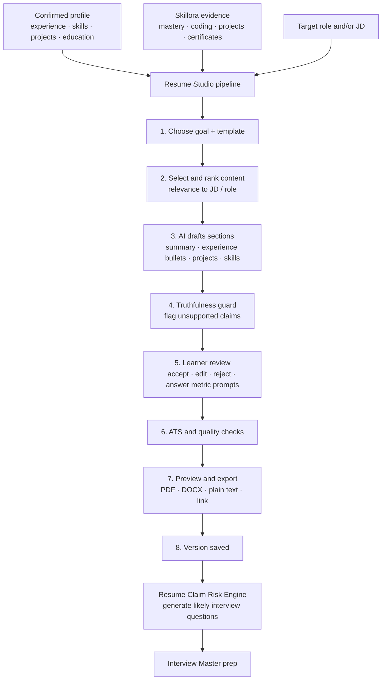
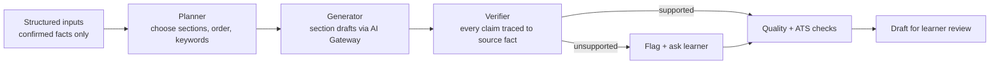

# Skillora Learning — Resume Studio Specification

## 1. PURPOSE

Turn a learner's **confirmed profile, projects, mastery evidence and target JD** into a polished, ATS-friendly, job-ready resume and companion career documents. It closes the loop: *learn → prove → present → interview*.

Free at launch; designed as a **premium feature** (feature keys above) via the entitlement system. See the SaaS & Monetization Architecture.

## 2. NON-NEGOTIABLE RULES

1. **Truthfulness.** Never invent employers, titles, dates, degrees, certifications, metrics or skills. The AI may *rephrase, structure, prioritise and suggest*; every new factual claim must come from the learner's confirmed data or be explicitly confirmed by the learner.
2. **Evidence-linked.** Skills may be marked "proven" when backed by Skillora evidence (mastery, coding results, projects, assessments); the learner chooses whether to show it. Unverified claims are flagged.
3. **Suggestion, not silent change.** Metrics/impact prompts ("How many users? What % improvement?") are asked of the learner; placeholders like `[X%]` are never shipped in an export.
4. **Learner owns the document.** Full edit control, version history, export anytime — even if premium access lapses, previously generated resumes remain viewable/exportable (policy configurable).
5. **Privacy.** Resume content is sensitive: tenant/user isolated, encrypted at rest, excluded from analytics, deletable.
6. **Consistency with interviews.** The resume that is generated feeds the **Resume Claim Risk Engine**, so the learner is prepared for questions on every claim they publish.
7. **No guarantees** of interviews or jobs.

## 2A. INDIA-SPECIFIC REQUIREMENTS

- Templates and guidance tuned for Indian recruiters/ATS: fresher (education, projects, internships, certifications, achievements first) and experienced formats; no photo, date of birth, marital status, religion or caste by default (region-configurable and learner-controlled);
- guidance for Indian context: CGPA/percentage presentation, internship and campus-project framing, notice period/CTC are **not** placed on the resume by default (handled in interview prep), GCC/product/service-company tone variants;
- Hinglish or Indic-language assistance for the *coaching UI* (the exported resume remains in English unless the learner chooses otherwise);
- resume data is sensitive-by-policy under DPDP: explicit consent for AI processing, short retention, deletion on request, no model training; the product is adult-only (18+), so no minors' handling is needed.

## 3. END-TO-END FLOW



## 4. FEATURES

| Feature | Description | Feature key |
|---|---|---|
| **Resume builder** | Guided sections; import from uploaded resume (confirmation flow) or from Skillora profile | `resume.ai_generate` |
| **AI drafting** | Professional summary, experience bullets (action–impact–metric style), project descriptions, skills grouping, achievements | `resume.ai_generate` |
| **JD tailoring** | Paste/upload JD → reorder, emphasise and reword for that role; keyword coverage report; creates a **tailored version** linked to the JD | `resume.jd_tailor` |
| **ATS check** | Parse-ability, standard headings, no tables/graphics traps, keyword coverage, length, date consistency, contact info, file-format checks; score + fixes | `resume.ats_check` |
| **Quality coach** | Weak verbs, passive voice, vague claims, missing metrics, repetition, tense consistency, seniority-appropriate tone | `resume.ai_generate` |
| **Level-aware output** | Beginner/career-switcher (projects & learning evidence first), mid-level (impact), senior (scope, leadership, architecture, outcomes) | `resume.ai_generate` |
| **Cover letter / LinkedIn / elevator pitch** | Tailored to a JD; "Tell me about yourself" script that feeds Interview Master | `resume.cover_letter` |
| **Multiple resumes & versions** | Base resume + JD-specific variants; compare versions (diff); restore | `resume.ai_generate` |
| **Templates** | Admin-managed ATS-safe templates (single-column, compact, modern, academic, senior); style tokens (font, spacing, colour) | included |
| **Export** | PDF, DOCX, plain text, shareable read-only link (optional, expiring) | `resume.export` |
| **Proof links** | Optional public skill profile / verified-project links shown on resume | `resume.ai_generate` |
| **Verified credentials** | Earned Skillora badges and certificates (with verification links/QR) added to a "Certifications & Proven Skills" section, with ✓ verified markers; learner chooses what to include (Credentials spec §7) | `resume.ai_generate` |
| **Interview linkage** | One click: "Prepare me for questions on this resume" → Interview Master | `interview.qa` |
| **Skill-gap nudges** | "This JD wants Kubernetes; your resume has none — take module X" (links to courses; commerce cross-sell later) | included |

## 5. DESIGN OF THE AI PIPELINE



- All calls go through the **AI Gateway** (metered, guardrailed, provider-neutral); prompts are versioned in the Admin Prompt Registry.
- **Provenance map:** each bullet stores `source_fact_ids`; unsupported text is highlighted and cannot be exported until resolved or removed.
- Output is generated as **structured data** (JSON sections), then rendered by templates — so formatting is deterministic and templates can be swapped.
- Prompt-injection defence for pasted JDs/resumes (treated as untrusted data).
- Evaluation suite (Admin → AI evaluation): hallucination rate, claim traceability, keyword relevance, ATS pass rate, tone appropriateness.

## 6. DATA MODEL

```text
ResumeDocument (user, tenant, title, target_role, jd_id?, status)
├── ResumeVersion (number, template_id, content_json, created_by: user|ai, created_at)
│   ├── Section (summary | experience | projects | skills | education | certifications | achievements)
│   └── Bullet (text, source_fact_ids[], verified, ai_generated, flagged)
├── AtsReport (score, issues[], keyword_coverage)
├── ExportRecord (format, created_at, expiring_link?)
ResumeTemplate (admin-managed: layout JSON, style tokens, ATS-safe flag, level suitability)
CoverLetter / CareerDoc (type, jd_id, version)
```

## 7. USER EXPERIENCE

**Web:** split view — editor (left), live preview (right), "AI suggestions" and "Checks" panels; section drag-reorder; accept/reject chips on each AI change; JD keyword highlights.

**Mobile:** step-by-step wizard (Choose goal → Review facts → Review AI draft → Fix flags → Export); quick edits; share/export via system share sheet; heavy editing offers "continue on web" handoff.

**Visuals** (per the Visual Learning System): a resume-readiness ring, JD keyword coverage bar, "claims vs evidence" chips (✓ proven · ◐ unverified · ✎ needs your input), before/after view for AI rewrites.

**Levels:** guidance adapts — beginners get explanations ("what is an impact bullet?" with examples); seniors get terse controls.

## 8. ENTITLEMENT & MONETIZATION BEHAVIOUR

- **Launch:** all keys granted by Launch-Free plan; generous quotas; "Premium later — free now" badge (configurable).
- **Future default (admin-changeable):** Free tier = import + manual builder + 1 ATS check + AI preview of one section; Pro = unlimited drafting/tailoring within fair-use quota, cover letters, all templates, DOCX export; credit packs for extra generations.
- Quota examples: AI generations per month, JD-tailored versions per month. Denials return structured reasons + upgrade options.
- Downgrade: existing resumes stay viewable and exportable (PDF) per policy; premium-only actions locked.
- Possible add-on: human resume review (service product via Commerce).

## 9. ADMIN PORTAL CONTROLS

- Template library (create/edit/preview/ATS-validate/enable per plan or tenant);
- section library and recommended phrases/verbs lists, industry/role presets, seniority rules;
- prompt templates and model routing for each resume task;
- ATS rule sets and keyword dictionaries (skill synonyms shared with the JD Engine);
- quotas and plan mapping (via Entitlements);
- content moderation / safety rules (disallowed claims, discrimination-sensitive fields such as photo/age/marital status — configurable per region);
- analytics: usage, completion, export rates, ATS score distribution, conversion to interview practice;
- AI evaluation results and cost per resume.

## 10. PHASING

| Phase | Deliverable |
|---|---|
| R1 | Profile → structured resume, 2 ATS-safe templates, manual editing, PDF export, versioning |
| R2 | AI drafting with truthfulness guard + provenance map; quality coach |
| R3 | JD tailoring, keyword coverage, ATS report, DOCX export |
| R4 | Cover letter, LinkedIn summary, "tell me about yourself", claim-risk → Interview Master link |
| R5 | Template marketplace in Admin, level-aware presets, proof links, mobile wizard polish |
| R6 | Entitlement/quota hardening, credit packs, human-review add-on |

## 11. DEFINITION OF DONE

- [ ] every exported claim is traceable to a confirmed fact or learner-confirmed input;
- [ ] no placeholder text can be exported;
- [ ] ATS check passes on all enabled templates (automated tests with parsers);
- [ ] works on web and mobile (wizard), offline-safe drafts;
- [ ] entitlement + quota enforced server-side; metered through AI Gateway;
- [ ] resume data encrypted, isolated, deletable, not used for analytics or model training;
- [ ] admin can manage templates, prompts, rules and quotas without deployment;
- [ ] accessibility and reduced-motion respected; visuals have alt text.
