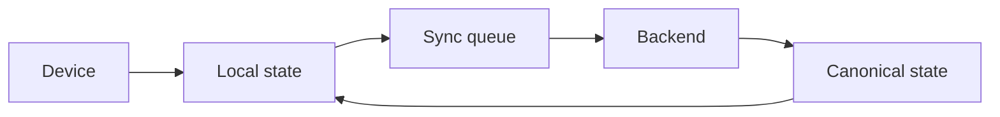

# Skillora Learning — Mobile Application Master Build Prompt

> **NOT PART OF RELEASE 1.0.** Release 1.0 is web only. This prompt is for **Release 1.1** (Android first, then iOS). Do not build from it until 1.1 is scheduled; re-sync it with the then-current web scope first. See `../../05_Release_1_0/01_Scope/Skillora_Learning_Release_1_0_Web_Scope_and_Founder_Curriculum.md`.

> Supersedes the v1 mobile prompt. Voice is **first-class** (v1 called it "future"; that is withdrawn). Sections v2.0 had dropped (home, auth, offline/sync, deep links, notifications architecture, lifecycle, DoD) are restored below.

## 1. ROLE

Act as a senior mobile architect, cross-platform engineer, UX designer, accessibility specialist, and real-time application engineer.

Build the Skillora Learning mobile application for both **iOS and Android** using a maintainable cross-platform architecture where practical.

The mobile app is a client of the shared Skillora backend.

## 2. CORE RULE

Do not duplicate backend business logic.

The same backend APIs and interview engine must serve:

- web;
- iOS;
- Android;
- future clients.

## 2A. ADMIN-DRIVEN CONTENT & CONFIGURATION

All content and configuration is managed in the **web Admin Portal** (see Skillora_Learning_Admin_Portal_Specification.md). The mobile app has no admin features initially and must not hard-code anything an admin can change:

- branches, courses, modules, lessons, visuals, questions, labels, master-data lookups;
- thresholds, level rules, feature flags, notification templates, theme/design tokens, supported languages;
- **mobile controls:** minimum supported app version and forced-update message, store links, deep-link domains, push provider settings, mobile-only feature flags, which lessons are available as offline packs;
- language/runtime metadata and question-type → UI mapping.

Consume **published, versioned** content and effective config through the shared API, with ETag/version caching; handle content updates mid-session gracefully (finish the version the learner started unless an admin forces migration; show "What's new" when content changes). Config is cached for offline start with a safe fallback to the last known good values.

## 2B. SaaS-READY MOBILE (ENTITLEMENTS, COMMERCE, SCHEDULES)

Authoritative design: **Skillora_Learning_SaaS_Monetization_Architecture.md**.

- **All features are free at launch** (Launch — Free Access plan), but the app is entitlement-aware from day one: read effective entitlements from the shared API; render features as available / locked / limit-reached; never hard-code plan names, prices or premium rules; the server enforces.
- Premium-later features use a shared `Gate` component and paywall sheet (hidden or "Premium later — free now" badge per admin config): Resume Studio, mock interviews, voice interviews, JD prep, system design, advanced analytics, offline packs, project reviews, certificates.
- **Billing channels:** web checkout, App Store in-app purchase, Google Play Billing, invoice/enterprise — abstracted behind the backend billing adapter; every channel yields the same Order → Entitlement result, so a purchase on web unlocks mobile and vice versa. Verify receipts server-side only; support **Restore Purchases**; follow the *current* store billing policies before release; admin config decides which channel/price is shown per platform and region. Billing UI stays disabled until monetization is switched on.
- **Catalogue & My Learning:** browse collections, bundles, programs and role tracks; enrol; view the **personal calendar** (live sessions, deadlines, drip unlocks, cohort dates) with local reminders and calendar export.
- **Resume Studio on mobile:** step-by-step wizard (goal → review facts → review AI draft → fix flags → export/share); heavy layout editing offers "continue on web".
- Usage/quota meters and clear limit-reached messages with upgrade options when quotas are active.
- Paid content media/files use short-lived signed URLs; offline packs respect entitlements and expire accordingly.

## 2D. INDIA-FIRST & PRODUCTION-GRADE REQUIREMENTS (MOBILE)

Authoritative: **Skillora_Learning_India_Market_and_Compliance_Specification.md** and **Skillora_Learning_Engineering_Quality_and_Operations_Specification.md**.

- **Budgets:** cold start ≤ 3 s on a 3 GB RAM device; download size target ≤ ~40 MB (AAB split by ABI/density); lazy-load editor, whiteboard, animators; crash-free sessions ≥ 99.5% as a release gate; startup, memory and battery profiled per release.
- **Data-lite mode & offline packs:** downloadable lesson packs (text + pre-rendered SVG diagrams + code examples), Wi-Fi-only download option, static visuals instead of animations, compressed media, resilient sync queue.
- **Auth:** mobile-number OTP primary (auto-read SMS where permitted), Google sign-in, biometric unlock for local session; OTP throttling; account recovery.
- **Channels:** push, WhatsApp (opt-in via backend), SMS for OTP; notification language follows user preference; per-channel consent and quiet hours.
- **Consent & eligibility (adult-only, 1.1+):** the same 18+ and Higher Secondary sign-up gate as the web app, no parental-consent flow, granular consent centre, data export/erase; honest app-store data-safety/privacy disclosures and an adult age rating.
- **Payments (when enabled):** UPI intent/QR and app-switch flows handled gracefully (return-from-UPI-app state recovery), cards, wallets, EMI; store-billing channels per policy; e-mandate pre-debit notice and cancellation visible; Restore Purchases.
- **Voice on poor networks:** reconnect/resume, local answer buffering, instant fallback to text; Indian-accent STT/TTS validated.
- **Language:** English plus i18n ready for Hindi/Indic; Hinglish tutor mode; Indic fonts verified.
- **Releases:** staged rollout, forced-update control from Admin, OTA fixes where store policy permits, device-farm regression on low-end Android and flaky-network profiles.

## 2C. BADGES & CERTIFICATES (MOBILE)

Spec: **Skillora_Learning_Credentials_Badges_Certificates_Specification.md**.

- **Credential wallet** inside Profile: badge shelf (earned / in progress / locked with requirements), certificate gallery, offline viewing of earned credentials, quick **QR display** for verification.
- Course/module screens show what the learner will earn and the criteria checklist; push notification when a credential is earned or nearly earned.
- Share via system share sheet, **Add to LinkedIn** deep link, social card; save to Apple Wallet / Google Wallet where feasible; privacy toggles per credential.
- Certificates render as accessible PDFs/images; badges follow the visual rules (shape + icon + label, alt text, reduced motion).
- Credential logic and verification are backend-only; the app never issues or trusts local credentials.

## 3. MOBILE UX PRINCIPLES

Prioritize:

- simple navigation;
- touch-friendly controls;
- fast startup;
- low bandwidth tolerance;
- responsive layouts;
- offline-safe local state where useful;
- accessibility;
- battery-conscious behavior;
- graceful network recovery.

## 4. PRIMARY AREAS

Provide:

```text
Home
Learn
Practice
Interview Master
Profile
JDs
Progress
Settings
```

## 5. LEARNING

Support:

- lessons;
- examples;
- quizzes;
- coding challenges;
- assessments;
- progress;
- module completion.

The normal course flow remains sequential while allowing revision.

**Home screen** answers: continue learning, today's revision, recommended practice, interview readiness, target role, quick Interview Master access. Show the route as a **vertical stepper** (✓ done · ◐ current · 🔒 locked).

### Visual learning on mobile (required)

- Hero diagram/analogy per lesson; step-through visuals with large Next/Back buttons in the thumb zone.
- Diagrams are **vertical-first** (top-to-bottom); wide diagrams open in a full-screen viewer with pinch-zoom, fit-to-width default and landscape support.
- One-tap **Simpler ◀ ▶ Deeper** level switch on each visual; default level comes from the learner's level in that branch.
- Heavy animations load on demand; lightweight static SVG fallbacks for low bandwidth, low battery and reduced-motion.
- Offline lessons include diagram sources so visuals render without network.
- Alt text and long description for each diagram; never colour alone for status.

Full spec: **Skillora_Learning_Visual_Learning_System.md**.

### Revision

Short daily sessions ("Today's Revision" list with a **Start Review** action), prioritising weak and interview-relevant topics, with a spaced-repetition timeline.

## 6. PROFILE

Support:

- manual profile editing;
- resume/CV upload;
- extracted profile preview;
- confirmation;
- target role;
- experience;
- technologies;
- projects;
- target JDs.

## 7. INTERVIEW MASTER

Interview Master is a first-class mobile feature.

It must support:

- technical Q&A;
- code output;
- coding;
- debugging;
- SQL;
- MCQ;
- short answer;
- code review;
- system design;
- behavioral;
- JD-specific interviews;
- voice interviews.

## 8. ADAPTIVE UI

Render the correct interaction for each question.

```text
Q&A          → Chat / Voice
Code Output  → Formatted Code Viewer + Answer
Coding       → Mobile Coding Editor
SQL          → SQL Editor + Results
MCQ          → Touch Options
Code Review  → Code + Comments
System Design→ Mobile Canvas
```

Do not reduce everything to chat.

## 9. CODE OUTPUT

Provide:

- syntax highlighting;
- line numbers where practical;
- language;
- readable code;
- horizontal scrolling;
- copy;
- expand;
- read-only state.

## 10. MOBILE CODING

Provide a usable coding editor with:

- syntax highlighting;
- cursor/selection;
- indentation support;
- run;
- submit;
- reset;
- test results;
- errors;
- stdout/stderr;
- timer where needed.

Do not provide AI autocomplete or automatic solutions in strict interview mode.

The authoritative execution must happen through the secure backend sandbox.

## 11. LANGUAGE SUPPORT

The mobile client must consume language metadata from the backend.

Initially support:

- Python;
- SQL (PostgreSQL and MySQL, with dialect badge);
- JavaScript/Node where required.

Design the UI for future languages.

## 12. FRAMEWORK TASKS

Support interview tasks for:

- Flask;
- Django;
- FastAPI.

For complex tasks, use a mobile-optimized multi-file navigation/editor experience.

## 13. SQL

SQL is part of the same adapter-driven coding experience as Python (same Run / Submit / Reset / timer model) and is configured from the Admin Portal. Provide:

- schema;
- data preview;
- SQL editor;
- run;
- result table;
- errors;
- submit.

## 14. SYSTEM DESIGN

Provide a touch-friendly whiteboard:

- nodes;
- connectors;
- labels;
- notes;
- zoom;
- pan;
- delete;
- reset.

The candidate can explain the architecture using voice or text.

## 15. VOICE INTERVIEW

Voice is a first-class feature.

Provide:

```text
Microphone
→ STT
→ Interview Engine
→ Response
→ TTS
→ Speaker
```

Support:

- microphone permissions;
- live transcript where available;
- final transcript;
- speaking indicator;
- replay;
- interruption;
- text fallback;
- configurable TTS voice;
- provider abstraction.

## 16. MULTI-MODAL SESSION

The same session can transition:

```text
Voice
→ Text
→ Coding
→ Tests
→ Voice Follow-up
→ System Design
→ Final Report
```

Do not restart the interview when the mode changes.

## 17. MINI ASSESSMENTS

Support:

- MCQ;
- multi-select;
- code output;
- short answer;
- coding;
- debugging.

Show:

- progress;
- timer;
- current question;
- navigation;
- submission status.

## 18. ADAPTIVE INTERVIEW

The backend determines the next interaction.

Example:

```text
Weak AsyncIO answer
→ follow-up
→ code-output test
→ coding task
→ re-evaluation
```

The mobile client should make transitions feel seamless.

## 19. INTERVIEW REPORT

Show:

- overall score;
- skill scores;
- strengths;
- weaknesses;
- incorrect answers;
- missed concepts;
- coding feedback;
- better answers;
- revision recommendations.

## 20. JD-DRIVEN PREPARATION

Allow the user to:

- paste/upload a JD;
- save it;
- generate preparation route;
- see skill gaps;
- launch a personalized mock interview.

## 21. NOTIFICATIONS

Future-ready for:

- study reminders;
- interview reminders;
- course progress;
- recommended revision.

Use platform-appropriate notification services behind a provider abstraction.

## 22. OFFLINE / NETWORK RESILIENCE

Where safe, cache:

- course metadata;
- downloaded learning content (with diagram sources);
- notes, saved questions, selected revision material;
- progress state.

Require connectivity (and say so clearly: *"You're offline. Reconnect to continue this action."*) for AI conversations, JD analysis, code execution, interview scoring, and mastery sync. Do not pretend an offline interview/code execution is authoritative if the backend is required. Never report a backend operation as completed when it was not.

Recover gracefully after network interruptions.

Sync model — backend is authoritative:



Handle retries, duplicate requests, stale data, conflicts.

## 22A. AUTH, SESSION & LIFECYCLE

- Signup, login, logout, password reset, email verification, optional OAuth.
- Tokens in iOS Keychain / Android Keystore only; never in plaintext preferences or logs.
- Optional biometrics unlock a local secure session; they never replace backend identity verification.
- Handle cold start, foreground, background, suspended, terminated states and network changes.
- **Session recovery:** restore lesson position, coding challenge, mock interview and AI conversation after interruption, using canonical backend state.

## 22B. DEEP LINKS & NOTIFICATIONS

- Custom scheme (`skilloralearning://lesson/{id}`, `/interview/session/{id}`, `/jd/{id}`) plus HTTPS universal/app links (`https://skilloralearning.com/learn/...`); open the app if installed, otherwise the web.
- Notification flow: `Backend event → Notification service → Provider adapter → iOS / Android`. Users control preferences. No coupling to one vendor.

## 22C. WEB + MOBILE CONTINUITY

Start a lesson on web, continue on mobile, review an interview on mobile, practise on web — all via backend sync. Web is optimised for long-form learning, large editor and knowledge exploration; mobile for revision, short lessons, interview practice, quick Q&A and notifications. Do not force identical layouts.

## 23. ACCESSIBILITY

Support:

- screen readers;
- dynamic text sizing;
- accessible labels;
- sufficient touch targets;
- contrast;
- reduced motion;
- voice fallback to text;
- diagram text alternatives and long descriptions.

## 24. SECURITY

- Secure token storage.
- Never expose backend secrets.
- Never trust client-side authorization.
- Upload files securely.
- Do not execute arbitrary candidate code locally as authoritative evaluation.
- Use backend sandbox execution.

## 25. PERFORMANCE

Optimize for:

- fast startup;
- low memory;
- battery usage;
- network efficiency;
- streaming voice;
- efficient code-editor rendering.

## 26. API ARCHITECTURE

The app must use the same versioned backend API contracts as the web client.

Provide a clean API/data layer so the UI is not coupled directly to HTTP implementation details.

## 27. DELIVERY

Implement incrementally:

```text
App Shell (+ design tokens, diagram viewer)
→ Auth/Profile
→ Home + Learning (stepper, lesson visuals, level switch)
→ Revision
→ Practice
→ Assessments
→ Interview Master
→ Voice
→ Adaptive Interview
→ JD Workflow
→ System Design
→ Offline / Sync / Deep Links / Notifications
→ Analytics
→ Production Hardening (accessibility, performance, App Store / Play Store readiness)
```

Test on both iOS and Android. End-to-end coverage at minimum: signup/login, profile and resume confirmation, curriculum navigation, lesson with visual interaction, coding submission, JD analysis, interview session, offline/online recovery, push routing, deep links.

**Definition of done:** works on iOS and Android; API integration; loading/error/empty states; offline behaviour considered; accessibility (VoiceOver/TalkBack, dynamic text); secure storage; deep links; tests; backend compatibility; **visuals meet the Visual Learning System Definition of Done**.

## 28. FINAL MOBILE STANDARD

The mobile application must feel like a genuine professional product, not a mobile wrapper around a website.

It must preserve the core Skillora experience:

**learn → practice → code → assess → interview → receive feedback → revise → interview again.**
