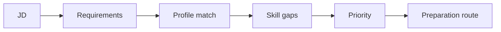

# Skillora Learning — Web Application Master Build Prompt

> Supersedes the v1 web prompt. Sections carried over from v1 that v2.0 had dropped are restored below (public site, auth, projects, last-minute mode, knowledge explorer, revision center, PWA, environments, notifications, testing, definition of done).

## 0. RELEASE 1.0 BUILD PROFILE (READ FIRST — OVERRIDES SCOPE BELOW)

For **Release 1.0 the web app (learner + admin) is the only client built.** Authoritative scope: `../../05_Release_1_0/01_Scope/Skillora_Learning_Release_1_0_Web_Scope_and_Founder_Curriculum.md` (and its sibling folders in `05_Release_1_0/`). Sections below describe the full web product; for 1.0 build them as follows.

| Build in 1.0 | Defer to 1.1+ (build only the hooks) |
|---|---|
| Accounts (email + Google), profile, consents, placement test (Python, DB, API, cloud, **DSA, system design**, LLM/AI) → route map | Mobile OTP login; Resume Studio UI (keep profile data model + hidden entitlement flag `resume.ai_generate`); recurring billing, subscriptions, mobile/store billing |
| Course player, visuals, level switch, mastery, revision; **Tracks A, B, C** (19 courses) | Additional tracks, Hindi/Indic UI |
| Browser IDE: Python + SQL (PostgreSQL & MySQL), visible/hidden tests, Learn/Practice/Interview modes | Other languages, multi-file framework workspace beyond what Tracks A/B need |
| **Interview Master: text AND voice (§8, §15, §16), adaptive (§17), last-minute (§21A), JD workspace (§21), project deep-dive, company packs** | Mobile voice, wallet passes, Interview-ready credential |
| **System-design workspace (§14): advanced canvas + auto-evaluation** (canvas always serialises to a typed graph) | Collaborative canvas |
| Badges + course certificates with public verification; **Public Profile Lite (opt-in profile at `/u/{handle}`, share images, embeddable badges; free on every plan; spec: `../../05_Release_1_0/01_Scope/Skillora_Learning_Release_1_0_Public_Profile_Lite_Specification.md`)** | LinkedIn add-to-profile polish, Open Badges 3.0 export, wallet passes, résumé integration, leaderboards, recruiter search |
| Admin Portal: RBAC+MFA+audit, content studio, question bank, challenge builder, **interview config (rubrics, prompts, voice settings, company packs, system-design palette/rubrics/model designs)**, templates, flags, entitlements and plans (Launch-Free, Free, Trial, Sprint, Pro 90, Pro Annual), price book and quota editor, trial settings and budget pools, coupons, orders/refunds/reconciliation, cost-per-learner dashboard, analytics, provider/budget config | Advanced imports, experiments, tenants UI, commerce admin (offerings/bundles/cohorts) |
| PWA-capable, responsive, accessible, performant (Engineering spec budgets applied to **web**) | Native app store releases |

Voice acceptance for 1.0: p50 end-of-speech to interviewer audio ≤ ~1.5 s, p95 ≤ ~3 s; barge-in; live transcript; replay; reconnect/resume; text fallback; mic/audio consent; no emotion inference. Company packs: public-source only, no confidential/leaked questions.

## 1. ROLE

Act as a principal frontend architect, UX engineer, accessibility specialist, full-stack engineer, and product designer.

Build the **Skillora Learning web application** against the shared Skillora backend APIs.

The web application must be lightweight, fast, professional, intuitive, responsive, and suitable for eventual production hosting.

## 1A. TWO WEB SURFACES

The web application has two surfaces on one platform:

| Surface | Users | Purpose |
|---|---|---|
| **Learner app** | Learners | Learn, practise, code, assess, interview, revise |
| **Admin Portal** | Admins, authors, reviewers, support, analysts | Manage all content, knowledge, rules, providers, users, settings and operations |

The Admin Portal is specified in **Skillora_Learning_Admin_Portal_Specification.md** (authoritative for admin features). Key rules for the web build:

- separate route/subdomain and code-split bundle (`/admin` or `admin.skilloralearning.com`); never loaded for learners;
- same design system, same typed API client, same shared backend (`/api/v1/admin/...`); no admin business logic in the frontend;
- role-aware navigation from server-provided permissions (RBAC); MFA and step-up auth for admins;
- **preview as learner** (any level, web or mobile width) from every authoring screen;
- schema-driven forms/lists so new content types, fields, settings and lookups appear without frontend rewrites;
- everything the learner app shows — branches, courses, lessons, visuals, questions, labels, thresholds, notifications, feature flags, theme — comes from admin-managed data via the API, never hard-coded.

Admin areas (see the Admin spec for detail): Dashboard · Content Studio · Knowledge Manager · Assessment & Interview Studio · Visual Library · Learning Rules · Execution Config · AI & Providers · Users & Access · Platform Settings · Insights · Operations (jobs, health, audit, backups).

## 2. CORE RULE

The web application is a client.

Do not duplicate domain/business logic unnecessarily in the browser.

The shared backend remains authoritative for:

- authentication;
- profile;
- course state;
- knowledge;
- assessments;
- interviews;
- scoring;
- AI orchestration;
- code execution;
- STT/TTS orchestration;
- JD analysis;
- content, configuration, feature flags and master data (admin-managed, served as published versions only).

## 3. UX PRINCIPLES

Use:

- clear navigation;
- minimal cognitive load;
- responsive layouts;
- accessible components;
- consistent spacing;
- clear primary actions;
- meaningful empty/loading/error states;
- keyboard support;
- dark/light theme readiness;
- professional typography;
- mobile-responsive layouts.

Avoid:

- visual clutter;
- unnecessary animations;
- platform-specific gimmicks;
- huge dashboard cards with little value;
- forcing all interactions into chat.

## 4. PRIMARY AREAS

Provide navigation for:

```text
Dashboard
Learn (Academy → Learning Room)
Knowledge Explorer
Practice (Coding Lab, Projects)
Interview Master (Q&A, Mock, Last-Minute)
Revision Center
Catalogue / Storefront (courses, bundles, programs, tracks)
My Learning (enrolments, schedule calendar, cohorts)
Resume Studio
My Profile
Billing & Plans (1.0: Pricing, My Purchases, usage meters; behind flags until the paid beta)
My JDs
Progress
Settings
```

Public pages (SEO-ready, unauthenticated): Landing, Features, About, Security/Privacy, Login/Signup. The landing page must not make unsupported guarantees (e.g. guaranteed employment). Prepare for `skilloralearning.com` with Development / Staging / Production environments configured through environment variables; never hard-code secrets or URLs.

Authentication: signup, login, logout, email verification, password reset, optional OAuth; secure cookies or short-lived tokens with refresh; backend authorization is authoritative.

Use one consistent application shell. Adapt navigation according to permissions and future roles. The Academy branch list is loaded dynamically from the backend so new branches need no frontend redeploy.

## 5. DASHBOARD

The dashboard answers at a glance: **Where am I? What next? What am I weak at? What should I revise? How ready am I?**

Show:

- current course/module on a **route map** (completed ✓ · current ◐ · locked 🔒, with next step highlighted);
- learning progress and mastery;
- recommended next lesson;
- coding practice;
- readiness ring for the target role / active JD;
- weak-area strip;
- revisions due;
- upcoming target interviews;
- recent activity.

Prefer useful information over vanity charts. Visual patterns are defined in the Visual Learning System §10.

## 6. COURSE PLAYER

Support:

- lesson content;
- code examples;
- embedded exercises;
- coding challenges;
- quizzes;
- progress;
- completion;
- next/previous navigation.

Normal learning flow:

```text
Lesson
→ Practice
→ Coding
→ Assessment
→ Mastery check
→ Complete / Mastered (or Revise)
→ Next Module
```

Module statuses: Locked, Not Started, In Progress, Completed, Needs Revision, Mastered. Show duration, difficulty, prerequisites, interview relevance and coding relevance on each module.

Layout: distraction-free **three-pane** learning room — curriculum navigation | lesson content | diagram/code panel (resizable, collapsible). Persist lesson position, notes and bookmarks through backend APIs.

### Visual learning (required)

- Hero diagram or analogy at the top of every lesson; interactive or step-through visuals where concepts are dynamic.
- **Level switch** (◀ Simpler · Deeper ▶) on every visual; default level comes from the learner's level in that branch.
- Code ↔ diagram side-by-side, with line-by-line step-through, variable/stack/memory viewer, and predict-then-reveal.
- Full-screen diagram viewer with zoom/pan; keyboard: ←/→ step, Space play/pause, +/− zoom.
- Serve **pre-rendered static SVG** (generated at publish time from versioned Mermaid / JSON / SVG source); load interactive visuals lazily on demand; theme-aware; alt text and long description for every diagram; reduced-motion fallback.
- "Was this clear?" feedback on each visual.

Full spec: **Skillora_Learning_Visual_Learning_System.md**.
## 7. CODING EXPERIENCE

Provide a browser coding editor for learning and interview practice.

Learning mode may provide normal instructional assistance.

Interview mode must disable AI completion/autocomplete assistance.

## 8. INTERVIEW MASTER — FIRST-CLASS UX

Interview Master must not be a generic chat page.

It must dynamically render the appropriate interface for the question type.

```text
Technical Q&A
→ Chat / Voice

Code Output
→ Read-only formatted code + answer

Coding
→ Professional coding IDE

SQL
→ SQL editor + result table

MCQ
→ Option interface

Code Review
→ Code + annotation interface

System Design
→ Diagram/whiteboard

Behavioral
→ Chat / Voice
```

## 9. CODE OUTPUT UI

Render:

- syntax highlighting;
- line numbers;
- language;
- read-only code;
- copy;
- expand;
- answer field.

Allow an optional reasoning answer.

## 10. LIVE CODING UI

Provide:

- multi-file editor where required;
- language indicator;
- Run;
- Submit;
- Reset;
- test results;
- stdout/stderr;
- runtime errors;
- timeout;
- timer.

Do not expose autocomplete or AI solution assistance in strict interview mode.

## 11. LANGUAGE SUPPORT

The UI must be driven by question metadata.

Do not hard-code a Python-only editor.

The coding IDE is **one adapter-driven shell** that opens the right workspace from question metadata: code workspace for program languages, **SQL workspace for SQL**. Both share Run / Submit / Reset / timer / results and work in Learn, Practice, Interview and Challenge modes. Runtimes and SQL dialects, limits and datasets are configured in the Admin Portal and exposed by the backend; the UI must support whatever the backend lists.

Initially prioritizing:

- Python;
- SQL (PostgreSQL and MySQL, with a dialect badge and dialect-specific highlighting);
- JavaScript/Node where required.

## 12. FRAMEWORK INTERVIEW WORKSPACE

Support multi-file tasks for:

- Flask;
- Django;
- FastAPI.

The UI should present realistic project structures where the assessment requires them.

## 13. SQL WORKSPACE

A full SQL workspace inside the coding IDE (also embeddable in lessons and assessments). Provide:

- schema browser (tables, columns, keys, indexes) and ER diagram;
- data preview panel;
- SQL editor with syntax highlighting (no autocomplete in strict interview mode);
- Run Query, Run Selection, Submit, Reset;
- results grid with row count, timing, truncation notice and optional export;
- errors with position/line;
- multi-statement scripts and transactions where the exercise allows;
- dialect badge (PostgreSQL / MySQL) from question metadata, with a "run on both" comparison view for comparison lessons;
- optional `EXPLAIN` / execution-plan view in learning mode (hidden in strict interview mode), rendered as a plan diagram per the Visual Learning System for either dialect;
- validation feedback (result match, state check, schema check, plan/performance check) with visible and hidden dataset results;
- panel visibility and limits driven by question metadata from the Admin Portal.

Execution is always on backend-isolated, disposable databases; the browser never runs authoritative SQL.

## 14. SYSTEM DESIGN WORKSPACE

Provide:

- canvas;
- components;
- connectors;
- labels;
- notes;
- zoom;
- pan;
- clear/reset;
- explanation area.

The candidate can explain via text or voice.

## 15. VOICE MODE

Voice is a first-class capability.

Provide:

- microphone permission flow;
- record/listen state;
- live transcript where available;
- final transcript;
- speaking indicator;
- interruption;
- replay;
- text fallback;
- TTS playback controls.

The interview can move naturally between voice, text, coding, and system design.

## 16. MULTI-MODAL INTERVIEW

Example UI state sequence:

```text
VOICE QUESTION
→ VOICE ANSWER
→ CODE CHALLENGE
→ CODE SUBMISSION
→ VOICE FOLLOW-UP
→ SYSTEM DESIGN
→ FINAL REPORT
```

All remain inside one session.

## 17. ADAPTIVE INTERVIEW UX

Show the candidate only the current relevant interaction.

Do not reveal hidden scoring logic or future questions unless the mode explicitly allows it.

When the engine requests a follow-up, seamlessly transition to it.

## 18. MINI ASSESSMENT UI

Support:

- MCQ;
- multi-select;
- code output;
- short answer;
- coding;
- debugging.

Show:

- progress;
- timer when applicable;
- question number;
- navigation;
- submit state.

## 19. INTERVIEW REPORT

After an interview show (with a skill **radar chart**, per-domain bars and a session timeline):

- overall rating;
- skill-wise ratings;
- strengths;
- weaknesses;
- incorrect/missed points;
- coding results;
- better answers;
- recommended learning;
- recommended next mock interview.

## 20. PROFILE EXPERIENCE

Allow:

- manual profile editing;
- resume/CV upload;
- resume extraction preview;
- user confirmation before applying extracted data;
- target roles;
- technology skills;
- experience;
- projects;
- target JDs.

## 21. JD WORKSPACE

Allow:

- paste JD;
- upload JD;
- save JD;
- generate preparation route;
- show skill gaps;
- launch tailored mock interview.

### JD pipeline visual



Show a match gauge, **strong / partial / missing** chips, likely interview topics, and recommended order.

## 21A. LAST-MINUTE MODE

Input: JD, interview date/time, available hours. Output as a visual checklist route:

```text
Critical topics → Likely questions → Resume questions → Coding → System design → Mock interview → Final revision
```

Make it extremely easy to follow, with time estimates per step.

## 21B. PROJECTS

Requirements, objectives, architecture diagram, milestones, tasks, submission, review, progress, interview questions. Projects combine multiple branches (e.g. Python + FastAPI + PostgreSQL + Docker + AWS + GenAI) and progress from guided lab to production-style project.

## 21C. KNOWLEDGE EXPLORER & REVISION CENTER

- **Knowledge Explorer:** keyword and semantic search; filters (branch, technology, difficulty, version, interview relevance); interactive graph showing prerequisites/dependents with the learner's mastery overlaid. Keep it useful, not decorative.
- **Revision Center:** due revisions, weak topics, repeated mistakes, forgotten concepts, interview-priority items, spaced-repetition timeline, clear **Start Revision** action.

## 21C0. INDIA-FIRST & PRODUCTION-GRADE REQUIREMENTS (WEB)

Authoritative: **Skillora_Learning_India_Market_and_Compliance_Specification.md** and **Skillora_Learning_Engineering_Quality_and_Operations_Specification.md**. Web client rules:

- **Auth:** mobile-number OTP primary, Google sign-in, email/password; OTP throttling and clear resend/timeout UX; quick logout and session timeout options for shared lab/cyber-café machines.
- **Consent & eligibility (adult-only):** sign-up gate with date of birth (under-18 attempts declined politely, nothing stored), highest-education selection (Higher Secondary or equivalent completed is the minimum), current status and target role, a required eligibility statement repeated at checkout; keep only birth year, 18+ flag and education level; granular consent screens (analytics, marketing, voice, resume/AI processing, public profile), consent centre and withdrawal, data export/erase self-service, grievance officer link. No guardian or parental-consent flow. Authoritative: `../../05_Release_1_0/01_Scope/Skillora_Learning_Release_1_0_Audience_and_Eligibility_Policy.md`.
- **Performance budgets (mid-range Android, 4G):** LCP ≤ 2.5 s, INP ≤ 200 ms, CLS ≤ 0.1, critical-path JS ≤ ~200 KB gzip; lazy-load editor, whiteboard, animators; Web Vitals and bundle-size checks enforced in CI.
- **Data-lite mode** (user-selectable and auto-suggested on slow networks): static SVG instead of animation, no autoplay, deferred heavy assets; **PWA** with cached shell and offline lesson packs.
- **Language:** English plus i18n framework ready for Hindi/Indic languages; Hinglish tutor-mode toggle; Indic-script font rendering tested.
- **Checkout (1.0, hosted gateway page):** UPI-first, cards, net banking, wallets, and the gateway's own EMI if offered; one-time payments only in 1.0 (e-mandate and auto-renewal arrive with subscriptions later, with pre-debit notice and easy cancel); no pre-selected add-ons, no fake urgency, no confirm-shaming; total price, quotas, trial terms and refund policy visible before payment.
- **Claims:** no placement/job guarantees; any outcome statistic or testimonial rendered only from compliance-approved admin content.
- **Support:** in-app help, AI tutor, community/mentor entry points (when enabled), support ticket with learner context, WhatsApp help link.
- **Quality:** accessibility WCAG 2.2 AA target; error/empty/loading states; analytics events per the Engineering spec §11, consent-aware.

## 21C1. CREDENTIALS: BADGES & CERTIFICATES

Spec: **Skillora_Learning_Credentials_Badges_Certificates_Specification.md**. Web requirements:

- **Credentials** area: badge shelf (earned / in progress / locked with requirements), certificate gallery, filters by skill/branch/level, download (PDF/image), share (LinkedIn add-to-profile, social card, link), privacy toggles (private / link-only / public, hide score).
- Course and module pages show **"what you'll earn"** (badges + certificate preview) and a live **criteria checklist** ("3 of 5 met") with the next recommended step.
- Dashboard **Next badge / Almost there** cards; restrained earn celebration (reduced-motion safe).
- Optional public skill profile and public **verification page** (`/verify/{id}`), SEO-friendly and privacy-safe. **In 1.0 build Public Profile Lite per its specification:** opt-in versioned consent, section switches, `noindex` by default, handle rules, share images, embeddable SVG badge, report and takedown, no leaderboards and no recruiter-facing features.
- Badges use shape + icon + label (never colour alone), alt text, light/dark safe; certificates are tagged/accessible PDFs.
- Credential visibility is entitlement-aware (free at launch; certificates may become add-on/plan feature, badges stay free).

## 21C2. SaaS-READY CLIENT BEHAVIOUR (PREMIUM, COMMERCE, SCHEDULES)

Authoritative design: **Skillora_Learning_SaaS_Monetization_Architecture.md**. Client rules:

- **Release 1.0 plan model (authoritative: Billing Lite and Trial Specification):** during founder alpha and closed beta the Launch — Free Access plan applies; from the paid beta onward new learners get a **7-day Trial (+7 days on activation: placement test, one lesson, one mock; no card)** and then the **Free tier**, with paid **Sprint (30 days), Pro 90 (90 days) and Pro Annual (12 months)** passes and **voice credit packs**. Quotas, limits (for example 4 voice mocks a month, 150 voice minutes, one active voice session, 45-minute cap, 2 sessions a day) and trial controls come from the API; never hard-code them. The client must be entitlement-aware from day one.
- **Never hard-code plan names or "premium" checks.** Read the effective entitlements from the API (`GET /me/entitlements`) and render each feature as *available / locked / limit-reached / expiring*. The server remains authoritative; a denied call returns a structured reason (`not_in_plan`, `quota_exhausted`, `expired`, `org_seat_missing`) plus upgrade options.
- **Gated features** (wrapped in a reusable `<Gate feature="...">` component and an upgrade sheet; in the free alpha/beta they are hidden or show a "Premium later — free now" badge according to admin config; from the paid beta they show real quotas, remaining counts and upgrade options): Interview module (mock interviews, voice, JD prep, system design, company packs), tutor beyond the Free cap, rubric-scored answers, certificates; Resume Studio, offline packs and project reviews remain hidden until 1.1.
- **Storefront / Catalogue:** collections/shelves, course and bundle landing pages, learning paths and role-based tracks, schedules and cohort start dates, price block (shows "Free — launch" until pricing is active), enrol / start CTA, recommendations ("because your target role is…").
- **My Learning:** enrolments, progress, **personal calendar** (live sessions, deadlines, drip unlocks, ICS export), cohort info.
- **Billing & Plans (Billing Lite, 1.0):** pricing page, plan comparison, trial banner with days left and activation checklist, checkout via hosted payment page, coupons, **My Purchases** (orders, GST invoices, refund request link, queued passes and start date), usage and quota meters, credit balance. Payment methods, cancel and pause belong to subscriptions (later). Honest, transparent pricing; clear refund policy (7 days if under 2 voice mocks and 30% of quotas used); learners can always see and export what they own.
- **Trial rules the client must show:** days left, what the extension needs, quotas remaining, what happens at the end (Free tier, nothing deleted); waitlist screen when the trial pool is full; no dark patterns.
- **Resume Studio:** split editor/preview, AI suggestion accept/reject chips, claims-vs-evidence indicators, JD keyword coverage, ATS report, export (Resume Studio spec §7).
- Upsell prompts are contextual and frequency-capped; never block free learning or access to the learner's own data.
- Store catalogue, pricing, schedules and gating rules come from the API (admin-managed); no pricing or plan logic in the frontend.

## 21D. NOTIFICATIONS & PWA

Backend-driven notifications (revision, milestones, interview prep, project events) rendered by the client. PWA readiness: installable, cached shell, selected offline lessons *including diagram sources*, reconnect sync; never report backend-dependent operations as successful while offline.

## 22. ACCESSIBILITY

Support:

- keyboard navigation;
- semantic structure;
- visible focus;
- readable contrast;
- screen-reader-friendly labels;
- responsive touch targets;
- reduced-motion readiness;
- text alternative + long description for every diagram; never colour alone to convey status; interactive visuals fully keyboard operable.

## 23. PERFORMANCE

Prefer:

- code splitting;
- lazy loading;
- efficient state management;
- streaming where useful;
- optimistic UI only where safe;
- minimal bundle size;
- caching of safe static content.

Do not over-engineer.

## 24. API INTEGRATION

Use a typed API client where practical.

Handle:

- loading;
- retries;
- expired sessions;
- rate limits;
- validation errors;
- server errors;
- realtime disconnections.

## 25. SECURITY

Never trust browser-side authorization.

Never execute candidate code directly in the browser as the authoritative result.

Use backend sandbox execution.

Do not expose API keys.

## 26. DELIVERY

Build incrementally:

```text
Shell (+ design tokens, diagram renderer)
→ Auth/Profile
→ Dashboard (route map)
→ Course Player (module map, level switch, lesson visuals)
→ Coding Practice (step-through)
→ Assessments
→ Interview Master
→ Voice
→ Adaptive Interview
→ JD Workflow
→ System Design
→ Revision / Knowledge Explorer / Analytics
→ Production Hardening
```

The Admin Portal is built in parallel, **ahead of the learner feature it feeds** (admin phases A0–A10 in the Admin spec §20): e.g. lesson authoring (A1) before the Course Player, question bank (A3) before Assessments, blueprints (A4) before Interview Master, provider registry (A6) before Voice.

For every phase:

- implement;
- test;
- verify responsive behavior;
- verify accessibility;
- document important decisions.

Before generating large amounts of code: analyze requirements, propose frontend architecture, define information architecture, design system, API dependencies, routing, state boundaries, security model and test strategy. When modifying an existing implementation, inspect it first and preserve working functionality.

## 26A. TESTING

Unit (components, utilities, state), integration (API workflows), and end-to-end covering at minimum: signup/login, profile creation, resume upload and confirmation, curriculum navigation, lesson completion with visual interaction, coding submission, JD analysis, interview start/answer/evaluation display, revision, continue learning.

## 26B. DEFINITION OF DONE

A feature is complete only when: **it has a registered feature key and is entitlement-aware (works under Launch-Free and under a simulated paid plan)**; it is **configurable/authorable through the Admin Portal where it involves content, data or settings (no hard-coded lists, labels, thresholds or copy)**; UX implemented; responsive; API integration works; loading/empty/error states exist; accessibility considered; **visuals meet the Visual Learning System Definition of Done**; tests exist; security considered; mobile API compatibility preserved; documentation updated.

## 27. FINAL UX STANDARD

The product should feel like a **professional learning and interview platform**, not a collection of disconnected AI demos.

The candidate should be able to move from:

**learning → practice → coding → assessment → interview → feedback → targeted revision**

without losing context.
