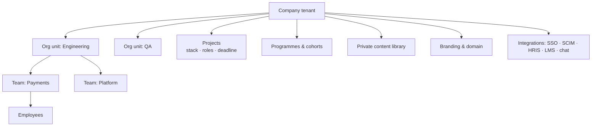
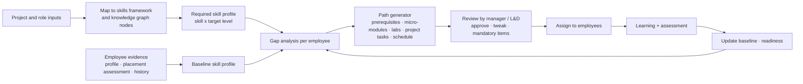
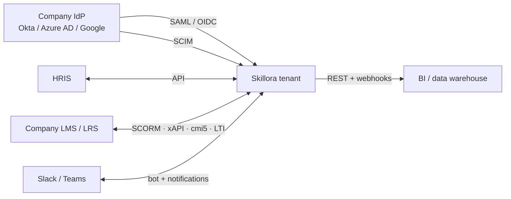

# Skillora Learning — Enterprise Upskilling Specification

## 1. PURPOSE & SCOPE

Let a company (tech firm, IT-services unit, GCC, startup, training partner or college) enrol its people in **short, personalised, project/role-based upskilling** with measurable readiness, using the same engines as the consumer product (knowledge graph, adaptive routes, mastery, labs, credentials, AI assessment) inside an **isolated, branded enterprise tenant**.

Strategy and market context: *Skillora_Learning_Competitive_Landscape_and_Enterprise_Strategy.md*.

**Boundary with Skillora Screen:** Skillora Screen (recruiter first-round screening) is a **separate product** with fully separated data, infrastructure and identity (`02_Skillora_Screen/`). Corporate upskilling data **must never** be used for hiring or screening decisions, and Screen data never flows into this product. Any shared ideas (e.g. skills framework concepts) are reused as design patterns or vendored libraries, not as shared data or services. See `Skillora_Portfolio_and_Product_Boundaries.md`.

Non-goals (initially): replacing a company's whole LMS; generic soft-skills/leadership libraries; open instructor marketplace.

## 2. ACTORS & ROLES

| Role | Capabilities |
|---|---|
| **Employee (learner)** | Takes assigned and self-selected paths; keeps a private career space |
| **Team lead / engineering manager** | Defines project skill needs; sees team readiness; assigns paths; approves time off for learning |
| **L&D / Talent admin** | Manages programmes, cohorts, budgets, reports, branding, integrations |
| **Company content author / SME** | Authors private courses, labs, assessments for the company |
| **Tenant admin (IT)** | SSO, SCIM, security settings, data residency/retention, API keys |
| **Finance / Procurement contact** | Contracts, POs, invoices, usage |
| **Skillora customer-success / solutions team** | Pilot setup, custom path building, health monitoring (consent-based access only) |

All roles are RBAC data in the Admin Portal (scoped to tenant, org unit, team).

## 3. ENTERPRISE TENANT MODEL



- Tenant isolation by row-level security and per-tenant encryption keys option; optional dedicated database for large customers (SaaS spec §2).
- **Org hierarchy** (units/teams) with manager relationships (from SCIM/HRIS or CSV import).
- **Seat model:** licensed seats, active-learner billing, or per-path pricing; seat assignment/reclaim; guest/contractor seats.
- **White-label:** logo, colour tokens, custom domain, sender email, hidden Skillora branding (higher tier).
- **Content visibility:** tenant sees (a) Skillora catalogue entitled to them, (b) its own private content, (c) optionally partner content; private content is never visible to other tenants.

## 4. PROJECT-TO-PATH ENGINE (CORE DIFFERENTIATOR)

### 4.1 Inputs

| Input | Examples |
|---|---|
| **Project profile** | Name, client/domain, tech stack (FastAPI, PostgreSQL, AWS EKS, Terraform…), architecture notes, coding standards, start date, ramp-up deadline |
| **Role profile** | Backend engineer L2, SDET, SRE, data engineer; target proficiency per skill |
| **Employee profile** | Experience (years, past projects/technologies), current role, confirmed skills, prior Skillora evidence, optional HRIS data |
| **Constraints** | Weekly learning hours, language, schedule/cohort dates, mandatory modules |

### 4.2 Pipeline



### 4.3 Rules

- **Skills framework:** a tenant-visible mapping between company terms (job levels, competency names) and Skillora's knowledge-graph topics; admin-editable, import from CSV/standard frameworks; supports proficiency scales (e.g. Aware / Working / Proficient / Expert) mapped to mastery stages.
- **Micro-path principle:** modules sized for work reality (15–45 min units), "just enough, just in time"; each path states total hours and expected completion date.
- **Experience-aware:** skip/compress what the employee already proves via assessment (adaptive placement), deepen where they're weak; seniors get design/trade-off content (Level L3/L4 visuals), juniors get foundations (L1/L2).
- **Project-specific tasks:** labs and capstone tasks can use the company's own patterns (private starter repos/templates, sanitised code, standards docs) — reviewed before publish.
- **AI-assisted creation with human review:** the engine drafts new micro-modules where gaps exist; SMEs (Skillora and/or company) review before release (Admin lifecycle: draft → review → publish).
- **Readiness score:** per employee, per skill, per project; thresholds define "project-ready"; transparent calculation; recalculated from assessments, labs, recency (retention checks).
- **Explainability:** every recommended module shows *why* ("needed for FastAPI dependency injection; your baseline: Working; target: Proficient").

### 4.4 Outputs

- Personalised path per employee; team plan; calendar/cohort schedule; readiness dashboards; credentials; exportable reports.

## 5. LEARNING & CONTENT FOR ENTERPRISES

| Capability | Description |
|---|---|
| **Private courses** | Company-authored or co-created courses in tenant-scoped Admin Content Studio; own branding; version/draft/review/publish; visibility by org unit/team |
| **Company standards & compliance modules** | Secure coding policy, data handling, onboarding to internal tools, mandatory annual training with deadlines, reminders and attestations |
| **Hands-on labs** | Python/SQL (PostgreSQL & MySQL) IDE and sandbox; later more runtimes and framework tasks; optional customer-provided datasets/templates under isolation |
| **Assessments** | Placement, module, project readiness, and **proctored/strict** certifications (webcam proctoring only if legally and ethically justified; prefer strict-mode + similarity checks; consent required) |
| **Mock/internal interviews** | Internal mobility and promotion prep (opt-in, private by default) |
| **Credentials** | Company-branded certificates/badges aligned to internal levels; verification pages; revocation rules; optional skills passport feeding HRIS |
| **Cohorts & schedules** | Programmes with start/end, live sessions, mentors, deadlines (SaaS spec §7), calendar sync (Google/Outlook), reminders (email, Slack/Teams, WhatsApp where appropriate) |
| **Microlearning in the flow of work** | Slack/Teams bot: "Your project needs async/await — 10-min lesson + quiz"; nudges respecting working hours; Copilot-style agent integration later |
| **Languages** | English first; Hinglish/Indic support per India spec |

## 6. PRIVACY MODEL — WHAT THE EMPLOYER SEES (CRITICAL FOR TRUST)

Employees will not engage honestly if they fear surveillance. Separate **work learning data** from **personal career data**.

| Data | Employer/L&D | Manager | Employee |
|---|---|---|---|
| Assigned path progress, completion, deadlines | ✔ | ✔ (own team) | ✔ |
| Assessment scores for assigned/work-related assessments | ✔ aggregated or individual per contract | ✔ team | ✔ |
| Skill readiness vs project | ✔ | ✔ | ✔ |
| Credentials earned in company programmes | ✔ | ✔ | ✔ (portable) |
| Time spent / logins | Aggregated by default; individual only if contract + disclosure | Limited | ✔ |
| **Personal career space**: resume drafts, personal mock interviews, off-programme learning, AI-tutor chats, notes | ✘ | ✘ | ✔ **private** |
| Voice recordings/transcripts of practice | ✘ (unless employee shares) | ✘ | ✔ short retention |
| Performance-review use of learning data | Must be explicitly disclosed by company; Skillora provides no "ranking/firing" analytics by default | — | Notice shown |

Rules:
- Clear **employee notice** in-app of what is visible to whom; consent per DPDP where applicable; Skillora acts as **data processor** for the company (data fiduciary) with a Data Processing Agreement; company configures retention within allowed bounds.
- **Portability:** when an employee leaves, company-programme credentials stay verifiable; personal career data stays with the employee's personal account (account linking/detaching flow); company-owned content/data is retained or deleted per contract.
- Learners must be 18 or older (Audience and Eligibility Policy); under-18 interns or apprentices are not enrolled.
- No dark-pattern gamification pressure; leaderboards are opt-in and team-level.

## 7. DASHBOARDS & REPORTING

| Audience | Views |
|---|---|
| **Team lead** | Team readiness heatmap (people × skills), project risk ("3 of 8 engineers below target in Kubernetes"), who is behind, suggested actions |
| **L&D / HR** | Programme enrolment, completion, assessed skill gain (pre/post), credentials issued, budget/usage, by org unit/cohort/project |
| **Executive** | ROI view: time-to-productivity for new projects, skill coverage vs plan, certification coverage, cost per skilled engineer — computed from verified data, with methodology notes |
| **Admin/IT** | Seats, SSO/SCIM status, API usage, audit log, security events |

Features: filters, saved views, scheduled email reports, CSV/PDF/API export, drill-down with privacy rules, skills-gap forecasting (what the roster can staff), comparison against benchmarks (anonymised across tenants only with consent and minimum cohort sizes).

## 8. INTEGRATIONS (STAGED)

| Integration | Standard / method | Phase |
|---|---|---|
| **SSO** | SAML 2.0 and OIDC; just-in-time provisioning; enforced SSO per tenant | E1 (via broker) / E2 |
| **User provisioning** | SCIM 2.0 (create/update/deactivate, groups → teams); CSV fallback | E2 |
| **HRIS** | Workday, SAP SuccessFactors, BambooHR, Darwinbox/Keka (India), Zoho People (via connectors/APIs) for org, role, manager sync; push credentials/skills back | E3 |
| **LMS/LXP interop** | **SCORM 1.2/2004 export/launch, xAPI statements to the company's LRS, cmi5, LTI 1.3** so Skillora can sit inside an existing LMS or report into it | E3 |
| **Collaboration** | Slack/Microsoft Teams bot and notifications; calendar (Google/Outlook) | E3 |
| **Developer tooling** | Optional GitHub/GitLab links for project labs (read-only, scoped) | E3+ |
| **Public REST API + webhooks** | Documented, versioned, rate-limited; events: `enrolment.created`, `path.assigned`, `assessment.passed`, `credential.issued`, `readiness.changed` | E2 |
| **Low-code connectors** | Zapier/Make/n8n | E3 |
| **Billing/finance** | PO/invoice flows, GST, e-invoicing where applicable; usage exports | E2 |
| **Identity of credentials** | Open Badges 3.0 / Verifiable Credentials export | E3 |

Standards references: [SCORM, xAPI and LTI explained](https://elearningindustry.com/scorm-xapi-and-lti-what-every-lms-buyer-needs-to-know); [enterprise LMS technical checklist](https://blog.braincert.com/the-enterprise-lms-technical-specifications-checklist-12-specs-buyers-actually-need-to-verify/).



## 9. SECURITY, COMPLIANCE & ASSURANCE (ENTERPRISE-GRADE)

- Tenant isolation tests in CI; optional per-tenant encryption keys; data residency in India; backup/DR per contract.
- SSO enforcement, MFA policies, session controls, IP allow-lists, audit log export, API key scopes and rotation.
- **DPDP:** Skillora as processor; DPA template; sub-processor list; breach notification timelines; deletion/return on contract end.
- **Assurance roadmap:** independent VAPT (before first pilot), security questionnaire pack (SIG/CAIQ-style), **ISO/IEC 27001 and/or SOC 2** when the pipeline justifies it; uptime and support SLAs in contracts.
- **Sandbox & content safety:** customer code/datasets run in isolated sandboxes with no cross-tenant access; uploaded customer content scanned; no customer data used for model training; AI provider terms flow down to customers.
- **IP and confidentiality:** contract clauses on company-authored content ownership, AI-assisted derivatives, confidentiality of project details; project inputs treated as confidential tenant data.

## 10. COMMERCE FOR ENTERPRISES (USES SaaS SPEC)

- **Plans:** Pilot, Team, Business, Enterprise; entitlements such as `enterprise.project_path`, `enterprise.private_content`, `enterprise.sso`, `enterprise.scim`, `enterprise.api`, `enterprise.lms_interop`, `enterprise.reports`, seat limits, usage quotas (AI interviews, voice, assessments).
- **Contracting:** annual contracts, POs, invoicing with GSTIN/SAC, multi-year discounts, true-ups for seat overages, renewal reminders; trials/pilots with success criteria and conversion path.
- **Metering:** active learners, seats, paths generated, assessments, AI usage per tenant with budget alerts.
- **Admin:** Tenants & Seats, Launch/pilot policy, contract terms (Admin spec §23).

## 11. ADMIN PORTAL ADDITIONS

- **Enterprise tenant console:** create tenant, set plan/entitlements, branding, domain, SSO/SCIM config, data-retention, seat limits, contract metadata, health score.
- **Project & skills-framework manager:** projects, role profiles, competency mapping, proficiency scales, imports.
- **Path builder & approvals:** template paths, auto-generated paths, review queue, bulk assign, schedule.
- **Private content studio** scoped to tenant, with company reviewers and Skillora SME review option.
- **Reports builder** and scheduled exports; benchmark settings (consent, k-anonymity).
- **Customer-success tools:** pilot tracker, success metrics, usage and engagement alerts, consent-based support impersonation, QBR report generator.
- **Compliance:** DPAs, sub-processor register, audit exports, employee-notice templates.

## 12. LEARNER EXPERIENCE (EMPLOYEE)

- **Web and mobile:** "My Company Path" with weekly plan, time estimates, deadlines, project context ("why this matters for Project X"), readiness ring; separate **"My Career"** space (private) with resume, personal practice and public skills.
- Employer-aware but not intrusive: reminders respect working hours/time zones; manager nudges are visible to the employee; "request time/extension" flow.
- Low-friction access: SSO login, deep links from Slack/Teams, mobile for commute-time microlearning, offline packs.
- Visuals follow the Visual Learning System levels based on the employee's baseline.

## 13. DATA MODEL ADDITIONS

```text
EnterpriseTenant (extends Tenant), OrgUnit, Team, Membership(role, manager_id)
Project (tenant, name, stack_json, deadline, status), RoleProfile, SkillsFramework, CompetencyMap, ProficiencyScale
RequiredSkill (project|role -> skill_node, target_level), BaselineSkill (user -> skill_node, level, evidence_refs)
PathTemplate, GeneratedPath (user, project, status, approved_by), PathItem (module|lab|assessment, due_date, rationale)
Programme, CohortRun (reused), Assignment, ExtensionRequest
ReadinessSnapshot (user, project, score, details, at)
PrivateContentSpace (tenant), ContentVisibilityRule (unit/team)
ReportDefinition, ScheduledReport, BenchmarkConsent
SSOConfig, SCIMToken, HRISConnection, LMSInteropConfig, WebhookEndpoint, ApiKey(scope)
DPA, SubProcessorNotice, EmployeeNoticeVersion, PrivacyVisibilityPolicy (per data class)
ContractTerm (seats, price book, PO, renewal), UsageSummary
```

All with `tenant_id`; privacy visibility enforced centrally in the data-access layer (policy engine), not per screen.

## 14. PHASING

| Phase | Deliverables |
|---|---|
| **E1 Pilot-ready** | Enterprise tenant creation by Skillora admins; CSV roster import; org units/teams; private courses; assigned paths (manually built from templates); basic team dashboard; company-branded certificates; SSO via OIDC/SAML broker; employee privacy notice; DPA template |
| **E2 Enterprise essentials** | Project-to-Path wizard and skills-framework mapping; readiness scores; manager/L&D dashboards; cohorts/assignments/deadlines; SCIM; REST API + webhooks; reports and scheduled exports; GST/PO invoicing; SLAs |
| **E3 Integrations & assurance** | HRIS connectors; LMS interop (SCORM/xAPI/cmi5/LTI); Slack/Teams bot and calendar sync; benchmark analytics; Open Badges export; ISO 27001/SOC 2 |
| **E4 Ecosystem** | Curated partner content, reseller/SI portal, external-catalogue launch/tracking, marketplace-lite |

## 15. SUCCESS METRICS

- Pilot: ≥ target % of assigned learners start within a week; completion of assigned path; **pre/post assessed skill gain**; project-readiness lift; manager-reported time-to-productivity; employee satisfaction/NPS; zero privacy incidents.
- Business: pilot→paid conversion, seats per customer, expansion, gross margin per tenant (AI + sandbox cost), support load per tenant, renewal rate.
- Product: path-generation accuracy (SME acceptance rate of AI drafts/paths), readiness-score predictive validity (does readiness correlate with project outcomes).

## 16. DEFINITION OF DONE (ENTERPRISE FEATURE)

- [ ] tenant-isolated and covered by isolation tests; works under enterprise RBAC and org scopes;
- [ ] privacy visibility policy enforced centrally and documented in the employee notice;
- [ ] configurable in the Admin Portal (no code change); audited;
- [ ] entitlement- and quota-aware; metered per tenant;
- [ ] works on web and mobile; SSO login path verified;
- [ ] reports exportable and consistent with dashboards; methodology documented;
- [ ] integration contracts (SSO/SCIM/API/webhooks) documented and tested;
- [ ] security review done; DPA/sub-processor documentation updated;
- [ ] pilot success metrics instrumented;
- [ ] AI-generated paths/content reviewed before publication; explanation shown to learners.
