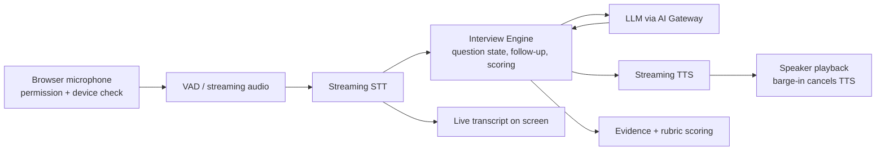
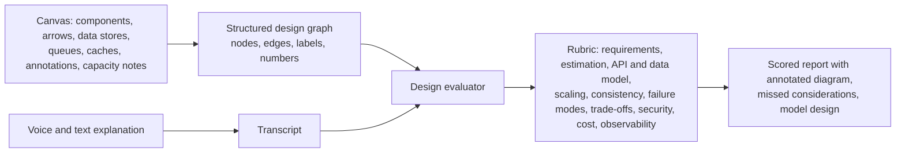

# Release 1.0 — Web-Only, Interview-Ready for Senior Python Backend / AI Engineer

## 1. DECISIONS (CONFIRMED)

| # | Decision |
|---|---|
| 1 | **1.0 is web only:** Learner Portal + Admin Portal. No native Android/iOS apps in 1.0 (the web app stays responsive/PWA-capable, so it works in a phone browser) |
| 2 | **Curriculum is purpose-built** for the founder's target roles: **Senior Python Backend Developer** and **AI Engineer** |
| 3 | **Interview Master ships in 1.0 with text AND voice mode on web**, as two modes of one session (Master Spec §19–20) |
| 4 | **Also in 1.0 (confirmed):** advanced system-design canvas with auto-evaluation; last-minute mode; company-pack library; full adaptive interview engine; placement test covers **DSA and system design** (see §4A) |
| 5 | **Everything else moves to 1.1** (see §6) |
| 6 | Goal test: the founder can complete the tracks and be able to clear interviews for comparable roles |
| 7 | **Billing Lite is in 1.0** (confirmed 2026-10-22): hosted checkout for time-boxed passes (Sprint 30 days, Pro 90, Pro Annual) and voice credit packs, GST-inclusive invoices, coupons, admin refunds, reconciliation. No recurring billing, monthly subscriptions, mobile billing or organisation billing |
| 8 | **Every new learner gets a 7-day free trial, extendable by 7 days (14 in total) on activation** (confirmed 2026-10-22): full features at capped quotas, no card, abuse-controlled, separate trial AI budget pool, gated public launch by weekly seats; learners then drop to the Free tier. Plans, prices, quotas, limits and acceptance criteria: `Skillora_Learning_Release_1_0_Billing_Lite_and_Trial_Specification.md` (authoritative) |
| 9 | **Public Profile Lite is in 1.0** (confirmed 2026-10-22): opt-in public profile at `/u/{handle}` with verified skill badges and certificates, per-credential verification pages, share images and embeddable badges; free on every plan; privacy-first (noindex by default, section switches, DPDP consent); no leaderboards, recruiter search or data feed to Skillora Screen. Authoritative: `Skillora_Learning_Release_1_0_Public_Profile_Lite_Specification.md` |
| 10 | **Adults only (18+) with Higher Secondary or equivalent completed; Diploma (after 10th) holders and students are eligible; 18+ is mandatory for everyone** (confirmed 2026-10-22): no accounts for minors, no guardian-consent flows; audience is tech and CS-related students (final-year most commonly), tech professionals (junior, mid, senior) and any adult upskilling for tech roles; no marketing aimed at under-18s; campus programmes only for 18+ students. Authoritative: `Skillora_Learning_Release_1_0_Audience_and_Eligibility_Policy.md` |

## 2. FOUNDER PROFILE → GAP-DRIVEN DESIGN

Source: resume in `04_Personal_Resources/`. Summary: ~11+ years in software, ~4 years in Python backend; FastAPI, Django, Flask, REST, PostgreSQL/MySQL, SQLAlchemy, Alembic, Pydantic, Redis, Docker, Git, Bitbucket Pipelines, AWS Lambda/S3, JWT, MQTT, Pytest, AsyncIO, background jobs; Anthropic Claude and OpenAI APIs, AI chatbots, voice agents, prompt engineering; prior PHP/Laravel career; IoT, aviation, sports, SaaS domains; MCA; GenAI prompt-engineering workshop; data-analytics internship.

**What interviewers for senior Python/AI roles typically probe beyond a resume like this** (hypotheses to validate with the placement test, not claims about the founder's ability):

| Area | Why it matters in interviews |
|---|---|
| **DSA and problem solving** | Most product-company loops include 1–2 DSA rounds even for senior backend roles; recently-Python depth (4 yrs) vs. 11 yrs total invites "prove it" questions |
| **Python internals and concurrency** | GIL, memory model, generators/iterators, descriptors, metaclasses, asyncio event loop, threads vs processes, profiling |
| **System design at scale** | Senior bar: design, capacity, trade-offs, failure modes, consistency, caching, queues |
| **Database depth** | Indexes, query plans, isolation levels, locking, partitioning, replication, migrations at scale (PostgreSQL and MySQL) |
| **Distributed systems and cloud** | Messaging, idempotency, retries, sagas, observability, Kubernetes basics, AWS beyond Lambda/S3 |
| **API design and security** | Versioning, pagination, rate limiting, authN/authZ (OAuth2/OIDC beyond JWT basics), OWASP |
| **Testing and engineering practice** | Test strategy, contract testing, CI/CD, code review, clean architecture |
| **LLM application engineering** | RAG, embeddings, vector search, tool use/agents, evaluation, guardrails, cost/latency, structured outputs, observability |
| **ML fundamentals (AI Engineer loops)** | Model evaluation, overfitting, embeddings, transformers at an interview level, fine-tuning vs RAG, MLOps basics |
| **Voice/real-time AI** | STT/TTS pipelines, streaming, latency budgets, barge-in (a strength to showcase, from SPIN voice agent work) |
| **Leadership and behavioural (senior)** | Ownership, mentoring, conflict, ambiguity, project deep-dives, career narrative, 'why switch' (11+ yrs, domain changes) |
| **Resume-claim defence** | Deep dives on listed projects (Aero Lounge, SPIN, NextPro, Routes-Pro) — each claim should survive 5 levels of "why" |

## 3. RELEASE 1.0 TRACKS (CURRICULUM)

Each module follows the platform lesson template (visual-first, level switch Simpler/Deeper, mastery check, practice, badge). The placement test (**includes DSA and system design**, with voice/diagram components for design) lets the founder **skip mastered content** and focus on gaps (route map is personalised).

### Track A — Senior Python Backend Mastery

| # | Course | Highlights |
|---|---|---|
| A1 | **Python Internals for Interviews** | Data model, memory/refcounting/GC, GIL, iterators/generators, decorators, descriptors, metaclasses, typing, packaging, profiling |
| A2 | **Concurrency and Async** | Threads vs processes vs asyncio, event loop, backpressure, task groups, pitfalls, FastAPI async patterns, Celery/RQ-style background jobs |
| A3 | **DSA and Problem Solving in Python** | Patterns-first (arrays/hashing, two pointers, sliding window, stacks/heaps, trees/graphs, DP, binary search), complexity, timed practice in the IDE |
| A4 | **Databases: PostgreSQL and MySQL for Senior Engineers** | Indexing, query plans, transactions/isolation, locking, partitioning, replication, migrations, ORM pitfalls (SQLAlchemy/Django ORM), SQL practice in the IDE (both dialects) |
| A5 | **API and Backend Architecture** | REST design, versioning, pagination, idempotency, rate limiting, caching (Redis), auth (OAuth2/OIDC/JWT), clean/hexagonal architecture, FastAPI vs Django vs Flask trade-offs |
| A6 | **System Design for Backend Engineers** | Framework, estimation, scaling reads/writes, queues/streams, consistency, failure modes, 15+ classic designs with diagrams; includes designing LLM/voice systems |
| A7 | **Cloud, DevOps and Observability** | Docker, Kubernetes basics, AWS core services (Lambda, S3, SQS/SNS, RDS, API Gateway, IAM, CloudWatch), CI/CD, logging/metrics/tracing, SLOs |
| A8 | **Testing, Quality and Security** | Pytest strategy, mocking, contract tests, test pyramid, code review, OWASP, secrets, threat modelling basics |

### Track B — AI Engineer Mastery

| # | Course | Highlights |
|---|---|---|
| B1 | **ML and Data Foundations for Interviews** | Core ML concepts, evaluation metrics, bias/variance, embeddings, transformers (interview depth), NumPy/Pandas fluency |
| B2 | **LLM Application Engineering** | Prompting patterns, structured outputs, tool use/function calling, context management, cost/latency optimisation, caching, guardrails, provider abstraction (Anthropic/OpenAI/others) |
| B3 | **RAG and Vector Search** | Chunking, embeddings, hybrid retrieval, reranking, vector DBs (pgvector and others), evaluation, failure analysis |
| B4 | **Agents and Workflows** | Agent loops, planning, tool design, memory, orchestration, reliability, human-in-the-loop, evaluation |
| B5 | **LLM Evaluation, Safety and LLMOps** | Eval harnesses, regression sets, LLM-as-judge pitfalls, red-teaming, PII/prompt-injection defence, monitoring, versioning, rollout |
| B6 | **Real-time and Voice AI Systems** | STT/TTS pipelines, streaming, latency budgets, barge-in, WebRTC/WebSocket basics, telephony/web voice agents |
| B7 | **Fine-tuning, Model Selection and MLOps Basics** | When to fine-tune vs RAG, LoRA/PEFT concepts, serving, batching, quantisation basics, model/cost trade-offs |

### Track C — Interview Craft (Senior)

| # | Course | Highlights |
|---|---|---|
| C1 | **Behavioural and Leadership Interviews** | STAR/CAR, senior competencies, conflict, ownership, mentoring, failure stories, India HR rounds (notice period, expectations, relocation) |
| C2 | **Project Deep-Dive and Resume Defence** | Turn your real projects into 5-level-deep narratives, trade-off defence, metrics, "what would you change?" |
| C3 | **Coding Interview Execution** | Clarify → plan → code → test → complexity, think-aloud practice, time management, common traps in Python |
| C4 | **Offer and Career Positioning** | Role targeting, salary/negotiation framing in India, 11-years-experience narrative, domain-switch storytelling |

**Final curriculum facts (as of 2026-10-05, from the 19 syllabi and the boss matrix; the tables above are the original intent, these are the binding numbers):** 19 courses and **192 modules** (Track A 84, Track B 70, Track C 38; C4 M2 and M3 merged). Study effort: full **Deeper path about 294 h** (247.5 h module time plus 47 h assessments, voice mocks and capstones; budget 300 h), Simpler fallback about 413 h. **Goal routes** (course tags MUST/SHOULD/NICE with multipliers 1.0/0.6/0.25): Senior Python Backend about **210 h**, AI Engineer about **215 h**, Python+AI hybrid about **250 h** (the reference learner is expected near 215 h after skip-ahead). Question bank target 33 per module (**6,336** in total); placement diagnostics (5 to 8 per module) are drawn from the existing MCQ/predict items. Sandbox pins: Python 3.14 default, PostgreSQL 18, MySQL 8.4 LTS. Platform needs derived from the curriculum are consolidated in `../05_Integration/Platform_Capability_Requirements.md`, the placement design in `../05_Integration/Placement_Test_Blueprint.md`, and the import/volume model in `../05_Integration/Content_Data_Model_and_Import_Schema.md`.

Authoring plan: the founder is both the first learner and a domain expert; content lead and SMEs author and review (draft → review → publish). Tracks A and B follow the founder's weakest-first order after the placement test; Track C runs in parallel.

## 4. INTERVIEW MASTER IN 1.0 (TEXT + VOICE, WEB)

Goal: **seamless**, realistic, repeatable practice for any senior Python / AI interview.

### 4.1 Interview types supported in 1.0

| Type | Notes |
|---|---|
| **Role-based mock interviews** | Senior Python Backend, AI Engineer, Python + AI hybrid; configurable level and duration |
| **JD-driven interviews** | Paste a JD → analyser extracts skills, level, probable question areas → tailored mock (also guides which courses to take) |
| **Technical depth rounds** | Python internals, concurrency, databases, API/backend, cloud, LLM/RAG/agents |
| **Coding rounds** | Browser IDE (Python + SQL PostgreSQL and MySQL), hidden tests, think-aloud mode, complexity discussion |
| **System-design rounds** | Voice + text discussion with the **advanced diagram canvas and auto-evaluation** (§4A.1) |
| **Project deep-dive** | Questions generated from the learner's profile/projects (resume claims confirmed by the learner) |
| **Behavioural / HR (India and global)** | STAR scoring, senior-leadership competencies, notice-period and expectation questions |
| **Company-style practice** | Company-pack library (§4A.3) |
| **Last-minute mode** | Time-boxed cram mode (§4A.2) |
| **Quick drills** | 10-minute topic drills (e.g. "asyncio", "indexes", "RAG") in voice or text |

### 4.2 Voice mode requirements (web, 1.0)

| Requirement | Detail |
|---|---|
| **Seamless turn-taking** | Voice activity detection, natural pauses, **barge-in** (interrupt the interviewer), "repeat/slow down/rephrase" commands |
| **Latency budget** | Target time from end of speech to start of interviewer audio ≤ about 1.5 s typical (p50) and ≤ about 3 s (p95); streaming STT and TTS; show "thinking" state; text fallback if budget is breached |
| **Hybrid session** | Voice ↔ text ↔ code ↔ diagram within one interview (Master Spec §20); voice answer can be followed by typed code |
| **Transcript** | Live transcript, editable after the session; word-level timestamps; downloadable |
| **Replay** | Play back the learner's answers and the interviewer's questions, with transcript sync |
| **Pre-flight** | Mic/speaker test, noise check, browser compatibility check, headphone suggestion, permission recovery guidance |
| **Reliability** | Auto-reconnect, session resume at the last question, graceful degradation to text, autosave of progress |
| **Voice choices** | Configurable interviewer voice, speed, English accents appropriate for India and global; strict interview mode (no hints) vs coaching mode |
| **Indian-English tolerance** | STT vocabulary/accent evaluation set including Indian English and technical terms (e.g. FastAPI, asyncio, Kubernetes, pgvector); custom vocabulary/hotwords |
| **Provider abstraction** | STT/TTS/LLM behind the AI Gateway so providers can be swapped, measured and costed; no hard coupling |
| **Privacy and consent** | Explicit microphone and recording consent; audio retained only as the learner chooses (default short retention, then transcript only); deletion on request; no voice biometrics; no emotion/personality inference |
| **Cost control** | Per-session budgets, quotas through the AI Gateway (trial and paid quotas per the Billing Lite specification; separate trial and paid budget pools), admin-visible cost per minute |

### 4.3 Evaluation and feedback (voice and text)

- Rubric-based scoring per competency with evidence quotes from the transcript; strict PASS/reveal logic per Master Spec; calibrated against SME-labelled sample answers.
- **Speech-delivery coaching (non-judgemental, optional):** pace, filler words, answer length/structure (e.g. "you took 4 minutes before stating the approach"), clarity of explanation. **No emotion, personality or "confidence" inference.**
- Final report: competency radar, strengths, gaps, model answers, follow-up study plan linked to courses/modules, resume-claim risk (from the founder's confirmed project list).
- Progress over time: readiness trend per role target, repeat-weak-topic drills.

### 4.4 Question bank and knowledge base for the interview engine

- Admin-managed, purpose-tagged **practice** banks (never hiring banks), difficulty-calibrated, with tags per role/track/competency/company-archetype.
- **Senior depth:** follow-up trees ("why not X?", "what if 10× load?", "how would you test it?") are first-class.
- Initial bank size targets (to be revised after pilot): enough breadth to avoid repetition across multiple mock cycles for each course in Tracks A–C; continuously extended from the Admin Portal. **Concrete 1.0 target: 33 items per module x 192 modules = 6,336 practice-bank questions** (2,880 usable in mock interviews as verbal, scenario and coding items); breakdown in `../05_Integration/Content_Data_Model_and_Import_Schema.md` section 11.

## 4A. ADDED TO 1.0 (CONFIRMED)

### 4A.1 Advanced system-design canvas with auto-evaluation

| Capability | Detail |
|---|---|
| **Rich canvas** | Component palette (clients, LB, API gateway, services, DBs, caches, queues/streams, object store, CDN, LLM/vector store, STT/TTS), connectors with protocols/labels, grouping (regions/AZs), notes, back-of-envelope calculator, undo/versioning, templates, keyboard-first, accessible alternative (text/structured mode) |
| **Diagram → structured graph** | Canvas always serialises to a typed graph so evaluation does not depend on image recognition |
| **Auto-evaluation** | Rule checks (single points of failure, missing cache/queue where load implies, unbounded fan-out, no idempotency on retries, no auth path, no observability) + LLM rubric scoring using the graph and the spoken/typed reasoning; **evidence-linked** to canvas elements and transcript |
| **Interactive probing** | Interviewer asks about the learner's own diagram ("what if this DB fails?", "10x traffic?"), using the graph as context; learner edits live; deltas are scored |
| **Design library** | 25+ classic designs and AI-system designs (RAG service, LLM gateway, voice agent platform, real-time chat, notification system, rate limiter, payment/booking, IoT ingestion) with model solutions in the Admin Portal |
| **Compare to model** | Overlay of learner design vs reference, with explanation (not a pass/fail on one "right" shape) |
| **Admin** | Component palette, rubrics, rule checks, model designs and probing trees are admin-managed |

### 4A.2 Last-minute mode

For "interview tomorrow" preparation. Learner enters the interview date/time, target role/company pack and available hours; the engine builds a **time-boxed plan** from mastery data: highest-yield topics first, 10-minute voice drills, cheat-sheet style visual recaps, rapid-fire Q&A, "most-asked" lists per role/company archetype, a final checklist (project stories, questions to ask, logistics), and a pre-interview warm-up mock. It never claims guaranteed outcomes and states which gaps remain.

### 4A.3 Company-pack library

| Aspect | Design |
|---|---|
| **Packs** | Curated packs for **major MNCs that hire for Senior Python / backend / AI Engineer roles** and for the **Big 4 firms (Deloitte, PwC, EY, KPMG) — interpreted as the Big 4 consulting/advisory firms; confirm if you meant big-tech** — and further companies added by Admin |
| **Target company list (founder-confirmed scope)** | See "Company-pack target list" below. Admin can add companies without code changes |
| **Contents** | Typical interview structure/rounds, publicly known engineering stack and culture, competency emphasis, role-specific topic weights, practice question sets in the company's *style*, behavioural/values themes, HR-round norms (India), project/case style (for consulting-tech loops: technology consulting, delivery and client-facing scenarios), suggested course path |
| **Source rules** | Built from **public information, job descriptions, published engineering blogs and official interview guides, and SME expertise**. **No confidential or leaked interview questions, no claims that questions are real or recent**, no use of NDA-protected material; each pack carries a "last reviewed" date and a disclaimer; legal review of the packs process |
| **Mock mode** | "Interview as <company> style" configures rounds, rubric weights, interviewer persona and time limits |
| **Maintenance** | Admin-managed with versioning, review cadence, and retirement; community reports of changes are optional later |
| **Neutrality** | Packs describe styles, not hiring promises; names used descriptively under nominative fair use; brand-owner takedown process documented |

**Company-pack target list (initial; priority order is a suggestion, validate by the founder's target employers)**

| Cluster | Companies (named as targets; interview style is described generally, never as insider knowledge) | Typical emphasis the pack models |
|---|---|---|
| **Indian IT services majors** | TCS, Infosys, Cognizant (CTS), Wipro, HCLTech, Tech Mahindra, LTIMindtree | Fundamentals, Python/SQL depth, project explanation, delivery and client-facing scenarios, HR/notice-period/relocation rounds, onsite-offshore models |
| **Global IT services and consulting-tech** | Accenture, Capgemini, Genpact, Ericsson, IBM, DXC, NTT Data, EPAM, Thoughtworks | Role-based technical screens, solution/architecture discussion, cloud and AI delivery, client case-style questions, behavioural/values |
| **Big 4 consulting and advisory (tech roles)** | Deloitte, PwC, EY, KPMG | Technology consulting and engineering delivery, case-style and stakeholder scenarios, data/AI solution design, structured behavioural |
| **Global product companies with India engineering presence** | Google, Microsoft, Amazon, Adobe, Atlassian, Salesforce, Oracle, SAP, Cisco, HPE (Hewlett Packard Enterprise), Intuit, PayPal, Walmart Global Tech, Uber, Nvidia, Qualcomm | DSA and coding rounds, deep system design, ownership/leadership principles-style behavioural, depth on distributed systems and (for AI roles) ML/LLM systems |
| **AI-first and startup archetypes** | AI product startups and platform companies (generic archetype pack) | LLM application engineering, RAG/agents design, evals, pragmatic coding, take-home style and live build |

Build order: start with 2 packs per cluster (about 12 packs) for 1.0, expand in the Admin Portal during beta. Each pack: rounds structure, rubric weights, question sets in the company's *style*, behavioural themes, recommended course path, "last reviewed" date and the standard disclaimer. Company names appear descriptively; no endorsement or affiliation is implied.

### 4A.4 Full adaptive interview engine

| Capability | Detail |
|---|---|
| **Competency model** | Each question targets competencies with difficulty; the engine maintains a per-competency estimate (with uncertainty) during and across sessions |
| **Adaptive selection** | Chooses the next question to maximise information (harder if strong, scaffold/diagnose if weak), avoids repeats, respects time and coverage constraints (must-cover areas per role/company pack) |
| **Adaptive probing** | Follow-up trees and LLM-generated probes bounded by rubric; depth escalates until the learner's limit is found; strict mode vs coaching mode |
| **Cross-session memory** | Weak-topic spaced repetition feeds the next mock and the study plan |
| **Calibration** | SME-labelled answer sets and replays measure scorer agreement and drift; rubric/model versioning; human-review sampling of scored sessions |
| **Guardrails** | Cost/time budgets, graceful degradation to rule-based selection if AI is unavailable, fully explainable question choice ("asked because…") for admin and learner |

## 5. WEB LEARNER PORTAL AND ADMIN PORTAL IN 1.0

### 5.1 Learner Portal (web)

Accounts (email + Google; see §6 for OTP), profile and target-role setup, consent management; placement test (**covers Python, databases, LLM/AI, DSA and system design**) → personalised route map; course player with visuals and level switch; mastery checks and revision loop; browser coding IDE (Python + SQL PostgreSQL/MySQL, visible/hidden tests, Learn/Practice/Interview modes); assessments; **Interview Master (text + voice)**; AI tutor (quota-limited); progress dashboard and readiness view; badges, course certificates and a **public profile with shareable badges and embeds**; **pricing page, free-trial banner with activation checklist, usage meters, checkout, My Purchases and GST invoices**; settings, privacy, data export/deletion. Responsive and PWA-capable; works in modern browsers on laptop and phone browser.

### 5.2 Admin Portal (web)

RBAC + MFA + audit; content studio (draft → review → publish, versioning, preview-as-learner); course/track/module management and ordering; question bank and coding/SQL challenge builder; **interview configuration** (role templates, rubrics, prompts, voice settings, provider/budget settings); badge and certificate templates; feature flags; entitlements and plans (Launch — Free, Free, Trial, Sprint, Pro 90, Pro Annual) with price book, quota editor, trial settings and budget pools, coupons, orders, refunds and reconciliation, cost-per-learner and margin dashboard; learner list and basic analytics (including interview readiness and voice-session health); AI provider/prompt config; support tools.

## 6. WHAT MOVES TO 1.1 (AND LATER)

| Item | Release |
|---|---|
| **Resume Studio** (R1–R3) | 1.1 (decided earlier; hooks only in 1.0) |
| **Android app** (with offline packs, data-lite mode) and **iOS app** | 1.1 |
| **Mobile OTP login** (SMS/WhatsApp, TRAI DLT registration) | 1.1 (1.0 uses email + Google) |
| **LinkedIn "add to profile" polish, wallet passes, Interview-ready credential, Open Badges 3.0 export, résumé integration** | 1.1 (the public profile page, share images and embeddable badges are **in 1.0**) |
| **Additional tracks** (DevOps/Kubernetes deep, Data Engineering, Java/JS, DSA advanced packs) | 1.1+ |
| **Hindi/Indic UI**, Hinglish tutor depth beyond English | 1.1+ |
| **Recurring billing (UPI AutoPay, mandates), monthly subscriptions, offerings/bundles/cohorts, vouchers, referral credits, tax engine, multi-currency, mobile and store billing, organisation billing** | 1.1 (mobile billing with the apps) to 1.2+ (Billing Lite passes, credit packs, coupons, GST invoices, refunds and the free trial are **in 1.0**; see the Billing Lite specification) |
| **Community, referral, WhatsApp journeys, campus dashboards** | 1.2+ |
| **Enterprise upskilling, Skillora Screen** | Future scope (separate planning) |

1.0 keeps the **hidden hooks** for the above (entitlement flags, tenant-ready schema, profile data model, credential export fields), so 1.1 additions do not require rework. Billing Lite is **not** a hidden hook: it is built, tested in gateway test mode by M5 and enabled for the paid beta at M6 (section 7 and the Billing Lite specification).

## 7. UPDATED DELIVERY SEQUENCE (WEB-ONLY 1.0)

```mermaid
gantt
    title Release 1.0 (web only) - indicative relative months
    dateFormat  X
    axisFormat  M%s
    section Foundations
    ADRs, design system, repo/CI/CD/IaC                       :0, 2
    Auth (email+Google), profile, consent, entitlements, AI gateway :1, 3
    Admin shell, RBAC, audit, content studio MVP              :2, 4
    section Learning core
    Course engine, player, visuals, route map                 :3, 6
    Python+SQL IDE and sandbox (hardened)                     :3, 6
    Assessments, question bank, badges, certificates          :5, 8
    section Interview Master
    Text interview engine, scoring, JD analyser, reports      :5, 8
    Voice mode (STT/TTS streaming, barge-in, replay)          :7, 10
    Interview admin config, rubrics, calibration              :7, 10
    System-design canvas + auto-evaluation                    :6, 10
    Adaptive engine, last-minute mode, company packs          :7, 11
    section Content
    Track A and C authoring and review                        :2, 9
    Company packs content and legal review                    :7, 11
    Track B authoring and review                              :4, 10
    section Hardening and launch
    Web performance, accessibility, PWA                       :8, 10
    Billing Lite (checkout, invoices, trial controls)         :8, 11
    Load test, VAPT (incl. payment flow), DR drill, compliance review :9, 11
    Closed beta (founder first, then small invite cohort)     :10, 12
    Public launch 1.0 (gated, see section 9)                  :12, 13
    section Release 1.1
    Resume Studio, Android, iOS, OTP login                    :13, 17
```

Removing mobile apps and Resume Studio from 1.0 frees capacity for **voice quality** and **curriculum depth**, the two things the founder's goal depends on. The founder acts as **user zero**: use Interview Master from month ~7 onward to find real issues early.

## 8. SUCCESS CRITERIA FOR 1.0 (FOUNDER GOAL)

- [ ] Placement test correctly identifies gaps for the Senior Python / AI Engineer profile.
- [ ] Tracks A, B and C complete and reviewed by SMEs; every module has mastery check, practice and badge.
- [ ] Voice mock interview feels natural: p50 response latency within budget, barge-in works, no loss of session on reconnect, text fallback seamless.
- [ ] Founder completes N full mock cycles per role (voice + code + design + behavioural) with improving, calibrated readiness scores.
- [ ] Interview reports lead to specific, actionable study plans linked to modules.
- [ ] System-design canvas evaluations agree with SME scoring within an agreed tolerance on a labelled set of designs.
- [ ] Adaptive engine covers must-have competencies per role/company pack and avoids repeats across mock cycles; last-minute plans are generated from mastery data.
- [ ] Company packs reviewed for source compliance (no confidential questions) before publishing.
- [ ] Admin can update courses, question banks, rubrics and prompts without engineering help.
- [ ] Security, privacy (mic/audio consent), VAPT and DR criteria from the Engineering spec are met for the web scope.
- [ ] Billing Lite and the free trial meet the definition of done in the Billing Lite specification: quotas enforced server-side, trial abuse controls and budget pools tested, GST invoice and refund policy signed off, reconciliation clean for 14 days in the paid beta.
- [ ] Sign-up eligibility gate (18+ and Higher Secondary completed, signed statement, underage response runbook) meets EL-01 to EL-09.
- [ ] Public Profile Lite meets PP-01 to PP-12: opt-in consent, section switches respected on page, image, embed and JSON, verification links for every credential, moderation and takedown drill done.

## 9. DECISIONS ON PREVIOUSLY OPEN QUESTIONS

| # | Question | Decision |
|---|---|---|
| 1 | Voice/STT/TTS providers and budget per interview minute | **Run a provider bake-off** (several STT/TTS/LLM combinations) on Indian-English accuracy, technical-term accuracy, latency (p50/p95), barge-in behaviour and cost; choose a primary and a fallback behind the AI Gateway. **Set the per-minute budget after the bake-off** (guardrail: a configurable per-session and monthly cap in the Admin Portal from day one). Bake-off happens in the first voice spike (about month 4–5), before voice build-out |
| 2 | Company archetypes | **Indian and global IT services majors (Infosys, TCS, CTS, Ericsson, Accenture, Capgemini, Genpact and similar), the Big 4, and major product companies with India presence** — target list in §4A.3; packs built safely per the source rules |
| 3 | Placement test scope | **Includes DSA and system design in 1.0**, plus Python, databases, API/backend, cloud, LLM/AI basics and behavioural basics; adaptive and time-boxed (45-minute sittings, two to three sittings, resumable); bands skip/skim/study/deep-study per module generate the personalised route for the Backend, AI Engineer or Hybrid goal. Design: `../05_Integration/Placement_Test_Blueprint.md` (v1 MCQ-only at M2, v2 with performance tasks at M5) |
| 4 | Public vs invite-only launch | **Recommendation (best for now): staged.** Stage 1, founder as user zero (month ~7 on) and closed beta for a small invite-only cohort (about 20–50 learners from the founder's network/communities) to validate voice quality, scoring calibration and curriculum. Stage 2, public launch 1.0 only after gates pass: voice latency/accuracy targets met, scorer calibration agreement achieved, VAPT and consent reviews closed, support runbook ready, cost per interview minute within budget. Keeps marketing risk low while the web-only product proves itself |

## 10. OPEN ITEMS

1. Confirm "Big 4" means Deloitte, PwC, EY and KPMG (assumed), not big-tech.
2. Per-minute voice budget — to be set after the bake-off.
3. Confirm or trim the company-pack target list in §4A.3 (about 12 packs first, 2 per cluster).
