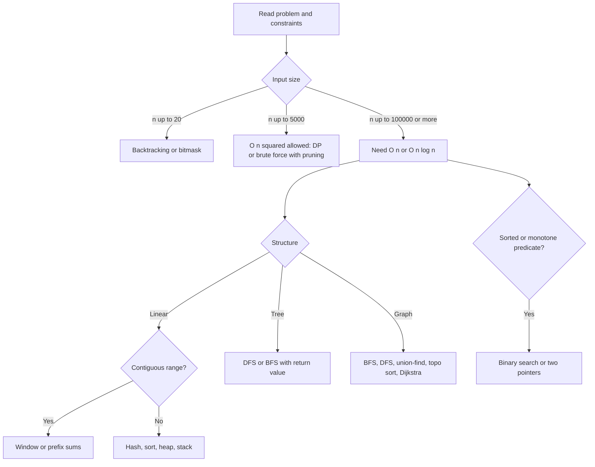

# A3 — DSA and Problem Solving in Python (Track A)

Version 2.0 (wave-2 upgrade, learner-fit) | drafted and upgraded 2026-10-05; facts as of October 2026 | authoring owner: SME agent A3 | reviewer: to be assigned

> **Route note.** A3 is a **continuous thread** (about 3 sessions per week) alongside the main sequence, not a blocking step. Goal tags: Senior Python Backend MUST, AI Engineer SHOULD (Core lessons only), Hybrid MUST (`B:M A:S H:M`). C3 timed mocks begin once M5 is passed. Pattern-first, diagnostic-driven and time-boxed: the reference learner (breadth-strong, DSA-rusty) should spend time on the weakest pattern families first, not on module order.

## 1. Course header

| Field | Content |
|---|---|
| Course ID / title / track | A3 — DSA and Problem Solving in Python / Track A (Senior Python Backend Mastery) |
| Audience | Experienced backend engineers (L3–L4) who build services daily but have not drilled algorithms recently. Target: the DSA/coding rounds of senior Python Backend and AI Engineer loops at product companies, global IT-consulting firms and Indian IT-services firms. Not a beginner course: loops, functions, classes, recursion basics and Big-O vocabulary are assumed. A Simpler path covers rusty fundamentals. |
| Prerequisites | Working Python; A1 recommended first (dotted edge A1 to A3 in the boss graph; hash-table mechanism is A1.M1). **Placement DSA section (R-A3-5):** a fixed **4-item adaptive core** (one item per pattern family: hash/array, window/pointer/stack-heap, tree/graph, DP/backtracking) plus an adaptive pool, 15-25 minutes; A3 supplies the tagged pool (pattern, difficulty, time) and the placement spec owns the engine. Bands per pattern family follow G-5 (>= 85 skip, 70-84 skim, 50-69 study, < 50 deep-study). A skip means the mastery checks for skipped modules are still offered as "test out" (80% threshold); the capstone M11 and the course final assessment are never waived. Link: hash-table mechanism lives in A1.M1 (`ref` A1.M1); seven-step execution loop lives in C3.M1 (`ref` C3.M1). |
| Outcomes (each tied to an interview competency) | 1. Classify an unseen problem into one or two patterns from the pattern map within 3 minutes of reading, and justify the choice from the problem's signals (`dsa.pattern-recognition`). 2. State and defend time and space complexity of any solution, including amortised and hidden costs of Python operations (slicing, `in list`, string concatenation, `pop(0)`) (`dsa.complexity`). 3. Solve medium problems in arrays, hashing, two pointers, sliding window, stacks, heaps and binary search in 20–25 min with hidden tests passing (`dsa.arrays-hashing`). 4. Solve medium-to-hard problems in trees, graphs (BFS, DFS, topological sort, union-find, Dijkstra) and backtracking in 30–35 min (`dsa.graphs`). 5. Derive a DP solution from brute-force recursion through memoisation to tabulation and space optimisation, and explain the state and recurrence (`dsa.dp`). 6. Use Python's standard library idiomatically (`collections`, `heapq`, `bisect`, `itertools`, `functools`, `math`, `graphlib`) and avoid its traps (`dsa.python-idioms`). 7. Apply C3's seven-step loop (clarify, examples, approach, complexity, code, test, optimise) to DSA problems and answer the graded follow-up ladder (streaming, memory limit, distributed, concurrency) (`coding.communication`, secondary; credit owner C3). 8. Connect an algorithm to a production analogue (rate limiter, scheduler, dependency resolver, LRU cache, top-k analytics) in one or two sentences (`dsa.applied-reasoning`). |
| Estimated effort | **35 h Simpler / 23.5 h Deeper** module time, plus **3.0 h** final assessments (boss effort table). Simpler = L1-L2 route with full scaffolding; Deeper = L3-L4 route, hours net of typical skip-ahead (so Deeper is shorter in wall-clock but harder per hour). The Deeper figure includes about 8 h of timed ladder practice. Per-module hours: see module hours table in section 6. Core vs Extended lessons are marked; SHOULD routes (AI target) take Core only. Fenwick/segment tree/SCC/bridges Challenge lessons (<= 2 h total) are outside these hours and never gating. |
| Interview coverage tags | `dsa.complexity`, `dsa.arrays-hashing`, `dsa.two-pointers-window`, `dsa.stacks-heaps`, `dsa.binary-search`, `dsa.linked-lists-trees`, `dsa.graphs`, `dsa.backtracking`, `dsa.dp`, `dsa.greedy-intervals`, `dsa.bits-design`, `dsa.pattern-recognition`, `dsa.python-idioms`, `dsa.applied-reasoning`. Secondary only: `coding.communication` (owner C3). Feeds Interview Master coding rounds, think-aloud mode, last-minute mode and the placement test DSA section. Hands off to C3 (Coding Interview Execution) for execution technique. |
| IDE (P-01, P-02, P-15) | Browser Python IDE, **Python 3.14 default** (3.13 and 3.15 selectable; free-threaded 3.14t not used here), visible and hidden tests (categories: empty, large, duplicates, with per-category catch rate), Learn / Practice / Interview modes, runtime and memory reading, **complexity-aware large-case timeout** (R-A3-2: operation-count proxies plus calibrated multipliers, never raw wall-clock alone), think-aloud recorder, process log and hint ledger. **Importable-library list is shown in the IDE.** Default allowlist: `heapq`, `bisect`, `itertools`, `collections`, `functools`, `math`, `graphlib`. **Strict from-scratch mode** (per-task import allowlist) is used in one item each of M4, M6, M7 and M10 and as a company-pack switch. NumPy, `sortedcontainers` etc. are not importable here (B1 owns NumPy/pandas). |
| Badge and certificate | Module badges M1–M11 (80% mastery check (G-7) plus at least 3 of 4 module coding tasks passing >= 70% hidden tests with correct stated complexity; "Meets" voice threshold average >= 3.0, none < 2, applies to the course voice mock). Course badge "DSA and Problem Solving in Python" requires all module badges plus the final assessment (Section 6) at or above threshold. Evidence stored: submissions, hidden-test pass rates, complexity statements, think-aloud transcript for the timed rounds. |
| Authoring owner / reviewer | SME agent A3 / to be assigned |
| Review cadence | Every 12 months for algorithm content; every 6 months for the Python-version-sensitive items (standard library additions, IDE pinned version) and the AI-tool-policy note; pattern map and problem set reviewed after each pilot cohort for difficulty drift. Last reviewed 2026-10-05. |

## 2. Course design principles

1. **Patterns first, problems second.** Each module teaches a pattern's signals, a template, its variants and its failure modes, then a graded problem ladder. The learner learns to recognise before they learn to code.
2. **Brute force is a deliverable.** Every problem ladder starts by stating the brute force and its cost, then identifies the bottleneck that the pattern removes. This mirrors what senior interviewers want to hear.
3. **Python cost model is taught explicitly.** Big-O of language operations is a recurring pitfall source (see M1).
4. **Original problems only.** The archetype ladder in Section 5 is original; names are descriptive, not platform titles. Authors must not port problems from any platform. Where a classic idea is unavoidable (for example two-sum-style hashing), the problem is re-framed in a new domain with different constraints.
5. **Senior calibration.** Time-boxed (L3: 20-25 min for a medium; L4: 30-35 min for a medium-hard), clear narration, test-case generation by the candidate, and discussion of production implications matter as much as the code. Every pattern carries a **graded follow-up ladder** (streaming input, memory limit, distributed version, concurrency); staff-level answers add trade-offs and how they would measure.
6. **Hidden tests are designed to separate complexity classes**: each coding task ships with (a) small correctness cases, (b) edge cases, (c) a large case that fails O(n^2) where O(n log n) is intended (via operation-count proxies, P-15).
7. **Diagnostic-driven and time-boxed.** The learner is routed by pattern-family score, not module order; weak families get the most time. Every practice rung has a target time and a "stop and read the hint ledger" rule.
8. **Library policy (R-A3-4).** Default allow of `heapq`, `bisect`, `itertools`, `collections`, `functools`; strict from-scratch variants test the mechanism. Always ask the interviewer which is allowed.
9. **Communication is owned by C3.** A3 uses C3's seven step names (clarify, examples, approach, complexity, code, test, optimise) in rubrics and keeps only a half-page recap (M1.4).

## 3. Pattern-recognition map

Use as the course's central visual (interactive: click a signal, see the pattern, template and sample problems).

| Signal in the problem statement | First pattern to consider | Typical complexity | Python tool |
|---|---|---|---|
| "Find a pair or complement", "count duplicates", "group by", "first non-repeating", "have I seen this" | Hash map or set | O(n) time, O(n) space | `dict`, `set`, `Counter`, `defaultdict` |
| "Subarray sum equals k", "range sums repeatedly", "difference of ranges" | Prefix sums plus hash map; difference array | O(n) | `itertools.accumulate`, `dict` |
| Sorted input, "pair with target", "remove duplicates in place", "palindrome check", "merge two sorted" | Two pointers (converging or fast/slow) | O(n) after sort, O(1) space | indices |
| "Longest or shortest contiguous subarray or substring satisfying a constraint", "at most k distinct" | Sliding window (variable); fixed window for "every window of size k" | O(n) | `dict`, `Counter`, `deque` |
| "Next greater or smaller", "span", "largest rectangle", balanced brackets, nested structures, undo | Stack, monotonic stack | O(n) amortised | `list` as stack |
| "Top k", "k-th largest", "merge k sorted", "running median", scheduling by earliest deadline | Heap (priority queue) | O(n log k) | `heapq`, `heapq.merge`, `nlargest` |
| Sorted or monotone predicate, "minimum value such that feasible", "maximise the minimum", capacity or rate problems | Binary search (on index or on answer) | O(log range * check cost) | `bisect`, manual loop |
| "Cycle", "middle", "k-th from end", reorder or reverse links | Linked list pointer techniques | O(n), O(1) space | dummy node, fast/slow |
| Hierarchical data, "path", "ancestor", "depth", "validate BST", "serialize" | Tree DFS or BFS, recursion with return value | O(n) | recursion, `deque` |
| Prefix queries, autocomplete, "words starting with", dictionary of strings | Trie | O(total characters) | nested `dict` |
| "Shortest path in unweighted graph or grid", "minimum steps", "levels" | BFS | O(V+E) | `deque` |
| "Connected components", "reachability", "flood fill", "detect cycle", "order of tasks with dependencies" | DFS, union-find, topological sort (Kahn or DFS) | O(V+E) | `graphlib`, `defaultdict` |
| "Cheapest route with non-negative weights" | Dijkstra with a heap; 0-1 BFS if weights are 0/1 | O((V+E) log V) | `heapq` |
| "Dynamic connectivity of merges", "are these in the same group" | Union-find (path compression plus union by size) | near O(1) amortised | arrays |
| "Generate all", "choose or not choose", permutations, combinations, placement with constraints | Backtracking with pruning | exponential, pruned | recursion, `itertools` |
| "Count ways", "min or max cost", overlapping subproblems, choices at each step, "can we reach" | Dynamic programming (1D, 2D, knapsack, interval, string DP, bitmask) | polynomial | `functools.cache`, lists |
| "Locally best choice is safe", scheduling, intervals, "minimum number of ... to cover" | Greedy (with exchange argument) | O(n log n) typical | `sorted(key=...)`, `heapq` |
| "Merge or insert intervals", "meeting rooms", "overlap count" | Sort by start and sweep; or sweep line with events | O(n log n) | `sorted`, `heapq` |
| "Appears once", "toggle", "subset enumeration", "parity", constraints n <= 20 | Bit manipulation, bitmask | O(n) or O(2^n) | `^`, `&`, `<<`, `int.bit_count()` |
| "Design a structure supporting operations in O(1)", LRU, rate limiter, time-based store | Hash map plus linked list, deque, heap, bisect | per-op O(1) or O(log n) | `OrderedDict`, `deque`, `dict` |

**Decision order to teach (visual: flow chart):** (1) What are the input size and constraints? n up to about 10^5 means O(n log n) or better; n up to 20 hints at exponential or bitmask; n up to about 5,000 permits O(n^2). (2) Is the input sorted, or does sorting help? (3) Is the structure linear, hierarchical or relational? (4) Is the question existence, optimum, count or enumeration? Enumeration implies backtracking; count or optimum with overlapping subproblems implies DP; optimum with a provable local rule implies greedy.

## 4. Module table

| # | Module | Module outcome | Key topics | Visuals | Practice tasks (IDE) | Pitfalls interviewers listen for |
|---|---|---|---|---|---|---|
| M1 | Foundations: complexity, Python cost model, communication protocol | Given a snippet, state its time and space complexity including hidden Python costs, and narrate a problem in the senior protocol. | Big-O, Theta, amortised analysis (dynamic array append, deque, hash table resize), best/average/worst for hash and sort, recurrence intuition (master theorem as intuition), reading constraints to choose complexity, Python operation costs (`list.pop(0)`, `x in list`, slicing copies, string `+=` in loops, `list.insert`, `sorted` Timsort and stability, dict/set average O(1) and degenerate hashing, `len`), recursion depth limit (default 1000, `sys.setrecursionlimit`, iterative conversion), integers are arbitrary precision, half-page recap of C3's seven-step loop with link (`ref` C3.M1), test-case generation; hash-table mechanism is a pointer to A1.M1 (cost model use only here) | Cost table heat map for Python ops; growth-curve chart with n markers; seven-step loop strip (from C3) on a worked problem | Complexity prediction quiz; benchmark `list.pop(0)` vs `deque.popleft()`; rewrite O(n^2) string-building into O(n); convert recursive DFS to iterative | Confusing average with worst case; saying "hash lookup is O(1)" without caveats; ignoring slicing cost in "O(1) space" two-pointer code; ignoring recursion stack space; not stating what n means; jumping to code without clarifying |
| M2 | Arrays, strings, hashing and prefix sums | Solve array and string problems with hash maps, sets, sorting and prefix sums in O(n) or O(n log n) with clean idiomatic Python. | Frequency maps (`Counter`), grouping (`defaultdict(list)`), canonical keys (sorted tuple, count tuple), set membership, complement lookups, prefix sums and "prefix sum plus hash map" for subarray counts, difference arrays, in-place array tricks (swap, partition, cyclic placement), 2D grid traversal helpers, matrix rotate and spiral, string building with `join`, anagram and palindrome patterns, sorting with `key` and tuples, `zip`, `enumerate`, unhashable keys (list vs tuple), integer overflow does not exist in Python but matters in discussion for other languages | Hash table bucket walk-through; prefix-sum timeline for a subarray count; grid direction vector diagram | Group events by composite key; count subarrays with target sum; first unique request id in a stream; rotate a matrix in place; product of array except self without division | Using lists as dict keys; mutating while iterating; `[[0]*n]*m` aliasing; `defaultdict` side effect on lookup; forgetting the empty-prefix entry `{0: 1}`; O(n^2) from nested `in list`; off-by-one on prefix indexes |
| M3 | Two pointers and sliding window | Choose between converging pointers, fast/slow pointers, fixed and variable windows, and write correct invariants. | Converging pointers on sorted data, partitioning (Dutch flag), in-place compaction (read/write pointers), fast/slow on arrays, fixed window with running aggregate, variable window "expand then shrink while invalid", "at most k" minus "at most k-1" trick for exact counts, window with `Counter` or `dict`, monotonic deque for window maximum, when windows fail (negative numbers with sum constraints), streaming interpretations | Pointer-movement step-through with invariant banner; window state table (left, right, counts, valid); deque contents animation | Longest balanced segment with at most k changes; smallest window covering required tags; max in every window of size k; remove duplicates in place; three-way partition of status codes | Not proving why the pointer can move (no invariant); window shrink loop written as `if`; using window with negative numbers where monotonicity fails; recomputing aggregate per window; off-by-one in length (`right - left + 1`) |
| M4 | Stacks, queues, monotonic stacks and heaps | Use stacks for nesting and next-greater structure, deques for queues and windows, and heaps for top-k, merging and scheduling. | Stack for parsing and undo, valid bracket sequences, evaluating expressions, monotonic stack (next greater, spans, largest rectangle in histogram), `deque` for BFS and sliding structures, `heapq` min-heap API, max-heap via negation, tuple ordering and tie-break counter, `nlargest` vs manual heap of size k, heap of k lists merge, two-heap running median, lazy deletion, `heapify` O(n), heap sort intuition, heap vs sorted list vs bisect trade-offs, priority queue use in schedulers | Monotonic stack push/pop animation with popped-element result arrows; heap array-to-tree view; two-heap balance diagram | Next warmer reading per sensor; evaluate a postfix expression with error handling; top-k most frequent endpoints; merge k sorted log streams; running median of latencies; task scheduler with cooldown | Using `list.pop(0)` as queue; max-heap forgetting negation; comparing non-comparable objects in heap tuples (needs a counter or key); assuming `heapq` is a max-heap; O(n log n) full sort when O(n log k) suffices; not mentioning stable top-k with ties; monotonic stack storing values when indexes are needed |
| M5 | Binary search and sorting-based thinking | Write bug-free binary search on indexes and on the answer space, and use sorting as a problem-reducing step. | Invariant-based templates (lower bound / upper bound, half-open interval), `bisect_left`/`bisect_right` and `key` parameter (3.10+), search on rotated or bitonic arrays, binary search on answer with a monotone feasibility check (capacity, rate, minimise maximum), floating-point search with iteration cap, search in 2D sorted matrix, sorting to enable two pointers or greedy, custom sort keys, stability, counting sort/bucket ideas, quickselect idea (average O(n), worst O(n^2)), when not to binary search (non-monotone) | Interval-shrinking visual with invariant; "feasibility curve" chart showing False...False True...True; rotated array pivot diagram | Smallest worker count so a job queue finishes by a deadline; first bad build in a sorted history; search rotated sorted array of version numbers; capacity to ship in d days; k-th smallest in a sorted matrix | Infinite loops from `mid` rounding; mixing closed and half-open intervals; wrong monotonicity claim; forgetting duplicates; not defining feasible(x) precisely; `(lo+hi)//2` overflow discussion (Python safe, still mention); searching on answer with an incorrect lower/upper bound |
| M6 | Linked lists, trees, BST and tries | Manipulate pointers safely and write recursive tree solutions where the return value and the global answer are distinguished. | Dummy node technique, reverse (iterative and recursive), cycle detection (Floyd), merge, reorder, k-th from end, copy with random pointer using map; tree DFS (pre, in, post), BFS by level, iterative traversals with an explicit stack, "return value vs side-effect answer" (diameter, max path sum), lowest common ancestor, BST properties and validation by bounds, BST insert/delete/successor, serialisation, balanced-tree discussion (AVL, red-black, B-trees as concept; Python has no built-in balanced tree, mention `sortedcontainers` as third-party and `bisect` on lists), trie insert/search/prefix, trie with counts, Morris traversal as concept only | Pointer rewiring step-through; recursion call-stack tree; BST in-order is sorted diagram; trie build animation | Reverse segments of k nodes in a ticket queue; detect and locate a cycle start; max path sum in a pricing tree; validate a BST of ids; autocomplete with top-3 suggestions via trie | Losing the next pointer before rewiring; not using a dummy node; validating BST by only comparing with parent; recursion depth on skewed trees (1000 limit); mutable default arguments in node helpers; confusing height and depth; claiming BST operations are O(log n) without balance caveat |
| M7 | Graphs: traversal, topological sort, union-find, shortest paths | Model a problem as a graph, pick the right traversal or algorithm, and discuss complexity in V and E. | Adjacency list vs matrix, implicit graphs (grid, state space), BFS for shortest unweighted path and level order, multi-source BFS, DFS (recursive and iterative), cycle detection (directed with colouring or Kahn's count; undirected with parent or union-find), topological sort (Kahn, DFS, `graphlib.TopologicalSorter`), bipartite check, connected components, union-find (path compression, union by size/rank, inverse-Ackermann), Dijkstra with heap and lazy deletion, 0-1 BFS, Bellman-Ford for negative edges (concept plus negative cycle), Floyd-Warshall (small V), minimum spanning tree (Kruskal using union-find, Prim concept), A* concept, state-space BFS (word ladder style puzzles, re-framed) | BFS frontier layer animation on grid; topological order peel-off animation; union-find forest before and after compression; Dijkstra priority queue trace with stale entries | Shortest path through a maze with keys (state = position plus keys); build order for services with dependencies and cycle report; minimum cost network with Kruskal; cheapest route under per-hop surcharge; count regions after dynamic merges | Marking visited at pop instead of push in BFS (duplicates blow up); Dijkstra with negative edges; forgetting stale heap entries; recursion limit on deep DFS; confusing directed and undirected cycle detection; building adjacency with `[[]] * n`; no mention of V and E in complexity |
| M8 | Recursion and backtracking | Enumerate solutions with choose-explore-unchoose, prune effectively, and recognise when memoisation or DP would be better. | Recursion tree and state, subsets/permutations/combinations (with and without duplicates), constraint placement (N-queens style), partition problems, word-break style search with pruning, string generation (valid brackets), pruning with feasibility bounds, ordering heuristics, `itertools` (`permutations`, `combinations`, `product`) when allowed vs hand-written, copying state (`path[:]` or `tuple(path)`), early exit with exceptions or flags, complexity of output-sensitive algorithms (n * 2^n), converting to iterative with an explicit stack, deciding backtracking vs DP | Decision tree with pruned branches greyed out; choose/explore/unchoose state timeline; duplicate-skipping rule illustration | Generate all valid configurations of feature flags under conflict rules; subsets summing to target (with duplicates); place k workers on a grid with no attacking pairs; split a string into valid tokens; unique permutations of a multiset | Appending the same list object to results (aliasing); not undoing state; duplicates produced because sort-and-skip rule missing; no pruning; claiming polynomial complexity; forgetting that output size dominates; exceeding recursion limit |
| M9 | Dynamic programming | Move from brute-force recursion to memoisation to tabulation to space-optimised form, defining state and recurrence precisely. | The DP recipe (state, transition, base, order, answer), top-down with `functools.cache` and its recursion-depth limits, bottom-up tables, 1D (climb, rob, coin change min and count), 2D grid paths, knapsack family (0/1, unbounded, subset sum, partition), string DP (edit distance, LCS, longest palindromic substring), LIS (O(n^2) and O(n log n) with `bisect`), interval DP concept, bitmask DP (n <= 20), DP on trees, state-machine DP (buy/sell with cooldown re-framed), reconstructing the solution, space optimisation with rolling rows, DP vs greedy decision, counting modulo 10^9+7 | State-table fill animation; recursion tree with repeated subproblems highlighted; dependency arrows showing fill order | Minimum cost to cover an event calendar with passes; count ways to decode tokens; longest chain of nestable boxes; edit distance between config versions; max profit with cooldown; knapsack with deployment budget | Not defining the state in words; wrong base cases; mutating cache keys; hitting recursion limit with `lru_cache` at depth 10^4–10^5; using `lru_cache` on methods holding `self` (memory leak); not discussing space optimisation; claiming greedy works without proof; wrong iteration order |
| M10 | Greedy, intervals, bit manipulation and design-a-data-structure | Prove or refute a greedy choice, solve interval problems with sort-and-sweep, apply bit tricks, and design O(1) or O(log n) structures. | Greedy with exchange argument and counterexample hunting, interval merge/insert/overlap counting, meeting-room style with heap, sweep line events, activity selection, jump-reachability, gas-station-style circular reasoning, scheduling by deadlines with heap, bit tricks (XOR for the single element, `n & (n-1)`, `n & -n`, masks, `int.bit_count()`, subset enumeration, Python negative-number masks `& 0xFFFFFFFF`), design problems: LRU cache (`OrderedDict` and hand-rolled doubly linked list plus dict), LFU concept, rate limiter data structure (sliding window log with `deque`; token bucket and algorithm comparison are owned by A5.M4), time-based key-value store (`bisect`), randomised set with O(1) insert/delete/random, min-stack, trie-based autocomplete, iterator and generator-based designs | Interval timeline with sweep marker; greedy counterexample gallery; bit-level binary views; LRU linked list plus map diagram | Minimum rooms for overlapping sessions; merge booking intervals with priorities; schedule jobs for max reward before deadlines; find the single unpaired sensor id with XOR; implement LRU with O(1) ops; implement a sliding-window-log counter (in memory, injected clock); time-travel key-value store | Greedy chosen by intuition without proof; sorting intervals by wrong key; treating touching intervals inconsistently; Python `~`, negative shifts and unbounded ints in bit tricks; LRU with `list.remove` O(n); no discussion of thread safety when asked; rate limiter ignoring clock source |
| M11 | Pattern recognition capstone and integrated timed practice | Solve unseen mixed problems under interview timing, with correct pattern choice, narration and testing. | Mixed-pattern drills (patterns hidden), pattern-combination problems (binary search plus heap; BFS plus bitmask; window plus monotonic deque; DP plus binary search), reading hidden-test feedback, time management and decision to switch approach, "stuck protocol" (simplify, small examples, brute force, rubber-duck), follow-up handling (streaming input, memory limits, distributed or parallel version, updates), production-linking answers, space/time trade-off discussion, partial credit strategy, final complexity summary | Pattern-selection game (timed); problem-to-pattern matrix; annotated solution replay with timer overlay | Four timed rounds (2 medium in 45 min; 1 medium-hard in 35 min; 1 follow-up-heavy round); review of own think-aloud transcript against rubric | Silent coding; no testing; restarting from scratch repeatedly; refusing to code brute force; defending an incorrect approach; failing to ask about constraints; no discussion of what changes if input does not fit in memory |

**Ownership notes.** OWNS: DSA patterns and complexity (O-99), Python idioms for DSA cheat sheet (O-100, section 7), cost model as used in problem solving (M1), canonical LRU cache DSA version (M10). POINTS: hash-table and list mechanism -> A1.M1; seven-step loop and think-aloud -> C3.M1; rate-limiter coding task -> A5.M4; rate-limiter service design and LRU TTL/single-flight -> A6; thread-safety and GIL detail -> A1.M3 and A2; B-tree and indexes -> A4; NumPy/pandas -> B1.

## 5. Curated progression of original problem archetypes

Ladders (E = warm-up, M = interview standard, H = stretch). All problems are original framings; authors must write full statements, constraints, visible examples and hidden tests. "Target time" is for a senior candidate in an interview setting.

| Module | Rung | Archetype (original) | Core idea | Target time |
|---|---|---|---|---|
| M1 | E | "Which loop is slower": five snippets with hidden costs | Cost model | 10 min |
| M1 | M | Rewrite a log-deduplication routine from O(n^2) to O(n) | Set plus order | 15 min |
| M2 | E | Detect duplicate transaction ids within a batch | Set | 8 min |
| M2 | M | Group API calls by normalised signature (canonical sorted key) | Hash grouping | 15 min |
| M2 | M | Count contiguous windows of orders whose total equals a target amount | Prefix plus hash | 20 min |
| M2 | M | Longest run of days with equal numbers of deploys and rollbacks (map +1/-1) | Prefix first-seen | 20 min |
| M2 | H | Count pairs of events whose timestamps differ by exactly d and whose categories match | Hash with composite key | 25 min |
| M3 | E | Merge two sorted event feeds without extra libraries | Two pointers | 10 min |
| M3 | M | Longest span of requests with at most k distinct clients | Variable window | 20 min |
| M3 | M | Shortest segment of a log containing all required event types | Window with counts | 25 min |
| M3 | M | Count subarrays with exactly k "error" entries | at-most(k) minus at-most(k-1) | 25 min |
| M3 | H | Max latency in every window of size w over a stream | Monotonic deque | 25 min |
| M4 | E | Validate nested template tags with escape rules | Stack | 12 min |
| M4 | M | Days until a higher price for each day | Monotonic stack | 20 min |
| M4 | M | Top k slowest endpoints from a stream with bounded memory | Heap size k | 20 min |
| M4 | M | Merge k sorted shard result streams lazily | Heap of iterators | 25 min |
| M4 | H | Running median of response times with removals | Two heaps plus lazy deletion | 35 min |
| M4 | H | Largest rectangular block of available slots in a histogram of free capacity | Monotonic stack | 30 min |
| M5 | E | Insert position for a new version in a sorted version list | `bisect` | 8 min |
| M5 | M | First commit where a test starts failing (monotone predicate) | Binary search on index | 15 min |
| M5 | M | Minimum number of workers to finish all jobs before deadline | Binary search on answer | 25 min |
| M5 | M | Search a rotated sorted list of release numbers | Modified binary search | 25 min |
| M5 | H | Minimise the maximum load when splitting a task list into m contiguous batches | Search on answer plus greedy check | 30 min |
| M6 | E | Reverse a linked list of notifications | Pointers | 10 min |
| M6 | M | Find where a cyclic dependency list loops back | Floyd | 20 min |
| M6 | M | Reverse every k-th segment of a linked playlist | Dummy node, pointer care | 30 min |
| M6 | M | Lowest common manager of two employees in an org tree | Tree recursion | 20 min |
| M6 | M | Validate that a tree of configuration ids is a BST | Bounds recursion | 15 min |
| M6 | H | Maximum path sum across any two nodes of a pricing tree | Return value vs global | 30 min |
| M6 | H | Autocomplete returning top 3 completions with weights | Trie plus heap or stored top-k | 35 min |
| M7 | E | Count connected regions on a grid map of server racks | DFS or BFS | 15 min |
| M7 | M | Fewest hops between services with some links blocked | BFS | 20 min |
| M7 | M | Build order for modules with dependency cycle reporting | Topological sort | 25 min |
| M7 | M | Group accounts that share any email, report group sizes | Union-find | 25 min |
| M7 | M | Cheapest delivery route with per-hop fees | Dijkstra | 30 min |
| M7 | H | Shortest path in a locked-door maze where keys are collected | BFS with state | 35 min |
| M7 | H | Minimum cost to connect all offices, with optional pre-built links | Kruskal | 30 min |
| M8 | E | All subsets of a feature-flag list | Backtracking basics | 12 min |
| M8 | M | Combinations of discount codes that sum to a target without repeats | Sorted pruning | 25 min |
| M8 | M | Unique orderings of tasks with repeated task types | Duplicate skipping | 25 min |
| M8 | M | Place k workers on a board with no shared row, column or diagonal | Constraint pruning | 30 min |
| M8 | H | Split a string into valid dictionary tokens (all splits), then count only (switch to DP) | Backtrack versus memo | 35 min |
| M9 | E | Ways to climb n steps with allowed jump set | 1D DP | 12 min |
| M9 | M | Fewest coins or passes to cover an amount; then count ways | Unbounded knapsack | 20 min |
| M9 | M | Minimum edits to transform config A into config B | 2D string DP | 25 min |
| M9 | M | Longest chain of nestable boxes | LIS variant | 30 min |
| M9 | M | Partition tasks into two machines with equal load | Subset sum | 25 min |
| M9 | H | Max profit with cooldown and fee | State-machine DP | 30 min |
| M9 | H | Shortest tour over up to 15 sites visiting each once | Bitmask DP | 40 min |
| M10 | E | Minimum meeting rooms | Sort plus heap | 15 min |
| M10 | M | Merge overlapping maintenance windows, weighted by priority | Interval merge | 20 min |
| M10 | M | Maximum reward scheduling with deadlines | Greedy plus heap | 30 min |
| M10 | M | Single unpaired sensor id; then two unpaired ids | XOR | 15 min |
| M10 | M | LRU cache with O(1) operations, then explain thread safety | Dict plus doubly linked list | 25 min |
| M10 | M | Sliding-window log (`deque`), in-memory, injected clock (pointer to A5.M4 for algorithm comparison and the canonical rate-limiter task) | Deque or counters | 25 min |
| M10 | H | Time-versioned key-value store with point-in-time reads | Dict plus `bisect` | 25 min |
| M10 | H | Randomised set with O(1) insert, delete and random pick | List plus dict swap-delete | 25 min |
| M11 | M/H | Mixed unlabeled sets A–D (4 rounds), authored so each round combines two patterns | Pattern recognition | L3 35-45 min, L4 30-35 min each |

**Difficulty calibration for the target audience**

| Band | Description | Expected performance by course end |
|---|---|---|
| Warm-up (E) | One idea, direct template, under 15 min | 100% solved, narrated cleanly |
| Standard (M) | Typical interview medium: one pattern plus a twist; 20–30 min | 80–90% solved within time with hidden tests passing |
| Stretch (H) | Combination or less common technique; 30–40 min | About 50–60% solved fully; remainder partially with correct approach and complexity discussion |
| Not in scope | Competitive-programming level (lazy segment trees, suffix automata, flows, advanced geometry, heavy number theory). Mentioned only as "know it exists". Advanced packs stay in 1.1. | n/a |

**Time bands by learner level (R-A3 upgrade item 7)**

| Level | Medium target | Medium-hard target | Practice rule |
|---|---|---|---|
| L1-L2 | 30-40 min with hints allowed | 45+ min, partial credit expected | Hints on; E and M rungs only until 80% |
| L3 | 20-25 min | 35-40 min | Hints cost points via the hint ledger |
| L4 | 30-35 min for a medium-hard (medium in 15-20) | 30-35 min | No hints; follow-up ladder mandatory |

**Challenge lessons (R-A3-3; not gating, at most 2 h total, tag `B:N A:N H:N`):** CH-1 Fenwick tree (0.5 h, after M5), CH-2 segment tree without lazy propagation (0.5 h, after M5), CH-3 Tarjan SCC and bridges (0.75 h, after M7), CH-4 A* and bidirectional BFS note (0.25 h). Total 2.0 h. Advanced packs remain 1.1.

**Strict from-scratch variants (R-A3-4):** one item each in M4 (hand-written binary heap with sift-up/down, then the top-k task on it), M6 (hand-written trie and iterative inorder with no library), M7 (Kahn's algorithm by hand, no `graphlib`), M10 (LRU with hand-rolled doubly linked list, no `OrderedDict`). Each carries an import allowlist (P-15), and the same items double as the "no shortcuts" company-pack switch.

**Graded follow-up ladder (applied to every ladder M rung and H rung; scored as probes, 1 point each).**

| Probe level | Question | Senior-bar signal |
|---|---|---|
| F1 Streaming | Input arrives as an unbounded stream | Names what must be remembered; per-element cost |
| F2 Memory limit | Only O(k) or O(sqrt n) memory | Trade time for memory; approximate structures labelled approximate |
| F3 Distributed | Data sharded over machines | Per-shard compute plus merge; skew; cost of shuffle |
| F4 Concurrency | Many threads or async tasks call it | Which operations need atomicity; GIL does not make compound ops atomic (see A2); lock granularity |
| Staff add-on | How would you measure it? | Benchmark design, production metrics, load shape, cost |

**Production-analogue labs (one per module; none duplicates A5/A6 tasks; see LF-6).** LRU cache canonical DSA version lives in M10 (A6.M2 extends with TTL and single-flight); rate limiter *window algorithms* here are small in-memory versions only, with the canonical rate-limiter coding task owned by A5.M4 and the service design by A6.

Calibration notes: senior backend and AI-role loops at product companies typically stop at medium with one hard follow-up; IT-services technical rounds lean to easy-medium plus Python fundamentals and SQL; consulting-tech loops often emphasise reasoning and clean code over trick questions. These are general style observations, not claims about specific companies. Pilot data must recalibrate target times and bands.

## 6. Per-module detail blocks

**Module hours (sum to header):**

| Module | M1 | M2 | M3 | M4 | M5 | M6 | M7 | M8 | M9 | M10 | M11 | Total |
|---|---|---|---|---|---|---|---|---|---|---|---|---|
| Simpler h | 2.0 | 3.0 | 3.0 | 3.5 | 3.0 | 3.5 | 5.0 | 2.5 | 4.0 | 3.0 | 2.5 | 35.0 |
| Deeper h | 1.0 | 2.0 | 2.0 | 2.5 | 2.0 | 2.5 | 3.0 | 1.5 | 3.0 | 2.0 | 2.0 | 23.5 |

Deeper includes about 8 h of timed ladder practice spread across modules; final assessments (3.0 h) are counted separately. **Core vs Extended:** lessons marked [Core] form the SHOULD route (AI target, 0.6 multiplier); lessons marked [Ext] are for MUST routes and Deeper challenge. Where a module lists lessons without a tag below, lessons 1-3 are Core and the rest Extended, except M2.4, M7.5, M9.5 and M11.4 which are Extended.

Lesson IDs are `A3.Mn.k`, where k is the number of the lesson in the module list below. Question-bank targets per module (template minimum): 12 MCQ, 6 code-output, 4 coding tasks with hidden tests, 8 verbal with follow-up trees, 3 scenario/design. Mastery check: 6–10 items, 80% threshold, miss-driven revision loop. Module badge: mastery check passed plus at least 3 of 4 coding tasks (or the ladder's E and two M rungs) passed with hidden tests, plus complexity statements accepted.

### M1 Foundations
- Lessons: (1) Reading constraints and choosing a complexity target [Core]; (2) Big-O, amortised cost and the Python cost table [Core]; (3) Recursion, stack depth and iterative conversion [Core]; (4) Half-page recap of C3's seven-step loop plus test-case generation, link to C3.M1 [Core, 15 min].
- Simpler: Big-O from scratch with loop counting; protocol on easy problems. Deeper: amortised proofs by potential idea, recurrence solving, hash collision attacks (randomised string hashing via `PYTHONHASHSEED`).
- Mastery focus: complexity of snippets with hidden costs; amortised reasoning; what n is; space including recursion stack.
- Question bank: standard targets. Coding tasks: dedup rewrite, benchmark pair, iterative DFS conversion, tokenizer cost fix.

### M2 Arrays, strings, hashing and prefix sums
- Lessons: (1) Hash maps and sets as the default first tool; (2) Frequency, grouping and canonical keys; (3) Prefix sums with hash maps and difference arrays; (4) In-place array and grid manipulation.
- Simpler: dict and Counter fluency. Deeper: rolling hash for substring problems with collision discussion, reservoir sampling mention, sort vs hash trade-off in memory-bound settings.
- Mastery focus: choosing key design; empty prefix; unhashable keys; O(n) vs O(n log n) trade.
- Coding tasks: grouping, subarray count, grid rotate, product-except-self.

### M3 Two pointers and sliding window
- Lessons: (1) Converging pointers and partitioning; (2) Read/write pointers and fast/slow; (3) Fixed and variable windows with invariants; (4) Exact-count trick and monotonic deque windows.
- Simpler: fixed windows only, then variable. Deeper: proof of window correctness (why shrink is safe), where windows fail, two-pointer vs binary search choice, streaming adaptation.
- Mastery focus: invariants, `while` shrink, validity function, negative-number caveat.
- Coding tasks: at-most-k-distinct, covering window, window max, in-place compaction.

### M4 Stacks, queues, monotonic stacks and heaps
- Lessons: (1) Stack patterns for nesting and parsing; (2) Monotonic stack; (3) `heapq` correctly: top-k, merge, tie-breaks; (4) Two heaps, lazy deletion and scheduling.
- Simpler: bracket and next-greater only. Deeper: histogram rectangle proof, heap internals (sift up/down, heapify O(n) derivation), indexed priority queues with decrease-key via lazy deletion, `heapq.merge` laziness.
- Mastery focus: when to pop; storing indexes; heap size k vs full sort; comparator tie-break.
- Coding tasks: warmer days, top-k stream (strict variant: hand-written heap, no `heapq`), k-way merge, running median.

### M5 Binary search and sorting-based thinking
- Lessons: (1) One invariant, one template (half-open lower bound); (2) `bisect` and key functions; (3) Binary search on answer; (4) Sorting as preprocessing, quickselect, stability.
- Simpler: classic search and insertion. Deeper: floating-point search, rotated/bitonic arrays; Fenwick and segment tree only as Challenge CH-1/CH-2 (not gating).
- Mastery focus: feasibility predicate, monotonicity, bounds, termination.
- Coding tasks: first bad build, worker capacity, rotated search, split-array minimise max.

### M6 Linked lists, trees, BST and tries
- Lessons: (1) Linked list pointer discipline; (2) Tree traversals recursive and iterative; (3) Return-value-versus-global-answer tree problems, LCA, BST; (4) Tries and prefix structures.
- Simpler: traversals and reversal. Deeper: Morris traversal concept, serialisation formats, balanced trees and B-tree link to databases (A4), trie memory trade-offs (dict vs array children, compressed tries).
- Mastery focus: dummy node, bounds-based BST validation, recursion depth, height vs depth.
- Coding tasks: reverse in groups, LCA, max path sum, autocomplete (strict variant: hand-written trie, no library).

### M7 Graphs
- Lessons: (1) Modelling: explicit and implicit graphs, BFS and DFS; (2) Topological sort and cycle detection; (3) Union-find; (4) Shortest paths: Dijkstra, 0-1 BFS, Bellman-Ford; (5) State-space BFS and spanning trees (Deeper).
- Simpler: grid BFS/DFS and components. Deeper: complexity with dense vs sparse graphs, `graphlib` use and its limitations.
- Mastery focus: visited-on-push, heap staleness, complexity in V and E, correct cycle detection per graph type.
- Coding tasks: dependency order with cycle report (strict variant: Kahn's by hand, no `graphlib`), account merge union-find, cheapest route, key maze. Tarjan SCC, bridges, A* and bidirectional BFS are Challenge CH-3/CH-4 only.

### M8 Recursion and backtracking
- Lessons: (1) Recursion tree and state; (2) Subsets, permutations, combinations and duplicates; (3) Constraint pruning; (4) Backtracking versus memoisation versus DP.
- Simpler: subsets and permutations. Deeper: bounding functions, ordering heuristics, branch and bound intro, constraint propagation intro.
- Mastery focus: copy on record, undo, dedupe rule, output-sensitive complexity.
- Coding tasks: combination sum variant, unique permutations, placement, token splits.

### M9 Dynamic programming
- Lessons: (1) The recipe and 1D DP; (2) Knapsack family; (3) String and grid DP; (4) LIS, state machines and bitmask DP; (5) Space optimisation and reconstruction.
- Simpler: memoisation first with prebuilt state tables. Deeper: DP on trees, digit DP concept, interval DP, convex-hull trick not covered, Python performance of DP (list-of-lists vs flat arrays, `array`, NumPy mention).
- Mastery focus: state definition in words, base cases, order, recursion limits, `lru_cache` memory implications.
- Coding tasks: coin cover (min and count), edit distance, partition subset, cooldown profit.

### M10 Greedy, intervals, bits and design-a-data-structure
- Lessons: (1) Greedy and exchange arguments; (2) Intervals and sweep line; (3) Bit tricks in Python; (4) Design a data structure: LRU, rate limiter, time-based store, randomised set.
- Simpler: interval merge and LRU with `OrderedDict`. Deeper: hand-rolled linked-list LRU, LFU, sliding-window log vs token bucket vs fixed window, concurrency aspects (locks, atomicity) linking to A2, distributed rate limiting link to A6.
- Mastery focus: counterexample hunting, sort key, touching intervals, negative numbers in bit tricks, O(1) guarantees.
- Coding tasks: rooms, deadline scheduling, LRU (strict variant: hand-rolled doubly linked list, no `OrderedDict`), rate limiter (small in-memory window algorithms only; canonical rate-limiter task is A5.M4), versioned store.

### M11 Capstone
- Lessons: (1) Pattern-selection speed drill; (2) Timed round technique and stuck protocol; (3) Follow-ups: scale, streaming, memory, concurrency; (4) Self-review of think-aloud against rubric.
- Simpler: labelled hints available in first two rounds. Deeper: no hints, hard follow-ups, concurrent pattern combos.
- Mastery focus: first-3-minute classification accuracy, narration, testing, time use.
- Badge: capstone rounds above threshold on correctness, complexity, communication, testing rubric.

## 7. Python idiom and standard-library cheat sheet (reference lesson in M1, re-used in all modules)

| Tool | Use | Watch out |
|---|---|---|
| `collections.Counter`, `defaultdict`, `deque`, `OrderedDict` (`move_to_end`, `popitem(last=False)`) | Frequency, grouping, queues and LRU | `defaultdict` inserts on read; `deque` index in the middle is O(n); `Counter` of unhashables fails |
| `heapq` (`heappush`, `heappop`, `heapify`, `nlargest`, `nsmallest`, `merge`, `heappushpop`) | Priority queue, top-k | Min-heap by default; push `(priority, counter, item)`; **teach negation for max-heap** (works on every Python an interviewer's judge may run). Python 3.14 added `heapify_max`, `heappush_max`, `heappop_max`, `heapreplace_max`, `heappushpop_max` (verified in the 3.14 docs, October 2026); mention as a version note only, since many judges run older versions |
| `bisect` (`bisect_left`, `bisect_right`, `insort`, `key=`) | Binary search on sorted lists | `key` since 3.10; `insort` is O(n) insertion; list must stay sorted |
| `itertools` (`accumulate`, `pairwise`, `combinations`, `permutations`, `product`, `groupby`, `chain`, `islice`, `batched`) | Prefix sums, pairs, enumeration | `groupby` needs sorted input; `pairwise` 3.10+; `batched` 3.12+ (`strict=` keyword from 3.13; all available on the pinned 3.14); some interviewers disallow library shortcuts for core algorithms, so ask |
| `functools.cache` / `lru_cache` | Memoisation | Arguments must be hashable; recursion depth; instance-method caching keeps `self` alive; `cache_clear()` between test cases |
| `math` (`gcd`, `lcm`, `isqrt`, `comb`, `perm`, `inf`) | Number tools | Use `math.inf` for sentinels; `isqrt` for exact integer square roots |
| `graphlib.TopologicalSorter` | Dependency ordering | Raises `CycleError`; fine in production, but interviews usually want Kahn's written by hand |
| Sorting: `sorted(key=...)`, `list.sort`, tuples, `functools.cmp_to_key` | Custom ordering | Stable; `reverse=True` preserves stability; avoid `cmp_to_key` unless needed |
| Slicing, `zip`, `enumerate`, `any/all`, `sum` with generator | Concise code | Slicing copies O(k); generator vs list when memory matters |
| Integers and bits (`int.bit_count()` 3.10+, `bit_length`) | Bit tricks | Unbounded ints: mask to emulate 32-bit |
| Recursion | Trees, DFS | Default limit about 1000 frames; raise carefully or iterate; do not rely on tail-call optimisation (none) |

## 8. Seed interview questions (3 verbal per module; style-of-question items)

Format: ideal answer outline; weak answers; follow-ups; difficulty; competency tag; cluster. Difficulty words map to the data-model integer scale 1-5 at import: easy 1, easy-medium 2, medium 3, medium-hard 4, hard 5 (same mapping as Track C); calibrated after the pilot.

### M1

**M1-Q1. "You have a function that deduplicates a list of log lines while preserving order. A teammate wrote it with `if line not in result`. Evaluate it and improve it."**
- Ideal: states `in list` is O(n), so total O(n^2); asks about n and memory; proposes a `seen` set plus result list for O(n) time and O(n) space; notes dict-based `dict.fromkeys(lines)` preserves insertion order (3.7+) as a concise alternative; mentions hashability requirement and unhashable items; discusses streaming variant (generator yielding unseen lines, memory bound by distinct count) and bounded-memory alternatives (Bloom filter with false-positive trade-off, explicitly approximate); gives a test plan (empty, all duplicates, ordering).
- Weak: only says "use a set" and loses order; claims set lookup is always O(1); no mention of memory; no tests.
- Follow-ups: What if the log does not fit in memory? What if two lines differ only by trailing whitespace? What are hash collision implications?
- Difficulty: easy-medium. Tag: `dsa.complexity`. Cluster: IT-services, Indian-product.

**M1-Q2. "Explain amortised O(1) append on a Python list. Why is it not simply O(1), and when does amortisation not help you?"**
- Ideal: list is a dynamic array with over-allocation; occasional resize copies n elements; geometric growth makes total copy cost proportional to n so average per append is constant; worst-case single append is O(n); exact growth factor is an implementation detail (CPython uses a modest over-allocation, not a clean doubling); amortised guarantees fail when latency per operation matters (real-time paths, p99); contrast with `deque` and pre-sized allocation (`[None]*n`); mentions `list.insert(0, x)` and `pop(0)` are O(n); links to hash table resize.
- Weak: "because Python is fast"; claims doubling exactly; confuses amortised with average-case over inputs.
- Follow-ups: How would you prove the bound? What is amortised cost for a table that also shrinks? How would a latency-sensitive service avoid resize spikes?
- Difficulty: medium. Tag: `dsa.complexity`. Cluster: global-product, global-IT-consulting.

**M1-Q3. "A problem statement says n can be 10^5 (or 20, or 5,000). Before you write any code, how do the constraints choose your complexity target and your first pattern guess? Give me the first five minutes."** (The full seven-step execution loop and think-aloud technique are owned by C3.M1; A3 grades only the constraint-to-complexity reasoning and the brute-force-first habit.)
- Ideal: asks what n means and the value ranges; maps size to a target (n about 10^5 means O(n log n) or better; n about 5,000 allows O(n^2); n at most 20 hints at exponential or bitmask); states the brute force and its cost within the first two minutes; names the bottleneck operation and the pattern it points to (repeated lookup to hash, repeated scan of a range to prefix sums or a window, sortedness to two pointers or binary search); confirms sorted/duplicate/empty assumptions; writes two examples including an edge case; commits to an approach with a stated complexity before coding; uses C3's step names without re-teaching them.
- Weak: silence then coding; no question about n; optimising before stating the brute force; recalls a memorised solution without matching it to signals.
- Follow-ups: The constraints say n up to 10^5 but your brute force is O(n^2): which operation do you attack first? What changes if the input is streamed? What if time limit, not size, is the binding constraint?
- Difficulty: easy. Tag: `dsa.complexity` (secondary `coding.communication`, owner C3, no credit). Cluster: all clusters (IT-services, global-product, Big4).

### M2

**M2-Q1. "Count the contiguous segments of an array whose sum equals k. Explain why a sliding window is wrong here if values can be negative, and what you do instead."**
- Ideal: brute force O(n^2) or O(n^3) first; window requires monotonic sum growth (non-negative values); with negatives, shrinking does not guarantee a smaller sum; use prefix sums: segment sum = P[j] - P[i]; need count of earlier prefixes equal to P[j] - k; hash map of prefix counts with `{0: 1}` seeded; one pass O(n) time, O(n) space; edge cases (k=0, all zeros, negatives); integer overflow not a concern in Python but mention for other languages; variant for longest segment stores first index.
- Weak: applies window anyway; omits the empty prefix; double-counts.
- Follow-ups: How do you adapt to "longest" segment? To 2D matrix sums? To streaming data with limited memory?
- Difficulty: medium. Tag: `dsa.arrays-hashing`. Cluster: global-product, Indian-product.

**M2-Q2. "Group a million API requests by a normalised signature (method, path template, sorted query keys). Design the key and discuss memory and complexity."**
- Ideal: key must be hashable and canonical: tuple of strings (not list); normalise (case, trailing slash, path variables) before keying; `defaultdict(list)` vs store only counts; O(n) time, O(g) space for g groups; avoids storing full objects if only counts needed; discusses hash collisions are handled by dict, canonicalisation errors are the real risk; mention sorting-based alternative with O(n log n) and external sort when data exceeds memory; testing of normalisation edge cases.
- Weak: concatenating strings without a delimiter (collision risk like "ab"+"c" vs "a"+"bc"); using a list as key; storing everything unnecessarily.
- Follow-ups: How would you shard this across workers? What if group count is huge? How would you detect skewed keys?
- Difficulty: medium. Tag: `dsa.arrays-hashing`. Cluster: IT-services, global-IT-consulting, AI-startup.

**M2-Q3. "Why does `grid = [[0]*n]*m` fail, and give two other Python aliasing traps that bite in algorithm code."**
- Ideal: outer multiplication repeats references to one inner list; fix with a comprehension; default mutable arguments retained across calls; appending `path` instead of `path[:]` in backtracking stores one mutating object; shallow vs deep copy; link to object model in A1; how to detect in tests (assert independence); mention tuple immutability and its limits (tuple containing list).
- Weak: knows the fix but cannot explain references; says "Python bug".
- Follow-ups: What about `[[]] * n` for adjacency lists? Does `copy.copy` help? How would you catch this in code review?
- Difficulty: easy. Tag: `dsa.python-idioms`. Cluster: IT-services, Indian-product, global-product.

### M3

**M3-Q1. "Find the longest substring with at most k distinct characters. Explain the invariant and prove the window logic is correct."**
- Ideal: brute force O(n^2) or worse; maintain counts in dict; expand right; while distinct > k shrink left, decrement counts, delete zero keys; update best after window valid; invariant: window [left, right] always valid at update time; shrink loop must be `while`; O(n) because each index enters and leaves at most once; space O(k); mention why monotonicity (removing characters cannot add distinct count) justifies shrinking; test: empty string, k=0, k larger than distinct, all same.
- Weak: `if` instead of `while`; forgets to delete zero-count keys so `len(dict)` is wrong; claims O(n*k) without reason.
- Follow-ups: Extend to count substrings with exactly k distinct. What if input is a stream? Unicode and grapheme clusters?
- Difficulty: medium. Tag: `dsa.two-pointers-window`. Cluster: global-product, Indian-product.

**M3-Q2. "When do two pointers on a sorted array beat a hash map, and when does a hash map win?"**
- Ideal: sorted input gives O(1) space with O(n); hash map O(n) space handles unsorted without sorting cost; if sorting needed, O(n log n) vs O(n) time; returning indexes vs values matters (sorting loses indexes); duplicates handling; many queries on same data favours preprocessing; memory-constrained environments favour two pointers; stable behaviour and determinism of output order; k-sum generalisation reduces to two pointers after fixing prefix elements.
- Weak: says one is "faster" without conditions; ignores index requirement.
- Follow-ups: How does it extend to 3-sum with duplicates? What if data is on disk? What if updates arrive?
- Difficulty: medium. Tag: `dsa.two-pointers-window`. Cluster: IT-services, global-IT-consulting, global-product.

**M3-Q3. "Max value in every window of size w over a stream. Walk through the deque approach and its complexity."**
- Ideal: brute force O(nw); deque stores indexes with decreasing values; pop back while new value >= back value; pop front when index out of window; front is the max; each index pushed and popped once so O(n); O(w) space; compare with heap plus lazy deletion O(n log n); handle w > n, w=1, equal values; streaming fits naturally since only current window needed.
- Weak: uses `max()` per window; stores values instead of indexes so expiry is impossible; uses list `pop(0)`.
- Follow-ups: How would you get min and max together? How would you distribute across partitions? What if windows are time-based rather than count-based?
- Difficulty: medium-hard. Tag: `dsa.stacks-heaps`. Cluster: global-product, AI-startup.

### M4

**M4-Q1. "For each day's temperature find the number of days to wait for a warmer one. Why is the monotonic stack O(n) despite the nested loop?"**
- Ideal: brute force O(n^2); stack of indexes with decreasing temperatures; when current exceeds top, pop and assign answer difference; push current; each index pushed once and popped once, so total O(n); leftover indexes get 0; discuss strictness for ties; space O(n) worst case; reverse iteration variant; relate to next-greater-element family and histogram problems.
- Weak: describes the stack but cannot justify O(n); stores temperatures not indexes.
- Follow-ups: Previous smaller instead? Circular array? How does largest rectangle in histogram reuse this?
- Difficulty: medium. Tag: `dsa.stacks-heaps`. Cluster: global-product, Indian-product.

**M4-Q2. "You need the top 10 slowest endpoints from a stream of hundreds of millions of latency events. Which structure and why? Compare `sorted`, `heapq.nlargest`, and a manual heap."**
- Ideal: bounded memory requirement; min-heap of size k keeps the k largest; each event costs O(log k), total O(n log k); full sort O(n log n) and memory heavy; `nlargest` implements a similar approach and is concise, good for iterables; ties and determinism need tuple `(latency, name)`; aggregation question: slowest by endpoint average or by single event changes the design (per-endpoint stats first); approximate alternatives (t-digest, Count-Min plus heap) as scale options; distributed version: per-shard top-k then merge.
- Weak: sorts everything; max-heap of all items; ignores whether "slowest" is per event or per endpoint.
- Follow-ups: What if k is large relative to n? How to merge results from 50 shards? What about a time-decaying leaderboard?
- Difficulty: medium. Tag: `dsa.stacks-heaps`. Cluster: global-product, AI-startup, Indian-product.

**M4-Q3. "`heapq` raises `TypeError: '<' not supported` when you push `(priority, task)` tuples. Why, and how do you fix it properly?"**
- Ideal: tuples compare element-wise; equal priorities fall through to compare tasks that may not be orderable; fix with a monotonically increasing counter `(priority, count, task)`; or wrap in a dataclass with `order=True` and `field(compare=False)` for payload; counter also gives FIFO among equals; mentions heap is not stable by itself; update of priority via lazy deletion with entry finder dict (document pattern in standard library docs); thread-safety: use `queue.PriorityQueue` for threads.
- Weak: "convert task to string"; changes data so ordering is arbitrary; does not know the cause.
- Follow-ups: How do you support decrease-key? What if priorities are floats with NaN? Why not `list.sort` each time?
- Difficulty: medium. Tag: `dsa.python-idioms`. Cluster: IT-services, global-IT-consulting.

### M5

**M5-Q1. "Explain your binary search template and how you avoid off-by-one errors."**
- Ideal: pick one invariant, for example half-open `[lo, hi)` with answer in range; define predicate precisely (first index where pred true); loop `while lo < hi`; `mid = lo + (hi - lo)//2`; if pred(mid) then `hi = mid` else `lo = mid + 1`; terminates because range shrinks every iteration; post-loop `lo` is the answer, check bounds; equivalence to `bisect_left`; duplicates handled by predicate choice (`>=` vs `>`); test on size 0, 1, 2, all true, all false.
- Weak: memorised variant with `<=` and `mid±1` not understood; no termination argument.
- Follow-ups: Search for last occurrence? Rotated array? Real-valued answers?
- Difficulty: easy-medium. Tag: `dsa.binary-search`. Cluster: IT-services, global-product.

**M5-Q2. "How do you recognise that a problem can be solved by binary searching on the answer? Use 'minimum workers to finish jobs before a deadline' as the example."**
- Ideal: signals: asks min of max or max of min or smallest feasible value; a feasibility check exists that is monotone (more workers never hurts); define feasible(x) precisely and its cost (O(n) greedy simulation); bounds: lower = max job duration or 1, upper = sum or n; total O((n) log range); prove monotonicity in words; contrast with DP; discuss non-monotone counterexample; handling integer vs real answers.
- Weak: "binary search because the answer is a number"; cannot state monotonicity; wrong bounds.
- Follow-ups: How would you handle heterogeneous workers? What if feasibility check is expensive (cost in network calls)? Does it relate to capacity planning?
- Difficulty: medium-hard. Tag: `dsa.binary-search`. Cluster: global-product, Indian-product, AI-startup.

**M5-Q3. "Quickselect versus heap versus sort for the k-th largest. Complexities and when you would pick each."**
- Ideal: sort O(n log n) simple, deterministic; heap size k O(n log k), streaming and bounded memory; quickselect average O(n), worst O(n^2) without randomisation or median-of-medians; mutates or copies input; for one-off in-memory array quickselect or `nlargest` for small k; production reasons (readability, library availability, repeat queries favour sorting once); introselect in NumPy `partition` as practical tool; tie handling.
- Weak: only knows sorting; claims quickselect is always O(n).
- Follow-ups: How would you randomise pivot? What if data is distributed? What if repeated queries with different k?
- Difficulty: medium. Tag: `dsa.binary-search`. Cluster: global-product, global-IT-consulting.

### M6

**M6-Q1. "Reverse a linked list in groups of k, in place. Talk me through pointer handling and testing."**
- Ideal: dummy node before head; walk to find k nodes (if fewer, leave as is); reverse the group with prev/curr; reconnect group tail to next group's head; track `group_prev`; O(n) time, O(1) space; diagrams of pointer state; tests: k=1, k>n, n multiple of k, single node, empty list; recursion alternative uses O(n/k) stack; avoid losing `next` by saving before rewiring.
- Weak: loses nodes; no dummy; cannot test pointer logic; reverses even the short tail.
- Follow-ups: Reverse alternate groups? Do it for a doubly linked list? What if nodes are huge and cannot be modified?
- Difficulty: medium-hard. Tag: `dsa.linked-lists-trees`. Cluster: IT-services, global-product.

**M6-Q2. "Validate a binary search tree. Why is comparing each node only with its children wrong, and what are two correct approaches?"**
- Ideal: BST property is for the entire subtree, so a deep node can violate an ancestor; approach 1: recursive with (low, high) bounds, strict or non-strict per duplicate policy (ask); approach 2: in-order traversal must be strictly increasing, with iterative stack to avoid recursion limits; O(n) time, O(h) space; counterexample tree; skewed tree depth vs Python recursion limit; mention duplicates policy and sentinel `-inf`/`inf` choice.
- Weak: local parent-child check; cannot give counterexample; ignores duplicates.
- Follow-ups: Make it iterative. What if tree has 10^6 nodes in a chain? Recover a BST with two swapped nodes?
- Difficulty: medium. Tag: `dsa.linked-lists-trees`. Cluster: IT-services, Indian-product, global-product.

**M6-Q3. "Design autocomplete returning the top 3 most frequent completions for a prefix. Trie details, complexity, and how it scales."**
- Ideal: trie nodes as dict children plus terminal count; naive: walk to prefix node then DFS entire subtree and heap top 3 (O(subtree)); optimisation: store top-3 at each node updated on insert (trade write cost for read speed); complexity O(L) lookup; memory trade-offs (dict children vs arrays vs compressed/radix trie); frequency updates and staleness; scale: shard by prefix, cache hot prefixes, offline build with periodic refresh; mention that in production this might be Elasticsearch/Redis sorted sets rather than a hand-built trie; Unicode and case normalisation.
- Weak: scans all words per query; no discussion of memory or updates.
- Follow-ups: How would you update counts online? Typo tolerance? How would you rank personalised suggestions?
- Difficulty: medium-hard. Tag: `dsa.linked-lists-trees`. Cluster: global-product, Indian-product, AI-startup.

### M7

**M7-Q1. "In BFS, should you mark a node visited when you push it or when you pop it? Why does it matter?"**
- Ideal: for unweighted shortest paths and general BFS, mark on push (enqueue) so a node enters the queue at most once; marking on pop allows many duplicates and worst-case blowup in dense graphs or grids; correctness of distance holds since first discovery is shortest in BFS; contrast with Dijkstra, where finalisation happens at pop and stale entries are skipped; complexity O(V+E); grid example showing duplicate enqueues; track distance via dict or level-size loop.
- Weak: "no difference"; cannot contrast with Dijkstra.
- Follow-ups: Multi-source BFS? How to reconstruct the path? Memory of the visited set for huge implicit graphs?
- Difficulty: medium. Tag: `dsa.graphs`. Cluster: global-product, global-IT-consulting.

**M7-Q2. "You are given service dependencies. Produce a valid startup order or report the cycle. Compare Kahn's algorithm with DFS, and relate to a real tool."**
- Ideal: model as directed graph; Kahn: indegree counts, queue of zero-indegree, process and decrement; if processed count < V a cycle exists; to report the cycle use DFS with three colours and parent tracking or extract remaining nodes then trace; DFS topo: post-order reversed; O(V+E); multiple valid orders (determinism via sorted heap if required); parallel stages by levels; real analogues: build systems, package resolvers, Airflow DAGs, database migration ordering; `graphlib.TopologicalSorter` provides static_order and parallel-friendly `prepare/get_ready/done` API; mention `CycleError`.
- Weak: no cycle handling; assumes unique answer; recursion limit ignored in DFS.
- Follow-ups: How to get the lexicographically smallest order? How to compute the minimum number of parallel stages? How to handle dynamic edge additions?
- Difficulty: medium. Tag: `dsa.graphs`. Cluster: IT-services, global-IT-consulting, global-product.

**M7-Q3. "Explain Dijkstra's algorithm with a heap in Python, why negative edges break it, and what to use instead."**
- Ideal: dist map initialised infinity; heap of (dist, node); pop smallest; skip stale if d > dist[node]; relax neighbours and push improved entries; no decrease-key in `heapq` so duplicates allowed (lazy deletion); complexity O((V+E) log V) (or E log V); correctness relies on non-negative edges so finalised nodes cannot be improved; negative edges: Bellman-Ford O(VE) with negative cycle detection, or reweighting (Johnson) for all-pairs; 0-1 BFS with deque when weights are 0 or 1; path reconstruction through parent map; mention A* heuristic as extension.
- Weak: treats heap as updating in place; claims works with negative edges "mostly"; misses stale check.
- Follow-ups: What if the graph is huge and implicit? How to find k shortest paths? How would you apply it to routing with time-dependent costs?
- Difficulty: medium-hard. Tag: `dsa.graphs`. Cluster: global-product, Indian-product, global-IT-consulting.

### M8

**M8-Q1. "Generate all unique permutations of a list with duplicates. Explain how you prevent duplicate results and estimate the complexity."**
- Ideal: sort the input; boolean `used` array; at each depth skip an element if equal to previous and previous unused (or use a counter map over distinct values); append a copy of the path when length equals n; time O(n * n!) worst case for distinct, fewer for duplicates, output-sensitive; space O(n) recursion plus output; compare with `set(itertools.permutations(...))`, which generates all then dedupes (wasteful); test: all equal, two groups, empty.
- Weak: generate all then dedupe by set without noting cost; reports O(n!) ignoring copy cost; aliasing bug.
- Follow-ups: Lexicographic next-permutation approach? How would you stream results lazily (generator)? What if you only need the k-th permutation?
- Difficulty: medium. Tag: `dsa.backtracking`. Cluster: IT-services, global-product.

**M8-Q2. "How do you decide between backtracking and DP for 'split a string into dictionary words'?"**
- Ideal: for "return all splits" the output can be exponential so backtracking (optionally memoised on index to prune dead ends) is natural; for "can it be split" or "count splits" repeated subproblems on suffix index make DP polynomial, O(n * L) or O(n^2) depending on lookup; state = start index; overlapping subproblems evidence by showing the same suffix reached via different paths; use `functools.cache` on index; discuss recursion depth and converting to bottom-up; note that enumeration cannot beat output size.
- Weak: cannot articulate overlapping subproblems; uses DP for enumeration and blows memory.
- Follow-ups: How would you speed dictionary lookups with a trie? How would you bound L? How do you reconstruct one split?
- Difficulty: medium-hard. Tag: `dsa.backtracking`. Cluster: global-product, global-IT-consulting.

**M8-Q3. "Your backtracking solution times out. What are your systematic options before changing the algorithm?"**
- Ideal: prune early with feasibility checks (remaining sum, remaining capacity, bound); order choices to fail fast (most constrained first); sort input; skip duplicates; use bitmasks or sets for O(1) conflict checks; memoise states when state space repeats; avoid copying large structures; convert to iterative to avoid call overhead if needed; measure with a profiler; consider algorithmic change (DP, meet-in-the-middle) if bound proves exponential is unavoidable; discuss Python call overhead and whether `itertools` helps.
- Weak: "use PyPy" only; random micro-optimisation without profiling.
- Follow-ups: Show a pruning that is wrong (prunes valid answers). When is meet-in-the-middle appropriate? Is memoisation always valid with a mutable path?
- Difficulty: medium. Tag: `dsa.backtracking`. Cluster: global-product, AI-startup.

### M9

**M9-Q1. "Coin-style problem: fewest passes to cover an amount. Derive it from brute force to a tabulated solution, state complexity, and say when greedy fails."**
- Ideal: brute-force recursion trying each denomination; observe repeated subproblems (remaining amount); define state `dp[a]` = min passes to cover amount a; transition `min(dp[a - c] + 1)`; base `dp[0]=0`, unreachable = infinity; bottom-up O(amount * denominations) time, O(amount) space; memoised version via `functools.cache` with recursion depth caveat; greedy counterexample (denominations 1, 3, 4 and amount 6); counting ways variant uses loop order (denominations outer) to avoid counting permutations; reconstruct choices via parent array.
- Weak: starts with greedy; cannot give the state in words; wrong loop order for counting.
- Follow-ups: Limited coin counts? Huge amount values? Why does loop order change the count result?
- Difficulty: medium. Tag: `dsa.dp`. Cluster: global-product, Indian-product, IT-services.

**M9-Q2. "Edit distance between two config strings. Define the state, recurrence, and optimise the space. What is lost when you optimise?"**
- Ideal: `dp[i][j]` = edit distance between first i of A and first j of B; base rows/columns; transitions: match (diagonal), replace, insert, delete; O(nm) time; rolling two rows to O(min(n,m)) space; lost: ability to reconstruct the alignment unless using Hirschberg's divide and conquer idea (mention); memoised top-down alternative; test cases (empty strings, identical, completely different); real uses: spell checking, diff, record linkage; bit-parallel and banded variants if edits bounded by small d.
- Weak: guesses recurrence; wrong base case; does not know why rolling rows work (dependence on previous row only).
- Follow-ups: Weighted operations? Return actual edit script? Strings of length 10^5?
- Difficulty: medium-hard. Tag: `dsa.dp`. Cluster: global-product, AI-startup.

**M9-Q3. "`functools.lru_cache` memoises your recursive DP and passes small tests but crashes on large input. Diagnose and fix. Also name a memory trap of `lru_cache`."**
- Ideal: deep recursion exceeds recursion limit (default about 1000) giving `RecursionError`; raising limit risks segfault from C stack exhaustion; preferred fix is bottom-up iteration or an explicit stack; alternatively process states in dependency order; `lru_cache(maxsize=None)` unbounded memory growth; on methods keeps `self` alive (leak) and requires hashable args; clear cache between test cases; `cache` is same as unbounded `lru_cache`; mention threading and that cached results must be immutable/treated as read-only.
- Weak: only increases the recursion limit; says memoisation is always better than tabulation.
- Follow-ups: How to convert a top-down to bottom-up systematically? When is top-down better (sparse state space)? How would you bound cache size?
- Difficulty: medium. Tag: `dsa.dp`. Cluster: IT-services, global-IT-consulting, global-product.

### M10

**M10-Q1. "Merge overlapping maintenance windows, then find the minimum number of simultaneous crews needed. Explain both solutions."**
- Ideal: sort by start; merge: extend current end if next start <= end (clarify whether touching intervals overlap); O(n log n); for crews: sweep line with start/end events (end before start at equal time if touching is not overlap) or min-heap of end times; max concurrent is the answer; O(n log n); compare approaches; edge cases: empty, identical intervals, nested; in-place vs new list; discuss time zones and unit definitions in real systems.
- Weak: no sorting; mishandles nested intervals; inconsistent touching rule.
- Follow-ups: Insert a new interval into a sorted list in O(n). Weighted overlap? Return the schedule of which crew takes which job?
- Difficulty: medium. Tag: `dsa.greedy-intervals`. Cluster: IT-services, Indian-product, global-product.

**M10-Q2. "Implement an LRU cache with O(1) get and put. Then tell me what you would change to make it thread-safe and what changes in production."**
- Ideal: hash map to nodes plus doubly linked list ordered by recency with sentinel head/tail; get moves node to front; put inserts or updates and evicts tail when over capacity; all O(1); Python shortcut: `OrderedDict` with `move_to_end` and `popitem(last=False)`; discuss hand-rolled being the expected core; thread safety: coarse lock around operations (or lock striping), note GIL does not make compound operations atomic; `functools.lru_cache` exists for functions; production: Redis `maxmemory-policy` allkeys-lru approximate LRU, TTLs, metrics (hit rate), stampede protection, memory bounds by size not count; capacity 0 edge case.
- Weak: uses list for order (O(n)); forgets to update on `put` of existing key; says GIL makes it thread-safe.
- Follow-ups: How would you add TTL? LFU? Distributed cache consistency?
- Difficulty: medium. Tag: `dsa.bits-design`. Cluster: global-product, Indian-product, IT-services, global-IT-consulting.

**M10-Q3. "Implement a sliding-window-log counter that allows at most N events per key per minute. Which data structure, what is the amortised cost, and how do you test it?"** (algorithm comparison, token bucket and the Redis implementation are owned by A5.M4 and Q-A5-M4-02; `ref`)
- Ideal: per-key `deque` of timestamps; evict entries older than the window from the left, then compare length with N: O(1) amortised per event, O(N) memory per key; injected monotonic clock so tests are deterministic; boundary rule (entry exactly at the window edge) stated; cleanup of idle keys; why `deque` beats `list.pop(0)`; single-process only (concurrency and distribution are A2 and A5.M4 pointers).
- Weak: uses a list with `pop(0)`; wall clock in tests; no eviction on read; ignores memory per key.
- Follow-ups: Memory per user if N is large? Boundary behaviour? What changes if the limiter must be shared across processes (pointer: A5.M4)?
- Difficulty: medium. Tag: `dsa.bits-design`. Cluster: global-product, Indian-product, AI-startup, global-IT-consulting.

### M11

**M11-Q1. "You are 15 minutes into a medium problem, your approach is O(n^2) and the interviewer says n is 10^5. What do you do?"**
- Ideal: acknowledge constraint out loud; confirm the brute force is correct and keep it as fallback; identify the bottleneck operation (repeated scan, repeated lookup); map bottleneck to patterns (hash, sort, window, heap, binary search); propose a candidate and test it on a small example mentally; communicate trade-off and time remaining; if still stuck, offer partial solution plus complexity analysis and discuss how to proceed; avoid silence; ask for a hint appropriately.
- Weak: starts over silently; insists current solution is fine; panics.
- Follow-ups: What if memory is limited? Which part of your brute force can be precomputed? How do you validate the optimised version against brute force?
- Difficulty: medium. Tag: `dsa.pattern-recognition` (secondary `coding.communication`, owner C3, no credit). Cluster: global-product, Indian-product, global-IT-consulting.

**M11-Q2. "After you solve it, the interviewer says: now the input arrives as an unbounded stream and you can keep only O(k) memory. How do you adapt your solution?"**
- Ideal: restate the new constraint; separate what must be remembered (window, counters, heap of k) from what can be discarded; adapt the pattern (window with deque, heap size k, reservoir sampling, running aggregates); accept approximate answers where exact is impossible and name the trade-off (Count-Min sketch, HyperLogLog, Bloom filter as concepts); state new complexity per element; discuss late or out-of-order events, restarts and checkpointing; generator-based Python implementation; tests with simulated stream.
- Weak: "load it into a list first"; no change in memory model.
- Follow-ups: How do you shard the stream? How do you recover after crash? What if events arrive out of order?
- Difficulty: hard. Tag: `dsa.applied-reasoning`. Cluster: global-product, AI-startup.

**M11-Q3. "Name three algorithms from this course and where each shows up in systems you have built or would build."**
- Ideal: gives specific, honest examples, for instance heap or priority queue in job scheduling and retry-with-backoff timers, hashing and consistent hashing in caches and sharding, topological sort in migration or workflow ordering, union-find in grouping duplicate entities, sliding window in rate limiting and metrics, trie in routing or autocomplete, binary search in log or version bisecting (`git bisect`), LRU in caching; explains trade-offs and why the library or database implementation is usually preferred in production while the interview wants the mechanism; connects to the learner's own projects without inflating claims.
- Weak: generic textbook statements; inflated claims not grounded in experience; no trade-offs.
- Follow-ups: When would you not hand-roll it? What would break at 100x scale? How would you test it?
- Difficulty: easy-medium. Tag: `dsa.applied-reasoning`. Cluster: Big4, global-IT-consulting, IT-services.

Seed question count: 33 verbal questions (3 per module for 11 modules). Authors extend to the template target of 8 verbal per module, using these as the anchors.

## 9. Final assessment

| Component | Description | Pass rule |
|---|---|---|
| Mastery check (course) | 30 items drawn across modules: pattern-classification MCQs from problem statements, complexity of snippets with hidden Python costs, predict-the-output (aliasing, heap ordering, `lru_cache`, mutation during iteration), and short scenario items | 80% overall, no module below 60% (miss-driven revision loop) |
| Timed coding task | One timed 45-minute session in Interview mode with two problems (one medium from a hidden-pattern pool, one medium-hard): hidden tests, visible tests, runtime large cases, complexity statement required, think-aloud recorded | At least 70% of hidden tests on the medium and a valid approach with correct complexity on the hard; clean code per rubric |
| Voice mock round | 20 minutes, Interview Master voice mode, adaptive follow-ups: candidate explains approach for a problem verbally (no code), states complexity, handles two follow-ups (streaming or scale change; alternative structure); then a short applied-reasoning question | Rubric: problem understanding, pattern choice, correctness reasoning, complexity, communication structure, testing mindset; Badge: "Meets" (average >= 3.0, none < 2, G-7); readiness: Senior bar (average >= 3.5, none < 3, two sessions at least 48 hours apart, G-6); anchors calibrated by SME-labelled samples |
| Design-flavoured task | A "design a data structure" exercise (for example an LRU variant, a time-based store or a sliding-window-log counter; the canonical rate-limiter coding task is A5.M4) with API, structure, complexity and concurrency discussion, submitted as text plus code in the IDE; canvas optional for the structure diagram | Rubric-scored: API clarity, correctness, complexity, edge cases, production considerations |
| Evidence | Submission history, hidden-test results, complexity statements, transcript of think-aloud, voice report, missed patterns mapped to modules for follow-up | Report links misses to module revision and to C3 for execution coaching |

Interview Master integration: the report must tag each miss with a pattern from the pattern map; last-minute mode uses the map to build a "pattern refresher plus 3 drills" plan.

## 10. Course-level risks and freshness notes

- **Python version dependence (as of October 2026).** The IDE pins Python 3.14 (G-8; 3.13 and 3.15 selectable). Features used: `bisect` `key=` (3.10+), `itertools.pairwise` (3.10+), `int.bit_count()` (3.10+), `itertools.batched` (3.12+), `graphlib` (3.9+), `functools.cache` (3.9+), `math.lcm` (3.9+); all exist in 3.14 by version history. `heapq` max-heap helpers (`heapify_max`, `heappush_max`, `heappop_max`, `heapreplace_max`, `heappushpop_max`) were added in 3.14 (verified against the 3.14.8 heapq documentation, 2026-10); the course still teaches negation as the portable method. Remaining **[verify: engineering build-time check]**: a CI import check of each feature on the pinned image at build time.
- **Free-threaded and performance changes.** Free-threaded 3.14t and the JIT affect only constant factors for single-threaded algorithm work; A3 does not use 3.14t. Concurrency aspects of design questions link to A2.
- **Third-party libraries.** `sortedcontainers`, NumPy and similar are not assumed available in interviews; the course teaches standard-library solutions and mentions third-party tools as "know it exists". The IDE should state which libraries are importable.
- **Interview-style drift.** Product-company loops evolve (more emphasis on practical, multi-part problems, debugging tasks, and AI-assisted-tool policies). Policies on AI tools in coding rounds vary by company and by round and change quickly (secondary 2026 coverage reports some companies running separate AI-permitted and AI-free rounds; no primary company source was fetched) **[verify: no reliable primary source; check each target company's candidate guidance]**; the course should teach working without assistance and state this clearly. Review the problem mix against current public guidance every 6 months.
- **Originality risk.** Problem archetypes resemble classic techniques; authors must write new statements and test data, and the content review must check for accidental copying of well-known platform problems.
- **Hidden-test integrity.** Per R-A3-2 and P-15, large-case tests use operation-count proxies plus calibrated multipliers, never raw wall-clock alone. Calibration per sandbox hardware is **[verify: engineering measurement in spike S-5, not a documentation fact]**.
- **Pedagogy risk.** Pattern memorisation without reasoning leads to brittle skill; the capstone with hidden pattern labels and the verbal "why this pattern" questions mitigate this.
- **Effort risk.** 23.5 h (Deeper) to 35 h (Simpler) for eleven modules is tight for learners who have not drilled in years; the placement test and route map must prioritise weak patterns, and the optional Deeper lessons must not be gating.
- **Calibration risk.** Target times and difficulty bands are estimates; adjust after pilot.
- **Review cadence.** Algorithm content 12 months; version-sensitive and IDE items 6 months; question bank difficulty recalibrated after each pilot cohort.

## 11. Open questions for the boss agent

All five original questions are resolved by the boss rulings (R-A3-1 to R-A3-5, P-01, P-15). Open items for boss (real ones only):
1. The "AI-tool policy in coding rounds" note is judgement-based; a 2026-10 web check found only secondary sources (company hiring pages were not retrievable as primary evidence), so keep **[verify: primary company guidance]** before publishing M11.3.
2. Confirm whether the 4-item placement core should be split into two sittings for L1-L2 learners (engine decision for the placement spec).

## 12. Learner-Fit Appendix (G-11; template section 6; facts as of October 2026)

Goal tags `B/A/H` follow G-3 (MUST / SHOULD / NICE). Seed verbal questions inherit their module's tags; every seed question's **senior-bar note** is the module's LF-4 line (mid vs senior vs staff). Cluster weighting is `[judgement]` and recalibrated after the 3-learner pilot.

### LF-1 Level paths

| Level | Route | Hours | Practice mix | Skipped | Challenge |
|---|---|---|---|---|---|
| L1 (new to DSA) | Simpler, all lessons, M1 to M11 in order, hints on | 35 + 3 assess | 60% guided E rungs, 35% M, 5% review | nothing; remediation to Python basics via A1 | none until M-ladder at 80% |
| L2 (junior-mid, some LeetCode-style practice) | Simpler, skim known lessons, weak pattern families first | about 28-32 | 40% E, 50% M, 10% H | lessons banded skim | CH-1 optional |
| L3 (experienced, rusty on DSA; the reference learner) | Deeper: placement bands per pattern family, Core + Ext on weak families, Core only on strong | 23.5 net + 3 assess; expect 14-18 h after skips `[judgement]` | 15% E, 60% M, 25% H with timers; strict-mode items | banded skip on strong families | CH-1 to CH-4 optional |
| L4 (strong DSA, recent practice) | Placement skip to mastery checks; M11 capstone and follow-up ladder mandatory | about 8-12 h `[judgement]` | 70% M/H timed, no hints | modules scoring >= 85 | all Challenge, plus F3/F4 probes |

AI Engineer target (SHOULD): Core lessons only, about 0.6 of Deeper. Backend target (MUST): all Core and Extended.

### LF-2 Module matrix

Diagnostics are 5-8 `placement` items per module drawn from MCQ/predict buckets, IDs `Q-A3-Mx-P1..P8`. Bands (G-5): >= 85 skip (mastery check plus optional Challenge), 70-84 skim (Ext lessons plus mastery check), 50-69 study (standard), < 50 deep-study (Simpler path plus remediation). Placement entry for the 4-item core maps: F-HASH = M1-M2, F-WINDOW = M3-M5, F-GRAPH = M6-M7, F-DP = M8-M10; a family score decides bands for all its modules, refined by the module diagnostics. Interview weight %: B = Senior Python Backend, A = AI Engineer, H = hybrid (each column sums to 100).

| Module | Diag items | Tags | Wt B / A / H % | Rehearsal modes | Module readiness criterion |
|---|---|---|---|---|---|
| M1 Foundations | 6 | B:M A:S H:M | 6 / 7 / 6 | voice drill, coding | State complexity incl. hidden Python costs on 5 snippets in 5 min; 2 strict-voice sessions >= 3.5 |
| M2 Arrays, hashing, prefix | 8 | B:M A:S H:M | 14 / 18 / 16 | coding, voice drill | Medium in <= 20-25 min (L3), hidden tests >= 70%, complexity correct |
| M3 Pointers and windows | 7 | B:M A:S H:M | 11 / 12 / 11 | coding, voice drill | State invariant aloud; 2 mediums timed |
| M4 Stacks, heaps | 7 | B:M A:S H:M | 11 / 13 / 12 | coding, voice drill | Top-k and k-way merge timed; tie-break explained; strict heap item passed |
| M5 Binary search | 6 | B:M A:S H:M | 8 / 7 / 8 | coding | Search-on-answer medium in <= 25 min; feasibility predicate stated |
| M6 Lists, trees, tries | 7 | B:M A:S H:M | 9 / 6 / 8 | coding, voice drill | Tree return-value-vs-global medium timed; strict trie item passed |
| M7 Graphs | 8 | B:M A:S H:M | 12 / 9 / 11 | coding, voice drill, canvas (dependency graph sketch) | BFS, topo sort, union-find, Dijkstra each solved once under time; strict Kahn item passed |
| M8 Backtracking | 5 | B:M A:S H:M | 6 / 5 / 5 | coding | Unique-permutation and pruning mediums timed; aliasing-free |
| M9 Dynamic programming | 8 | B:M A:S H:M | 10 / 9 / 10 | coding, voice drill | Derive brute force to tabulation aloud on 2 new problems; state in words |
| M10 Greedy, intervals, bits, design | 7 | B:M A:S H:M | 8 / 9 / 8 | coding, voice drill, behavioural-technical (production questions) | LRU (strict), interval sweep, sliding-window-log counter; thread-safety answer at Senior bar |
| M11 Capstone | 5 | B:M A:S H:M | 5 / 5 / 5 | coding (timed rounds), voice mock | 4 rounds: classification <= 3 min, correctness, complexity, F1-F4 follow-ups; G-6 readiness |
| CH-1..CH-4 Challenge | n/a | B:N A:N H:N | 0 | none | optional |

Rationale `[judgement]`: product-company loops weight DSA heavily and lean on hashing, windows, heaps, graphs, DP; AI-engineer loops usually lean on hashing, windows, heaps and streaming follow-ups with lighter trees and DP; IT-services technical rounds are easy-to-medium (arrays, strings, hashing, simple recursion) plus Python fundamentals and SQL. By cluster: product DSA-heavy (full ladder, strict mode on), global-IT-consulting and Big4 solution rounds light (M1-M4, M10 reasoning), IT-services light (M1-M3, M6 basics, M10 LRU).

**Diagnostic trap topics per module (what each `placement` item is built around; titles only, items are authored from the MCQ and predict buckets; each item separates "knows the pattern" from "has the trap in muscle memory")**

| Module | Diagnostic traps (one item each, count matches the Diag column) |
|---|---|
| M1 | `x in list` inside a loop; `s += c` in a loop vs `join`; `pop(0)` on a list vs `deque`; what "amortised O(1) append" does and does not promise; slicing inside a "two-pointer" loop; recursion depth on a 10^5-deep DFS |
| M2 | `[[0]*n]*m` aliasing; subarray-sum-k without the `{0: 1}` seed; list as dict key; `defaultdict` insertion on read; prefix-sum index off-by-one; sort-vs-hash memory trade; anagram canonical key; first-unique in a stream |
| M3 | `if` vs `while` on window shrink; window sum with negative numbers; exact-k as at-most(k) minus at-most(k-1); stale zero-count key breaking `len(dict)`; converging pointers on unsorted input; Dutch-flag partition order; fixed-window running aggregate |
| M4 | max-heap negation sign slip; `(priority, task)` tie-break `TypeError`; monotonic stack storing values instead of indexes; `nlargest` vs size-k heap vs sort cost; strict vs non-strict comparison on ties; two-heap rebalance invariant; `heapify` O(n) vs n pushes |
| M5 | `lo = mid` infinite loop; value of `lo` after a half-open loop; `bisect_left` vs `bisect_right` on duplicates; non-monotone predicate; bounds for search-on-answer; rotated-array pivot case |
| M6 | losing `next` before rewiring; when a dummy node is required; local parent-child BST check counterexample; recursion limit on a skewed tree; height vs depth; trie prefix vs word end; iterative in-order |
| M7 | visited on push vs pop in BFS; Dijkstra stale-entry skip; negative edge with Dijkstra; cycle detection directed vs undirected; Kahn count < V meaning; union-find complexity with and without compression; `[[]] * n` adjacency; stating complexity in V and E |
| M8 | appending the live path list; missing undo step; duplicate-skip rule with a `used` array; output-sensitive complexity claim; backtracking vs memoisation decision |
| M9 | state stated in words; base case and unreachable sentinel; loop order for counting ways vs permutations; greedy coin counterexample (1, 3, 4 and amount 6); why rolling rows work; `lru_cache` recursion-limit failure; LIS with `bisect_left` vs `bisect_right`; 0/1 knapsack iteration direction |
| M10 | exchange argument vs counterexample; touching intervals rule; interval sort key; `n & (n-1)` and `n & -n`; negative-number masks in Python; LRU `put` on an existing key; `OrderedDict.move_to_end` semantics |
| M11 | pattern classification from signals in under 3 minutes; constraint-to-complexity mapping; stuck protocol order; streaming adaptation (what to keep); hint-ledger cost |

Seed IDs: `Mn-Qk` is the k-th seed of module n and maps to bank ID `Q-A3-Mn-0k` (the importer keeps the legacy ID; diagnostics keep `Q-A3-Mx-Pk`).

**Interview-weighted time by cluster `[judgement]`**

| Cluster | DSA weight in loop | Modules to emphasise | Practice time split |
|---|---|---|---|
| Global-product / Indian-product | High (often 2+ rounds) | M2-M7, M9, M10, M11 | 60% M/H timed, 20% follow-up ladder, 20% strict mode |
| AI-startup | Medium | M2-M4, M10, M11 (streaming probes) | Core only, 50% timed, 30% follow-ups |
| Global-IT-consulting / Big4 | Low to medium, reasoning over trick | M1-M4, M7 (dependency graphs), M10 | 40% E/M, 40% explain-aloud, 20% idioms |
| IT-services | Low (easy-medium plus Python fundamentals) | M1-M3, M6 basics, M8 basics | 70% E/M, 30% explain-aloud |

### LF-3 Experience bridge (you already know -> gap to senior depth)

| Module | You already know (from FastAPI, Django, Postgres, Redis, Lambda, LLM and voice work) | Gap between using it and explaining it at senior depth |
|---|---|---|
| M1 | You profile endpoints and know `in list` is slow | Quote exact costs, amortised argument, say what n is, defend space including recursion stack |
| M2 | `Counter`, `defaultdict`, set-based dedupe in ETL and request handling; Redis hashes | Compose keys canonically, prefix-sum plus hash, empty-prefix trap, memory and external-sort alternatives |
| M3 | Rate-limit windows, log scanning, batching tokens for LLM calls | Prove the invariant, `while` shrink, why negatives break windows, streaming form |
| M4 | Celery priority queues, `heapq` in schedulers, top-N dashboards; LLM context-window trimming | Tie-break counters, lazy deletion, O(n log k) vs sort, monotonic stack proof of O(n) |
| M5 | `git bisect`, SQL B-tree lookups, `ORDER BY ... LIMIT` | Invariant-based template, search on answer (capacity planning, autoscaling thresholds), quickselect trade-offs |
| M6 | Recursive JSON/ORM trees, URL routers, Django admin hierarchies, B-tree indexes | Return-value vs global answer, BST bounds, iterative traversal against recursion limit, trie trade-offs |
| M7 | Dependency graphs (pip, Airflow, migrations), service meshes, agent workflow DAGs | Visited-on-push, Kahn with cycle report, union-find, Dijkstra with stale entries, complexity in V and E |
| M8 | Config validation, feature-flag combinations, prompt-variant grids | Choose-explore-unchoose, dedupe rules, pruning, backtracking vs DP decision |
| M9 | Caching, cost optimisation, chunking/packing documents under token budgets | Derive from brute force, state in words, order, rolling rows, `lru_cache` recursion and memory traps |
| M10 | Redis LRU eviction, token-bucket rate limits, scheduling windows, booking systems | Prove greedy or find counterexample, sweep line, hand-rolled LRU, thread-safety (GIL does not make compound ops atomic), clock source |
| M11 | Production scale reasoning, streaming pipelines (voice, MQTT) | Pattern classification speed under time, follow-up ladder F1-F4 delivered calmly |

### LF-4 Senior-bar framing (mid vs senior vs staff)

| Module | Mid answer | Senior adds | Staff adds |
|---|---|---|---|
| M1 | Correct Big-O of the code | Hidden Python costs, amortised vs worst case, space incl. stack | When amortisation hurts (p99), measurement and profiling plan |
| M2 | Uses a dict | Key design, prefix-sum insight, edge cases, memory | Skew, sharding, external-memory and approximate options (labelled approximate) |
| M3 | Window works on examples | States invariant and why shrink is safe, knows when it fails | Stream and time-window variants, partitioning |
| M4 | Uses heap or stack | Index-based monotonic stack, tie-break, O(n log k), lazy deletion | Bounded memory at stream scale, per-shard top-k merge, approximate sketches |
| M5 | Writes a binary search | One invariant, search on answer with a proven monotone predicate | Cost of the feasibility check in real systems, capacity-planning link |
| M6 | Recursion passes tests | Dummy node, bounds-based BST, recursion depth, strict iterative form | Memory layouts, index/trie trade-offs in production, update paths |
| M7 | BFS or DFS compiles | Correct algorithm per graph type, cycle report, Dijkstra staleness | Implicit huge graphs, parallel stages, incremental updates |
| M8 | Generates all answers | Dedupe, pruning, output-sensitive complexity, aliasing-free | Meet-in-the-middle, when to stop enumerating, profiling |
| M9 | Recites a recurrence | State in words, base cases, space optimisation, trade-offs of reconstruction | Large-state engineering (arrays, NumPy mention), approximation |
| M10 | Implements LRU | Exchange argument, thread safety, TTL/metrics discussion | Distributed rate limiting and eviction trade-offs, test via injected clock |
| M11 | Solves with hints | Classifies in 3 min, tests aloud, handles F1-F4 | Offers trade-offs and how to measure before building |

### LF-5 Adaptive hooks

| Hook | Rule |
|---|---|
| Mastery thresholds | Module mastery check 80% (G-7); readiness 85% on retake spaced >= 7 days (G-6) |
| Remediation | M1 <- A1.M1 (hash tables) and Python basics (L1); M2-M4 <- M1; M5 <- M1, M3; M6 <- M1, A1 (references); M7 <- M6 (trees), M4 (heaps); M8 <- M6; M9 <- M8, M1; M10 <- M4, M6, M7; M11 <- the family with the lowest score |
| Challenge extensions | When a module check >= 90 on first attempt: strict variant item, F3/F4 probes, CH lessons |
| Reorder | Engine may reorder M2-M10 by diagnostic (weakest family first) and defer M8, M9, M10 Extended lessons for the AI route; M1 before everything for L1-L2; M11 never moves before M5 is passed; C3 timed mocks start after M5 |
| Pointer links | Seven-step loop -> C3.M1; hash-table internals -> A1.M1; rate-limiter coding -> A5.M4; LRU extension -> A6.M2; concurrency of structures -> A2 |
| Decay | A topic's readiness expires after 21 days without a timed rung; spaced retake scheduled `[judgement]` |

### LF-6 Applied labs (production analogue; none duplicates A5/A6 tasks)

| Module | Lab (one line) |
|---|---|
| M1 | Profile and fix an O(n^2) log-deduplication step in an ingestion job with operation-count proxy |
| M2 | Detect duplicate webhook deliveries and group API calls by canonical signature in a batch |
| M3 | Sliding-window error-rate monitor for an IoT/MQTT topic with at-most-k distinct devices |
| M4 | Top-k slowest endpoints from a bounded-memory stream; merge k shard result streams lazily |
| M5 | Find the smallest worker count meeting a queue-drain deadline (capacity planning); bisect a release history |
| M6 | Resolve org-chart lowest common manager and a prefix autocomplete over product names |
| M7 | Dependency resolution as topological sort with cycle report for service startup or migrations |
| M8 | Enumerate valid feature-flag combinations under conflict rules, then switch to counting |
| M9 | Pack documents into a token-budget (knapsack) and compute edit distance between config versions |
| M10 | LRU cache canonical DSA version; in-memory rate-limit window comparison with injected clock |
| M11 | Four timed mixed rounds with F1-F4 follow-ups on streaming voice-event data |

### LF-7 Currency and quality bar (stamp: reviewed 2026-10-05)

| Module | Memorable visual or analogy | Top 3 misconceptions handled |
|---|---|---|
| M1 | Heat map of Python op costs; "hotel front desk" for amortised resize | Hash lookup is always O(1); slicing is free; recursion needs no space |
| M2 | Prefix sums as "odometer readings" (difference of two readings is the trip) | Window works with negatives; lists as keys; `[[0]*n]*m` aliasing |
| M3 | Caterpillar crawling along a log | `if` instead of `while`; stale zero-count keys; window on non-monotone data |
| M4 | Stack of plates with taller-plate bouncer; tournament of size k for top-k | Heap is max by default; storing values not indexes; sort when heap suffices |
| M5 | "Light switch on a dimmer": False...False True...True curve | Off-by-one `mid`; non-monotone predicate; wrong bounds |
| M6 | Pointer rewiring like re-linking train carriages | Local parent-child BST check; no dummy node; BST always O(log n) |
| M7 | Ripples in a pond (BFS layers); peeling an onion (topo sort) | Mark visited at pop; Dijkstra with negatives; cycle logic same for directed and undirected |
| M8 | Maze with chalk marks (choose, explore, unchoose) | Appending the live list; missing undo; generate-then-dedupe |
| M9 | Staircase of remembered answers; fill-order arrows | Greedy always works; no state in words; deep `lru_cache` recursion is fine |
| M10 | Sweep marker over a timeline; LRU as a "recently used" conveyor belt | Greedy by intuition; touching intervals inconsistent; GIL makes LRU thread-safe |
| M11 | Pattern signal map (central visual) | Pattern memorisation replaces reasoning; silence is OK; restarting repeatedly |

## 13. Boss compliance log

| ID | Applied |
|---|---|
| G-1 / O-98 | Communication protocol reduced to a half-page recap pointing to C3.M1; hash mechanism pointer to A1.M1; rate-limiter canonical task pointer to A5.M4 |
| G-2, section 5 | Effort 35 / 23.5 h plus 3.0 assess; per-module hours sum to header |
| G-3, G-5, G-6, G-7 | Tags, bands, readiness, thresholds in header and LF-2 and LF-5 |
| G-8 / P-01 | Python 3.14 default, IDE note updated |
| G-10 / G-11 | Seed questions inherit goal tag and senior-bar line; Appendix section 12 added |
| R-A3-1 | Seven-step names adopted; nine-step variant removed |
| R-A3-2 / P-15 | Complexity-aware timeouts via op-count proxies; negation taught; `heapq` max helpers verified for 3.14 |
| R-A3-3 | Fenwick, segment tree, SCC, bridges as Challenge CH-1 to CH-4, 2.0 h, `B:N A:N H:N`, non-gating |
| R-A3-4 | Default allow plus strict variants in M4, M6, M7, M10; importable-library list in IDE |
| R-A3-5 | 4-item adaptive core plus pool; A3 supplies tagged pool |
| Upgrade items 1-9 | Appendix, communication, M1 pointer, strict variants, production analogues, follow-up ladder, time bands, Core vs Extended, `[verify]` resolved (remaining: engineering CI import check, op-count calibration, AI-tool policy) |

- Track A lead review (2026-10-05, TRACK-LEAD-A): hours, weights, strict-mode and pointer rules checked; difficulty mapping stated. Verdict: Approve. See _reviews/TrackLead_A_Report.md.
