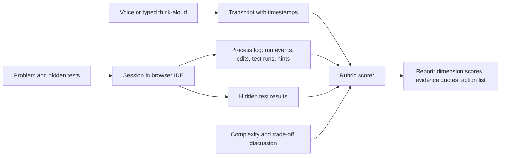

# C3 — Coding Interview Execution (Track C)

Status: see front matter (boss approved 2026-10-06; conditions in the Human Action Register); v1.0 content, learner-fit upgrade, facts as of October 2026. Scope boundary: C3 teaches how to execute and communicate in coding rounds. Pattern knowledge (two pointers, DP, graphs) lives in A3; Python internals in A1; SQL depth in A4; API design depth in A5 (design patterns A5.M10); testing strategy and code-quality principles in A8; multi-depth explanation to non-technical audiences in C2.M3. C3 links to those and rehearses them under interview conditions. C3 OWNS the canonical seven-step execution loop (shared lesson X6), think-aloud and time management, the LLD / machine-coding round format, practical API/SQL round execution, and the AI-assistant principle policy.

**The canonical seven-step loop (X6; step names and time budgets referenced by A3 and C1).** Slot of 45 minutes, budgets are guidance and scale proportionally:

| Step | Name | Budget (45 min) | Observable evidence |
|---|---|---|---|
| 1 | Clarify | about 5 min | Questions asked, assumptions written down |
| 2 | Examples | about 5 min | One simple and one tricky example with expected output |
| 3 | Approach | about 8 min | Brute force stated, bottleneck named, plan agreed aloud by minute 5 to 8 |
| 4 | Complexity | about 2 min | Time and space with n defined, before coding |
| 5 | Code | about 15 min | Small testable pieces, narrated intent |
| 6 | Test | about 7 min | Dry run plus at least 3 input categories |
| 7 | Optimise | about 5 min | Improvement or trade-off statement, complexity restated |

Judgement note: budgets are `[judgement]`, calibrated after the 3-learner pilot. Efficient seniors often merge steps 1-2 and compress step 3; the rubric scores presence of evidence, not the stopwatch.

## 1. Course header

| Field | Content |
|---|---|
| Course ID / title / track | C3 — Coding Interview Execution / Track C (Interview Craft) |
| Audience | Senior Python backend / AI Engineer candidates (L3–L4) who can already code but lose marks on process, communication, testing and time. Simpler path (L1-L2) for gaps: learners who freeze when thinking aloud, or who have never done a timed or shared-editor round. Reference learner: 11+ years engineering, about 4 years Python, ships FastAPI/Django/SQL/Redis/AWS/LLM-API systems but may not have sat on the interviewee side of a timed shared-editor round for some time (confirmed only by the process probe, not assumed) |
| Prerequisites | Working Python; A3 patterns at least at "Practice" level is recommended but not required (timed mocks begin once A3.M5 is passed). Placement skip: the placement spec owns the engine and threshold (R-C3-1); default skip threshold is a process score of at least 75 percent of the rubric `[judgement]`, tuned after pilot, on the coding-execution probe (a timed task scored on process evidence, not only correctness) plus one voice think-aloud probe; C3 supplies the task pool and process rubric. Passing may skip M1–M2 lessons only and go to M3 onward; M3-M10 test out via mastery check (G-5). Skipping never removes the final assessment |
| Outcomes (measurable) | 1. Run the 7-step loop (clarify, examples, approach, complexity, code, test, optimise) on an unseen medium problem within 35–45 minutes, stating each step aloud (competency: structured problem solving). 2. State time and space complexity correctly for own solution, including Python-specific costs (slicing, string concatenation, `in` on list vs set), and compare at least two approaches (competency: complexity reasoning). 3. Think aloud continuously while coding with at most the agreed share of silence and with a clear approach statement inside the first 5 minutes (competency: communication). 4. Write idiomatic, bug-resistant Python under pressure and avoid the named trap list (mutable defaults, late binding, shallow copy, integer division, sorting stability misuse) (competency: language fluency). 5. Self-test code by dry-running with at least 3 categories of inputs and fix defects found without prompting (competency: quality ownership). 6. Take a hint productively: acknowledge, restate, adapt, and recover within 5 minutes (competency: coachability and resilience). 7. Deliver a practical round (API endpoint, SQL query, data manipulation) and a take-home with a README that states scope, trade-offs and next steps (competency: practical delivery). 8. Perform well in pair-programming, debugging and code-review rounds, and state clearly what AI-assistant use is allowed and how to disclose it (competency: collaboration and professional judgement) |
| Estimated effort | **17.5 h Simpler / 12 h Deeper** module time (module hours in the table below sum to these), plus about 2.5 h final assessment allowance (boss effort table), plus recommended 6–8 timed mock sessions in Interview Master (not counted). Simpler = L1-L2 full-scaffolding route; Deeper = L3-L4 route with foundations skimmed per placement and net of typical skip-ahead, so it is usually shorter in wall-clock hours but harder per hour (G-2) |
| Goal tags (G-3) | Course `B:M A:M H:M`. Per module: M1-M5 `B:M A:M H:M`; M6 `B:M A:M H:M`; M7 `B:M A:S H:M`; M8-M9 `B:S A:S H:S`; M10 `B:M A:M H:M` |
| Competency tags owned (G-9) | `coding.*` namespace listed below (C3 owns all; `coding.complexity` credit is shared by reference with A3 as secondary). Secondary tags: none |
| Interview coverage tags | `coding.process`, `coding.communication`, `coding.python-idioms`, `coding.testing`, `coding.debugging`, `coding.code-review`, `coding.pair`, `coding.practical-api`, `coding.practical-sql`, `coding.data-manipulation`, `coding.take-home`, `coding.remote-logistics`, `coding.ai-policy`, `coding.lld`, `coding.complexity`, `coding.time-management`, `coding.hints`, `coding.trade-offs`, `coding.problem-solving`, `coding.live-coding`. Feeds Interview Master coding rounds, technical depth rounds, company packs (IT-services practical rounds, product-company DSA/coding rounds, AI-startup live build) |
| Badge and certificate | Module badges M1–M10 (each requires module mastery check at 80% or above plus module practice evidence). Course badge "Coding Interview Ready" requires all module badges, the final assessment (section 5) passed, and at least 3 Interview Master coding sessions with a process score at or above the configured threshold ("Meets": average at least 3.0, none below 2), with at least one in voice mode. Readiness (stronger than the badge) is defined in section 8, LF-2. Evidence stored: scored transcripts, hidden-test results, complexity-discussion scores. The badge states the evidence; it does not claim hiring outcomes |
| Authoring owner | SME agent SME-C3 |
| Reviewer | To be assigned |
| Review cadence | Process and communication content: every 12 months. Items touching AI-assistant policy, remote tooling, Python version features and Interview Master scoring: every 3 months |

## 2. Module table

| # | Module | Module outcome | Key topics | Visuals | Practice tasks | Pitfalls interviewers listen for |
|---|---|---|---|---|---|---|
| M1 | The execution loop (owner of X6) | Run clarify, examples, approach, complexity, code, test, optimise on an unseen problem and show each step | Seven-step loop with time budget per step (about 5/5/8/2/15/7/5 min in a 45-min slot; canonical names and budgets published in the course intro for A3 and C1 to reference); clarifying questions taxonomy (input shape, constraints, duplicates, ordering, empty, error behaviour, scale, memory); constructing examples including a tricky one; brute force first then optimise; stating complexity before coding; when to code the brute force anyway | Loop flow diagram with clock bands; "good vs rushed" annotated timeline of the same problem | 6 problems from A3 solved with a forced step checklist in the IDE (IDE gates "Run" until approach text is written in Learn mode); clarification drill: given a vague prompt, list 8 questions in 3 min | Jumping to code in under a minute; no examples; never asking about constraints; stating "O(n)" without saying what n is; optimising before a correct baseline |
| M2 | Think-aloud, voice delivery and time management | Narrate reasoning clearly, stay within time, and recover from silence | Narration patterns ("I am considering X because Y; trade-off Z"); signposting; how to think silently for 20 seconds without losing the interviewer ("let me think for a moment about the edge cases"); chunking explanation; pace and filler awareness; time checkpoints and when to cut scope; describing code while typing without reading it line by line; strict verbal vs written balance; Indian-English clarity tips (slower on technical terms, spell unusual names); **pointer (20 min, preview of C2.M3):** explaining a solution to a non-technical stakeholder for consulting-style rounds (one worked rewrite; depth lives in C2.M3, stakeholder stories in C1.M4/M5) | Talk-to-code ratio timeline; checkpoint clock diagram; transcript before/after rewrite | Voice drills in Interview Master: 3-min approach narration on 5 problems; replay review of own pace, fillers and long silences (non-judgemental, as per platform rules: no confidence or emotion inference) | Long unexplained silence; narrating syntax instead of intent; monologue without checking in; never mentioning complexity; running out of time with no testing |
| M3 | Python in interviews: traps and fluency drills (trimmed) | Avoid the ten classic traps and retrieve stdlib idioms fast under time pressure | **Idioms are owned by A3 section 7 (stdlib cheat sheet); Python internals by A1; mutable defaults and late binding mechanics by A1 (C3 drills recognition and fix only).** C3 teaches about 10 traps: (1) `list.pop(0)` / `insert(0)` as queue, (2) `s += x` in loops, (3) slicing copies O(k), (4) `in` on list vs set, (5) `[[0]*n]*m` aliasing, (6) mutable default args, (7) late-binding closures, (8) `//` and `%` with negatives, (9) recursion limit and iterative conversion, (10) `heapq` is min-only, tuple tie-breaks, mutating while iterating. Fluency drills: 60-second recall of `Counter`, `defaultdict`, `deque`, `heapq`, `bisect`, `itertools`, `functools.cache` signatures in a plain editor; stability of `sorted`; `lru_cache` memory growth; Python 3.12-3.14 features worth recognising (`match`, `itertools.batched` since 3.12, clearer error messages, free-threaded build officially supported but optional since 3.14 per PEP 779, as of October 2026) | Cost cheat-sheet table (operation vs complexity); trap gallery with step-through of aliasing in `[[0]*n]*m` | 14 predict-the-output items; fix 10 buggy solutions each hiding one trap (timed, 2 min each); 60-second signature-recall drill; implement top-k with heap two ways | Using `list.pop(0)` as a queue; `s += x` in a loop and claiming O(n); sorting inside a loop; recursion depth blowup on 10^5 input; "Python is slow so I'd use C++" as a deflection; not knowing that `heapq` is min-only |
| M4 | Testing your own code and edge cases | Verify a solution before the interviewer does | Dry-run on a small example by hand with a trace table; edge-case catalogue (empty, single, duplicates, negatives, large, sorted/reverse, cycles, unicode, None, off-by-one, overflow-like in other languages); property thinking ("invariants I rely on"); writing 3 quick asserts or a pytest parametrize inside the editor; reading failing output; boundary conditions in binary search and sliding window; test-first for practical rounds; how many tests to write in 5 minutes | Trace-table template; edge-case wheel; "bug found by dry-run" step-through | For 8 solutions, produce a 5-case test list in 3 min and run it; hidden-test challenge where 40% of cases are edge cases; trace a binary-search off-by-one | Declaring "done" without running anything; testing only the given example; fixing a bug by random edits; ignoring the empty input |
| M5 | Hints, being stuck, trade-offs | Convert hints and dead-ends into progress, and articulate trade-offs | Types of hints (nudge, constraint, counter-example, direct); acknowledge, restate, adapt; stuck protocol (restate problem, small example by hand, brute force, relax constraint, look for monotonicity or structure, ask one targeted question); when to abandon an approach; partial credit strategy; trade-off language (time vs space, simplicity vs speed, readability vs micro-optimisation, mutate vs copy); "what would I do with more time/at scale" answers; honesty about unknowns | Stuck-protocol flowchart; hint-response decision tree | Interview Master coding mode with hint mode on: three problems where a hint is scheduled at minute 15; practise one-sentence trade-off statements for 10 solutions | Ignoring the hint and continuing the failed path; defensiveness; bluffing; freezing instead of asking; claiming optimal without justification |
| M6 | Live coding, shared editors, remote logistics and AI-assistant policy | Operate calmly in the real environment and respect the rules | Shared editors (CoderPad-, HackerRank-, CodeSignal-style, Google Docs, own IDE share); no autocomplete or limited lint in many editors; running code vs not; keyboard fluency; dual monitors and screen-share etiquette; audio, camera, backup network and power; time zones and interview-link hygiene; whiteboard-over-video fallback; what an interviewer sees (paste detection, tab-switch signals) described generically, not per vendor (vendor features change; reviewed every 3 months); **AI-assistant policy at principle level only (R-C3-2): ask, comply, disclose, verify.** No per-company policy table. Treat AI-enabled rounds as a different skill (decompose, prompt, verify with tests, own the output); firms differ and policies change quickly, so the rule is to ask the recruiter in advance and follow the written instructions exactly | Environment checklist; "what the interviewer sees" diagram; AI-policy decision tree (ask, comply, disclose) | Complete 3 problems in a plain editor mode (no autocomplete, no lint) in the IDE; run the pre-flight checklist in Interview Master; practise opening statement asking about rules and tools | Using prohibited assistance; not asking about allowed tools; no fallback if the link or network fails; coding in an unfamiliar IDE without a warm-up; long fumbling with the editor |
| M7 | Practical rounds: API building, SQL and data manipulation | Deliver a small working backend feature, query or transform in 30–60 min | FastAPI/Flask endpoint skeleton under time pressure (routes, Pydantic models, status codes, validation, error responses, pagination); in-memory store vs SQLite/Postgres; idempotency and simple auth where asked; SQL: joins, window functions (`ROW_NUMBER`, `LAG`, running totals), CTEs, top-N per group, dedupe, gaps and islands basics, NULL traps, `GROUP BY` with `HAVING`, dialect differences (PostgreSQL vs MySQL) at a glance; data manipulation in plain Python and pandas (parse CSV/JSON, group, merge, rolling, clean, dedupe), streaming large files with generators; reading a spec and prioritising the minimum viable path; commit to a thin end-to-end slice first. **Execution only; SQL depth is owned by A4.M1, API design by A5, rate-limit and idempotency implementation by A5.M4 (C3 reuses their items by `ref`).** **New lesson M7.6 LLD / machine-coding rounds (about 2 h S / 1.5 h D):** round format (60-120 min, runnable code, extensibility follow-up), process (requirements and entities in 10 min, class and interface sketch, core flow first, then extension), class design and extensibility (use patterns only when a requirement forces them; patterns owned by A5.M10, principles by A8.M6), in-memory state and thread-safety note, tests, time boxing, what to say when the extension arrives; six `lld` seed problems supplied by A5.M10 (examples of archetype: parking lot, rate limiter class, LRU cache with TTL, elevator or ticket booking, notification dispatcher, library or inventory manager) | API skeleton diagram with request lifecycle; SQL join/window visual walk-through; data pipeline flow; LLD round timeline with the extension-request moment marked | 5 API tasks (CRUD with validation; paginated list; webhook receiver with idempotency key; LLM-proxy endpoint with timeout and retry; rate-limited endpoint by `ref` to A5.M4) with visible and hidden tests; 8 SQL tasks (PostgreSQL and MySQL); 5 data-manipulation tasks; 2 timed LLD rounds from the A5 `lld` seeds (one with a live extension request) | Writing everything before running anything; no input validation; N+1 queries in the handler; global mutable state without a lock; ignoring HTTP status semantics; SQL without checking NULL or ties; loading a huge file into memory; in LLD rounds: drawing ten classes before one flow runs, pattern name-dropping with no requirement, no answer to the extension request |
| | **Ownership notes** | | **OWNS:** seven-step loop (X6), think-aloud and time management, round-execution skills, LLD round format (C3.M7.6), practical API/SQL round execution, pair/debug/review round conduct, take-home flow, AI-assistant principle policy, coding-mode rubric. **POINTS:** DSA patterns -> A3.M2-M11; stdlib idiom cheat sheet -> A3 section 7; mutable defaults, late binding, internals -> A1; SQL depth -> A4.M1; API design -> A5.M1-M4; design patterns in Python -> A5.M10; SOLID and review principles -> A8.M6; non-technical explanation -> C2.M3; stakeholder stories -> C1.M4-M5; rate limiter and idempotency code -> A5.M4; concurrency bugs -> A2 | | | | |
| M8 | Pair-programming, debugging and code-review rounds | Collaborate with an interviewer on existing code and find and communicate issues | Pair-programming: driver/navigator, narrating intent, inviting input, small commits of thought; debugging round: reproduce, narrow, hypothesise, instrument (print, `pdb`, logging), fix, add regression test; reading unfamiliar code fast; common seeded bugs (off-by-one, mutation during iteration, shadowed variable, wrong comparison, race, timezone, float, encoding, resource leak, swallowed exception); code-review round: prioritise correctness, security, performance, readability, tests; tone and framing (question vs command); severity labelling (blocker, should, nit); explain why, suggest alternative; know when to stop | Debugging loop diagram; review checklist matrix (severity vs category) | 6 seeded-bug files to debug in IDE with failing tests; 4 pull-request-style diffs to review in writing and verbally; pair mock where the interviewer deliberately proposes a worse idea and the learner responds | Silent debugging; changing many things at once; blaming the code instead of reproducing; nit-picking style while missing a SQL injection; harsh review tone; not asking the interviewer to run the failing case |
| M9 | Take-home assignments | Plan, build and present a take-home that signals senior judgement within the time cap | Reading the brief for hidden criteria; scope control and explicit time-box (state "I spent N hours"); structure (small clean layering, config, typed models); tests (a few meaningful ones, not coverage theatre); error handling, logging, validation; Docker or Makefile for one-command run; README: how to run, design decisions, trade-offs, what I would do next, known limitations; git history hygiene; no secrets; do not over-engineer; AI-assistant disclosure in README where allowed; follow-up walkthrough call preparation; time-versus-quality trade-off; plagiarism and ownership: you must be able to explain every line | README template; scope-versus-time diagram; reviewer's rubric view | Build one 3-hour take-home (rate-limited URL shortener or webhook processor) with checklist self-review; write the README; record a 5-minute walkthrough in voice mode for scoring | Over-building a framework; no README; broken run instructions; no tests or only trivial tests; hard-coded secrets; unexplainable code (cannot defend it in the follow-up); exceeding time cap silently |
| M10 | Interview Master coding mode and integrated mock cycles | Understand how the platform scores coding rounds and use the feedback to improve | Mode anatomy (see section 7): hidden tests, think-aloud scoring, complexity discussion, hint ledger, process timeline; reading the report; mapping gaps to modules; mock cycles (45-min DSA style, 60-min practical style, debugging, review, take-home walkthrough); company-style presets; strict vs coaching mode; calibrating your own self-assessment against the score | Score breakdown radar; session timeline with annotated evidence quotes | 4 full mock sessions (2 voice), each followed by a written action list of 3 items, re-attempted after 48 hours | Optimising for hidden tests only; memorising solutions; ignoring the process score; treating a score as a hiring prediction |

## 3. Per-module detail

Question-bank targets per module use the template minimums: 12 MCQ/concept, 6 code-output, 4 coding/SQL tasks with hidden tests, 8 verbal questions with follow-up trees (the 3 seeds in section 4 are part of the 8), 3 scenario/design questions. Mastery check: 8 items per module, pass 80%, revision loop on misses.

Module hours (Simpler / Deeper; sum 17.5 / 12.0): M1 2.5/1.75; M2 2.0/1.25; M3 1.5/0.75; M4 1.5/1.0; M5 1.5/1.0; M6 1.5/1.0; M7 3.5/2.5; M8 1.5/1.25; M9 1.25/0.75; M10 0.75/0.75. All modules are inside the 0.75-3.0 h Deeper module range (M10 raised from 0.5 to 0.75 h and M4 lowered from 1.25 to 1.0 h by the INT-A pass; total unchanged).

### M1 The execution loop
- Lessons: (1) The seven steps and time budget; (2) Clarifying questions and constraints; (3) Examples and brute force baseline; (4) Complexity before code; (5) Optimise and close.
- Simpler: one worked problem per lesson with scripted narration; checklist always visible. Deeper: unfamiliar problem families, compressed time, interviewer interrupts.
- Mastery focus: ordering of steps, constraint-to-approach mapping, complexity statements with defined n.
- Badge: mastery 80% plus 4 timed problems where the process log shows all steps present.

### M2 Think-aloud, voice delivery and time management
- Lessons: (1) What interviewers want to hear; (2) Narration patterns and signposting; (3) Productive silence; (4) Pace, clarity and delivery (including Indian-English tips); (5) Time checkpoints and scope cutting.
- Simpler: read-aloud-then-paraphrase drills, sentence stems. Deeper: narrate while typing under interruptions, defend a choice mid-flow.
- Mastery focus: identify good vs poor narration from transcripts, checkpoint decisions.
- Badge: mastery plus 3 voice replays meeting approach-statement-by-minute-5 and longest-silence thresholds (thresholds configurable in Admin).

### M3 Python in interviews: traps and fluency drills
- Lessons: (1) Stdlib recall drill (link to A3 section 7; 20 min); (2) Complexity of Python operations; (3) Trap gallery (the ten traps); (4) Recursion, iteration and memory; (5) Modern Python worth recognising.
- Simpler: one trap per card with micro-quiz. Deeper: skip to timed trap-fix set and signature-recall drill; discuss CPython costs.
- Mastery focus: operation costs, trap recognition, idiom selection.
- Badge: mastery plus all trap-fix tasks passing hidden tests.

### M4 Testing your own code and edge cases
- Lessons: (1) Dry-run with a trace table; (2) Edge-case catalogue per problem family; (3) Quick asserts and pytest in the editor; (4) Boundaries (binary search, windows, intervals); (5) Fixing what you find calmly.
- Simpler: provided checklists per family. Deeper: invent invariants, generate adversarial inputs, minimal property-style checks.
- Mastery focus: choosing meaningful cases, tracing accurately, fix discipline.
- Badge: mastery plus hidden-test challenge with at least the configured edge-case catch rate.

### M5 Hints, being stuck, trade-offs
- Lessons: (1) Hint taxonomy and responses; (2) The stuck protocol; (3) Abandoning and pivoting; (4) Trade-off language; (5) Honesty and partial solutions.
- Simpler: scripted dialogues. Deeper: adversarial interviewer, ambiguous hints, hard problems with partial credit strategy.
- Mastery focus: response to a hint, pivot decisions, trade-off statements.
- Badge: mastery plus 3 hinted sessions with the hint ledger showing successful uptake.

### M6 Live coding, shared editors, remote logistics and AI-assistant policy
- Lessons: (1) Shared-editor skills; (2) Remote setup and failure plans; (3) Opening the round (rules, tools, language choice); (4) AI-assistant policies and professional conduct; (5) AI-enabled rounds: prompt, verify, own.
- Simpler: checklist-driven dry run. Deeper: induced failures (network drop, editor lag) and AI-enabled round simulation.
- Mastery focus: policy reasoning, logistics checklist, recovery.
- Badge: mastery plus completed pre-flight and 2 plain-editor sessions.

### M7 Practical rounds
- Lessons: (1) Reading a spec and thin slice first; (2) FastAPI/Flask endpoint under time; (3) SQL practical patterns (both dialects); (4) Data manipulation in Python and pandas; (5) Production-minded touches within the time box (validation, errors, logging, tests); (6) LLD / machine-coding rounds (format, process, class design and extensibility, tests, time boxing; six `lld` seeds from A5.M10).
- Simpler: scaffolded starters, LLD with a provided class skeleton. Deeper: ambiguous specs, perf constraints, concurrency and idempotency add-ons, LLD with a live extension request and no skeleton.
- Mastery focus: working slice, correctness on hidden tests, sensible trade-offs, LLD extensibility reasoning.
- Badge: mastery plus at least 3 API, 4 SQL and 3 data tasks passed on hidden tests, plus 2 LLD rounds scored on rubric (runnable core flow, extension handled, tests present).

### M8 Pair-programming, debugging and code-review rounds
- Lessons: (1) Pairing etiquette and narration; (2) Debugging loop; (3) Reading unfamiliar code fast; (4) Code review with severity and tone; (5) Handling disagreement and a worse idea.
- Simpler: guided debug with hints. Deeper: concurrency and timezone bugs, large diffs, security-flavoured reviews.
- Mastery focus: reproduce-first discipline, review prioritisation, tone.
- Badge: mastery plus 4 debug tasks and 3 reviews scored on rubric.

### M9 Take-home assignments
- Lessons: (1) Reading the brief and scoping; (2) Structure, tests, errors; (3) README and trade-offs; (4) Delivery hygiene (git, run in one command, no secrets); (5) The follow-up walkthrough.
- Take-home flow in 1.0 (R-C3-5): multi-file project (at most 1 MB) built in the IDE workspace (P-16), pytest runner and hidden tests, plus an **advisory** LLM rubric review of README and structure with human sampling (never the sole determinant of the badge); the voice walkthrough is optional. No external repository cloning.
- Simpler: template repository. Deeper: ambiguous brief, intentional time cap, AI-disclosure choices.
- Mastery focus: scope decisions, README quality, defensibility.
- Badge: mastery plus one submitted take-home reviewed by rubric (auto plus optional peer) and a scored walkthrough.

### M10 Interview Master coding mode and mock cycles
- Lessons: (1) How scoring works; (2) Reading the report; (3) Turning feedback into a 3-item action list; (4) Company-style presets; (5) Cycle planning and readiness.
- Simpler: annotated sample reports. Deeper: self-score then compare to platform score; calibration discussion.
- Mastery focus: interpreting rubric dimensions, action planning.
- Badge: mastery plus 4 sessions with improvement trend recorded.

## 4. Seed interview questions (verbal, style-of-question only)

Format per item: ideal outline, weak answers, probes, difficulty, competency, cluster. Seed labels `Qm.n` map to bank IDs `Q-C3-M<m>-<nn>` (Q1.1 = Q-C3-M1-01). Difficulty words map to the data-model 1-5 scale at import: easy 1, easy-medium 2, medium 3, medium-hard 4, hard 5.

### M1 — The execution loop

**Q1.1 "You get a problem you have never seen. Walk me through exactly how you will approach the next 40 minutes."**
- Ideal: restate the problem in own words; ask about input size, types, duplicates, empties, error behaviour; produce one simple and one tricky example and the expected output; propose brute force with complexity; identify the bottleneck and the structure that removes it; agree the plan with the interviewer before coding; code in small testable pieces; finish with a dry run and complexity restatement; keep checkpoints.
- Weak: "I would just start coding and fix as I go"; no mention of clarification or testing; a memorised pattern named without evidence.
- Probes: What if the interviewer says input is a stream? How long do you spend before coding? What do you do at minute 25 with no working code?
- Difficulty: medium. Competency: `coding.process`. Cluster: global-product.

**Q1.2 "Why do you state complexity before writing the code, and what exactly does n mean in your statement?"**
- Ideal: complexity predicts feasibility against constraints; avoids rewriting; define each variable (n items, m queries, k distinct); separate time and space; include hidden costs (sort, slicing, copying, recursion stack, hash collisions rarely); amortised vs worst case; compare with the brute force; reconcile with input limits; revisit after coding.
- Weak: "O(n)" with no definition; ignoring space; claiming dict operations are always O(1) with no caveat.
- Probes: What is the complexity of your solution if strings are long? What does amortised mean for `list.append`? Does recursion count toward space?
- Difficulty: medium. Competency: `coding.complexity`. Cluster: global-product, Indian-product.

**Q1.3 "The problem statement is deliberately vague. What do you ask and how do you decide when to stop asking?"**
- Ideal: group questions (input, output, constraints, behaviour on invalid, scale, performance priorities, allowed libraries); prioritise those that change the algorithm; state assumptions explicitly when no answer; confirm with an example; avoid interrogation; signal progress; write assumptions in the editor comments.
- Weak: no questions; or 20 questions with no direction; asking things answered in the prompt.
- Probes: Give an example question that changes the algorithm. What if the interviewer refuses to answer? How do you document assumptions?
- Difficulty: easy–medium. Competency: `coding.process`. Cluster: IT-services, global-IT-consulting.

### M2 — Think-aloud, voice delivery and time management

**Q2.1 "I notice you went quiet for two minutes. What would you do differently, and how do you think while staying communicative?"**
- Ideal: acknowledge without defensiveness; narrate the question being explored ("I am checking whether sorting first helps"); announce intent to think silently for a short bounded time; summarise findings after; ask a clarifying question to externalise; use the example on the editor; avoid narrating trivial syntax.
- Weak: defensive; "I think better silently"; fills silence with unrelated chatter.
- Probes: How long is acceptable? What do you say when your idea fails? How do you narrate while typing?
- Difficulty: easy–medium. Competency: `coding.communication`. Cluster: global-IT-consulting, Big4.

**Q2.2 "You have 12 minutes left and your optimal solution is half written. What do you do?"**
- Ideal: state the situation aloud; weigh finishing a correct but slower version against completing the optimal; propose to the interviewer; ensure something runs; leave clear comments or pseudo-code for the rest; reserve 3 minutes for testing; describe remaining steps and complexity verbally; avoid silent panic.
- Weak: keeps coding silently; abandons everything; skips testing.
- Probes: How do you decide between partial optimal and complete brute force? What do you say to the interviewer? How do you use remaining time to earn credit?
- Difficulty: medium. Competency: `coding.time-management`. Cluster: global-product, Indian-product.

**Q2.3 "Explain your solution to me as if I were a junior teammate reading the code later."**
- Ideal: state the problem and invariant; high-level idea in one sentence; walk through a small example; key data structure and why; edge cases handled; complexity; known limitations; alternative considered; structured with signposts; paced; no line-by-line reading.
- Weak: reads code verbatim; jargon without explanation; no example; no limitations.
- Probes: Which part is hardest to maintain? What would you rename? How would you document it?
- Difficulty: medium. Competency: `coding.communication`. Cluster: IT-services, AI-startup.

### M3 — Python in interviews: idioms and traps

**Q3.1 "What are the costs of common Python operations that bite in interview solutions: list pop(0), slicing, string concatenation, `in`?"**
- Ideal: `list.pop(0)` and `insert(0)` are O(n), use `collections.deque` for queues; slicing copies O(k); repeated `s += t` is quadratic in general (CPython may optimise sometimes; do not rely on it), use `''.join`; `x in list` O(n), `in set` and `in dict` average O(1); `sorted` is O(n log n) and stable; `heapq` operations O(log n); `list.append` amortised O(1); tuple vs list hashability for keys; copying a list for each recursion step multiplies cost.
- Weak: "Python handles it"; confusing dict worst case; claiming slicing is free.
- Probes: Implement BFS correctly in Python. How would you build a 1-million-char string? Why is a list of lists not safe to create with multiplication?
- Difficulty: medium. Competency: `coding.python-idioms`. Cluster: global-product, Indian-product.

**Q3.2 "Find the bug: `grid = [[0]*3]*3; grid[0][0] = 1`. Also: a function with `def f(x, acc=[])`. Explain both and the fix."**
- Ideal: outer multiplication copies the reference, so rows are the same list; fix with comprehension `[[0]*3 for _ in range(3)]`; inner `[0]*3` is fine for immutables; default argument evaluated once at definition, mutable state persists across calls; use `None` sentinel; relate to name-object model; mention late-binding in closures as a sibling trap and `copy.deepcopy` cost; mention linting catches (B006).
- Weak: only describing the symptom; suggesting deepcopy everywhere.
- Probes: Why does `[0]*3` work for the inner list? Show a late-binding closure bug in a loop. When is a mutable default intentional?
- Difficulty: easy–medium. Competency: `coding.python-idioms`. Cluster: IT-services, global-product.

**Q3.3 "Implement top-k frequent elements and a running median in Python; which tools would you pick and why?"**
- Ideal: `Counter` plus `heapq.nlargest(k, ...)` or `most_common`, O(n log k); bucket sort alternative O(n); running median with two heaps (max-heap via negation, min-heap), O(log n) per insert; rebalancing invariant; tie-breaking with tuples; mention `bisect.insort` O(n) insert cost; memory trade-offs; testing for even/odd counts and duplicates.
- Weak: sorts the whole array repeatedly; does not know heapq is min-heap.
- Probes: What is the complexity of `most_common` for full n? How do you handle ties deterministically? Stream is unbounded; what changes?
- Difficulty: medium–hard. Competency: `coding.python-idioms`, `coding.complexity`. Cluster: global-product, Indian-product.

### M4 — Testing your own code and edge cases

**Q4.1 "You finish coding in 20 minutes. What do you do next, specifically?"**
- Ideal: do not declare done; dry-run the tricky example with a trace table; list edge cases (empty, one element, duplicates, negatives, max size, already sorted); run tests if allowed; check boundaries and off-by-one; re-read for variable shadowing and mutation; state complexity; mention what is not handled; fix issues calmly.
- Weak: "I think it works"; only the given example; random tweaks when a test fails.
- Probes: Which three tests give the most coverage for your solution? What invariant does your loop maintain? How do you test without an interpreter?
- Difficulty: easy–medium. Competency: `coding.testing`. Cluster: all clusters.

**Q4.2 "Binary search on a rotated array passes the example but fails a hidden test. How do you find the error?"**
- Ideal: reproduce with the smallest failing input; consider boundaries (empty, two elements, duplicates, target at ends); examine loop condition `<` vs `<=`, mid computation, `lo`/`hi` updates for infinite loop; define the invariant; trace by hand; add asserts or prints; fix one thing at a time; add as regression test; discuss duplicates changing worst case to O(n).
- Weak: rewrites from memory; tries variants blindly.
- Probes: How do you prevent infinite loops? What is your loop invariant? What changes with duplicates?
- Difficulty: medium. Competency: `coding.testing`, `coding.debugging`. Cluster: global-product.

**Q4.3 "What would you test for a function that merges overlapping intervals, and how would you write the tests in a live round?"**
- Ideal: categories: empty, single, no overlap, touching (inclusive vs exclusive; ask), full containment, unsorted input, duplicates, negative numbers, large; mention the mutation of input; parametrised pytest list with expected outputs; property check (output sorted, non-overlapping, covers the union); keep to 5 minutes; clarify touching-interval semantics with the interviewer.
- Weak: one or two happy-path tests; no clarification of semantics.
- Probes: Does your function mutate input? How would you check without a reference implementation? Performance test?
- Difficulty: medium. Competency: `coding.testing`. Cluster: IT-services, Indian-product.

### M5 — Hints, being stuck, trade-offs

**Q5.1 "You are stuck at minute 18 and the interviewer gives a small hint. Show me how you take it."**
- Ideal: acknowledge the hint; restate it in own words; connect to the current partial work; test the hint on the small example; adapt approach, naming what changes; do not pretend to have seen it; ask a clarifying question if unclear; continue narrating; thank without grovelling.
- Weak: ignores the hint; defensive; says "oh I knew that" without evidence; goes silent.
- Probes: What if the hint contradicts your approach? What if you still do not understand? How do you avoid sounding like you are fishing for the answer?
- Difficulty: medium. Competency: `coding.hints`. Cluster: global-product, Big4.

**Q5.2 "Describe your protocol when you have no idea how to optimise."**
- Ideal: restate and re-read constraints; solve a tiny example by hand and notice what you do; write brute force and state its complexity; find the repeated work or ordering structure (sort, hash, heap, monotonic, two pointers, DP state); try to relax constraint; consider known patterns without forcing; ask one targeted question; deliver brute force with clear improvement path if time runs out.
- Weak: blank stare; guessing patterns; refusal to write anything.
- Probes: What signals "this is DP"? What if brute force is too slow by 100×? How do you decide to ask for a hint?
- Difficulty: medium. Competency: `coding.problem-solving`. Cluster: global-product.

**Q5.3 "Compare two valid solutions to your interviewer in terms of trade-offs and recommend one."**
- Ideal: state criteria (time, space, simplicity, readability, maintainability, input scale, mutation); quantify using n; mention real-world constraints (memory, latency, team skill); recommend with a conditional ("if n is below 10^4 I would choose the simpler"); mention testing difficulty; note what would change the decision; avoid dogmatism.
- Weak: "this one is faster" with no context; refusing to choose.
- Probes: When would you choose the O(n log n) version over the O(n)? What would you monitor in production? How does it change if data is streaming?
- Difficulty: medium. Competency: `coding.trade-offs`. Cluster: global-product, AI-startup.

### M6 — Live coding, remote logistics, AI-assistant policy

**Q6.1 "Before a remote coding round, what do you set up and what do you say at the start?"**
- Ideal: test link, audio, camera, screen-share, second network or phone hotspot, power, notifications off, quiet room, water, editor familiarity; practise in a plain editor; at start, ask about language, running code, allowed references, whether the interviewer wants narration, time budget; know the failure plan (say so quickly if the connection drops and agree a way to continue).
- Weak: logs in at the last minute; no backup; no questions about rules.
- Probes: What if the editor lags? What if your audio drops? Do you ask if you may search documentation?
- Difficulty: easy. Competency: `coding.remote-logistics`. Cluster: IT-services, Big4.

**Q6.2 "What is your stance on using AI assistants during interviews?"**
- Ideal: follow the stated rules exactly; ask if unclear; never use hidden assistance where prohibited since it breaches trust, can be detected, and tends to surface in later rounds or at the offer stage; where allowed, disclose usage, narrate prompts, verify output with tests, and own the result; AI-enabled rounds evaluate judgement (decomposition, verification, security) not typing; in take-homes follow brief and state use in README; acknowledge policies differ and change, so ask the recruiter beforehand (principle level, no company table); separate learning use (preparation) from performance use.
- Weak: "everyone does it"; evasive; claiming it is undetectable; or refusing to engage with AI-enabled rounds.
- Probes: The brief is silent; what do you do? How would you verify AI-generated code in a live round? How do you explain code you did not write?
- Difficulty: medium. Competency: `coding.ai-policy`, professional judgement. Cluster: AI-startup, global-product, Big4.

**Q6.3 "You must code in an editor without autocomplete or linting. How do you protect yourself?"**
- Ideal: practice in plain mode; keep imports and signatures minimal and explicit; write small functions; use type hints as documentation; run frequently if execution allowed; know standard library signatures (`heapq`, `bisect`, `collections`); say if unsure of an API and state intended behaviour; avoid clever one-liners; reread before running; ask whether docs lookup is allowed.
- Weak: relies on IDE memory; panics about missing syntax; refuses to use an API unsure of.
- Probes: What if you forget `heapq` argument order? How do you handle unknown library functions? Do you look up docs?
- Difficulty: easy–medium. Competency: `coding.python-idioms`, `coding.live-coding`. Cluster: global-product, Indian-product.

### M7 — Practical rounds: API, SQL, data manipulation

**Q7.1 "You have 45 minutes to build a small endpoint: create and list orders with validation and pagination. Walk me through your plan and shortcuts."**
- Ideal: clarify storage (in-memory or DB), auth, scale, error format; thin vertical slice first (model, POST, GET list); Pydantic validation, status codes (201, 400/422, 404), pagination (limit/offset vs cursor, trade-off), deterministic ordering, idempotency key if retries matter, simple tests with `TestClient`; avoid N+1 and global state without lock; state what is stubbed and what would come next (auth, DB, migrations, rate limit, logging).
- Weak: begins with project scaffolding and folders; no tests; ignores HTTP semantics; ignores ordering in pagination.
- Probes: Cursor vs offset pagination trade-offs? How do you make POST idempotent? How would you add a rate limit?
- Difficulty: medium. Competency: `coding.practical-api`. Cluster: IT-services, Indian-product, AI-startup.

**Q7.2 "Write SQL for the top 3 customers by revenue per month, and explain ties and NULLs."**
- Ideal: aggregate to customer-month in a CTE; use `RANK` or `DENSE_RANK` or `ROW_NUMBER` with partition by month ordered by revenue descending; filter rank at most 3; explain choice (ties included vs exactly 3); handle NULL revenue (`COALESCE`, `SUM` ignores NULL); date truncation differences (`date_trunc` in PostgreSQL vs `DATE_FORMAT` in MySQL); index considerations; note MySQL window function support from 8.0; verify with a small dataset; mention performance on large tables.
- Weak: correlated subqueries only; `LIMIT 3` without partition; ignores ties.
- Probes: What changes if two customers tie at third? What index helps? How would you do this in a legacy MySQL environment with no window functions (MySQL 5.7 reached end of life in October 2023, so this is a legacy-codebase question only, as of October 2026)?
- Difficulty: medium. Competency: `coding.practical-sql`. Cluster: IT-services, Indian-product, global-IT-consulting.

**Q7.3 "A 5 GB CSV of events must be summarised per user. Show me the approach in Python."**
- Ideal: do not load all into memory; stream with `csv` reader or chunked pandas `read_csv(chunksize=...)`; aggregate incrementally with dict/Counter; consider memory of number of users; use generator pipeline; validate and skip bad rows with counters; explain when pandas, DuckDB or a database is better; parallelism with caution; test on a small sample; output deterministic; discuss data types and encoding.
- Weak: `pd.read_csv` on the whole file; no handling of malformed rows.
- Probes: What if distinct users exceed memory? How would you parallelise? How would you verify correctness on sampled data?
- Difficulty: medium. Competency: `coding.data-manipulation`. Cluster: IT-services, AI-startup, global-IT-consulting.

**Q7.4 (LLD) "In 75 minutes, design and code a parking-lot system that supports new vehicle types later. How do you spend the time and what do you do when I add a requirement at minute 50?"** (archetype only; seeds come from A5.M10)
- Ideal: clarify scope (vehicle types, pricing, concurrency, persistence); list entities and the one core flow (park, unpark, fee) before drawing classes; sketch interfaces only where variation is real (vehicle type, pricing strategy); code the core flow end to end and run it with 2-3 tests; state which patterns you used and why a simpler structure was not enough (patterns -> A5.M10); keep state in memory behind a repository seam; mention thread-safety as a next step; when the extension arrives, say which class changes and which does not (open-closed in plain words), then implement and re-run tests.
- Weak: ten classes and no runnable flow; pattern name-dropping; rewrites everything on the extension; no tests.
- Probes: Where would a lock go if two cars arrive together? Why strategy and not an if-chain here? What would you persist first?
- Difficulty: medium-hard. Competency: `coding.lld`. Cluster: Indian-product, IT-services, global-product.

### M8 — Pair-programming, debugging and code-review rounds

**Q8.1 "We will pair on an existing failing test suite. How do you start?"**
- Ideal: ask for the goal and constraints; run the tests and read the failure first; reproduce with the smallest case; form a hypothesis and say it; locate with a debugger or targeted prints; change one thing at a time; verify; add a regression test; keep the interviewer involved (who drives, who navigates); summarise root cause.
- Weak: reading all the code first with no run; editing many places; silent.
- Probes: What if the failure is flaky? When do you use `pdb` vs prints? How do you explain root cause?
- Difficulty: medium. Competency: `coding.debugging`, `coding.pair`. Cluster: global-IT-consulting, AI-startup.

**Q8.2 "Review this 40-line pull request in 10 minutes aloud (assume it contains an SQL injection, a swallowed exception and a missing test)."**
- Ideal: summarise intent first; order by severity (security, correctness, data loss, performance, readability, style); name the injection and propose parameterised queries; point out bare `except` hiding failures and suggest narrow exceptions and logging; ask for tests; phrase as questions and suggestions; separate blocking from non-blocking; acknowledge good parts; check for secrets and resource handling.
- Weak: style nits only; rewriting the code for the author; harsh tone; no prioritisation.
- Probes: What would you not block on? How do you handle pushback? How do you review code you do not understand?
- Difficulty: medium. Competency: `coding.code-review`. Cluster: global-product, Big4, global-IT-consulting.

**Q8.3 "A function intermittently returns wrong totals under load. Describe how you would find and prove the cause."**
- Ideal: gather evidence; reproduce under concurrency with a loop or test harness; suspect shared mutable state, non-atomic read-modify-write, caching, timezone or float; inspect with logging including request ids; narrow with minimal reproduction; propose a fix (lock, atomic DB operation, immutable data, transaction); prove with a stress test before and after; add regression; mention A2 for deeper concurrency.
- Weak: guesses and adds sleep; adds locks everywhere without proof.
- Probes: Does the GIL protect you? How do you make the test deterministic? What is the DB-level fix?
- Difficulty: medium–hard. Competency: `coding.debugging`. Cluster: global-product, Indian-product.

### M9 — Take-home assignments

**Q9.1 "You get a take-home with a '4 hours' guideline and an open-ended brief. How do you decide scope?"**
- Ideal: read for explicit and implicit criteria; list must-haves vs nice-to-haves; time-box with a plan (for example 30 min design, 2h core, 45 min tests and docs, 15 min polish); build a thin vertical slice first; choose boring tech; state assumptions; stop at the cap and document remaining work; ask clarifying questions by email if allowed; avoid gold-plating.
- Weak: builds a microservice platform; ignores time guidance; no stated assumptions.
- Probes: What if you exceed the time? Would you ask questions to the recruiter? What do you cut first?
- Difficulty: medium. Competency: `coding.take-home`. Cluster: AI-startup, Indian-product, global-product.

**Q9.2 "What goes into the README of a take-home, and why does it matter?"**
- Ideal: how to run (one command), how to test, requirements and assumptions, design decisions and alternatives, trade-offs, limitations, what next, time spent, AI-assistant usage if any, sample requests; reviewers often read the README first; it shows senior judgement and communication; keep it concise and accurate; verify instructions on a clean machine or container.
- Weak: "just a title and run steps"; stale commands.
- Probes: How do you show trade-offs concisely? Would you list known bugs? How do you verify the README works?
- Difficulty: easy–medium. Competency: `coding.take-home`, communication. Cluster: AI-startup, global-IT-consulting.

**Q9.3 "In the review call they ask why you chose X and to extend your submission live. How do you prepare?"**
- Ideal: re-read own code and decisions; rehearse the architecture walkthrough; know the alternatives and why not; know test coverage and gaps; run the project fresh; prepare an extension scenario (new field, new endpoint, scale 10x); be ready to modify live while narrating; be honest about shortcuts; own all code including generated portions.
- Weak: cannot explain parts; defensive; blames time.
- Probes: What would you change with another week? How would you scale it? Which part are you least proud of?
- Difficulty: medium. Competency: `coding.take-home`, ownership. Cluster: AI-startup, global-product.

### M10 — Interview Master coding mode and mock cycles

**Q10.1 "How is a coding round assessed beyond whether the tests pass?"**
- Ideal: rubric dimensions (problem understanding, approach quality, correctness, complexity, code quality, testing, communication, handling of hints/feedback); hidden tests measure correctness and edge coverage; process evidence (clarifying questions, stepwise delivery, self-testing); think-aloud transcript measured on clarity and structure; complexity discussion accuracy; mention that a correct but silent solution often scores below a slightly incomplete well-communicated one; scoring is practice feedback, not a hiring prediction.
- Weak: "tests passing is everything".
- Probes: How would you recover after failing hidden tests? What evidence would show a strong process? How should you use the report?
- Difficulty: easy–medium. Competency: `coding.process`. Cluster: all clusters.

**Q10.2 "Show how you would improve between two mock sessions."**
- Ideal: review transcript and replay; identify top 3 gaps with evidence; map each to a module and drill; set measurable targets (approach statement by minute 5, 5 edge cases listed, complexity stated); re-attempt a similar problem after 48 hours; avoid memorising answers; track trend, not a single score.
- Weak: "practise more problems"; retrying the same problem to memorise.
- Probes: How do you know a gain is real? How many mocks per week is reasonable? When is the right time to stop?
- Difficulty: easy. Competency: `coding.process`. Cluster: all clusters.

**Q10.3 "Talk me through how you would present the complexity of your solution and alternatives at the end of a round."**
- Ideal: summarise approach; time and space with definitions; compare with brute force and one alternative; mention practical factors (constants, cache, memory, language); state improvements with more time (parallelism, streaming, better data structure); name edge cases handled and unhandled; offer production considerations (logging, validation, monitoring) concisely.
- Weak: one-liner "O(n log n)"; no comparison.
- Probes: What are the best and worst cases? Can you reduce space? What would you change for 100x data?
- Difficulty: medium. Competency: `coding.complexity`, communication. Cluster: global-product, Indian-product.

Seed total: 31 verbal questions (3 per module plus the LLD seed Q7.4). Goal tags and senior-bar notes for every seed are in section 8, LF-8.

## 5. Final assessment

- Mastery check: 25-item cross-module check (concept, predict-the-output, process decisions), 80% pass (G-7), with a revision loop that routes misses to lessons. Whole-course test-out only via 85% here plus the voice mock at Senior bar (G-5).
- Timed task 1 (45 min, text and code, plain editor): one medium problem (A3 pattern, unseen), hidden-test pass at least 70 percent plus correct stated complexity (G-7), complexity discussion, self-test requirement. Scored on process log plus tests. Readiness timing: medium problem solved with tests in 35 minutes.
- Timed task 2 (60 min practical): API endpoint plus SQL query plus data transform on a mini scenario, hidden tests, README-style summary at the end.
- Timed task 3 (20 min debug and review): fix a seeded bug and review a short diff aloud.
- Voice mock round (35 min, Interview Master coding mode, think-aloud mandatory): one problem with scheduled hint at about minute 15 and a complexity and trade-off discussion at the end; scored by the coding rubric (section 7). Pass at or above configured threshold with no critical rubric dimension below its floor (testing and communication floors apply).
- LLD timed round (75 min, optional for badge, counted in M7 badge): one A5 `lld` seed with a live extension request.
- Take-home capstone (optional for badge, required for "Take-home Ready" distinction): 3-hour build in the IDE workspace (at most 1 MB), hidden tests, advisory README review, optional 5-minute recorded walkthrough (R-C3-5).
- Certificate evidence: assessment scores, transcript excerpts, hidden-test results, and mock trend graph.

## 6. Course-level risks and freshness notes

| Item | Risk | Action |
|---|---|---|
| AI-assistant policies in interviews | Changing fast; firms differ (some permit or require AI in selected rounds, others prohibit); this is a judgement-level observation, not a sourced statistic; secondary 2026 sources report some firms (for example Meta, Canva) running AI-permitted rounds and others prohibiting AI use, but per-company claims are not asserted here and were not confirmed from primary sources (verified 2026-10: policy is taught as principles only, so no company fact is needed) | Review every 3 months; principle-only (ask, comply, disclose, verify) per R-C3-2; no company policy table |
| Shared-editor and assessment platforms | Vendors change features (autocomplete, execution, proctoring signals); not verifiable generically | Describe generically, never per vendor; review every 3 months |
| Python version features | Verified October 2026: Python 3.14 ships the free-threaded build as officially supported but optional (PEP 779; 3.13 was experimental); `itertools.batched` exists since 3.12. Sandbox default is 3.14 (G-8) | Pin version in the IDE; examples tested in CI; avoid version-specific tricks in core lessons |
| MySQL and PostgreSQL versions | Verified October 2026: MySQL 5.7 reached end of life in October 2023 (sources cite 21 to 31 October; say "October 2023"); window functions need MySQL 8.0 or later; primary pins are MySQL 8.4 LTS and PostgreSQL 18.x (G-8) | Dialect tabs in all SQL tasks; the no-windows question is legacy-only |
| Hidden-test category catch rate | Depends on IDE capability P-15 (internal engineering dependency, not an external fact; to be settled by spike S-5) | Spike S-5; fallback: report aggregate pass rate only |
| Interview Master scoring | Rubric weights and thresholds will change after calibration | Keep module text referencing dimensions, not numbers; thresholds in Admin config |
| Company-style content | Must not imply real or leaked questions | All questions are style-of-question and tagged by cluster; keep the standard disclaimer |
| Hiring-outcome claims | Badge could be misread as a hiring guarantee | Wording review; no outcome claims |
| Voice features | STT accuracy on Indian-English technical terms affects think-aloud scoring fairness | Use hotword vocabulary for coding terms; allow transcript edit before scoring; human-review sampling |
| Stable content | Execution loop, testing, trade-off communication | 12-month review |

Review cadence: AI-policy, platform and scoring content every 3 months; remaining content every 12 months; pilot with at least 3 learners before publish.

## 7. How Interview Master's coding mode scores these skills

| Rubric dimension | Evidence used | What a high score looks like | Course modules that train it |
|---|---|---|---|
| Problem understanding | Clarifying questions in transcript, restated problem, assumptions noted | Constraints and edge semantics clarified before coding | M1 |
| Approach and reasoning | Approach statement time, brute-force to optimal progression | Approach stated early, alternatives compared | M1, M5 |
| Correctness | Hidden tests: visible pass rate, hidden pass rate, edge-case subset | All pass; edge cases handled | M3, M4 |
| Complexity and trade-offs | Verbal complexity statement vs actual measured behaviour of the solution; discussion quality | Correct with defined variables, trade-offs argued | M1, M5, M10 |
| Code quality | Naming, structure, idiom use, absence of known traps | Readable, idiomatic, small functions | M3 |
| Testing and self-verification | Run events, self-written tests, dry-run narration | Tests own code before prompted, finds own bug | M4 |
| Communication (think-aloud) | Transcript: structure, silence gaps, signposting, clarity; optional delivery stats (pace, fillers, long silences) | Continuous, structured narration | M2 |
| Hint handling | Hint ledger: number, timing, uptake | Hint acknowledged and used within minutes | M5 |
| Time management | Timeline of checkpoints | Working solution with time left for testing | M2 |
| Practical delivery (practical, take-home modes) | Hidden API/SQL tests, README rubric | Working thin slice, sensible trade-offs, clear docs | M7, M9 |

Rules to teach the learner:
- Hidden-test display policy (R-C3-4): in Interview mode only visible-test and run results are shown during the session; after final submission the learner sees aggregate hidden pass/fail and category labels (empty input, large input, duplicates) but never inputs or expected outputs. Practice mode may show category names after two failed submissions. Learn mode may reveal a failing case only in the post-mortem view after pass or give-up. The IDE tags hidden tests by category and exposes per-category catch rate (P-15).
- Delivery coaching (pace, fillers, long silences) is optional and non-judgemental; there is no emotion, personality or "confidence" inference; scoring uses what was said and done.
- A correct but silent solution is expected to score lower on communication than a well-narrated one; a narrated but incorrect solution is expected to score lower on correctness; the report shows both.
- Strict mode gives no hints; coaching mode gives graded hints which are recorded in the hint ledger and affect the hint-handling and approach dimensions transparently.
- Scores are calibrated against SME-labelled sessions; they are practice feedback and not a prediction of any employer's decision.
- Company-style presets adjust rounds and weights (for example IT-services practical round emphasises API and SQL delivery and explanation; product-company coding round emphasises DSA correctness, complexity and testing; AI-startup live build emphasises thin-slice delivery and trade-offs).

## 8. Learner-Fit Appendix (template section 6; G-11). Facts as of October 2026

Tag key: `B` Senior Python Backend, `A` AI Engineer, `H` hybrid; `M` MUST, `S` SHOULD, `N` NICE. Interview-weight percentages are `[judgement]`, calibrated after the 3-learner pilot.

**Core insight for the reference learner.** Seniors rarely fail coding rounds on knowledge; they fail on process evidence that interviewers cannot see: no clarification, no stated complexity, silence, no self-test, defending instead of adapting to a hint. C3 is therefore mostly behaviour change, measured by the process log, not content absorption. The practice-to-theory ratio is about 80:20.

### LF-1 Level paths

| Level | Route | Hours (module time) | Practice mix | Skipped | Challenge items |
|---|---|---|---|---|---|
| L1 (new to timed rounds, new to Python idioms) | Simpler, all lessons, scripted narration, A3 pre-reading linked | about 17.5 + 2.5 assessment | 40% guided problems, 30% narration drills, 30% quizzes | nothing | none until M1-M4 pass |
| L2 (junior-mid) | Simpler, skim known idioms | about 13 to 15 + 2.5 | 50% timed problems, 25% narration, 25% review of own logs | M3 recall cards if diagnostic at least 70 | one hinted mock |
| L3 (experienced, process gaps) | Deeper: M1-M2 skim by diagnostic, full M4-M5, M7 | about 10 to 12 + 2.5 | 70% timed and voice mocks | M3 lessons, M6 logistics if band skip | adversarial interviewer in M5, ambiguous spec in M7 |
| L4 (senior; reference learner) | Deeper plus Challenge; start with the timed process probe, then test out where scored | about 7 to 9 + 2.5 after skip-ahead `[judgement]` | 80% timed and voice mocks, 20% targeted lessons (expected: M2, M4, M5, M7.6, M9) | M3, M6, M8 lessons likely skipped | live LLD extension, AI-enabled round simulation, take-home with ambiguous brief |

### LF-2 Module matrix

Diagnostics: items drawn from existing MCQ/predict buckets plus, for M1/M2/M4/M5, one process-scored timed probe (R-C3-1; task pool and process rubric supplied by C3, thresholds in admin). Bands (G-5): at least 85 skip lessons and take mastery check; 70-84 skim; 50-69 study; below 50 deep-study with the remediation link in LF-5.

| Module | Diagnostic items (IDs) | B/A/H | Weight % B / A / H | Rationale | Rehearsal modes | Module readiness criterion |
|---|---|---|---|---|---|---|
| M1 Loop | Q-C3-M1-01..06 (6) plus process probe | B:M A:M H:M | 12 / 14 / 13 | Every coding round starts here; process scoring is the discriminator | coding, voice drill | 3 timed problems, all seven steps evidenced in log |
| M2 Think-aloud and time | Q-C3-M2-01..05 (5) plus voice probe | B:M A:M H:M | 9 / 11 / 10 | AI and product rounds weight narration; Indian-English clarity | voice drill, coding | Approach stated by minute 5; longest silence under admin threshold in 2 voice sessions |
| M3 Traps and fluency | Q-C3-M3-01..08 (8) | B:M A:M H:M | 8 / 9 / 8 | Cheap marks, quickly mastered by Python users | coding | Timed trap-fix set at least 8 of 10 in 20 min |
| M4 Self-testing | Q-C3-M4-01..06 (6) plus probe | B:M A:M H:M | 9 / 10 / 9 | Self-testing is the most commonly skipped senior signal | coding | Edge-case catch rate at or above admin threshold; bug self-found in 2 mocks |
| M5 Hints and trade-offs | Q-C3-M5-01..05 (5) | B:M A:M H:M | 8 / 9 / 8 | Hint uptake and trade-offs separate levels | coding (hint mode), voice drill | 3 hinted sessions with successful uptake in ledger |
| M6 Live editor, remote, AI policy | Q-C3-M6-01..05 (5) | B:M A:M H:M | 6 / 8 / 7 | Every remote round; AI-startup rounds probe AI policy | coding (plain editor), voice drill | Pre-flight done; 2 plain-editor sessions; AI-policy answer rated at least 3.5 |
| M7 Practical, API/SQL/data, LLD | Q-C3-M7-01..08 (8) | B:M A:S H:M | 22 / 14 / 18 | IT-services and Big 4 practical rounds, Indian-product LLD; AI route lower | coding, practical, design canvas (LLD sketch) | API, SQL, data tasks at least 70% hidden tests in time; LLD round extension handled |
| M8 Pair, debug, review | Q-C3-M8-01..06 (6) | B:S A:S H:S | 9 / 7 / 8 | Common in global-product and consulting loops | coding, voice drill | Debug task reproduced-first; review scored at least 3.5 with severity ordering |
| M9 Take-home | Q-C3-M9-01..05 (5) | B:S A:S H:S | 7 / 8 / 8 | AI-startup and some product firms use take-homes | project deep-dive, voice drill (walkthrough) | Take-home rubric at least 3.5; walkthrough Senior bar |
| M10 Coding mode and mocks | Q-C3-M10-01..05 (5) | B:M A:M H:M | 10 / 10 / 11 | Calibrating self-assessment drives improvement | coding, voice drill | 4 sessions with improving trend; self-score within 0.5 of platform score |

**Course readiness (G-6 specialised, topic tag `coding.process` and siblings).** Interview-ready when: (1) module and final mastery at least 85% on a retake at least 7 days after first pass; (2) timed task passed, and a medium problem solved with tests in 35 minutes; (3) at least three Interview Master coding sessions at Senior-bar process score (average at least 3.5 of 5, none below 3), one in voice mode, in two sessions at least 48 hours apart; (4) no open remediation flag on A3 (patterns) prerequisites. Badge "Meets" stays at average at least 3.0, none below 2.

### LF-3 Experience bridge (you already know -> gap between using and explaining at senior depth)

| Module | You already know | Gap |
|---|---|---|
| M1 | Breaking down tickets, design reviews, estimating | Doing it aloud in 45 minutes with a stranger watching; stating complexity before code |
| M2 | Explaining designs in standups and incident calls | Continuous narration while typing; bounded silence; delivery clarity on an audio call |
| M3 | Four years of daily Python | Recalling `heapq`/`bisect` signatures without an IDE; naming costs (slicing, `+=`, `in`) precisely |
| M4 | pytest on production code, code review | Fast self-testing on an unfamiliar problem with a trace table; no CI to catch you |
| M5 | Pairing with colleagues, unblocking juniors | Taking a hint from an evaluator without defensiveness; saying "I don't know, here is my plan" |
| M6 | Remote work, Zoom, shared docs | Plain editor without autocomplete; knowing what is allowed (AI policy) |
| M7 | FastAPI/Flask/Django endpoints, Postgres/MySQL queries, Redis, CSV/ETL scripts | Producing a thin slice in 45 minutes with hidden tests; window-function fluency; LLD with extension on demand (rarely done in services work) |
| M8 | Debugging production incidents, PR reviews | Narrating the debug loop; prioritising severity aloud; tone under evaluation |
| M9 | Writing design docs and READMEs | Time-boxed scope control; defending every line in a follow-up call (including AI-assisted lines) |
| M10 | Performance reviews, retrospectives | Interpreting a rubric as evidence rather than a verdict |

### LF-4 Senior-bar framing

| Module | Mid-level answer | Senior adds | Staff adds |
|---|---|---|---|
| M1 | Solves the problem, may skip examples | Clarifies, compares approaches, defines n, tests | Reframes the problem, names the production variant, sets the plan with the interviewer |
| M2 | Narrates syntax | Narrates intent and trade-offs, bounded silence | Steers the conversation, invites challenge, manages time for both |
| M3 | Knows idioms | Names costs and traps unprompted | Explains why CPython behaves so and when it stops mattering |
| M4 | Tests the given example | Edge catalogue, invariants, finds own bug | Chooses tests by risk; property-style checks; states what is not covered |
| M5 | Takes hint, continues | Restates, adapts, names what changed | Pre-empts hints by stating alternatives; honest partial-credit plan |
| M6 | Asks if tools allowed | Pre-flight, fallback plan, AI principles (ask, comply, disclose, verify) | Treats AI-enabled rounds as judgement tests: decomposition, verification, security |
| M7 | Working endpoint | Validation, status semantics, idempotency, N+1 avoided, tests | Operations: limits, observability, migration path; LLD extension without rewrite |
| M8 | Finds the bug | Reproduces first, one change at a time, regression test; severity-ordered review | Root-cause systemic fix; coaching tone; decides what not to block |
| M9 | Works on their machine | One-command run, honest README, scope control | Anticipates the reviewer rubric; explicit cost and scaling notes |
| M10 | Reads the score | Maps gaps to modules with measurable targets | Calibrates self-assessment; tracks trend not single scores |

### LF-5 Adaptive hooks

| Module | Remediation (prerequisites) | Challenge extension | Reorder or defer |
|---|---|---|---|
| M1 | A3.M1 (cost model), A3.M2 | Unfamiliar family, 30-min compressed loop | Never deferred; always first |
| M2 | M1 | Narrate under interruptions | May run parallel to M1 |
| M3 | A1.M1 and A1.M5 (mutable defaults, late-binding closures), A3 section 7 | Custom heap key, generator solution | Deferrable if band skip |
| M4 | M1, A3.M5 | Adversarial input generation | After M1 |
| M5 | M1, M4 | Adversarial interviewer | After M4 |
| M6 | M2 | AI-enabled round simulation | Deferrable until mocks start |
| M7 | A4.M1 (SQL), A5.M1-M4 (API), A5.M10 (patterns for LLD) | Ambiguous spec; idempotency add-on | May be pulled forward for IT-services targets |
| M8 | M4, A2.M1 (concurrency bugs) | Concurrency and timezone bug files | Deferrable |
| M9 | M7, A8.M6 (code quality) | Ambiguous brief with time cap | Deferrable until a take-home is in the pipeline |
| M10 | M1-M5 | Self-score calibration | Runs continuously from first mock |

Mastery threshold 80% per module (G-7); readiness at 85% retake (G-6). Timed mocks begin once A3.M5 is passed. Engine may reorder M3, M6, M8, M9 freely; M1, M2, M4, M5, M10 form the spine.

### LF-6 Applied labs (production-framed, one per module)

M1: triage a vague "slow orders report" ticket into clarifying questions then a solved subproblem. M2: narrate a live incident-style log-parsing task. M3: fix ten bugs seeded from real-looking utility code (queue, cache, config merger). M4: test plan for an IoT telemetry deduplicator (MQTT-style duplicate and out-of-order messages). M5: respond to a hint on a rate-window problem from an AI-assistant usage-quota scenario. M6: plain-editor session on a webhook signature check. M7: SaaS orders API with pagination and idempotency key; SQL top-N revenue per tenant; 5 GB event-log summary; LLD of a notification dispatcher. M8: debug intermittent wrong totals in a payments-style service; review a PR with an injection and a swallowed exception. M9: webhook processor with retries as a 3-hour take-home. M10: self-calibrated mock cycle using a voice-agent latency-log parsing task.

### LF-7 Currency and quality bar

| Module | Dated stamp | Memorable visual or analogy | Top 3 misconceptions handled |
|---|---|---|---|
| M1 | Oct 2026 (12-month cadence) | Pilot's pre-flight checklist: the seven steps are non-skippable even when you are expert | "Experts skip examples"; "stating complexity is a formality"; "brute force is embarrassing" |
| M2 | Oct 2026 (3-month; voice scoring) | Talk-to-code ratio timeline: sat-nav giving turn-by-turn directions, not reading the road signs | "I think better in silence"; "narrate every line"; "accent hurts my score" (scoring is on content, not accent; no emotion inference) |
| M3 | Oct 2026 (Python 3.14 default) | Aliasing gallery: one list, many names | "Python handles it"; "dict is always O(1)"; "deepcopy fixes all" |
| M4 | Oct 2026 | Trace table: a flight recorder for your code | "Passing the example means correct"; "write more tests" over better tests; "random edits will find it" |
| M5 | Oct 2026 | Hint as a GPS recalculation, not a failure | "Hints reduce my score a lot" (uptake raises it); "never admit not knowing"; "just keep trying the same approach" |
| M6 | Oct 2026 (3-month; AI policy) | Decision tree: ask, comply, disclose, verify | "Everyone uses AI quietly"; "detection is impossible"; "AI-enabled means no judgement needed" |
| M7 | Oct 2026 (MySQL 8.4 LTS, PostgreSQL 18.x pins) | Thin vertical slice as a cross-section of a cake | "Scaffold first"; "ties and NULLs do not matter"; "design patterns always impress in LLD" |
| M8 | Oct 2026 | Reproduce-first as the detective's rule: no theory before the scene | "Read all code first"; "style nits show rigour"; "add locks everywhere" |
| M9 | Oct 2026 | Reviewer's 15-minute README skim | "More features win"; "tests optional"; "AI-written code needs no ownership" |
| M10 | Oct 2026 (scoring thresholds in admin) | Radar of dimensions, tracked over time | "Score equals hiring odds"; "memorise problems"; "only hidden tests matter" |

### LF-8 Seed question tags (G-10)

Format: seed -> goal tag; senior-bar note (mid / senior / staff). Course tags are `coding.*` as in the seeds.

| Seed | Tag | Senior-bar note |
|---|---|---|
| Q1.1 | B:M A:M H:M | Mid codes early; senior has a plan agreed first; staff adds production variant |
| Q1.2 | B:M A:M H:M | Mid says O(n); senior defines n and hidden costs; staff reconciles with constraints |
| Q1.3 | B:M A:M H:M | Mid asks nothing; senior asks algorithm-changing questions; staff documents assumptions |
| Q2.1 | B:M A:M H:M | Mid defends; senior bounds silence; staff steers dialogue |
| Q2.2 | B:M A:M H:M | Mid panics; senior negotiates scope; staff earns credit with a running baseline |
| Q2.3 | B:M A:M H:M | Mid reads code; senior states invariant; staff states limits and maintainability |
| Q3.1 | B:M A:M H:M | Mid lists costs; senior gives fixes; staff links to CPython mechanics |
| Q3.2 | B:M A:M H:M | Mid fixes; senior explains name-object model; staff cites linting |
| Q3.3 | B:M A:M H:M | Mid sorts; senior uses heaps with tie-break; staff handles streams |
| Q4.1 | B:M A:M H:M | Mid says done; senior traces and lists edges; staff states unhandled |
| Q4.2 | B:M A:M H:M | Mid rewrites; senior uses invariant; staff handles duplicates complexity |
| Q4.3 | B:M A:M H:M | Mid happy path; senior parametrised plus property; staff clarifies semantics |
| Q5.1 | B:M A:M H:M | Mid ignores; senior restates and adapts; staff pre-empts |
| Q5.2 | B:M A:M H:M | Mid freezes; senior brute-forces; staff finds structure |
| Q5.3 | B:M A:M H:M | Mid says faster; senior conditional recommendation; staff adds operations |
| Q6.1 | B:M A:M H:M | Mid last-minute; senior pre-flight; staff has fallback agreed |
| Q6.2 | B:M A:M H:M | Mid evasive; senior principle-based; staff treats AI rounds as judgement skill |
| Q6.3 | B:M A:M H:M | Mid panics; senior practices plain editor; staff states assumptions on APIs |
| Q7.1 | B:M A:S H:M | Mid scaffolds; senior slices thin; staff adds ops and limits |
| Q7.2 | B:M A:S H:M | Mid LIMIT 3; senior windows with ties; staff index and dialect |
| Q7.3 | B:M A:M H:M | Mid loads file; senior streams; staff picks engine by scale |
| Q7.4 | B:M A:S H:M | Mid draws classes; senior runs core flow first; staff handles extension cleanly |
| Q8.1 | B:S A:S H:S | Mid reads all code; senior reproduces first; staff leads root cause |
| Q8.2 | B:S A:S H:S | Mid nits; senior severity order; staff coaches tone |
| Q8.3 | B:S A:S H:S | Mid guesses; senior reproduces under load; staff fixes at DB level |
| Q9.1 | B:S A:S H:S | Mid over-builds; senior time-boxes; staff anticipates rubric |
| Q9.2 | B:S A:S H:S | Mid title only; senior trade-offs; staff verifies on clean machine |
| Q9.3 | B:S A:S H:S | Mid defensive; senior owns lines; staff has extension ready |
| Q10.1 | B:M A:M H:M | Mid says tests; senior knows rubric; staff uses evidence |
| Q10.2 | B:M A:M H:M | Mid practises more; senior sets measurable targets; staff tracks trends |
| Q10.3 | B:M A:M H:M | Mid one-liner; senior compares; staff adds production notes |

## 9. Open items for the boss (at most 3, real only)

1. Resolved in the INT-A pass: M10 Deeper raised to 0.75 h (G-2 floor) by lowering M4 Deeper to 1.0 h; course Deeper total unchanged at 12.0 h.
2. Per-category hidden-test catch rate (R-C3-4, P-15) is assumed; confirm via spike S-5, else the M4 badge reverts to aggregate hidden-pass rate.
3. The six `lld` seed problems from A5.M10 are not yet available; the M7.6 archetypes above are placeholders until A5 supplies them by ID.

## 10. Boss compliance log

- G-1: Ownership notes row added to module table; pointers kept short (A3, A1, A4, A5, A8, C2).
- G-2: Hours per module sum to 17.5 S / 12 D; semantics sentence in header; assessment allowance 2.5 h.
- G-3, G-10, G-11: goal tags in header, LF-2 and LF-8; Learner-Fit Appendix LF-1 to LF-8.
- G-4, G-5, G-6, G-7: levels, bands, readiness and thresholds applied (80 module, 85 readiness).
- G-8: Python 3.14 default, MySQL 8.4 LTS, PostgreSQL 18.x.
- G-9: tags `coding.*` owned; no secondary credit.
- G-10: seeds carry goal tags and senior-bar notes; coding bucket remains coding.
- G-12: dated October 2026; no model names; no invented statistics.
- G-13: X6 published in course intro.
- R-A3-1: seven-step names and time budgets published.
- R-A5-3, O-101: M7.6 LLD lesson added, six `lld` seeds from A5.M10.
- R-C3-1: placement probe task pool and process rubric supplied; threshold 75% `[judgement]` in admin.
- R-C3-2: AI policy principle-only.
- R-C3-3: 20-minute pointer to C2.M3 added in M2.
- R-C3-4: hidden-test display policy applied in section 7.
- R-C3-5: take-home flow defined (1 MB, hidden tests, advisory LLM review, optional walkthrough).
- Upgrade items 1-10: applied; item 10 `[verify]` resolved (MySQL 5.7 EOL October 2023; PEP 779 3.14; `itertools.batched` 3.12).
- Track Lead C review (2026-10-05): Q2.3, Q6.1 and Q6.3 goal tags aligned with their module tags; AI-assistant detection wording softened; reference-learner assumption softened; A1.M5 added to M3 remediation; seed ID and difficulty mapping stated. See `_reviews/TrackLead_C_Report.md`.
