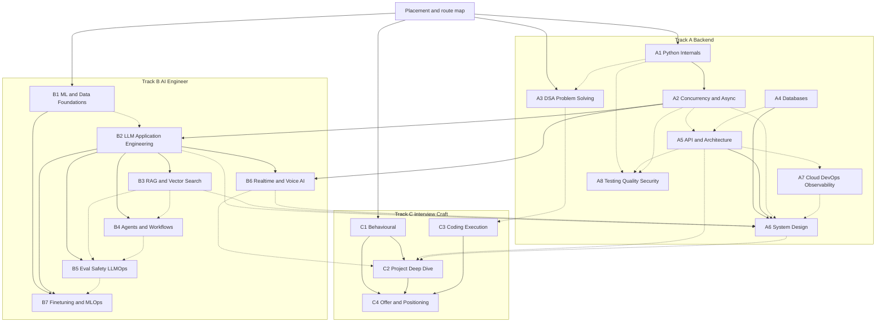
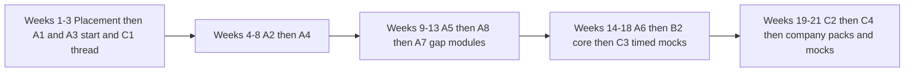
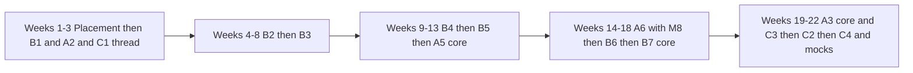
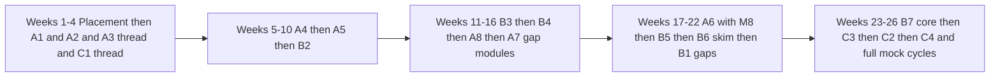

# Boss Decisions and Ownership Matrix

## 0. How to read and obey this document

1. **Precedence.** Decisions here override any conflicting text in a syllabus, review or the brief. Wave-2 agents revise their syllabus to comply and add a "Boss compliance log" (one line per decision ID applied) at the end of the file.
2. **IDs.** `G-n` global standards, `R-<course>-<n>` rulings on open questions, `O-n` ownership rows, `P-n` platform capabilities, `S-n` engineering spikes. Cite IDs in change logs.
3. **Module and lesson IDs** are `A5.M4` and `A5.M4.2`. The level labels `L1` to `L4` are reserved for **learner levels** (see G-4). A4 used `L1`..`L5` for lesson numbers; rename to `.1`..`.5`.
4. **Do not edit** the template, the scope document or this file. Propose changes in your "Open items for boss" list (max 3, only real ones).
5. **Judgement marks.** Numbers marked `[judgement]` are boss estimates to be calibrated after the 3-learner pilot; numbers marked `[verify]` need web or human confirmation (listed in the consolidated review).

---

## 1. Global standards (binding for every course)

### G-1 Ownership principle and pointer rule

- Every topic has **one owner course (and module)** that holds depth: lessons, labs, assessment items and the canonical visual.
- Other courses keep only a **pointer**: at most one lesson section of 20 minutes or less (a short recap plus a link to the owner lesson ID), no lab, no new code task, at most **one** `ref` question item (an item copied by reference from the owner bank, never re-authored). A pointer never carries its own mastery-check weight beyond that one item.
- Each module table gains a final row **Ownership notes**: `OWNS:` topics this module owns; `POINTS:` topic -> owner ID (for example `idempotency keys -> A5.M4`).
- Pointers are one-way (downstream course points to the upstream owner). If the owner is later in the route than the pointer course, the pointer lesson must be self-contained enough for a first read and is marked "preview".

### G-2 Effort semantics and the total study budget

- **Simpler path** = L1-L2 learner route (full scaffolding, foundations included). **Deeper path** = L3-L4 route: foundations skimmed per placement, senior-bar and challenge content included, hours stated **net of typical skip-ahead**. Deeper is therefore usually shorter than Simpler in wall-clock hours but harder per hour; every syllabus header must say this in one sentence (A1 review item 6).
- Hours are stated per module (Simpler/Deeper) and must sum to the header. Module range: 0.75 h to 3.0 h Deeper; course module count 9 to 12.
- **Budget (binding): about 300 hours for the full Deeper path across Tracks A+B+C**, comprising about 247.5 h of module time plus about 47 h for final assessments, voice mocks, capstones and revision loops (table in section 5). The Simpler path is about 366 h plus assessments (about 413 h); it is a fallback, not the plan.
- **Goal-weighted routes** (section 4): Senior Python Backend about 210 h, AI Engineer about 215 h, Python+AI hybrid about 250 h. Reference learner (user zero) expected after skip-ahead: about 215 h on the hybrid route `[judgement]`.
- A course header may deviate from the section 5 hours by at most 10 percent without boss approval.

### G-3 Route multipliers (goal tags to hours)

`MUST` = 1.0 of Deeper hours, `SHOULD` = 0.6 (core modules only, chosen by the adaptive engine from the diagnostic), `NICE` = 0.25 (primer or skim lessons only). Each course's Learner-Fit Appendix marks every module and every seed question with `MUST/SHOULD/NICE` for **B** (Senior Python Backend), **A** (AI Engineer) and **H** (hybrid), written compactly as `B:M A:S H:M`.

### G-4 Level definitions (L1-L4) and Simpler/Deeper mapping

| Level | Definition for a topic | Typical years of hands-on exposure | Route |
|---|---|---|---|
| L1 | New to the topic | 0 to 1 | Simpler, all lessons, all prerequisites linked |
| L2 | Junior to mid, uses it with guidance | 1 to 3 | Simpler, skim lessons already known |
| L3 | Experienced, uses it independently, cannot always explain it | 4 to 8 | Deeper: skim foundations, study "explain at depth" lessons |
| L4 | Senior or expert, owns it in production | 9 plus or recognised owner | Deeper plus Challenge items; skip to mastery check where scored |

### G-5 Placement bands (default, configurable, calibrate after pilot)

Per module, using that module's 5 to 8 diagnostic items (drawn from the module's existing MCQ/predict buckets, not extra authoring): **>= 85** skip lessons, take mastery check (and optional Challenge); **70-84** skim (Deeper-only lessons plus mastery check); **50-69** study (standard path); **< 50** deep-study (Simpler path plus linked prerequisite remediation). No band ever waives the course final assessment. Whole-course test-out is allowed only by passing the course final mastery check at 85 percent plus the voice mock at the Senior bar.

### G-6 Readiness criterion (standard definition; courses add topic specifics)

A learner is "interview-ready on topic T" when all hold: (1) module mastery check >= 85 percent on a retake spaced >= 7 days after first pass; (2) timed task for T passed (hidden tests, or rubric >= 3.5 for design/behavioural); (3) strict-mode voice drill on T's tags at **Senior bar** (average >= 3.5 of 5, no competency < 3) in **two sessions at least 48 hours apart**; (4) no open remediation flag on T's prerequisites. Badge threshold ("Meets") is lower: average >= 3.0, none < 2. Readiness is per topic tag, rolled up per role target by the Interview Master.

### G-7 Standard thresholds (normalising the 75/80/85 mix across syllabi)

Module mastery check 80 percent. Course final mastery check 80 percent (A2 and B4 move from 75 to 80 for this component; their practical/rubric components keep their own thresholds). Voice mock for badge: "Meets" (average >= 3.0, none < 2); for readiness: Senior bar (G-6). Design/canvas: rubric overall >= 3.5, no dimension < 3, no critical rule findings. Hidden-test coding tasks: >= 70 percent of hidden tests plus correct stated complexity.

### G-8 Version baseline for content and sandbox (override local choices)

| Item | Pin | Notes |
|---|---|---|
| Python | **3.14 default** image; 3.13 and 3.15 selectable for version-difference lessons; **free-threaded 3.14t selectable** (A1.M3, A2.M1 only) | Re-evaluate default to 3.15 when 3.15.1 or later ships and NumPy, pandas, psycopg, pydantic, scikit-learn wheels exist `[verify]`. Teach 3.12 as minimum idiom floor. B1 pins its libraries on the same interpreter (not 3.12/3.13) |
| PostgreSQL | **18.x** primary; 17 differences noted; PG 19 notes only after GA and review | Never teach beta features as fact |
| MySQL | **8.4 LTS** primary; 9.x as "innovation notes"; add a 9.7 image only after `[verify]` of its LTS status and driver support | 8.0 EOL flagged as legacy |
| Redis-compatible | Latest stable OSS-compatible build; say "Redis-compatible (Redis or Valkey)" in designs | Licence note as vendor-risk only |
| Frameworks | FastAPI plus Pydantic v2, Django 5.2 LTS (6.x notes), Flask 3.x, SQLAlchemy 2.x, Celery 5.x, pytest 8/9 `[verify]` | Pins live in one platform manifest, not per course |
| Kubernetes / Terraform / OTel | Current minus one minor at review date; Terraform with OpenTofu note; OTel stable signals only | Static validators only in the sandbox (P-11) |
| LLM providers | Tier language, no model names in lessons; dated "Provider Notes" sidebars; prices from a dated data file | Code uses the thin `LLMClient` adapter (R-B2-1) |

### G-9 Competency tag registry (one namespace, hyphens, one owner per tag)

- Format `<domain>.<topic>` lowercase with hyphens (A8 used underscores such as `eng.test_strategy`: convert to hyphens).
- Normalisations: `security.api` -> `sec.api`; `sd.ai-feature` and `system-design.ai-systems` -> `design.ai-systems`; `llm.model-selection` owned by B2 (B7 uses `llm.model-routing`); C4 drops `hr.notice-period` and `hr.expectations` as primary tags (owned by C1; C4 may add them as secondary); `perf.load-testing` stays A8; `api.fastapi-async` stays A2.
- A tag's **owner course** issues competency credit; pointer courses may attach the tag as secondary (no credit). The platform keeps the registry; wave-2 agents list in the header only tags they own and, separately, secondary tags.

### G-10 Question-bank rules

- IDs: `Q-<course>-<module>-<n>` (for example `Q-A5-M4-07`). Each item has one owner course; other courses reference by ID (`ref`), never copy.
- Template targets stay (12 MCQ, 6 code-output, 4 coding, 8 verbal, 3 scenario per module). **Track C relabel:** for C1, C2 and C4 the "coding/SQL" bucket becomes **applied artefact tasks (rubric-scored)** x4 (for example script rewrite, worksheet, story-card audit); C3 keeps coding. B6 and B7 use harness or calculator tasks in the coding bucket.
- Placement diagnostics (5-8 per module) are tagged `placement` items chosen from the MCQ/predict buckets.
- Every verbal seed keeps: ideal outline, weak answers, 2-3 probes, difficulty, competency tag, cluster tag, plus **goal tag** `B:M A:S H:M` and `senior-bar note` (what mid vs senior vs staff adds, one line).
- Cluster vocabulary fixed: IT-services, global-IT-consulting, Big4, global-product, Indian-product, AI-startup.

### G-11 Learner-Fit Appendix (mandatory section 8 in every wave-2 syllabus; table-driven, at most about 250 lines)

| Part | Required content |
|---|---|
| LF-1 Level paths | Table L1/L2/L3/L4: route, hours, practice mix, what is skipped, challenge items |
| LF-2 Module matrix | One row per module: diagnostic item IDs and count; band actions (skip/skim/study/deep-study); `B/A/H` tags (G-3); interview-weight percent per target (sums to 100 per target, with a one-line rationale and `[judgement]` flag); rehearsal modes (voice drill, coding, canvas, behavioural, project deep-dive); module readiness criterion (G-6 specialised) |
| LF-3 Experience bridge | Per module: "you already know" (FastAPI, Django, Flask, Postgres/MySQL, Redis, Docker, AWS Lambda/S3, MQTT, LLM APIs, voice agents) -> "gap between using it and explaining it at senior depth" |
| LF-4 Senior-bar framing | Per module: signals separating mid, senior and staff answers (trade-offs, failure modes, scale, operations, cost, mentoring) |
| LF-5 Adaptive hooks | Remediation links (module -> prerequisite module IDs), challenge extensions, which modules the adaptive engine may reorder or defer, mastery thresholds |
| LF-6 Applied labs | One production-framed lab per module (backend, IoT, SaaS, AI assistant, voice, enterprise) named in one line |
| LF-7 Currency and quality bar | Per module: dated stamp, one memorable visual or analogy, top 3 misconceptions handled |

### G-12 Freshness, integrity and tone

- Cadence: AI/LLM and vendor content every 3 months; security and standards every 6; stable theory every 12. Every lesson carries a "last reviewed" stamp and the "as of" date for version claims.
- No invented statistics, salaries, hiring rates, latency or price claims; numbers in examples are labelled placeholders or come from supplied datasets. No model names in lessons (provider notes only).
- Compliance, tax and legal content is awareness only with the standard disclaimer; publication of C4 modules on compensation, offers, notice and BGV is **gated on human professional review** (R-C4-3).
- Indian context where useful; globally valid technically.

### G-13 Shared lessons (single source, reused in several routes)

The platform must support a lesson being referenced by multiple routes by stable ID (P-21). Designated shared lessons: **X1 Compliance primer** (owner A8.M9.4: DPDP Act, GDPR basics, retention, consent, residency, breach notification, ASVS/SOC2 awareness), **X2 Retry, backoff and jitter** (owner A5.M4), **X3 Cost-estimation template** (owner B2.M9 for tokens; infra levers A7.M10), **X4 Provider notes template** (owner B2), **X5 LLM Lab Harness orientation** (owner B5.M1, 20 min, first thing in B-track labs), **X6 Seven-step execution loop** (owner C3.M1).

---

## 2. Rulings on every open question

Format: ID, the question in brief, **ruling**. Review-log "unresolved questions" (REV-A1, REV-A4, REV-B2) are merged into the matching course.

### A1 Python Internals (SME questions 1-5 plus REV-A1 1-5)

| ID | Question | Ruling |
|---|---|---|
| R-A1-1 | Container internals (dict, list) in A1.M1 or A3? | **A1.M1 owns mechanism** (hashing, open addressing, resize, list over-allocation, str and int representation, `__slots__`). **A3.M1 owns the cost model as used in problem solving** (complexity table, exercises) and links to A1.M1 for why. Keep one hash-table animation, in A1. |
| R-A1-2 | Sandbox Python 3.14 or 3.15; free-threaded build? | G-8: **3.14 default**, 3.13/3.15 selectable, **3.14t selectable** for A1.M3 and A2.M1 benchmarks. Switch gate to 3.15 per G-8. Treat all 3.15 features as `[verify]` until What's New is checked. |
| R-A1-3 | Who owns the "which concurrency tool" guide? | **A2.M1 owns it fully.** A1.M3 keeps GIL semantics, free-threading and JIT status plus a one-paragraph pointer. No assessment items on the guide in A1 beyond one `ref`. |
| R-A1-4 | Logging fundamentals in A1 or A7? | **A1.M8 owns stdlib logging mechanics** (hierarchy, handlers, `dictConfig`, QueueHandler, contextvars filter). **A7.M9 owns structured logging at platform level** (JSON, correlation IDs in pipelines, cost, PII in logs) and must not re-teach handlers. |
| R-A1-5 | 11 modules acceptable? Merge M8/M10 into a supplement? | Keep 11 modules; no supplement. Tag A1.M8 and A1.M10 `B:S A:S H:S`, M3 and M11 `B:M`. Deeper cap 14 h (G-2 tolerance). |
| R-A1-6 (REV) | Free-threading status wording; effort semantics; template gaps | Effort semantics fixed by G-2. Free-threading: state PEP 703/779 phases and "as of" date; never claim default status. |

### A2 Concurrency and Async

| ID | Question | Ruling |
|---|---|---|
| R-A2-1 | Rate limiting, idempotency, outbox: A2 vs A5 vs A6? | **Rate-limit algorithms and Redis implementation, idempotency-key middleware, retry/backoff/jitter, circuit breaker and bulkhead implementation: owner A5.M4.** **Transactional outbox implementation (relay worker, idempotent consumer): owner A5.M8.** **Delivery-semantics theory (at-least-once, effectively-once), saga, CDC, system-level reasoning and the rate-limiter service design: owner A6.M4.** **A2.M6 owns only the in-process async mechanics**: bounded queues, semaphore as concurrency limiter versus rate limiter, load shedding in a coroutine pipeline, in-process token bucket (30 lines). **A2.M9 owns worker-level semantics** (acks_late, visibility timeout, idempotent task handling, poison messages) and points to A5 for keys and outbox. Remove duplicate items; the canonical Redis token-bucket coding task is A5's. |
| R-A2-2 | `SKIP LOCKED` queues: A4 M6 vs A2 M9? | **A4.M6 owns** the primitive (semantics, lock modes, lab). **A2.M9 owns the decision** "DB-backed queue vs broker" (matrix) plus a 30-minute applied lab that reuses A4's worker. A5.M8 points. |
| R-A2-3 | Sandbox: free-threaded build, Celery/RabbitMQ services? | Free-threaded 3.14t: **yes** (P-01). Redis and PostgreSQL per attempt: **yes** (P-04). **Celery runs in eager and in-memory-broker mode plus Redis-backed; RQ with Redis; no RabbitMQ, Kafka or SQS live in 1.0** (design and reading only; AWS queue semantics via emulator spike S-1). |
| R-A2-4 | Django Channels/async coverage? | **No Channels.** Keep a one-page Django async note in A2.M8 (async ORM partial, `sync_to_async`, thread sensitivity) with a pointer to A5.M10. |
| R-A2-5 | AI-workload concurrency angle in A2 or B? | **Mechanics stay in A2** (SSE streaming, semaphore for provider limits, `to_thread` for sync SDKs, cancellation on client disconnect). **Provider-specific streaming, 429 handling and token budgets: B2.M8/M9.** Tool-call fan-out in agent loops: B4.M5 (using A2 TaskGroup). Real-time audio concurrency: B6.M3. The A2 capstone Q10.3 stays generic. |

### A3 DSA and Problem Solving

| ID | Question | Ruling |
|---|---|---|
| R-A3-1 | Communication protocol: A3 or C3? | **C3.M1 owns the canonical seven-step loop** (clarify, examples, approach, complexity, code, test, optimise) and think-aloud. **A3 drops its nine-step variant**, keeps a half-page recap with a link, and uses C3's step names in rubrics. |
| R-A3-2 | Complexity-aware large-case timeout; pinned Python? | **Yes** (P-15): operation-count proxies plus calibrated multipliers, never raw wall-clock alone. Python per G-8. Teach negation for max-heap; `heapq` max-heap helpers only as a version note `[verify]` for 3.14+. |
| R-A3-3 | Fenwick, segment tree, SCC, bridges? | Keep as **Challenge lessons** (<= 2 h total, `B:N A:N H:N`), not gating; advanced packs stay 1.1. |
| R-A3-4 | Library policy: stdlib shortcuts allowed? | **Default allow** `heapq`, `bisect`, `itertools`, `collections`, `functools`. Provide a **strict from-scratch variant** (import allowlist per task, P-15) used in one item each in M4, M6, M7, M10 and as a company-pack switch. IDE shows the importable-library list. |
| R-A3-5 | Placement DSA section shape? | Fixed **4-item adaptive core** (one per pattern family) plus an adaptive pool; 15-25 minutes. A3 supplies the tagged pool (pattern, difficulty, time); placement spec owns the engine. |

### A4 Databases

| ID | Question | Ruling |
|---|---|---|
| R-A4-1 | MySQL pin 8.4 or 9.7; is 9.7 LTS; version labels? | **8.4 LTS primary** (G-8). 9.x taught as "innovation notes" and only features that are stable; **no 9.7 image until `[verify]`** of LTS designation, naming ("26.x" labels) and driver support. Content says "MySQL 8.4 LTS and later LTS". |
| R-A4-2 | PostgreSQL 19 GA? | Pin **18.x**. Add a boxed "What changes in 19" only after GA and review. |
| R-A4-3 | IDE capability for two-session, replication, PITR labs | **Two-session mode is mandatory in 1.0** (P-05) for M5 and M6. **No live replication or multi-node labs in 1.0**: M7 replication and M9 PITR use guided step-through simulators with recorded outputs; a single-node base-backup-and-restore lab is optional `[judgement]`. Vacuum, bloat and wraparound demos run single-node with a limited-privilege role (P-06). |
| R-A4-4 | Boundaries: sharding/caching (A6), managed DB (A7), pagination (A5) | Sharding strategy and cross-service consistency: **A6.M3**; A4 keeps partitioning and "when sharding is justified" at database level. Caching mechanics: **A5.M5**; cache topology design: A6.M2; A4 keeps DB-side caching (buffer cache, materialised views). Managed DB selection and operations (RDS/Aurora): **A7.M5**. Pagination: **API contract and cursors A5.M3; SQL keyset, index and plan A4.M4** (A5's lab reuses A4's query). pgvector: **B3.M4** (A4 keeps one pointer lesson). |
| R-A4-5 | Effort 30/22 h and placement skip scope | Effort approved. Placement may skip **M1 and M2 lessons only**; M3-M10 test-out via mastery check; whole course only via G-5 test-out. Authoring priority wave: M3, M4, M5, M6, M8. |
| R-A4-6 (REV) | Items still `[verify]` | Carried to the verify checklist. |

### A5 API and Backend Architecture

| ID | Question | Ruling |
|---|---|---|
| R-A5-1 | Contract testing: A5 or A8? | **A8.M3 owns** consumer-driven contracts, schemathesis and property-based API testing. **A5.M2 keeps** contract-first OpenAPI, breaking-change classification, lint and diff tooling, and points to A8. |
| R-A5-2 | GraphQL/gRPC depth? | **Stay in A5.M9 at overview plus trade-offs**; no elective in 1.0. WebSocket/SSE: protocol choice A5.M9; server implementation A2.M7; LLM token streaming B2.M8; audio transport B6.M3. |
| R-A5-3 | LLD/machine-coding exercises: A5 or C3? | **C3 owns the round format and process** (new lesson in C3.M7, see C3 upgrade). **A5.M10 owns architecture and design patterns in Python** (add one lesson: strategy, factory, observer, adapter, repository, dependency injection) and supplies 6 LLD problem seeds tagged `lld` to C3. A8.M6 owns SOLID/clean-code principles. |
| R-A5-4 | Local OIDC test provider? | **Mocked token issuer only** (local JWKS signer with fixed keys, scripted claims, expiry and key-rotation controls) (P-09). No full IdP in 1.0. |
| R-A5-5 | LLM-backed endpoint API design? | **B2.M8/M9 own** token-metered limits, streaming plumbing and non-deterministic retry semantics. A5 keeps one worked example (<= 20 min) in M4 and points. A6.M8 (LLM gateway) uses both. |

### A6 System Design

| ID | Question | Ruling |
|---|---|---|
| R-A6-1 | Canvas vocabulary and rule IDs | **Adopt A6 sections 1.1 and 1.3 as canvas vocabulary v0.1** with the amendments in section 7. Rule IDs are **stable** (`R-<AREA>-<n>`, never renumbered or reused). A6 owns rule semantics and the registry content; the canvas spec owns implementation; other courses may only reference rule IDs and propose new rules to A6. |
| R-A6-2 | Overlap boundaries; who owns the canonical rate-limiter coding task? | A6 keeps **design-level** treatment only. **Canonical rate-limiter coding task: A5.M4.** A6's timed coding set reuses A5/A3 items by `ref` or adds distinct ones (consistent hashing, outbox poller). A6 owns the rate-limiter **service design** (library item 2). |
| R-A6-3 | 20 designs at launch vs scope 25+? | **Closed beta: 20 designs. Public 1.0: 26** (20 plus the 6 stretch designs, authored in wave 3 after pilot). B4 supplies the agent/workflow orchestration platform design seed to A6's library. Each design carries decision card, estimation sheet, rule expectations and probing tree. |
| R-A6-4 | Placement reuse; calibration tolerance owner | System-design placement section draws from A6 items tagged `placement` (M1 estimation and M10 probing). Evaluator-vs-SME agreement target (initial, tune after pilot) `[judgement]`: on a labelled set of at least 30 designs, evaluator score within +/-0.5 of SME mean on at least 80 percent of dimension scores and rank correlation >= 0.8. Owner: Interview Master team; A6 supplies the labelled designs. |
| R-A6-5 | Consulting-style rubric variant | **Re-weighting profile in admin config**, not a second rubric: "solution-architecture" profile (D1 15, D4 15, D10 10, D2 5, D5 10, others rescaled). A6 documents it in an appendix. |
| R-A6-6 | Voice-agent platform design: A6 or B6? | **Canonical design and canvas task: A6 library #17.** B6.M11 is converted to the voice latency-budget workbook plus a generic "interview voice agent" case study; it must not duplicate the canvas task or question bank (see B6). |

### A7 Cloud, DevOps and Observability

| ID | Question | Ruling |
|---|---|---|
| R-A7-1 | Kubernetes beyond basics? | Stays **1.1** (per scope). Allow one optional Challenge lesson (<= 2 h) in M3: operators, service mesh and networking internals as awareness only. |
| R-A7-2 | AWS emulation approach | **No live cluster, Docker daemon or cloud in 1.0.** Spike S-1 decides between an in-process moto-style emulator (preferred) and LocalStack after licensing review `[verify]`; Kubernetes and Terraform use static validators plus scripted step-through simulators (P-11). Every lesson states what the emulator does not model (IAM enforcement, limits, timing). |
| R-A7-3 | Observability for LLM and voice workloads | **B5.M7 owns LLM observability** (traces, token and cost metrics, drift, quality monitoring); **B6 owns voice metrics** (per-stage latency, barge-in, WER sampling); B4.M8 owns agent-trace specifics. **A7.M9 keeps generic OTel, metrics, tracing and SLOs** plus one pointer lesson (<= 20 min) on GenAI spans. Remove "M9 L5" depth. |
| R-A7-4 | Terraform only, or CDK/CloudFormation? | **Terraform sole IaC** (OpenTofu note). One comparison lesson (CloudFormation, CDK, Pulumi) at table level; no labs. |
| R-A7-5 | Cost/FinOps in A6 too? | **Cost levers for infrastructure: A7.M10 owns.** LLM token cost: B2.M9 (template X3). RAG and serving cost: B3.M9, B7.M8. A6's dimension D10 uses one shared **cost rubric card** (A6 owns the card; A7 and B2 supply inputs). |

### A8 Testing, Quality and Security

| ID | Question | Ruling |
|---|---|---|
| R-A8-1 | A5 vs A8 boundary for auth and security | **A5.M6 owns protocols, token design and object-level authorisation design.** **A8.M7 owns OWASP API Top 10 depth, injection, SSRF and exploit-and-fix labs.** **A5.M7 is reduced** to design-time controls (CORS, CSRF, security headers, TLS, mass-assignment at schema level, webhook signing pointer to M8) and points to A8.M7 for BOLA, BFLA, SSRF (see A5 upgrade). |
| R-A8-2 | CI security gates: A7 or A8? | **A7.M8 owns pipeline design including SAST, dependency scanning and gates.** A8.M8 owns tool concepts and local usage (pip-audit, bandit, semgrep, ruff security rules, secret scanning) and must not design pipelines. Container supply chain (scanning, SBOM, signing): A7.M2. Python dependency supply chain (pinning, hashes, typosquatting, trusted publishing): A8.M8. |
| R-A8-3 | Shared vulnerable "lab API"? | **Yes**: a platform-owned, network-isolated, ephemeral **Lab Service** (P-10) used by A8, A5.M7 and A7 labs, after legal and security review (spike S-6). Fallback if review fails: code-review and static-analysis tasks on vulnerable snippets. Payloads stay educational. |
| R-A8-4 | LLM-app security: A8 or B5? | **B5 owns depth** (M4 red-team and injection, M5 PII, M6 guardrails). **A8.M9 keeps generic threat modelling plus a pointer lesson (<= 45 min)** mapping the OWASP LLM Top 10 to B5; the A8 canvas threat-model task stays. B2.M10 keeps basics (<= 1 h). B4.M9 owns agent-specific tool-permission design. |
| R-A8-5 | Performance (M10) stay in A8? | **Stays in A8.M10** (load-testing method, percentiles, Little's Law, bottleneck finding at service level). A1.M11 owns Python profiling; A2.M10 owns async stall diagnosis; A7.M9 owns production telemetry. |

### B1 ML and Data Foundations

| ID | Question | Ruling |
|---|---|---|
| R-B1-1 | Fine-tuning mechanics boundary | **B7 owns all fine-tuning mechanics.** B1 keeps one conceptual paragraph (<= 15 min). B1.M7 owns forward/backward and optimiser memory intuition; **B7.M8 owns GPU memory arithmetic and calculators**. |
| R-B1-2 | Embeddings/ANN split | **B1.M8 owns** what embeddings are, similarity metrics, normalisation and **tokenisation mechanics** (BPE, vocabulary, token cost). **B3.M3 owns** embedding-model selection, dimension, Matryoshka, quantisation, query/document prompts and evaluation. **B3.M4 owns ANN indexing** (HNSW, IVF); B1.M8 keeps one slide on the recall/latency trade-off. B2.M1 owns token accounting in application cost. |
| R-B1-3 | Sandbox: scikit-learn, pandas, PyTorch? | **Yes to NumPy, pandas, scikit-learn; CPU-only small PyTorch** with limits in P-02 (<= 2 min per run, 4 GB RAM for B1). Heavier demos use precomputed outputs. Tokenisers and vocab files bundled offline `[verify]` licence. |
| R-B1-4 | NumPy/Pandas (M6) as shared prerequisite | **Stay in B1 as owner (`B:N A:M H:S`)**, exposed as a standalone-testable module with its own placement items; A1/A3 link to it as optional. |
| R-B1-5 | Statistics add-on? | **No separate add-on.** Add a 1.5 h lesson to B1.M10: confidence intervals (bootstrap), p-value intuition, power, multiple comparisons; B5 uses it for eval uncertainty. |

### B2 LLM Application Engineering (SME questions plus REV-B2)

| ID | Question | Ruling |
|---|---|---|
| R-B2-1 | Provider-neutral samples | **One thin in-house `LLMClient` protocol adapter** (messages-style and responses-style shapes behind it) for all code in B2-B7; no heavy abstraction library as a dependency (name LiteLLM-style libraries in one comparison sidebar). Graded tasks run against recorded fixtures (P-07). |
| R-B2-2 | Ownership B3/B4 | Confirmed: **RAG architecture, RAG-vs-long-context decision, retrieval: B3 (decision tree at B3.M1).** **Prompt vs RAG vs fine-tune decision framework: B7.M1.** **MCP and tool-design depth: B4.M2.** B2.M7 keeps context-window management (ordering, compaction, summarisation, memory hooks) and one pointer slide to each decision owner. |
| R-B2-3 | OWASP LLM Top 10: B5? | **B5 owns fully.** B2.M10 stays at basics (<= 1 h): output validation, injection awareness, PII hygiene. |
| R-B2-4 | Mocked providers or live budget? | **Graded tasks: recorded/mock only.** Optional live mode through the AI Gateway with per-learner caps, never gating badges (P-23). No bring-your-own keys. |
| R-B2-5 (REV) | 12 modules and 13-18 h acceptable? | Accepted with trims: M11 compressed to <= 1 h (eval basics, pointer to B5), M12 limited to "LLM feature architecture patterns and client-side gateway concept" (gateway system design is A6 #16). Target 16/11.5 h. |

### B3 RAG and Vector Search

| ID | Question | Ruling |
|---|---|---|
| R-B3-1 | RAG evaluation: B3 or B5? | **B3.M8 owns RAG-specific metric definitions and failure analysis** (recall@k, MRR, nDCG, context precision/recall, faithfulness, citation accuracy; retrieval golden sets and hard negatives). **B5.M1-M3 own general eval methodology** (golden-set discipline, slicing, CI gating, statistics, judge calibration and bias). B3.M8's LLM-as-judge content shrinks to a pointer (<= 20 min). Agent-specific evaluation stays B4.M8. Rule: metric definitions live where the system type lives; methodology lives in B5. |
| R-B3-2 | Managed cloud RAG services to name | One build-vs-buy comparison lesson in B3.M1 naming Amazon Bedrock Knowledge Bases, Azure AI Search and Vertex AI Search as **dated examples** (AWS emphasis given the reference background) `[verify]`. No labs. |
| R-B3-3 | Sandbox: CPU embedding model plus pgvector? | **Yes**: Postgres with pgvector (P-04) and a small pinned CPU embedding model, with **frozen embedding fixture mode as the default** for determinism. BM25 via a pure-Python library or Postgres full-text; OpenSearch is design-only. |
| R-B3-4 | Multimodal and document AI | **Overview only** (<= 45 min, B3.M2 and M10); no elective in 1.0; OCR labs use fixtures. |

### B4 Agents and Workflows

| ID | Question | Ruling |
|---|---|---|
| R-B4-1 | Mock-model labs; gateway budget for live mode | **Deterministic mock model labs (P-07) are the graded path.** Live mode optional, gateway-capped, never gating. |
| R-B4-2 | Standard framework for the comparison lab | **Framework-neutral thin loop in all labs.** The framework comparison is a **code-reading and design exercise** (no install), using one graph-style framework chosen by engineering `[verify currency]`. |
| R-B4-3 | LLM-as-judge and red-team depth | **B5 owns.** B4.M8 keeps agent-specific evaluation (trajectory, task success, tool-call accuracy, step efficiency); B4.M9 keeps agent-specific security design (excessive agency, confused deputy, tool permissions) with pointers to B5.M4. |
| R-B4-4 | Durable-execution lab environment | **Yes in the Python sandbox**: SQLite/Postgres-backed state machine with a crash-injection API (kill-and-resume) (P-12). Workflow engines (Temporal-style) are conceptual only in 1.0. |

### B5 LLM Evaluation, Safety and LLMOps

| ID | Question | Ruling |
|---|---|---|
| R-B5-1 | Remove guardrails from B2 or keep as preview? | **Keep a preview in B2.M10 (<= 1 h); B5 is the deep treatment.** B2 assessment items on attack classes are limited to MCQ. |
| R-B5-2 | Shared mocked-LLM harness | **Yes: one platform capability, "LLM Lab Harness" (P-07)**, built once by engineering; B2-B6 contribute fixtures to a shared repository. Orientation lesson X5 (B5.M1). |
| R-B5-3 | Regulatory awareness location | **X1 Compliance primer (owner A8.M9.4)** covers DPDP Act, GDPR basics, retention, consent, residency, breach notification. **B5.M9 owns AI-specific governance** (EU AI Act tiers, NIST AI RMF, ISO/IEC 42001, model cards) and links to X1. B6 keeps voice-specific consent and call-recording awareness (<= 20 min). B3.M7 and B7.M6 point to X1. The AI route pulls X1 as a shared lesson even if A8 is `NICE`. |
| R-B5-4 | Live-provider eval mode in 1.0? | **Recorded-response mode is default and graded; live mode optional behind gateway caps**, never gating. |
| R-B5-5 | Owner of human-labelled calibration datasets | **Content Lead** (founder plus SME panel) owns; B5's wave-2 agent drafts three synthetic labelled sets (summarisation, RAG faithfulness, safety refusal; 60-100 items each) for two human labellers; stored as platform "calibration sets"; no real user data. |

### B6 Real-time and Voice AI

| ID | Question | Ruling |
|---|---|---|
| R-B6-1 | Optional live-provider labs? | **Harness-only in 1.0**; no bring-your-own keys. A non-gating live demo through the gateway is allowed only after the provider bake-off. |
| R-B6-2 | Owner of Indian-English technical speech fixtures | **Interview Master/voice team** (bake-off deliverable); consent-cleared speakers or synthetic speech only; licence allows reuse in B6 labs; no learner audio. |
| R-B6-3 | WebRTC internals deep-dive module? | **No new module.** Keep interview depth in M3 plus one Challenge lesson (ICE, STUN/TURN, SFU; <= 1.5 h, `B:N A:N H:N`). |
| R-B6-4 | M11 Interview Master case-study sign-off | M11 is rewritten as **latency-budget workbook plus a generic interview-voice-agent case study** with no unreleased internals. Interview Master specifics may be added later as an admin-managed note after product sign-off. |
| R-B6-5 | Where does voice-agent platform design live? | **A6 library #17** (design and canvas). B6 owns voice technology questions (VAD, barge-in, transport, STT/TTS quality, telephony), the latency method and numbers. |

### B7 Fine-tuning, Model Selection and MLOps

| ID | Question | Ruling |
|---|---|---|
| R-B7-1 | GPU-backed notebooks? | **No GPU in 1.0.** CPU-only tiny models, calculators, config review, recorded training logs. Optional GPU notebooks 1.1. |
| R-B7-2 | B5 vs B7 boundary (M5, M9) | **B7.M5** evaluates tuned models (before/after, forgetting, held-out sets, win-rate). **B7.M9** owns model-artefact lifecycle (registry, lineage, reproducibility, classical drift). **B5.M8 owns LLM release engineering** (prompt and model versioning in the app, canary, shadow, A/B, rollback gates). B5 owns the eval harness; B7 adds tuned-model specifics only. |
| R-B7-3 | Compliance content here or in a primer | **B7.M6 keeps licence literacy only** (open-weight licences, provider data and training terms) and points to X1. |
| R-B7-4 | Hosted fine-tuning hands-on lab? | **No paid-API lab in 1.0.** A dry-run lab with provider-shaped fixtures (create job, poll, evaluate) runs in the harness. |

### C1 Behavioural and Leadership

| ID | Question | Ruling |
|---|---|---|
| R-C1-1 | Career narrative and "4 years Python" probe: C1, C4 or C2? | **C1 owns the spoken career narrative** (90 s and 3 min "tell me about yourself", the "only 4 years of Python" probe, "why switch" answer, story bank). **C4 owns the positioning thesis** (role target, evidence-to-role mapping, written profile and recruiter pitch) and **merges its M2 and M3 into one module** that produces a one-paragraph thesis consumed by C1.M9. **C2 owns project-level narrative** only. |
| R-C1-2 | Hard cap L2 when no result or contribution | **Strict mode applies a cap to the result/ownership dimension (L2) for that answer**; coaching mode flags and coaches only. Configurable in admin; default on in strict. |
| R-C1-3 | Quote published company principles in packs? | Allowed: **list published principle titles as facts with a link to the primary source and neutral-wording themes**; no copying of descriptive text beyond a short phrase; subject to legal review. |
| R-C1-4 | Learner-confirmed facts sheet | **Yes: one profile entity, the Profile Facts Ledger** (roles, dates, team sizes, metrics, projects, confirmed claims), shared by C1 consistency checks, C2 claim-risk and C4 negotiation role-plays (P-20). Optional for the learner; scorer flags inconsistencies only against it or the transcript. |
| R-C1-5 | India HR round mirrored for non-India markets? | **Defer to 1.1**; add one awareness lesson (<= 30 min) in C1.M7 on global HR-screen differences. |

### C2 Project Deep-Dive and Resume Defence

| ID | Question | Ruling |
|---|---|---|
| R-C2-1 | Claim ledger location | **Profile-level Profile Facts Ledger** (R-C1-4); confirmation is a single onboarding step used by all interview types and later Resume Studio; C2 teaches building it and reads/writes it. |
| R-C2-2 | C2.M7 vs C1 failure and conflict stories | **C1 owns generic failure/conflict STAR stories; C2.M7 reuses by reference** and adds only project-specific failure, ownership and NDA abstraction content. Separate question tags. |
| R-C2-3 | Canvas "my own architecture" mode; diagram-vs-story rubric owner | **Confirmed for 1.0**: free-form mode on the same canvas with the v0.1 vocabulary and graph export. **Rubric owner for "diagram vs story consistency": C2** (content); engineering implements; it is rubric-based, not a deterministic rule. |
| R-C2-4 | Show numeric claim-risk band from first release? | **Qualitative feedback only until calibration is met**: at least 30 SME-labelled transcripts and agreement within one band on >= 80 percent `[judgement]`; band then enabled by admin flag. |
| R-C2-5 | Placeholder policy for archetypes | **Keep generic fictional archetypes in shared content.** The founder's real projects live only as private, learner-owned data in the founder's account and are never seeded into the product. |

### C3 Coding Interview Execution

| ID | Question | Ruling |
|---|---|---|
| R-C3-1 | Who defines the placement coding-execution probe and skip threshold? | **Placement spec owns the engine and threshold**; C3 supplies the task pool and process rubric. Default skip threshold: process score >= 75 percent of rubric `[judgement]`, tune after pilot. |
| R-C3-2 | AI-assistant policy at principle level only? | **Yes**: ask, comply, disclose, verify; no per-company policy table; reviewed every 3 months. |
| R-C3-3 | Explaining to a non-technical stakeholder | **C2.M3 owns multi-depth delivery including non-technical audiences**; C1.M4/M5 own stakeholder stories; C3.M2 keeps one 20-minute pointer for consulting-style rounds. |
| R-C3-4 | Hidden-test display policy | **Accepted with edits**: Interview mode shows only visible-test and run results during the session; after final submission show aggregate hidden pass/fail and **category labels** (empty input, large input, duplicates) but never inputs or expected outputs. Practice mode may show category names after two failed submissions. Learn mode may reveal a failing case only in the post-mortem view after pass or give-up. IDE must tag hidden tests by category and expose per-category catch rate (P-15). |
| R-C3-5 | Take-home storage and scoring | **Yes in 1.0**: multi-file project in the IDE (<= 1 MB), hidden tests, plus an **advisory** LLM rubric review of README and structure with human sampling; voice walkthrough optional. No external repository cloning. |

### C4 Offer and Career Positioning

| ID | Question | Ruling |
|---|---|---|
| R-C4-1 | Compensation calculator tool? | **1.0: structured in-app worksheet** where the learner enters their own formulas and numbers; **no statutory or tax engine** (candidate for 1.1 with a maintained rules source and legal review). |
| R-C4-2 | Coding-task quota for C4 | **Waived and relabelled** per G-10 (applied artefact tasks, rubric-scored; script rewrite, offer-comparison, negotiation script). |
| R-C4-3 | Qualified reviewer for comp, tax and legal | **Human action item (blocking publication of M6-M10 content on compensation, offers, notice, BGV):** engage an external compensation/tax professional and employment-law counsel. SME review alone is insufficient. |
| R-C4-4 | Learner pay data in role-plays | **Allowed with explicit opt-in consent**, session-scoped by default, retained only if the learner saves it, encrypted, deletable, never used for model training, aggregate-only for admins. |
| R-C4-5 | Relocation and international offers | **Defer to 1.1**; no content in 1.0 beyond relocation negotiation inside India. |

---

## 3. Cross-course OWNERSHIP MATRIX

`Owner` = course.module holding depth. `Pointers` = courses keeping a short pointer only (G-1). Rows are binding; the syllabus modules named must be adjusted per section 8.

### 3.1 Python language and runtime

| # | Topic | Owner | Pointers |
|---|---|---|---|
| O-1 | Object model, hashing, dict/set/list/str/int internals | A1.M1 | A3.M1 (cost model use) |
| O-2 | Memory management, refcount, GC, leaks | A1.M2 | A2, A8.M10 |
| O-3 | GIL semantics, free-threading and JIT status | A1.M3 | A2.M1, B7 |
| O-4 | Concurrency tool decision guide (threads, processes, asyncio, queues) | A2.M1 | A1.M3, A5.M8, A6 |
| O-5 | Generators, iterators, context managers, decorators | A1.M4-M5 | A2 (generators to coroutines) |
| O-6 | Typing mechanics, dataclasses, enums, match | A1.M7 | A5.M2 (Pydantic at schema level) |
| O-7 | Exceptions, stdlib logging mechanics | A1.M8 | A7.M9, A2.M5 |
| O-8 | Import system, packaging, lockfiles | A1.M9 | A8.M8 (dependency risk) |
| O-9 | Serialisation, pickle risks, buffers | A1.M10 | A8.M7-M8 |
| O-10 | Python profiling (cProfile, py-spy, flame graphs) | A1.M11 | A8.M10, A2.M10 |

### 3.2 Concurrency, backend patterns and reliability

| # | Topic | Owner | Pointers |
|---|---|---|---|
| O-11 | Threads, processes, asyncio mechanics, structured concurrency, cancellation | A2.M2-M5 | A1.M3, B4, B6 |
| O-12 | In-process async limits, bounded queues, load shedding | A2.M6 | A5.M4 |
| O-13 | FastAPI/ASGI async patterns, streaming server side | A2.M7 | A5.M9, B2.M8 |
| O-14 | Async data access, pools, PgBouncer interaction | A2.M8 | A4.M7 |
| O-15 | Worker-level job semantics (Celery, RQ, acks, visibility) | A2.M9 | A5.M8, A7.M5 |
| O-16 | DB-backed queue primitive (`SKIP LOCKED`, locks) | A4.M6 | A2.M9 (decision), A5.M8 |
| O-17 | Rate-limit algorithms and Redis implementation | A5.M4 | A2.M6, A6.M4, B2.M9 |
| O-18 | Idempotency keys and conditional requests | A5.M4 | A2.M9, A6.M4, A4.M6 (SQL side) |
| O-19 | Retry, backoff, jitter, circuit breaker, bulkhead (implementation) | A5.M4 (X2) | A2.M6, A6.M5, A7.M10, B2.M9 |
| O-20 | Transactional outbox implementation and idempotent consumer | A5.M8 | A2.M9, A6.M4, A4.M2 |
| O-21 | Delivery semantics theory, saga, CDC, "exactly-once" reasoning | A6.M4 | A5.M8, A2.M9, A7.M5 |
| O-22 | Queue vs log broker comparison (design level) | A6.M4 | A2.M9, A7.M5 |
| O-23 | AWS queues and eventing services (SQS, SNS, EventBridge, Kinesis) | A7.M5 | A6.M4, A5.M8 |
| O-24 | Failure-mode thinking, DR tiers, RPO/RTO at design level | A6.M5 | A7.M10 |
| O-25 | DR implementation, backups-restore testing, incidents, postmortems | A7.M10 | A6.M5, A4.M9 |
| O-26 | Graceful shutdown | A2.M5 (process) plus A7.M3 (pod lifecycle) | A5.M11 |
| O-27 | Feature flags, progressive delivery | A7.M8 | A5.M11 |

### 3.3 Data and databases

| # | Topic | Owner | Pointers |
|---|---|---|---|
| O-28 | SQL fluency, windows, CTEs, dialect gaps | A4.M1 | C3.M7, A3 |
| O-29 | Schema design, constraints, UUIDv7, RLS data models | A4.M2 | A5.M11, A6.M9, B3.M7 |
| O-30 | Indexing, plans, tuning, keyset SQL | A4.M3-M4 | A5.M3, A2.M8 |
| O-31 | Isolation, MVCC, locking, deadlocks | A4.M5-M6 | A6.M3, A5.M4 |
| O-32 | Replication, partitioning, pooling, sharding concepts at DB level | A4.M7 | A6.M3, A7.M5, A2.M8 |
| O-33 | Sharding strategy, consistency models, consistent hashing (cross-service) | A6.M3 | A4.M7 |
| O-34 | Migrations, online DDL, vacuum, backup/PITR, observability of the DB | A4.M8-M9 | A7.M5, A7.M10 |
| O-35 | ORM pitfalls (SQLAlchemy, Django) | A4.M10 | A2.M8, A5.M10 |
| O-36 | Managed DB selection and operations (RDS, Aurora, ElastiCache) | A7.M5 | A4.M11 |
| O-37 | pgvector indexing (HNSW, IVF) and vector DB comparison | B3.M4 | A4.M3 (one pointer lesson), A6.M8 |
| O-38 | Multi-tenancy: data model and RLS | A4.M2 | A5.M11, B3.M7 |
| O-39 | Multi-tenancy: architecture patterns (pool, bridge, silo, cells, noisy neighbour) | A6.M9 | A5.M11 (tenant context only), B3.M7 |

### 3.4 API, architecture, caching

| # | Topic | Owner | Pointers |
|---|---|---|---|
| O-40 | REST design, errors (RFC 9457), versioning, OpenAPI contract-first | A5.M1-M2 | A8.M3 |
| O-41 | Pagination contract, cursors, bulk and async job resources | A5.M3 | A4.M4 |
| O-42 | HTTP caching and Redis caching mechanics (incl. stampede) | A5.M5 | A6.M2, A4 (DB side) |
| O-43 | Cache topology, sizing, hit-rate design | A6.M2 | A5.M5 |
| O-44 | OAuth2/OIDC protocols, JWT, token design, object-level authorisation design | A5.M6 | A8.M7, A7.M6 |
| O-45 | Design-time API security (CORS, CSRF, headers, TLS) | A5.M7 (reduced) | A8.M7 |
| O-46 | OWASP API Top 10 depth, injection, SSRF, exploit-and-fix | A8.M7 | A5.M6-M7 |
| O-47 | Webhooks, events, outbox at API level, AsyncAPI | A5.M8 | A6.M4 |
| O-48 | GraphQL, gRPC, SSE vs WebSocket choice (overview) | A5.M9 | A2.M7, B6.M3 |
| O-49 | Clean/hexagonal architecture, design patterns in Python, framework choice | A5.M10 | A8.M6, C3 (LLD) |
| O-50 | Config, uploads, health endpoints, tenant context hooks | A5.M11 | A7 |

### 3.5 Cloud, ops, testing, security

| # | Topic | Owner | Pointers |
|---|---|---|---|
| O-51 | Docker, Compose, K8s basics, AWS compute and serverless, IAM, VPC, Terraform, CI/CD | A7.M1-M8 | A6.M5 |
| O-52 | Container supply chain (scan, SBOM, signing) | A7.M2 | A8.M8 |
| O-53 | Python dependency supply chain | A8.M8 | A1.M9, A7.M2 |
| O-54 | CI security gates in pipelines | A7.M8 | A8.M8 |
| O-55 | Generic observability (OTel, metrics, tracing, SLO) | A7.M9 | A1.M8, A5.M11, A2.M10 |
| O-56 | Infrastructure cost levers and FinOps | A7.M10 | A6.M5 (cost card), B7.M8 |
| O-57 | Test strategy, pytest, mocks and fakes | A8.M1-M2, M4 | A2.M10 |
| O-58 | Contract testing (consumer-driven, schemathesis) | A8.M3 | A5.M2 |
| O-59 | Coverage, mutation, property-based testing | A8.M5 | A3, A2.M10 |
| O-60 | Code quality, review, SOLID and refactoring | A8.M6 | A5.M10, C3.M8 |
| O-61 | Secrets management practice | A8.M8 | A7.M6 (AWS services), A5.M7 |
| O-62 | Threat modelling | A8.M9 | A6.M5, B5.M4 |
| O-63 | Load testing method and bottleneck finding | A8.M10 | A7.M9, A1.M11 |
| O-64 | Compliance primer (X1: DPDP, GDPR basics, retention, residency) | A8.M9.4 | B3.M7, B5.M9, B6, B7.M6, C4 |
| O-110 | Networking and Linux triage fundamentals (TCP, TLS, DNS, HTTP/2-3, sockets, file descriptors, top/strace-style triage) | A7.M6 (new lesson) | A5.M1, A6.M1, A2.M10 |
| O-111 | Streaming-platform essentials (partitions, consumer groups, offsets, rebalances, compaction; Kafka-style) | A6.M4 (Challenge lesson, <= 1.5 h) | A2.M9, A7.M5 |

### 3.6 AI Engineer track

| # | Topic | Owner | Pointers |
|---|---|---|---|
| O-65 | ML framing, generalisation, classical models, metrics, leakage | B1.M1-M5 | B5 |
| O-66 | Tokenisation mechanics, embeddings concept, similarity | B1.M8 | B2.M1, B3.M3 |
| O-67 | Transformers, attention, KV-cache formula | B1.M9 | B7.M7-M8 |
| O-68 | Experiment design, A/B testing, statistics for evals | B1.M10 | B5.M7-M8 |
| O-69 | Token accounting, reasoning models, per-request model choice | B2.M1-M2 | B7.M6 |
| O-70 | Structured outputs, single-turn tool calling mechanics | B2.M4-M5 | B4.M2 |
| O-71 | Prompt caching, batching, cost and latency of LLM apps (X3) | B2.M9 | B3.M9, B4.M8, B6, A6.M8 |
| O-72 | Provider-specific streaming, 429 handling, token-metered limits | B2.M8-M9 | A5.M4, A2.M7 |
| O-73 | Context-window management and memory hooks | B2.M7 | B4.M4 |
| O-74 | RAG architecture, RAG vs long-context decision | B3.M1 | B2.M7, B7.M1 |
| O-75 | Prompt vs RAG vs fine-tune decision framework | B7.M1 | B3.M1, B2.M7 |
| O-76 | Chunking, retrieval, hybrid, rerank | B3.M2, M5 | B4 |
| O-77 | Embedding model selection and operations | B3.M3 | B1.M8 |
| O-78 | RAG metrics, retrieval golden sets, failure analysis | B3.M8 | B5.M1-M3 |
| O-79 | General eval methodology, regression gating, slicing | B5.M1-M2 | B2.M11, B3.M8, B4.M8 |
| O-80 | LLM-as-judge design, bias, calibration | B5.M3 | B3.M8, B4.M8 |
| O-81 | Prompt injection, red-teaming, guardrails, PII, OWASP LLM Top 10 | B5.M4-M6 | B2.M10, A8.M9, B4.M9, B3.M7 |
| O-82 | LLM observability and drift | B5.M7 | A7.M9, B4.M8, B6 |
| O-83 | LLM release engineering (prompt/model versioning, canary, shadow, rollback) | B5.M8 | B7.M9 |
| O-84 | AI governance (EU AI Act, NIST AI RMF, ISO 42001) | B5.M9 | X1 |
| O-85 | Agent loop, workflows vs agents, orchestration, memory, durability | B4.M1, M3-M7 | A6 (orchestration design seed) |
| O-86 | Tool design and MCP | B4.M2 | B2.M5 |
| O-87 | Agent evaluation and agent trace specifics | B4.M8 | B5 |
| O-88 | Agent security design (excessive agency, tool permissions) | B4.M9 | B5.M4 |
| O-89 | Voice pipeline technology, VAD, barge-in, transport, STT/TTS quality, telephony, voice evaluation | B6.M1-M10 | A6 #17 |
| O-90 | Voice latency-budget method and workbook | B6.M6 (workbook packaged in M11) | A6.M8, B2.M8 |
| O-91 | Voice-agent platform design (canvas) | A6 library #17 | B6 |
| O-92 | Fine-tuning mechanics (SFT, LoRA, QLoRA, DPO) and tuned-model evaluation | B7.M2-M5 | B1.M9 |
| O-93 | Model selection, routing, open-weight vs hosted | B7.M6 | B2.M2 |
| O-94 | Serving, quantisation, GPU memory arithmetic and cost | B7.M7-M8 | B1.M7, B1.M9 |
| O-95 | Model-artefact lifecycle (registry, lineage, classical drift) | B7.M9 | B5.M8 |

### 3.7 Interview craft and system design

| # | Topic | Owner | Pointers |
|---|---|---|---|
| O-96 | System design framework, estimation, classic designs, canvas craft, rubric D1-D11, rule registry | A6.M1-M10 | A5, A7, B-track capstones |
| O-97 | AI-system designs (RAG service, LLM gateway, voice platform, orchestration platform) | A6.M8 | B3.M10, B4.M9, B6 |
| O-98 | Seven-step coding execution loop, think-aloud, time management | C3.M1-M2 (X6) | A3.M1, C1 |
| O-99 | DSA patterns and complexity | A3.M2-M11 | C3 |
| O-100 | Python idioms for DSA (stdlib cheat sheet) | A3 section 7 | C3.M3 (traps only), A1 |
| O-101 | LLD/machine-coding round format | C3.M7 (new lesson) | A5.M10 (patterns), A8.M6 |
| O-102 | Practical API/SQL rounds execution | C3.M7 | A4.M1, A5 |
| O-103 | Behavioural frameworks, story bank, senior competencies, spoken career narrative, "why switch" | C1.M1-M5, M9 | C4, C2 |
| O-104 | India HR round (notice, expectations, relocation within India) | C1.M7 | C4.M7-M9 |
| O-105 | Project narrative, claim ledger method, 5-level why, multi-depth delivery incl. non-technical | C2.M1-M4 | C1, C3 |
| O-106 | Own-architecture canvas defence | C2.M8 | A6.M10 |
| O-107 | Positioning thesis, role targeting, profile and portfolio, job search | C4.M1-M4 | C1.M9, C2 |
| O-108 | Compensation, levels, negotiation, offer evaluation, BGV, first 90 days | C4.M5-M9 | C1.M7 |
| O-109 | Profile Facts Ledger (shared entity) | Platform (content owner C2) | C1, C4, Interview Master |

---

## 4. Recommended STUDY ORDER and dependency graph

### 4.1 Dependency graph (solid arrow = prerequisite, dotted = recommended)

Notes: (1) **A6.M8 (AI-system designs) is a deferrable module**: the adaptive engine unlocks it only after B2.M1-M5 and one of B3/B4/B6 are passed; A6.M1-M7 and M9-M10 do not wait. (2) A3 and C1 run as **continuous threads** (3 sessions per week) alongside the main sequence, not as blocking steps. (3) C3 timed mocks begin once A3.M5 is passed. (4) X1 Compliance primer (A8.M9.4) is pulled into the AI route even when A8 is `NICE`.

### 4.2 Route A: Senior Python Backend target (about 210 h)

MUST: A1, A2, A3, A4, A5, A6, C1, C2, C3. SHOULD: A7, A8, B2 (M1, M4, M5, M9, M10 core), C4. NICE: B1, B3, B4, B5, B6, B7 (primers: B3.M1, B4.M1, B5.M4-M5, B6.M1). Interview-weighted time: DSA and system design carry the most weight for product clusters; databases and API/concurrency for services and Big 4 solution rounds `[judgement]`.

### 4.3 Route B: AI Engineer target (about 215 h)

MUST: A2, A6, B1, B2, B3, B4, B5, C1, C2, C3. SHOULD: A1, A3, A4, A5, B6, B7, C4. NICE: A7, A8 (X1 Compliance primer still pulled). Reference learner note: B6 is a strength to showcase; the adaptive engine will likely band B6 at "skim".

### 4.4 Route C: Python + AI hybrid (about 250 h; reference route)

Weeks assume about 10 h per week; at 15 h per week the hybrid route takes about 17 weeks. Skip-ahead for the reference learner is expected on A1.M5, A2.M7, A4.M1, A5.M1 and M3, A7.M1 and M4 (Lambda) and M5 (S3), B2.M1 and M3, B6.M1 `[judgement]`.

### 4.5 Goal-weighted course tags (drives route builder)

| Course | Backend | AI Engineer | Hybrid |
|---|---|---|---|
| A1 | M | S | M |
| A2 | M | M | M |
| A3 | M | S | M |
| A4 | M | S | M |
| A5 | M | S | M |
| A6 | M | M | M |
| A7 | S | N | S |
| A8 | S | N | S |
| B1 | N | M | S |
| B2 | S | M | M |
| B3 | N | M | M |
| B4 | N | M | M |
| B5 | N | M | S |
| B6 | N | S | S |
| B7 | N | S | N |
| C1 | M | M | M |
| C2 | M | M | M |
| C3 | M | M | M |
| C4 | S | S | S |

`M` MUST, `S` SHOULD, `N` NICE (multipliers G-3).

---

## 5. EFFORT TABLE (hours)

Original = as drafted by SME/reviewer. Revised = after the rulings (adjustment reason in the last column). Assess = final assessment, voice mocks, capstones and revision loops allowance `[judgement]`.

| Course | Orig S | Orig D | Revised S | Revised D | Assess | Adjustment reason |
|---|---|---|---|---|---|---|
| A1 Python Internals | 22 | 15 | 22 | 15 | 2.0 | none |
| A2 Concurrency and Async | 16 | 11 | 15.5 | 10.5 | 2.5 | M1 GIL recap trimmed to pointer |
| A3 DSA | 36 | 24 | 35 | 23.5 | 3.0 | communication protocol to C3 pointer |
| A4 Databases | 30 | 22 | 30 | 22 | 3.0 | none |
| A5 API and Backend Architecture | 22 | 14 | 21.5 | 13.5 | 2.5 | M7 reduced (-2 S/-1.5 D), design-patterns lesson added (+1.5 S/+1 D) |
| A6 System Design | 26 | 18 | 26 | 18 | 4.0 | none (two canvas tasks) |
| A7 Cloud DevOps Observability | 24 | 15 | 24 | 15 | 3.0 | LLM observability depth removed; networking and Linux triage lesson added (+2 S/+1.5 D), offset by trimming multi-cloud and Compose |
| A8 Testing Quality Security | 26 | 17 | 27 | 17.5 | 3.0 | owns X1 compliance primer (+1.5/+1), LLM-security trimmed (-0.5/-0.5) |
| **Track A total** | **202** | **136** | **201** | **135** | **23.0** | |
| B1 ML and Data Foundations | 18 | 12 | 19.5 | 13 | 2.0 | statistics lesson added in M10 |
| B2 LLM Application Engineering | 18 | 13 | 16 | 11.5 | 2.5 | M10 basics, M11 compress, M12 lite |
| B3 RAG and Vector Search | 16 | 11 | 15.5 | 10.5 | 2.5 | judge content to pointer |
| B4 Agents and Workflows | 16 | 11 | 15.5 | 10.5 | 2.5 | judge/red-team to pointer |
| B5 Eval Safety LLMOps | 16 | 11 | 16 | 11 | 2.0 | absorbs depth, no net change |
| B6 Real-time and Voice AI | 16 | 11 | 15.5 | 10.5 | 2.0 | M11 reworked, Challenge lesson added |
| B7 Finetuning and MLOps | 16 | 11 | 16 | 11 | 2.0 | none |
| **Track B total** | **116** | **80** | **114** | **78** | **15.5** | |
| C1 Behavioural | 12 | 8 | 12.5 | 8.5 | 2.0 | owns spoken narrative, global HR awareness |
| C2 Project Deep-Dive | 12 | 8 | 12 | 8 | 2.5 | none |
| C3 Coding Execution | 16 | 11 | 17.5 | 12 | 2.5 | LLD lesson added (+2/+1.5), M3 trimmed (-0.5/-0.5) |
| C4 Offer and Positioning | 10 | 7 | 9 | 6 | 1.5 | M2 and M3 merged |
| **Track C total** | **50** | **34** | **51** | **34.5** | **8.5** | |
| **GRAND TOTAL** | **368** | **250** | **366** | **247.5** | **47** | |

| Path | Hours |
|---|---|
| Full Deeper path (all courses) | 247.5 + 47 = **about 294 (budget 300)** |
| Full Simpler path (fallback) | 366 + 47 = about 413 |
| Route A Backend (G-3 multipliers) | 122.0 (A) + 23.5 (B) + 32.1 (C) = 178 + about 30 assess = **about 210** |
| Route B AI Engineer | 81.1 (A) + 69.4 (B) + 32.1 (C) = 183 + about 30 = **about 215** |
| Route C Hybrid | 122.0 (A) + 56.0 (B) + 32.1 (C) = 210 + about 38 = **about 250** |
| Reference learner after skip-ahead (hybrid) | about 215 `[judgement]` |

---

## 6. SANDBOX AND PLATFORM CAPABILITY REQUIREMENTS (deduplicated, for engineering)

Priority: **P0** blocks launch curriculum, **P1** needed for beta, **P2** nice for 1.0.

| ID | Capability | Needed by | Priority |
|---|---|---|---|
| P-01 | Python 3.14 default image; 3.13 and 3.15 selectable; free-threaded 3.14t selectable; one platform pin manifest (NumPy 2.x, pandas, scikit-learn, FastAPI, Pydantic v2, Django, SQLAlchemy 2, psycopg 3/asyncpg, Celery, pytest, pytest-asyncio, Hypothesis, mutmut, Locust, respx, time-machine, httpx, tiktoken with offline vocab) | A1, A2, A3, A5, A8, B1-B4 | P0 |
| P-02 | Resource limits: default 10 s wall per run; 60 s perf/stress tasks; 120 s A8 practical; 1-2 vCPU, 2 GB RAM (4 GB for B1 PyTorch tasks); **CPU-only, no GPU**; <= 4 processes, <= 64 threads; repeat-run runner (xN) for flakiness; deterministic seeds | All | P0 |
| P-03 | Network policy: no outbound by default; allowlisted internal services; isolated SSRF target; optional AI Gateway egress for live-mode labs; keys never exposed to learner code | A8, B2-B6 | P0 |
| P-04 | Per-attempt disposable PostgreSQL 18 (pgvector, pg_stat_statements enabled, extension allowlist), MySQL 8.4 LTS, Redis-compatible; start-up under 5 s via templates | A2, A4, A5, A8, B3 | P0 |
| P-05 | **Two-session DB mode** (two connections side by side, scripted interleaving with step control, lock-wait and deadlock visualisation) for PostgreSQL and MySQL | A4.M5-M6 | P0 |
| P-06 | SQL IDE: dialect-aware validation and hidden tests per dialect; plan viewer for both engines; limited-privilege role allowing `VACUUM`, `ANALYZE`, `pg_locks`, `pg_stat_*`, `performance_schema` reads; file/program/extension functions blocked | A4, C3.M7 | P0 |
| P-07 | **LLM Lab Harness**: record/replay fixtures; deterministic scripted mock model (tool calls, refusals, injected-instruction compliance, streaming chunks, 429/5xx/timeout faults, token and latency simulation); messages-style and responses-style adapters behind the `LLMClient` protocol; fake embeddings and reranker; budget meter; shared fixture repository | B2-B6, A6.M8 labs | P0 |
| P-08 | **Voice harness**: fake streaming STT/TTS/LLM with configurable latency and jitter, audio fixtures (Indian-English technical speech), asyncio WebSocket server skeleton, metrics collector. No real WebRTC or telephony in 1.0 | B6, A6 #17 | P1 |
| P-09 | Fault-injection and request-replay HTTP harness (drops, duplicates, delays), webhook receiver, mocked OIDC token issuer with JWKS (claims, expiry, rotation controls) | A5, A8 | P1 |
| P-10 | **Lab Service**: intentionally vulnerable and slow API plus SSRF target, network-isolated, ephemeral, exploit hidden tests; legal and security review first | A8, A5.M7, A7 | P1 |
| P-11 | Cloud/devops simulators: Dockerfile linter and image-size analyser (no daemon); Kubernetes manifest validator plus scripted `kubectl` step-through; Terraform static plan analysis or mocked provider; CI YAML linters; IAM policy evaluator; AWS emulator (spike S-1); in-process OTel collector and Prometheus-style metrics evaluator | A7 | P1 |
| P-12 | Crash-injection API (kill-and-resume) plus SQLite/Postgres state-machine support for durability labs | B4.M7, A2.M9 | P1 |
| P-13 | Celery in eager and memory-broker modes; RQ with Redis; no RabbitMQ/Kafka/SQS live | A2.M9, A5.M8 | P1 |
| P-14 | Time-control utilities (fake clock) and deterministic stress runner | A2, A8 | P1 |
| P-15 | **Hidden-test engine**: categories (empty, large, duplicates), per-category catch rate, display policy per mode (R-C3-4), complexity-aware large-case timeouts via op-count proxies plus calibrated multipliers, memory reading, strict from-scratch import allowlist per task, importable-library list shown, think-aloud recorder, process log (run, edit, test, hint events), hint ledger | A3, C3, all coding | P0 |
| P-16 | Multi-file project workspace (<= 1 MB) with pytest runner and README rubric review hook (take-homes, A5/A8 practicals) | C3.M9, A5, A8 | P1 |
| P-17 | Coverage and mutation-score runners (changed-file scope), Hypothesis reproducibility | A8.M5 | P1 |
| P-18 | Notebook-style cell runner with SVG plots and precomputed-output fallback | B1 | P1 |
| P-19 | **Canvas**: vocabulary v0.1 (section 7), typed-graph export, structured-text accessible mode, estimation calculator, rule-engine registry with stable IDs and "stated non-goal" suppression, probing-delta versioning, free-form "my architecture" mode, overlay-to-reference, diagram-vs-story consistency hook | A6, C2.M8, A2/A5/A7/B3/B4/B6 capstones | P0 |
| P-20 | **Profile Facts Ledger** (claim ledger) with consent, deletion, export; learner pay-data store (opt-in, encrypted, session-scoped by default) | C1, C2, C4, Interview Master | P0 |
| P-21 | Content platform: cross-course lesson reuse by stable ID (X1-X6), tag registry, question IDs with owner and `ref` items, placement item bank, calibration-set store, "last reviewed" stamps and review-due alerts, dated provider-notes sidebar, dated price data file, rubric registry with versions | All | P0 |
| P-22 | Voice scoring: delivery metrics (pace, fillers, length) only, no emotion inference; hotword vocabulary for coding and AI terms; transcript edit before scoring | C1, C3, Interview Master | P0 |
| P-23 | AI Gateway: provider abstraction, per-learner budgets, optional live mode that never gates badges; no bring-your-own keys | B2-B6 | P0 |
| P-24 | Sandbox isolation (gVisor/Firecracker-class), seccomp, cgroups, ephemeral filesystem, no host mounts; unsafe demos (pickle) only inside; abuse logging | All | P0 |
| P-25 | Admin: compute cost per attempt and per course dashboards; bank and rubric calibration tooling; flags for claim-risk band and strict-mode caps | Admin | P1 |

### Engineering spikes to schedule before authoring the affected labs

| ID | Spike | Decides |
|---|---|---|
| S-1 | AWS emulation: moto-style in-process vs LocalStack licensing and feature tier | A7.M4-M5 labs |
| S-2 | Two-session database mode and lock visualisation feasibility and cost | A4.M5-M6 |
| S-3 | LLM Lab Harness build (record/replay plus scripted mock) | B2-B6 |
| S-4 | Indian-English technical speech fixture set (consent, licence) | B6, bake-off, calibration |
| S-5 | Hidden-test engine: categories, op-count proxies, import allowlists | A3, C3 |
| S-6 | Lab Service legal and security review | A8 labs |
| S-7 | Static validators for Kubernetes, Terraform, IAM, CI YAML | A7 |

---

## 7. Canvas vocabulary and rule-ID amendments (applies to A6 section 1.1 and 1.3)

Adopted as **canvas vocabulary v0.1** with these amendments (A6 wave-2 agent writes them in; platform canvas spec mirrors them):

- **Node additions or clarifications:** `service.kind` gains `worker`, `scheduler`, `agent` (tool-calling agent) and `stream-processor`; `external.kind` gains `mcp-server`; `datastore` and `cache` and `queue` gain `tenant-scoped` (bool); `datastore` gains `pii` (bool) and `data-class` (public, internal, restricted); `ai` gains `tools` (list with side-effect flag) and `step-budget`; `edge` (network) gains `region`.
- **Edge attribute additions:** `idempotent`, `delivery`, `ordering-key` stay; add `timeout-ms`, `retry-budget`, `human-approval` (for agent tool edges).
- **New rules (IDs reserved):** `R-AGENT-1` agent with write-capable tools and no human approval or scope limit (M); `R-AGENT-2` agent loop with no step, token or time budget (M); `R-TENANT-2` vector index or cache lacking tenant filter or ACL path (C in multi-tenant context); `R-PII-1` PII flows to an external model with no redaction path (M); `R-VOICE-1` voice path with no barge-in or cancellation path (m); `R-COST-2` metered external (LLM, STT, TTS) with no budget or quota (M, merges with R-AI-2 for gateways).
- **ID policy:** `R-<AREA>-<n>`; IDs are permanent; retired rules are marked deprecated, never reused; severities (C, M, m) can be re-weighted in admin; "stated non-goal" suppression is mandatory so a deliberate single-AZ internal tool is not penalised.
- **Cross-use:** B3.M10, B4.M9, B6 (generic case study), A2 capstone, A5 notifications platform and A7 final tasks must cite **only registry rule IDs**; they may not invent local rules.
- **Rubric dimensions** D1-D11 are canonical (A6 section 1.2). D12 is not added; C2's diagram-vs-story consistency is a separate rubric.

---

## 8. Per-course upgrade instructions (wave-2 SME agents obey)

**Universal tasks for every wave-2 agent (in addition to the course items below):**

1. Revise your file in place to v2.0, keep the 7-part structure, add a **Learner-Fit Appendix** (G-11) as a new final section before "Open items for boss", and a **Boss compliance log** (decision IDs applied).
2. Apply ownership edits (G-1): add the "Ownership notes" row per module; convert non-owned content to pointers; move or delete duplicated question items and replace with `ref` IDs.
3. Rewrite header hours per G-2/section 5 (state S and D semantics and assessment allowance); keep module hours summing to the header.
4. Normalise tags (G-9), thresholds (G-7), version baseline (G-8), lesson IDs (`.n`), seed-question format (G-10: add goal tag and senior-bar note).
5. For each `[verify]` item in your course (listed in the consolidated review), attempt web verification with official sources; write the result inline with date and source type, or leave `[verify]` with the exact check needed.
6. Add per module: 5-8 placement diagnostic item IDs (as titles plus tag, not full items), one named production-framed applied lab, one memorable visual or analogy.
7. Do not add new modules beyond the course's cap (12); do not lengthen the file by more than about 20 percent net; shorten duplicated sections.
8. Keep seed questions; improve weak ones (see course items). Add 2 "senior-bar upgrade" probes (staff-level follow-ups) per module where missing.

### A1 — Python Internals for Interviews

1. Add Learner-Fit Appendix. Mark M3, M11 `B:M`; M8, M10 `B:S A:S H:S`; M5 `B:S` with L4 skip likely (reference learner uses decorators daily).
2. Add experience bridges: FastAPI dependency injection and decorators -> descriptors and closures; Django ORM identity map and Pydantic -> object model and memory leaks (identity maps, caches); Lambda cold start -> import system and startup cost; Celery pickling -> serialisation risks.
3. M3: reduce the concurrency decision guide to one paragraph pointing to A2.M1; keep GIL semantics, free-threading phases (PEP 703/779 "as of" date), JIT status; the 3.14t benchmark lab is the only multi-thread lab.
4. M1: keep container internals as owner; remove any complexity-table exercise that duplicates A3.M1 (keep one hash-table probe animation).
5. M8: confirm A1 owns logging mechanics; remove any structured-logging-platform content (A7.M9).
6. Resolve `[verify]` items by checking What's New pages for 3.14 and 3.15 (PEP 810 lazy imports, frozendict, sampling profiler, incremental GC, deferred annotations, PEP 758, PEP 751). Replace "arriving in 3.15" with confirmed status.
7. Add seed-question depth for senior bar: for each module one question whose strong answer includes a measurement or a production failure story (for example leak found via tracemalloc diff, import-time regression in Lambda).
8. Add 5 diagnostic items per module that distinguish "uses it" from "can explain it" (predict-output with a subtle trap).
9. Align Deeper hours to 15 (cap 14 if M10 is skimmed by band).

### A2 — Concurrency and Async

1. Add Learner-Fit Appendix; M1 and M2 band-skippable; M5, M6, M9 `B:M A:M H:M`; M3 `B:S A:S`.
2. Apply R-A2-1: M6 keeps only in-process async mechanics (bounded queue, semaphore vs rate limiter, load shedding, 30-line token bucket); delete Redis sliding-window and distributed rate-limit lab (moved to A5.M4 as owner) and replace with pointer; retry/jitter becomes a pointer to X2 (A5.M4).
3. M9: keep worker semantics and the DB-queue-vs-broker decision matrix with a 30-minute lab reusing A4's `SKIP LOCKED` worker; outbox and idempotency keys become pointers (A5.M8, A5.M4). Celery labs run in eager/memory-broker or Redis mode only (P-13); drop RabbitMQ lab text.
4. M1: shrink "what the GIL protects" to a one-slide pointer to A1.M3; keep Amdahl, workload classification, and be the owner of the decision guide (add a one-page decision flowchart and 6 scenario items).
5. M7: coordinate with A5.M9: A2 owns server-side SSE/WebSocket implementation and disconnect handling; add provider-rate-limit semaphore and `to_thread` for sync LLM SDKs as one lesson, pointing to B2.M8/M9 for provider specifics.
6. Make the IDE note consistent: Python 3.14 default, 3.14t available (P-01). Remove "3.13 default".
7. Experience bridge: Celery/FastAPI daily use -> where it breaks (visibility timeout vs long task, threadpool limiter, sync SDK in async endpoint, pool x workers vs max connections). Add 6 incident-style scenario questions (service hangs, queue depth growing, p99 spike, connection exhaustion).
8. Close `[verify]` items: 3.14 forkserver default, `asyncio` CLI introspection, AnyIO limiter default, pytest-asyncio loop-scope semantics, Arq maintenance.
9. Add the voice/LLM streaming capstone variant as a Challenge item (not required).

### A3 — DSA and Problem Solving in Python

1. Add Learner-Fit Appendix; pattern-level placement bands (the 4-item adaptive core, R-A3-5). Mark M2-M8 `B:M A:S H:M`; M9-M10 `B:M A:S`; Fenwick/segment/SCC Challenge `N`.
2. Replace the nine-step protocol with C3's seven-step loop names; reduce the M1 communication lesson to a half-page recap plus link (O-98).
3. M1: keep the Python cost model exercises; point to A1.M1 for hash-table mechanism (one `ref`).
4. Add the "strict from-scratch" item variant to M4, M6, M7, M10 (R-A3-4) and an explicit list of importable libraries.
5. Add per-module "production analogue" lab (rate limiter window, dependency resolution as topological sort, LRU cache) without duplicating A5/A6 tasks; LRU cache canonical DSA version lives here (A6.M2 extends with TTL and single-flight).
6. Strengthen the senior-bar: for each pattern add the follow-up ladder (streaming input, memory limit, distributed version, concurrency) as a graded probe set; staff-level answers mention trade-offs and measurement.
7. Calibrate the problem ladder with time bands (L3: 20-25 min medium; L4: 30-35 min medium-hard) and add an "interview-weighted time" table by cluster (product DSA-heavy, services light) `[judgement]`.
8. Effort: Deeper 23.5 h, include 8 h of timed ladder and 3 h assessments; mark Core vs Extended lessons so SHOULD routes (AI target) take Core only.
9. Resolve `[verify]`: `heapq` max-heap helpers version, `itertools.batched` etc. against the pinned 3.14.

### A4 — Databases: PostgreSQL and MySQL

1. Add Learner-Fit Appendix; rename lesson IDs (`L1`..`L5` -> `.1`..`.5`) and use `L1`-`L4` only for learner levels. Mark M3-M6, M8 `B:M A:S H:M`; M7, M9 `B:M A:N`; M10 `B:M A:S`; M11 `B:S A:N`.
2. Apply version rulings (R-A4-1/2): PostgreSQL 18.x primary, MySQL 8.4 LTS primary; remove any text implying a 9.7 image; keep "innovation notes" box with `[verify]`.
3. Make M5-M6 labs explicit about P-05 two-session mode with scripted interleavings; M7 replication and M9 PITR as guided simulators; add a clear "lab runs in sandbox vs simulated" label per task.
4. M4: keep keyset SQL, index and plan lab as the owner; A5.M3 will reuse it. M7: keep partitioning, pooling; sharding strategy text becomes a pointer to A6.M3. M11: managed selection pointer to A7.M5.
5. Experience bridge: Postgres/MySQL daily use -> EXPLAIN reading, isolation per engine, lock queueing on `ALTER TABLE`, vacuum, replication lag read-your-writes; PgBouncer interplay with A2.M8.
6. Trim A4.M3 pgvector to the one pointer lesson (B3.M4 owns).
7. Add multi-tenancy RLS data-model lab in M2 as the owner (A5.M11 and B3.M7 reference it).
8. Add production-framed labs: IoT time-series partitioning and retention, SaaS multi-tenant migration, queue table under load.
9. Close the `[verify]` list (PgBouncer prepared statements, PG18 temporal constraints syntax, MySQL skip-scan, MySQL VECTOR, 8.0 EOL date).

### A5 — API and Backend Architecture

1. Add Learner-Fit Appendix. Mark M4, M6, M8, M10 `B:M A:S H:M`; M1, M3 `B:S`; M7 `B:S`; M9, M11 `B:S A:N`.
2. **Reduce M7 to design-time controls** (CORS, CSRF, headers, TLS, mass assignment at schema level, webhook signing pointer) and point to A8.M7 for BOLA, BFLA, SSRF, injection (O-45/46); cut about 2 h Simpler / 1.5 h Deeper; remove any OWASP Top 10 enumeration duplicating A8.
3. **M2:** keep contract-first OpenAPI, breaking-change classification, lint/diff; move consumer-driven contracts and schemathesis to A8.M3 (pointer).
4. **M4 is the owner** of rate-limit algorithms and the Redis token-bucket task (canonical for A6), idempotency-key middleware, retry/backoff/jitter (shared lesson X2), circuit breaker and bulkhead. Add the retry-budget and storm lab. Provide stable lab names that A2/A6 reference.
5. **M8 is the owner** of outbox and idempotent consumer implementation; keep webhooks; remove delivery-semantics theory duplicates (pointer to A6.M4).
6. **M10:** add one lesson "design patterns in Python" (strategy, factory, observer, adapter, repository, DI) and supply 6 `lld` seed problems to C3; keep framework comparison with versions `[verify]` at publish.
7. M5 owns caching mechanics and stampede; A6.M2 will point to it. M6 owns auth protocols; keep OIDC lab on the mocked issuer (P-09).
8. M11: reduce observability hooks to a 20-minute pointer (A7.M9); tenant context propagation stays with a tiny lab; RLS pointer to A4.M2.
9. Add a worked "LLM-backed endpoint" example (<= 20 min) in M4 pointing to B2.M8/M9.
10. Close `[verify]`: IETF RateLimit headers, OAuth 2.1 status, OWASP API edition, Valkey licensing, Arq/GraphQL library maintenance.
11. Raise question quality: add 2 failure-scenario probes per module (duplicate request race, cache poisoning, token replay).

### A6 — System Design for Backend Engineers

1. Add Learner-Fit Appendix; M1-M5, M10 `B:M A:M H:M`; M6-M7 `B:M A:S`; M8 `B:S A:M H:M` (deferrable, G section 4.1 note); M9 `B:S A:S`.
2. Apply canvas amendments (section 7) to sections 1.1 and 1.3; publish the rule registry as a table with permanent IDs and owners; add the six new rules and their tests (a "good" and a "weak" graph example each).
3. Voice-agent platform (#17): remain canonical; add a link to B6's latency-budget workbook as input and remove any duplicate voice-technology content.
4. M4: own delivery-semantics theory, saga, CDC and the rate-limiter **service** design; point to A5.M4 for algorithms/implementation; the timed coding set reuses A5/A3 items by `ref` or adds distinct ones (consistent hashing, outbox poller).
5. M2: own cache topology and sizing; stampede mechanism pointer to A5.M5.
6. M3: own sharding strategy, consistent hashing and consistency models; A4.M7 pointer for DB-level partitioning.
7. M5: own failure-mode thinking and the shared **cost rubric card** (D10) with inputs from A7.M10 and B2.M9; DR tiers design-level only.
8. Library plan: 20 designs for closed beta, 26 for public launch (add stretch six, including the agent orchestration platform seed from B4); each design gets a decision card, estimation sheet, rule expectations and probing tree.
9. Document the "solution-architecture" admin re-weighting profile (R-A6-5) and the placement item pool (M1 estimation, M10 probing) with `placement` tags.
10. Provide a labelled set of at least 30 designs spec (inputs, SME scores) for evaluator calibration (R-A6-4).
11. Add a Challenge lesson (<= 1.5 h, inside the existing M4 hours) on streaming-platform essentials (partitions, consumer groups, offsets, rebalances, compaction, exactly-once scope) owned here (O-111).
12. Reduce effort risk: mark Core designs (12) vs Extended (8) so SHOULD/NICE routes take Core only.
13. Close `[verify]`: Kafka version-level claims, MQTT 5 platform support, Redis licensing wording, "how far one Postgres goes" numbers.

### A7 — Cloud, DevOps and Observability

1. Add Learner-Fit Appendix; keep the SKIP-AHEAD/GAP flags but translate to G-5 bands and `B/A/H` tags (M3, M6, M7, M9, M10 `B:S`; M1, M4 skip bands for the reference learner; AI route `N`).
2. Replace all references to local Kubernetes/LocalStack with the P-11 simulator list and the S-1 decision; every lab states what is not modelled; remove "kind-like disposable cluster" text.
3. M9: keep generic OTel, metrics, tracing, SLOs, structured logging at platform level; replace the LLM/voice observability lesson with a 20-minute pointer to B5.M7 and B6; no duplicated labs.
4. M10: own infrastructure cost levers and FinOps; give A6.M5 the inputs for the shared cost rubric card; keep DR implementation, restore testing, incidents, postmortems.
5. M8: confirm owner of pipeline security gates (SAST, dependency scan); add a pointer line to A8.M8 local tooling.
6. M2: own container supply chain; M6: keep Secrets Manager/KMS service specifics with pointer to A8.M8 for secrets practice.
7. M3: add the optional Challenge lesson (<= 2 h) on operators/service mesh awareness.
8. Terraform sole IaC; add one comparison lesson (CloudFormation, CDK, Pulumi) at table level; resolve S3 native locking, OpenTofu context.
9. Verify `[verify]` items: ingress-nginx retirement status, Lambda runtimes and init billing, SnapStart for Python, App Runner status, OTel signal stability, GitHub Actions and Bitbucket features.
10. Experience bridge for Lambda/S3/Bitbucket Pipelines learner: gaps are ECS/Fargate, SQS/SNS/EventBridge semantics, IAM evaluation, VPC and PrivateLink, Terraform state, SLO maths, burn-rate alerts.
11. **Add a lesson in M6: Networking and Linux triage fundamentals** (TCP handshake and congestion at interview depth, TLS handshake and certificates, DNS resolution and TTL pitfalls, HTTP/2 and HTTP/3 differences, sockets and file descriptors, ephemeral port exhaustion, `top`/`ss`/`strace`-style triage for a hung Python service); offset the +2 S/+1.5 D by trimming the multi-cloud lesson and Compose depth. This closes a gap no course owned (O-110).
12. Add JD-driven weighting hook: placement weights M3 (Kubernetes) by the JD analyser output (already noted); document the rule.

### A8 — Testing, Quality and Security

1. Add Learner-Fit Appendix; M7 `B:M A:S H:M`; M1-M6 `B:S A:N`; M8 `B:S A:N`; M9 `B:S A:S` (X1 compliance primer `B:S A:S H:S`); M10 `B:S A:N`.
2. **M3 is the owner of contract testing** (Pact-style consumer-driven contracts, schemathesis, property-based API tests); A5.M2 will point.
3. **M7 is the owner of OWASP API Top 10 depth**, injection and SSRF; remove duplication with A5.M6-M7 by referencing A5's auth protocols; keep the exploit-and-fix labs on the shared Lab Service (P-10) with the static-analysis fallback.
4. **M9:** keep threat modelling; add lesson 4 = **X1 Compliance primer** (DPDP Act, GDPR basics, retention, consent, residency, breach notification, ASVS/SOC2 awareness) as a shareable standalone lesson with disclaimer; reduce LLM-app security to a <= 45 min pointer to B5 (OWASP LLM Top 10 map) and keep only the threat-model canvas task.
5. **M8:** keep Python dependency supply chain and secrets practice; remove pipeline design content (A7.M8 owns); keep local tool usage (pip-audit, bandit, semgrep, secret scanning).
6. M6: own SOLID/clean-code and code review; supply the `Q` items C3.M8 references.
7. M10: remains owner of load testing; remove Python profiler tutorials that duplicate A1.M11.
8. Normalise tags to hyphens (`eng.test-strategy`); close `[verify]`: OWASP editions (API, Web 2025, LLM 2025), pytest-asyncio semantics, mutmut maintenance, ty/pyrefly maturity, PyPI attestations.
9. Add the senior-bar angle to M1 and M6: leading test strategy across teams, review culture, mentoring through review.
10. Gate the lab release on S-6.

### B1 — ML and Data Foundations

1. Add Learner-Fit Appendix; the reference learner is L1-L2 in ML; mark M1-M5, M7-M10 `A:M H:S B:N`; M6 `A:M H:S B:N` with standalone test-out; M8-M9 `A:M H:M`.
2. Re-pin libraries on the platform interpreter (3.14), drop "3.12 or 3.13" pins.
3. M8: own tokenisation mechanics and embeddings concept and similarity; remove embedding-model selection and ANN indexing depth (pointers to B3.M3/M4); one slide on recall/latency trade-off.
4. M9: own the transformer explanation and the KV-cache size formula derivation; B7 will reuse it.
5. M10: add a 1.5 h lesson on statistics for evals (bootstrap confidence intervals, p-value intuition, power, multiple comparisons) used by B5; keep A/B testing and ML-vs-LLM decision.
6. M7: keep optimiser-memory intuition conceptual; fine-tuning mechanics pointer to B7 (<= 15 min).
7. Experience bridges are strongest here (train/serve skew, leakage): extend to every module; add LF-3 for FastAPI/Redis/AWS parallels (feature store as cache, drift as monitoring).
8. Tokeniser licence and offline vocab `[verify]`; pandas major-version defaults `[verify]`; remove numeric multipliers unless sourced.
9. Add L1-L2 scaffolding (maths refreshers) explicitly as Simpler content; Deeper path for L3-L4 ML learners must remain meaningful (extra metric/calibration challenges).

### B2 — LLM Application Engineering

1. Add Learner-Fit Appendix (currently weakest on learner-fit): mark M1, M4, M5, M9, M10 `B:S A:M H:M`; M2, M3, M7, M8 `B:S A:M`; M6, M11, M12 `B:N A:S`.
2. Adopt the `LLMClient` adapter (R-B2-1) in all code samples; show messages-style and responses-style implementations behind it; tests run on recorded fixtures (P-07).
3. M7: keep context-window management only; add pointers to B3.M1 (RAG vs long context) and B7.M1 (prompt vs RAG vs fine-tune); delete duplicated decision frameworks.
4. M10: reduce to basics (<= 1 h): output validation, injection awareness, PII hygiene, budget guardrails; remove attack taxonomy (B5.M4).
5. M11: compress to <= 1 h eval basics with pointer to B5; M12: client-side gateway concept and feature architecture patterns; pointer to A6 #16 for the system design.
6. M8/M9: own streaming plumbing, 429 handling, token-metered limits, prompt caching, batching, fallbacks, cost template X3 and provider-notes template X4.
7. M2: keep reasoning-model behaviour and per-request model/effort choice; model routing and open-weight vs hosted pointer to B7.M6.
8. Resolve `[verify]` against provider docs with dates (cache TTLs and minimums, batch discount, structured-output schema subsets, reasoning-state handling across tool turns).
9. Add experience bridge for Claude/OpenAI API users: gap between using the API and explaining token economics, determinism, caching, failure modes, structured-output limits.
10. Target 16 S / 11.5 D; remove model names; keep dated Provider Notes sidebars.

### B3 — RAG and Vector Search

1. Add Learner-Fit Appendix (weak: no level paths or goal tags): M1-M6, M8 `A:M H:M B:N`; M7, M9 `A:M H:S`; M10 `A:S H:S`.
2. M1: own the RAG-vs-long-context decision tree and add the build-vs-buy lesson naming dated managed services (R-B3-2); pointer to B7.M1 for fine-tuning decision.
3. M3: own embedding selection/operations (Matryoshka, quantisation, prompts, multilingual, eval); remove duplicated "what is an embedding" (B1.M8 pointer). M4: own ANN indexing and pgvector; A4 pointer.
4. M8: own RAG metric definitions and failure analysis; shrink judge content to a 20-minute pointer (B5.M3) and point to B5 for methodology and CI gating; keep golden-set construction specific to retrieval.
5. M7: multi-tenant RAG-specific isolation and ACL pre-filtering; RLS/data-model pointer to A4.M2, architecture pointer to A6.M9; compliance pointer to X1.
6. Make the fixture mode (frozen embeddings) the default for all graded tasks; list which labs can run a live CPU model.
7. Provide a capstone canvas task using only registry rule IDs (R-AI-3, R-AI-4, R-TENANT-2).
8. Experience bridge: Postgres/Redis/FastAPI user -> pgvector tuning, hybrid retrieval, eval, failure analysis; chatbot builders often lack retrieval metrics: add diagnostic items on recall vs faithfulness.
9. Close `[verify]` (pgvector version, dimension limits, BM25 options on managed Postgres, defaults, prices, managed service features).

### B4 — Agents and Workflows

1. Add Learner-Fit Appendix: M1-M7 `A:M H:M B:N`; M8-M9 `A:M H:M`; M7 durability `A:M H:M`.
2. Labs use the P-07 harness and the thin provider-agnostic loop; framework comparison becomes a code-reading and design exercise (R-B4-2); drop any install requirement.
3. M8: keep agent-specific evaluation (trajectory, task success, tool-call accuracy, step efficiency, cost per task) and agent trace specifics; pointers to B5.M1-M3 for methodology and judge calibration.
4. M9: keep agent-specific security design (excessive agency, confused deputy, tool permissions, human approval); pointers to B5.M4; add canvas capstone using registry rules R-AGENT-1/2, and supply the agent/workflow orchestration platform design seed to A6.
5. M7: durable-execution lab on a SQLite/Postgres state machine with crash injection (P-12); Temporal-style engines conceptual only.
6. M2 owns tool design and MCP; B2.M5 retains function-calling mechanics only; verify MCP spec revision and A2A status `[verify]`.
7. Verify unconfirmed frameworks (LangGraph, LlamaIndex, CrewAI, AutoGen/Microsoft Agent Framework, Pydantic AI, ADK, OpenAI Agents SDK, Claude Agent SDK) and token-multiplication figures; remove any figure you cannot source; verify "lethal trifecta" attribution.
8. Experience bridge: chatbot and voice-agent builders -> loop budgets, tool idempotency, state and replay, evals for trajectories; add 3 production-incident scenarios (runaway loop, tool double-execution, injected tool output).
9. 27 seed questions are the lowest count in Track B: add 1 senior-bar probe set per module.

### B5 — LLM Evaluation, Safety and LLMOps

1. Add Learner-Fit Appendix: M1-M4, M8 `A:M H:M B:N`; M3 judge `A:M H:S`; M5-M7 `A:M H:S`; M9 `A:S H:S`.
2. Take full ownership of: general eval methodology (M1-M2), judge design/calibration (M3), injection/red-team/guardrails/PII/OWASP LLM Top 10 (M4-M6), LLM observability (M7), LLM release engineering (M8). Remove overlap with B7.M9 by stating the boundary line in M8.
3. Add lesson X5 (LLM Lab Harness orientation, 20 min) at the start of M1 and use the shared harness (P-07).
4. Add statistics usage referencing B1.M10 (confidence intervals); ensure no judge-human agreement figures are quoted without a source.
5. M9: own AI governance only (EU AI Act tiers, NIST AI RMF, ISO/IEC 42001, model cards, responsible AI); link to X1 for DPDP/GDPR; verify EU AI Act application dates and amendments `[verify]`.
6. Calibration datasets: author three synthetic labelled sets spec (R-B5-5) with labelling guidelines; keep attack content synthetic and defensive.
7. Cite canvas rules (R-AI-1..4, R-PII-1) in a canvas task for secure AI feature design.
8. Experience bridge: shipped LLM features without systematic evals -> golden-set construction from real tickets, CI gates, canary.
9. Add senior-bar framing: staff answers define SLOs for quality, error budgets for hallucination, incident response for model regressions.
10. Verify tool-landscape claims (tracing tools, guardrail libraries maintenance, OWASP LLM edition, moderation endpoints).

### B6 — Real-time and Voice AI Systems

1. Add Learner-Fit Appendix; the reference learner has lived experience: use "skim and defend" bands and a **Defend-your-numbers** mode (L4). M1-M7 `A:S H:S B:N`; M8-M10 `A:S H:S`; M11 `A:S H:S`.
2. Rewrite M11 per R-B6-4/5: latency-budget workbook plus generic interview-voice-agent case study; remove unreleased internals and any duplicate of A6 #17; keep a pointer to A6.
3. Add the Challenge lesson on WebRTC internals (ICE, STUN/TURN, SFU; <= 1.5 h) in M3, no new module.
4. Use the voice harness (P-08) and owner for Indian-English fixtures (R-B6-2); no BYO keys; label every lab as simulated vs real.
5. Voice metrics: per-stage latency, barge-in, WER sampling, endpointing errors; point to B5.M7 for LLM observability and to A7.M9 for generic.
6. Add voice-specific compliance awareness (call recording consent, TRAI/DLT scope, DPDP consent) at <= 20 min with pointer to X1; verify with current rules `[verify]`.
7. Convert illustrative latency numbers into harness-generated values and label them assumptions.
8. Provide goal tags: voice is `NICE` for backend and `SHOULD` for AI, but a differentiator in company packs (AI-startup, product); weight interview time accordingly `[judgement]`.
9. Resolve `[verify]`: Safari/iOS audio, G.711 regional variants, provider/framework versions.
10. Add senior-bar probes: failure modes under packet loss, endpointing trade-offs, cost per minute decomposition.

### B7 — Fine-tuning, Model Selection and MLOps Basics

1. Add Learner-Fit Appendix: M1, M6 `A:M H:S B:N`; M2-M5 `A:S H:N`; M7-M8 `A:S H:S`; M9 `A:S H:N`.
2. M1: own the prompt-vs-RAG-vs-fine-tune decision framework; B3.M1 and B2.M7 point to it.
3. M5: tuned-model evaluation only; remove generic harness content (B5); M9: model-artefact lifecycle only; rollout/canary/versioning of LLM features pointer to B5.M8.
4. M7/M8: reuse the KV-cache formula from B1.M9 (no re-derivation); own GPU memory arithmetic with calculators and config-review tasks; CPU-only tasks (R-B7-1); no hosted fine-tuning lab (R-B7-4): provide the fixture dry-run.
5. M6: model selection/routing/open-weight vs hosted; compliance only licence literacy and a pointer to X1.
6. Verify PEFT/TRL APIs, preference-method landscape, vLLM features, Indian-region GPU availability `[verify]`; use freshness boxes for dated examples.
7. Experience bridge: API-only learner -> reasoning about training without running it; calculators for memory and cost; "explain LoRA rank maths and KV cache sizing aloud".
8. Add 2 decision-memo scenarios (regulated, high-volume) and a staff-level probe on when not to fine-tune.

### C1 — Behavioural and Leadership Interviews

1. Add Learner-Fit Appendix; all modules `B:M A:M H:M` except M6 (company-style) `S` and M7 (India HR) `M` for India-based clusters. Keep L1-L4 rubric anchors as canonical for behavioural scoring.
2. M9 is the owner of the **spoken career narrative** (90 s, 3 min), the "only about 4 years in Python" probe and "why switch"; accept the positioning thesis from C4's merged module as input; remove any written-profile/recruiter-pitch content (C4).
3. Add the cap rule (R-C1-2) to section 4 rubric notes: strict-mode cap L2 on result/ownership when absent; coaching mode flags.
4. M6: apply R-C1-3 for company principles (titles as facts with source links, neutral themes); keep "last reviewed" stamp and legal review.
5. M7: add a <= 30-minute awareness lesson on global HR-screen differences; HR tags `hr.*` are owned here.
6. Integrate the Profile Facts Ledger (R-C1-4) as the optional consistency input; document truthfulness rules.
7. Experience bridge: 11 years across domain and language changes: convert domain switches into transferable-competency stories; add diagnostics via a 3-minute spoken answer scored on L1-L4 (already present) plus 5 MCQ on competency mapping.
8. Reduce overlap with C2: failure/conflict generic stories here; project-specific in C2.M7 by reference.
9. Relabel the coding bucket as applied artefact tasks (G-10); add the rubric for story-card audits.
10. Add readiness criterion: story bank coverage, L3 average over three spoken answers on separate days, no competency below L2; Senior bar = L3.5 avg (map to 3.5/5).

### C2 — Project Deep-Dive and Resume Defence

1. Add Learner-Fit Appendix; all modules `B:M A:M H:M`; M5 personalised by listed tech. Mark L4 learners as skip-ahead on M1-M2 via claim ledger status.
2. Use the Profile Facts Ledger as the single claim ledger (R-C2-1); make the course a workshop that reads/writes it; add the consent and deletion note.
3. M3: own multi-depth delivery including non-technical audience (R-C3-3); M7: reuse C1 failure/conflict by reference; keep NDA abstraction.
4. M8: confirm canvas "my architecture" mode (R-C2-3); define the diagram-vs-story consistency rubric (LLM-scored, qualitative) and its examples; use vocabulary v0.1; no deterministic rule IDs.
5. Section 5 (claim-risk): keep qualitative-only feedback until calibration criteria are met (R-C2-4); document the calibration protocol (30 labelled transcripts).
6. Archetypes remain generic and fictional (R-C2-5); remove any text suggesting founder-specific content in shared material.
7. Add experience bridge: Aero Lounge, SPIN, NextPro, Routes-Pro-style projects are learner-owned only; teach the method with generic archetypes (IoT/MQTT, voice, SaaS, aviation-style booking); add 5-level why drill diagnostics.
8. Strengthen technology probes: per listed technology include 10 depth probes tied to owner courses (links to A2, A4, A5, B2, B6) so the learner can remediate quickly.
9. Relabel the coding bucket per G-10.

### C3 — Coding Interview Execution

1. Add Learner-Fit Appendix; M1-M5 `B:M A:M H:M`; M6 `M`; M7 `B:M A:S` (Indian IT-services practical rounds); M8-M9 `S`; M10 `M`.
2. M1 is the owner of the seven-step loop (X6); publish the step names and time budgets A3 and C1 reference.
3. M3: trim to **traps and fluency drills** (about 10 traps) and link to A3 section 7 for idioms and A1 for mutable defaults/late binding; save about 0.5 h.
4. **M7: add a lesson "LLD / machine-coding rounds"** (about 1.5-2 h): process, class design, extensibility, tests, time boxing; use the 6 `lld` seeds from A5.M10; tag Indian-product and IT-services clusters `B:M`.
5. Apply the hidden-test display policy (R-C3-4) in section 7 and the rubric; define the take-home flow (R-C3-5) and the AI-assistant principle policy (R-C3-2).
6. M2: add the 20-minute stakeholder-explanation pointer (C2.M3) for consulting rounds.
7. Placement probe: provide the task pool and process rubric (R-C3-1); keep thresholds in admin config.
8. Experience bridge: strong engineers who lose marks on process: add diagnostics from a timed task scored on process evidence (clarify, test, narrate).
9. Readiness criterion: at least three Interview Master coding sessions at Senior-bar process score, one in voice mode (already in badge); add timing criterion (medium problem in 35 min with tests).
10. Verify AI-assistant policy `[verify]`, Python features, MySQL 5.7 relevance.

### C4 — Offer and Career Positioning

1. Add Learner-Fit Appendix; C4 `B:S A:S H:S` with M3-M5 `S`, M6-M8 `M`, M9 `S` once an offer is in sight (corrected 2026-10-06 to the nine-module numbering; see 10.2 and section 11) (timing flag: unlocks in the last 4 weeks of a route or when the learner reports an interview pipeline).
2. **Merge M2 and M3 into one module** "Positioning thesis and domain-switch rationale" that outputs a one-paragraph thesis consumed by C1.M9; remove spoken-narrative drills (C1 owns); module count becomes 9; adjust hours to 9 S / 6 D.
3. Apply R-C4-1: worksheet only, no statutory engine; R-C4-2: relabel the coding bucket; R-C4-3: add a publication gate banner for M5-M9 (professional review pending; corrected numbering); R-C4-4: consent text for pay-data use in role-plays; R-C4-5: remove international/relocation content beyond India.
4. Remove duplicated HR-round answers (notice period, expectations) now owned by C1.M7; keep numbers, structure, negotiation, offer evaluation and BGV/first 90 days.
5. Close the largest currency risk in the set: verify and date every statutory and platform item (EPF, gratuity, labour codes, tax regime, ESOP, non-compete enforceability, portal features) or leave `[verify]` with a named professional reviewer requirement; never present numbers as facts.
6. Add experience bridge: 11+ years/4 Python years: seniority signals checklist and evidence-to-role mapping; add senior-bar framing for negotiation (scope, leverage, truthfulness).
7. Add a readiness criterion: Positioning Pack accepted against rubric; HR/negotiation voice mock at Senior bar; offer-comparison worksheet correct on a seeded two-offer case.
8. Strengthen depth: add level-mapping tables as "approximate, sourced, dated" and a truthfulness-ethics module test.

---

## 9. Cross-checks wave-2 must pass before resubmitting

- [ ] Every topic in sections 2-3 that your course owns has depth and one canonical visual; every non-owned topic is a pointer (<= 20 min, <= 1 `ref` item).
- [ ] Hours sum to header; header within 10 percent of section 5; Simpler/Deeper semantics sentence present.
- [ ] Learner-Fit Appendix has LF-1 to LF-7 and goal tags for every module and every seed question.
- [ ] Tags normalised (G-9); thresholds per G-7; version baseline per G-8; no model names.
- [ ] `[verify]` items attempted with dated sources or restated precisely.
- [ ] Mermaid blocks (if any) have balanced fences and simple labels (no ampersands, slashes, or parentheses in labels).
- [ ] Boss compliance log lists decision IDs applied; "Open items for boss" has at most 3 items.

---

## 10. INT-A integration addendum (2026-10-05): corrected effort table and renumbering notes

Status: 'Final candidate — pending boss approval and human SME review'. This section was appended by INT-A after the cross-course consistency pass. It does not change any ruling above; it records the verified effort totals and mappings the syllabi now follow. Where earlier boss text and this section differ, this section reflects the 19 syllabi as they now stand.

### 10.1 Corrected effort table (verified against every course header and every per-module hours table)

| Course | Modules | Simpler h | Deeper h | Assessment h | Deeper + assessment |
|---|---|---|---|---|---|
| A1 | 11 | 22 | 15 | 2.0 | 17.0 |
| A2 | 10 | 15.5 | 10.5 | 2.5 | 13.0 |
| A3 | 11 | 35 | 23.5 | 3.0 | 26.5 |
| A4 | 11 | 30 | 22 | 3.0 | 25.0 |
| A5 | 11 | 21.5 | 13.5 | 2.5 | 16.0 |
| A6 | 10 | 26 | 18 | 4.0 | 22.0 |
| A7 | 10 | 24 | 15 | 3.0 | 18.0 |
| A8 | 10 | 27 | 17.5 | 3.0 | 20.5 |
| B1 | 10 | 19.5 | 13 | 2.0 | 15.0 |
| B2 | 12 | 16 | 11.5 | 2.5 | 14.0 |
| B3 | 10 | 15.5 | 10.5 | 2.5 | 13.0 |
| B4 | 9 | 15.5 | 10.5 | 2.5 | 13.0 |
| B5 | 9 | 16 | 11 | 2.0 | 13.0 |
| B6 | 11 | 15.5 | 10.5 | 2.0 | 12.5 |
| B7 | 9 | 16 | 11 | 2.0 | 13.0 |
| C1 | 10 | 12.5 | 8.5 | 2.0 | 10.5 |
| C2 | 9 | 12 | 8 | 2.5 | 10.5 |
| C3 | 10 | 17.5 | 12 | 2.5 | 14.5 |
| C4 | 9 | 9 | 6 | 1.5 | 7.5 |
| **Total** | 192 | **366.0** | **247.5** | **47.0** | **294.5** |

Track subtotals (Simpler / Deeper / Assessment): Track A 201 / 135 / 23; Track B 114 / 78 / 15.5; Track C 51 / 34.5 / 8.5.

Result: Deeper plus assessment is 294.5 h against the 300 h budget (1.8 percent under). The per-course headers already matched section 5 of this document; no header needed to change. The INT-A pass corrected the per-module splits that did not sum to those headers:

| Course | Defect found | Correction (course totals unchanged) |
|---|---|---|
| A8 | Module hours summed to 30.0 S / 18.5 D against the header 27 / 17.5 | Module hours re-based to 27.0 S / 17.5 D |
| C4 | No per-module hours table | Table added (section 1.1): 9.0 S / 6.0 D |
| B3 | M10 Deeper 0.5 h (below the G-2 floor of 0.75) | M10 0.75, M4 1.25; Deeper total 10.5 |
| B7 | M4 0.7 h and M9 0.8 h Deeper | M4 0.75, M9 0.75; Deeper total 11.0 |
| C3 | M10 Deeper 0.5 h (below the floor) | M10 0.75, M4 1.0; Deeper total 12.0 |

Remaining module-floor exception (G-2, 0.75 h minimum Deeper per module): C4 M3, M4 and M5 stay at 0.5 h Deeper because nine modules at 0.75 h would be 6.75 h and exceed the 6 h boss total. Either accept these as skim-heavy modules or raise C4 Deeper to about 6.6 h (inside the 10 percent tolerance; this would take the Deeper plus assessment total to about 295.1 h). This remains the C4 open item 1.

### 10.2 C4 module renumbering (R-C1-1 effect on earlier boss text)

C4 v2.0 merged old M2 and M3, so old M4 to M10 are now M3 to M9. Rows in sections 3 and 8 that still use the old numbering are to be read through this map:

| Matrix row or text | Old reference | Current reference |
|---|---|---|
| O-104 | C4.M8-M10 | C4.M7-M9 |
| O-107 | C4.M1-M5 | C4.M1-M4 |
| O-108 | C4.M6-M10 | C4.M5-M9 |
| C1 pointers to compensation, negotiation, offers, BGV | C4.M6-M10 | C4.M6-M9 |
| C2 pointer to the positioning thesis | C4.M1-M5 | C4.M2 |

Gated (publication gate R-C4-3): M5 to M9. Timing-flag unlock (pay, negotiation, offers): M6 to M8.

### 10.3 Dependency graph as implemented in the syllabi

The prerequisites in all 19 syllabi now match the boss dependency graph (solid edges required, dotted edges recommended). Specific clarifications: A1 is required for A2; A4 and A5 are required for A6, and A6.M8 additionally needs B2.M1-M5 plus one of B3, B4 or B6; A2 is required for B2 and B6; B2 is required for B3, B4, B5, B6 and B7 (B1 also for B7); C1.M1-M3 are required before C2; C1, C2 and C3 are required for C4.M5-M9, with C4.M1-M2 startable after C1.M1-M3. The only forward hand-off is C4.M2 (thesis) feeding C1.M9 as an optional input, which creates no cycle.

### 10.4 Cross-references to the INT-A outputs

Competency tag registry: `_Competency_Tag_Registry.md`. Defect log: `_reviews/Integration_Consistency_Report.md`.

---

## 11. BOSS FINAL RULINGS (2026-10-06, final approval pass)

Source: `_reviews/Boss_Final_Approval.md` (full text, human action register, residual risks). These rulings close every open question recorded by SME agents, verifiers, INT-A, INT-B, INT-C and the three track leads. They amend, and where they differ override, the sections above. Sections 3 and 8 keep their original (old-numbering) wording as history; read them through 10.2 and this section.

| ID | Ruling |
|---|---|
| FR-01 | C4 has nine modules; the old-to-new map in 10.2 is the reading rule. Corrected in place: O-104 (C4.M7-M9), O-107 (C4.M1-M4), O-108 (C4.M5-M9), section 8 C4 items 1 and 3. Gated M5-M9; timing-flag unlock M6-M8; C1 pointer targets C4.M6-M9 (M5 levels is gated but not a C1 pointer target). |
| FR-02 | Waiver W-C4-1 RATIFIED: C4 keeps 9.0 S / 6.0 D with M3, M4, M5 at 0.5 h Deeper (below the G-2 0.75 h floor). Grand total unchanged at 366 S / 247.5 D / 47 assessment = 294.5 h. Fallback (6.75 h, 295.25 h) not taken. |
| FR-03 | Assessment allowance: the 47 h line stays the budget allowance. Real per-course assessment (final mastery check, timed task, canvas, voice mock) may reach about 3 h (B5 is the worked case). Not a build blocker; the pilot measures it. If actuals average above 3 h per course the 300 h headline is restated after the pilot (not before). |
| FR-04 | LF-2 of each syllabus is the authority for rehearsal modes, per-module goal tags and band actions. The Interview Master mapping was regenerated from LF-2 for all 19 courses. |
| FR-05 | G-10 amended: a seed's goal tag and senior-bar note may be inherited from its module row where the syllabus says so (A3, A4, A8; B5 and B7 annotation tables); the importer reads the per-seed value if present, else the module value. |
| FR-06 | G-5 exception accepted: B7.M1 and B7.M6 are never skippable (placement 85 or above is treated as skim). C3 keeps its own 75 percent process-rubric skip threshold (R-C3-1). |
| FR-07 | A5.M8.3 is a 20-minute API-side pointer to A2.M9 (consequence of O-15), no lab; added to the pointer inventory. |
| FR-08 | Version gates: a selectable Python 3.15 image is allowed after 3.15.0 final (2026-10-09) and a re-read of its What's New; the default stays 3.14 until the 3.15.1 gate in G-8. No MySQL 9.7 image until the driver and ORM check passes (A4). PostgreSQL 19 content only after GA plus a review within 30 days. |
| FR-09 | Celery 5.6 lists CPython 3.9-3.13. Engineering runs the A2.M9 and A5.M8 labs on 3.14, or pins those labs to the selectable 3.13 image and says so in the lab header. Blocks authoring of those labs only. |
| FR-10 | Tag and ID hygiene: registry spellings are final; `python.concurrency-basics` belongs to A1 (secondary A2), no alias claim; the importer carries an alias table for legacy question-ID forms and the difficulty-word mapping (easy 1, easy-medium 2, medium 3, medium-hard 4, hard 5; A8 seniority labels 2 to 5; B7 'senior' 4). |
| FR-11 | Placement pool eligible types include the Track C MCQ-form items (identify-the-flaw, classify-the-level, spot-the-weakness, predict-the-outcome). Placement never serves gated C4 M5-M9 items. |
| FR-12 | Reference-learner hours are recomputed from the 0.6 / 0.25 multipliers (Learner Journey section 7.3): hybrid about 250 h route total, reference learner about 217 h (was 216); B1 about 15 h Deeper plus 2.0 h assessment. |
| FR-13 | B4 NICE slice for the Backend route is B4.M1.2-1.3, M2.3, M7.1-7.2; the Backend NICE slice for B5 is M4-M5 while the AI last-minute crash list names B5.M1 and M4 (different purposes, deliberate). B5.M8 is A:M. B1.M10 stays `H:S` until pilot. A7 module tags that deviate from the literal section 8 text (A:S on M1, M4, M5, M9; B:M on M4, M5, M8) are accepted as judgement. B5 M3 is H:S. B4 per-seed B tags above the module tag B:N are deliberate. |
| FR-14 | A6 section 1.1 and 1.3 (canvas vocabulary and the 39 rule IDs) are frozen as the canvas spec input; the platform must mirror them before visuals are authored. Any later rule change goes through the A6 owner and the boss. |
| FR-15 | Archetypes in C2 (ARC-3 Django IoT access control, ARC-4 field-service platform) are accepted as generic. Policy: shared content never names a real product, client or employer; archetypes stay at the level of a project type. C4 seeds that embed the reference persona are parameterised at import. |
| FR-16 | Company-pack principle titles: only neutral competency labels in learner-facing themes; any pack that cites a company's published principle titles goes through legal review (S6) with primary-source URLs first. |
| FR-17 | Open reviewer slots are filled by role, not name, in the Human Action Register of `_reviews/Boss_Final_Approval.md`; the register is the single place that tracks them. |

