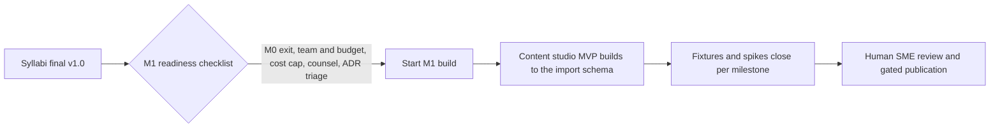

# Boss Final Approval: Skillora Learning Release 1.0 syllabi

## 1. Executive summary for the founder

- **All 19 syllabi are approved for Release 1.0 content build.** 192 modules, 366 h Simpler, 247.5 h Deeper, 47 h assessment allowance: Deeper plus assessment is **294.5 h** against the 300 h budget. Every course's module hours sum to its header and to the boss effort table (checked by script against the regenerated Interview Master module table, 19 of 19).
- **Verdicts:** 2 courses are **FINAL v1.0** (A1, A3). 17 are **APPROVED WITH CONDITIONS** (A2, A4 to A8, B1 to B7, C1 to C4). No course needed rework. Conditions are human or engineering items (legal and professional reads, spikes, fixtures, reviewer names), not content rewrites.
- **Every stamp says "AI-authored; human SME review pending", and that is literally true.** No named human SME has reviewed any course. The quality gates (SME, pedagogy, visual, question bank, 3-learner pilot) have not run.
- **Integration documents are now consistent with the final syllabi.** The Interview Master mapping was regenerated from each syllabus's LF-2 table for all 19 courses (the largest discrepancy). Module names, IDs and hours, diagnostic and seed counts, tag spellings, C4 numbering, journey hours and the company-pack map were reconciled. The boss matrix was corrected (C4 numbering) and now carries section 11 with 17 final rulings.
- **Ready to start M1? Yes, with conditions** (section 8). M1 is the platform foundation (auth, admin shell, gateway, content-studio MVP and the import schema); it has no dependency on any unresolved content item. The later blockers are listed per milestone in the register.
- **Biggest honest caveats:** (1) no human has reviewed the content; (2) C4 compensation, tax and employment content (M5 to M9) must not be published until a professional signs off; (3) about 948 verbal seeds, plus almost the whole MCQ, code and scenario bank, are still to be authored from the seeds (B3 has 30 verbal seeds against an 80 target); (4) every `[judgement]` weight, band and hour estimate is uncalibrated until the pilot.

## 2. Per-course final verdict

| Course | Modules | S / D h | Verdict | Conditions (Human Action Register IDs) | Main reason |
|---|---|---|---|---|---|
| A1 Python Internals | 11 | 22 / 15 | **FINAL** | none beyond routine review (HAR-03 is a dated re-read) | Strongest dated-status handling; senior seeds with measurement requirements. |
| A2 Concurrency and Async | 10 | 15.5 / 10.5 | AWC | 01, 02, 03 | Celery 5.6 lists CPython 3.9-3.13; labs on 3.14 need a check or a 3.13 pin. |
| A3 DSA | 11 | 35 / 23.5 | **FINAL** | none (HAR-26 is a routine CI check) | Pattern-first, original ladder, clean pointers to C3 and A5.M4. AI-tool policy stays `[verify]` with neutral wording. |
| A4 Databases | 11 | 30 / 22 | AWC | 01, 05, 07 | Two-session DB mode (S-2) is critical for M5 and M6; MySQL 9.7 and PostgreSQL 19 gates. |
| A5 API and Backend Architecture | 11 | 21.5 / 13.5 | AWC | 01, 02, 08 | Mocked issuer (P-09), Django 6.1 async claim, C3.M7 seed IDs; Celery check for M8 labs. |
| A6 System Design | 10 | 26 / 18 | AWC | 01, 10 | Canvas spec must mirror the rule registry; calibration set needs two scorers. |
| A7 Cloud, DevOps, Observability | 10 | 24 / 15 | AWC | 01, 04, 11 | Spike S-1 (emulator and licence) before M4 and M5 labs; five narrow `[verify]` items. |
| A8 Testing, Quality, Security | 10 | 27 / 17.5 | AWC | 01, 06, 09 | Lab Service review (S-6) and a legal read of the X1 DPDP primer. |
| B1 ML and Data Foundations | 10 | 19.5 / 13 | AWC | 01, 12 | Tokeniser vocabulary licence; Great Expectations on 3.14 (Pandera fallback). |
| B2 LLM Application Engineering | 12 | 16 / 11.5 | AWC | 01, 13 | Data-use, ZDR and residency wording needs a legal read; Provider Notes owner. |
| B3 RAG and Vector Search | 10 | 15.5 / 10.5 | AWC | 01, 14 | Extension-list checks, pgvector pin, erasure wording; seed gap against target. |
| B4 Agents and Workflows | 9 | 15.5 / 10.5 | AWC | 01, 15 | One graph framework and fixtures to choose; dated vendor facts not re-fetched in the final pass. |
| B5 Eval, Safety, LLMOps | 9 | 16 / 11 | AWC | 01, 16 | Legal read of M5 and M9; OWASP LLM numbering from the primary source; labellers. |
| B6 Real-time and Voice AI | 11 | 15.5 / 10.5 | AWC | 01, 17 | Lesson 7.5 (TRAI, DLT, AI-call disclosure) is gated on a named compliance reviewer. |
| B7 Fine-tuning, Model Selection, MLOps | 9 | 16 / 11 | AWC | 01, 18 | Provider terms, regulator status, GPU price data file. |
| C1 Behavioural and Leadership | 10 | 12.5 / 8.5 | AWC | 01, 19 | HR and counsel read of M7 market-practice; company-principle title check. |
| C2 Project Deep-Dive | 9 | 12 / 8 | AWC | 01, 20 | Claim-risk calibration (30 transcripts, 2 labellers); P-19 canvas date. |
| C3 Coding Interview Execution | 10 | 17.5 / 12 | AWC | 01, 21 | Spike S-5 (hidden-test categories); six `lld` seed IDs from A5.M10. |
| C4 Offer and Career Positioning | 9 | 9 / 6 | AWC (M1-M4 publishable; **M5-M9 gated**) | 01, 22 | Compensation, tax and employment-law professional sign-off; waiver W-C4-1 ratified. |

AWC = `APPROVED WITH CONDITIONS — see Human Action Register`. The stamp rule: FINAL only when routine SME review, currency re-reads and CI checks are all that remain; any legal, professional, spike or fixture dependency makes a course AWC. The final-review agents recommended FINAL for A7 and A8, and I overrode that to AWC on the spike and legal dependencies.

## 3. Rulings made

The 17 boss rulings FR-01 to FR-17 are recorded in `_Boss_Decisions_and_Ownership_Matrix.md` section 11 (authoritative text there). Summary:

| ID | Ruling | Closes |
|---|---|---|
| FR-01 | C4 has 9 modules; matrix rows O-104 (M7-M9), O-107 (M1-M4), O-108 (M5-M9) and section 8 C4 items 1 and 3 corrected in place. | INT-A defect 5.1, TL-C |
| FR-02 | Waiver W-C4-1 ratified: C4 stays 9.0 S / 6.0 D with M3 to M5 at 0.5 h Deeper. Fallback 6.75 h not taken; total stays 294.5 h. | INT-A 5.2, TL-C 5.1, C4 open item 1 |
| FR-03 | Assessment allowance stays 47 h; real per-course assessment may reach about 3 h; measured in the pilot, not a build blocker. | TL-B (B5 and others) |
| FR-04 | LF-2 of each syllabus beats the Interview Master Modes column. Doc regenerated. | TL-B section 4 item 1 |
| FR-05 | Seed goal tags and senior-bar notes may be inherited from the module row where stated (A3, A4, A8; B5, B7 tables). G-10 amended. | TL-A items 6 and 10(d), A8 8.1a |
| FR-06 | B7.M1 and B7.M6 never skippable (G-5 exception accepted); C3 keeps its 75 percent threshold. | TL-B 4.1, INT-A 5.7 |
| FR-07 | A5.M8.3 is a 20-minute pointer to A2.M9, no lab; added to the pointer inventory. | TL-A 10(a) |
| FR-08 | Python 3.15 selectable after 3.15.0 final plus a What's New re-read; default stays 3.14 until the 3.15.1 gate; no MySQL 9.7 image before the driver check; PostgreSQL 19 content only after GA plus review. | A1 oi1, A4 oi1 and oi2, TL-A 10(b)(c) |
| FR-09 | Celery labs (A2.M9, A5.M8): run on 3.14 or pin to 3.13 with a lab header note. | TL-A 4 item 5 |
| FR-10 | Registry spellings final; `python.concurrency-basics` owned by A1; importer alias table for legacy question IDs; difficulty words map to 1-5. | TL-A/B/C tables, INT-A |
| FR-11 | Placement pool accepts the Track C MCQ-form item types; gated C4 M5-M9 items are never served. | TL-C 4 |
| FR-12 | Learner-journey hours recomputed (reference learner about 217 h, hybrid about 250 h, B1 about 15 h plus 2.0 h assessment). | TL-B 3, TL-A 3 |
| FR-13 | Routes and tag deviations accepted (B4/B5 NICE slices, B5.M8 A:M, B1.M10 H:S, A7 A:S/B:M, B5 M3 H:S, B4 per-seed tags). | TL-B 3, A7 report |
| FR-14 | A6 sections 1.1 and 1.3 frozen as the canvas spec input. | A6 oi1 |
| FR-15 | C2 archetypes ARC-3 and ARC-4 accepted as generic; policy: no real product, client or employer names in shared content. | TL-C 5.4 |
| FR-16 | Company-pack principle titles: neutral competency labels only; titled packs need legal review (S6) first. | TL-C 4 |
| FR-17 | Reviewer slots tracked by role in the register below. | all |

**Further rulings on agent open questions (recorded here; no matrix text needed):**

| Source | Question | Ruling |
|---|---|---|
| A1 oi2 | Optional Tachyon profiling lab | Yes, optional, outside the hours; re-check CLI flags at 3.15 final. |
| A2 oi1 | M7.5 inside the 1.3 h Deeper budget | Accepted. |
| A3 oi2 | Split the 4-item placement core into two sittings for L1-L2 | Placement spec decides; default on for L1-L2. |
| A6 oi3 | Kafka share-group production status | Closed (resolved by verification). |
| A6 | B6 workbook pointer (B6.M6 lab vs B6.M11 package) | Stay as written; cite both IDs at authoring. |
| A7 | JD-analyser output format for M3 weighting | Interview Master team defines at M4 (list of registry tags with 0-1 weights); non-blocking. |
| A8 Q9.2 | Pure bank-ID `ref` to B5.M4 | Replace once B5 publishes item IDs (noted in A8 section 7). |
| B1 oi3 | B1.M10 hybrid tag | Keep `H:S`; revisit after the pilot. |
| B2 | Reasoning-state round-trip in the `LLMClient` fixture contract; Provider Notes owner; media-token calculators from the harness | All accepted; owner is the AI lead, quarterly slot. Vendor names only in dated Provider Notes (B5 oi2 approved). |
| B3 | B:N weighting, pgvector 0.8.2 pin, BM25-extension labs out of scope | All accepted. |
| B4 | One graph framework, P-07/P-12 fixtures | Accepted; chosen at M3 harness work. |
| B6 | A6 ID `Q-A6-M8-03` stable | Confirmed; frozen with the A6 numbering. |
| B7 | X5 tuned-model gate template; GPU price file | B5 owns the template, B7 supplies fixtures; A7.M10 owns the GPU price data file. |
| C1 | Section numbers differ between files | The importer finds Learner-Fit parts by heading and the LF-1 to LF-7 labels, not by section number (A8 and C4 carry a mapping). |
| C2 | Ledger onboarding; canvas free-form mode | Ledger is a 1.0 requirement (ADR-030), optional for the learner; if P-19 is late for closed beta, use the structured-text fallback. |
| C4 oi2, oi3 | External level data; timing-flag owner | Level tables are approximate, sourced and dated, professionally reviewed, never scraped live; the adaptive engine owns the flag, the content lead owns the wording. |
| Journey (INT-C) | BR-04, BR-05, BR-06 local rulings | Ratified. |
| INT-C | Hand-estimated Table 7.3 rows | Replace with route-engine output after placement data exists (HAR-23). |

## 4. Consistency checks performed

| Check | Method | Result |
|---|---|---|
| Module hours sum to header and boss table, 19 courses | I ran a script over the regenerated Interview Master module table (192 rows); 7 final-review agents recomputed per file | 19 of 19 match; totals 366 / 247.5 |
| Deeper floor 0.75 h and ceiling 3.0 h | Agents' scripts | Pass; only C4 M3 to M5 below floor (waiver W-C4-1) |
| LF-2 weight columns sum to 100 per target | Agents' scripts, all 19 | Pass |
| Every backticked tag exists in the registry, one owner each | Agents' scripts on syllabi and on the Interview Master doc | Pass (invalid cloud.aws.x, sec.llm-app and unprefixed B1 tags fixed in the doc) |
| Placeholder and boilerplate scan (TODO, TBD, lorem, XXX, `{new}`, `[new tag`) | I ran a grep over every markdown file | Clean in all 19 syllabi and all integration docs (the two hits are quoted text inside the consistency and track-lead reports) |
| Mermaid fences balanced, syntax plain | I ran a script over all markdown files; I read the gantt block and checked bracket balance on every block | All fences balanced (22 blocks across 12 files: A3, C3, matrix, scope, ADR, milestones and the six integration docs); no render test |
| Ownership and pointer rules | Seven agents read the owner rows and seeds; track leads' leak fixes (A5.M8.3, A5 seed M8-03, A8 Q9.2) confirmed in files | No unresolved leak; accepted overlaps unchanged (INT-A section 4) |
| Goal tags and seed format | Agents sampled 6 to 30 seeds per course; I read 11 seeds myself | Senior-level, no model names, outlines, weak answers and probes present |
| Template conformity | Agents | Fixed: outcome counts over 8 (A1, A4, B2); B2.M11 lesson count; table breaks in A8 and B1; open-item gaps in B3, B7 |
| C4 numbering across matrix, C1, C2, C4 | Reading map confirmed by the C4 agent and applied in the matrix | Consistent |
| Integration docs vs syllabi | Three reconciliation agents with scripts for module references | All module references resolve; totals 192 / 588 / 1,175 / 916 lessons consistent across data model, placement blueprint and Interview Master |

## 5. What I personally verified, and what I did not

**Personally read or run:** the three track-lead reports (full); the Integration Consistency Report (full); the template (full) and the boss matrix sections 0, 1, 5, 8 (C4), 10 and the C4 ownership rows; Verification Log A1-A4 (the other four logs were read by the agents, not by me); the milestones doc readiness section; every syllabus's front matter and section list; eleven seeds (Q-A5-M4-02, M4-03, M5-01 to M5-03, B5 Q4.2 and Q5.2, B6 M6-Q2, C1 M8-Q2, C3 Q5.1, C4 Q-C4-M7-04); the scripts listed in section 4; all rulings and the stamping.

**Delegated and relied on:** the line-by-line syllabus review (seven agents, each told to read the full header, module table, LF appendix, compliance log and at least 6 seeds per course; they report reading between 9 and 36 seeds per course) and the three integration reconciliations. I read their reports and re-ran the hours and status checks; I did not re-read the 19 syllabi myself (about 1.7 MB) and I did not re-read the 1,175 diagnostics or any lesson text.

**Not verified by anyone in this pass:** any external fact (Python 3.15 final on 2026-10-09, PostgreSQL 19, MySQL 9.7, MCP/A2A revisions, EU AI Act, DPDP Rules dates, TRAI, tax and labour-code content, OWASP LLM numbering, vendor terms); those rest on the verification logs, which used primary sources where they could and left `[verify]` markers where they could not. The code in the labs has not been run. The Mermaid blocks were checked for syntax, not rendered.

## 6. Residual risks

| Risk | Severity | Handling |
|---|---|---|
| No human SME has reviewed any course; correctness of 588 seeds' ideal answers is AI-judged | High | HAR-01; no publication before review; pilot with 3 reviewers |
| C4 compensation, tax, notice and employment-law content is unreviewed | High | M5-M9 gated (ADR-032); HAR-22 |
| Question bank is about 38 percent seeded (588 of 1,536 verbal); B3 is at 30 of 80 | Medium | Bank-build task; B3 owner items first; not an M1 blocker |
| Version-volatile facts (Python 3.15, PostgreSQL 19, MCP/A2A, provider features) go stale within a quarter | Medium | Dated stamps; review cadence calendar (HAR-25); AI content every 3 months |
| Calibration: weights, bands, hours, thresholds, labels are `[judgement]` | Medium | Pilot calibration (HAR-23); route reconciliation CI within 10 percent of 210/215/250 h |
| Sandbox dependencies: two-session DB mode, Lab Service, cloud emulator, LLM/voice harnesses | Medium | S-1, S-2, S-6, S9, S10 with documented fallbacks (recorded step-throughs, static validators, code-review tasks) |
| Assessment hours may exceed the 47 h allowance (about 3 h per course in places); headline could move to roughly 300 to 305 h | Low | FR-03; restate after the pilot |
| Single-founder persona creeping into shared content (C4 persona seeds; C1 examples) | Low | FR-15; parameterise at import; legal and HR read |
| Dependency on one importer (alias table, seed-tag resolution, 3 diagnostic ID families, V-017 extra MCQs) | Medium | HAR-27; S15 dry-run |
| Integration docs describe not-yet-built platform behaviour; engineering has not reviewed them | Medium | Milestone checklist item stays open until engineering triage of ADR-023..035 and S7..S17 |

## 7. HUMAN ACTION REGISTER

"Blocks M1 build" is always **No** except where marked; M1 is the platform foundation and needs no content. The last column says what the item blocks later. Owner roles are roles, to be named by the founder (HAR-25).

| ID | Owner role | What exactly must be checked or done | Courses | Blocking for starting M1 build? | Blocks later |
|---|---|---|---|---|---|
| HAR-01 | Founder / content lead | Name an SME reviewer per course (19) and run quality gates 1 to 5 (SME accuracy, pedagogy, visual, question bank, 3-learner pilot) | all | No (but "SME/content roles assigned" is an M1 readiness checkbox) | Publication of every course |
| HAR-02 | Platform engineer | Run A2.M9 and A5.M8 Celery eager, memory-broker and Redis labs on the 3.14 image; if they fail, pin those labs to the selectable 3.13 image and say so in the lab header | A2, A5 | No | Authoring of A2.M9 and A5.M8 labs |
| HAR-03 | Python SME | After 2026-10-09 re-read the 3.15.0 final What's New and Tachyon flags; restamp A1 M3, M7, M9, M11 and A2 3.15 items; decide the 3.15 selectable image (default stays 3.14 until 3.15.1) | A1, A2 | No | Nothing; currency |
| HAR-04 | Platform engineer plus counsel | Spike S-1: moto-style emulator vs LocalStack, licence review; default to moto-style if late | A7 | No | Authoring A7.M4 and M5 labs |
| HAR-05 | Platform engineer | Spike S-2: two-session database mode (isolation and locking demos, SKIP LOCKED preview); fallback is recorded step-throughs | A4, A2 | No | A4.M5 and M6 labs; needed by milestone M2 |
| HAR-06 | Security reviewer plus counsel | Spike S-6: Lab Service legal and security review; keep `lab_service.enabled` Off until passed (A8 fallback: code-review and static analysis on vulnerable snippets) | A8, A5, A7 | No | A8.M7 labs and the timed practical |
| HAR-07 | Database SME / platform engineer | Check MySQL 9.7 driver and ORM support (mysqlclient, PyMySQL, SQLAlchemy, Django) before any 9.7 image; run EXPLAIN for MySQL full-prefix row comparison; PostgreSQL 19 "what changes" box within 30 days of GA | A4 | No | 9.7 image; PG19 box |
| HAR-08 | A5 SME and platform engineer | Read the Django 6.1 async DB documentation page; P-09 mocked issuer needs key rotation, expiry and a replay-with-modified-claims switch; C3.M7 owner confirms acceptance of the six `lld` seeds and lab names; pin FastAPI, Django, Flask, SQLAlchemy at image build | A5 | No | A5.M6 labs, M8 labs |
| HAR-09 | Privacy / legal counsel | Read the X1 compliance primer (A8.M9.4) with its DPDP Rules phase dates before publication; repeat every 6 months | A8 (feeds B3, C4) | No | Publishing A8.M9.4 |
| HAR-10 | Canvas/platform lead and A6 SME | P-19: confirm canvas vocabulary v0.1+ and the 39-rule registry (FR-14) before visuals are authored; staff two independent scorers for the 30-design calibration set; author good and weak graphs for the 33 original rules; keep the M8 AI review on a 3-month cadence | A6 (also A5, A7, B3, B4, C2) | No | Visual authoring; A6 final assessment; rule-engine regression suite |
| HAR-11 | A7 SME plus counsel | Re-check SnapStart exclusions and the Python 3.15 Lambda runtime date, Fargate wording, LocalStack licence text, X-Ray and App Runner status; counsel glance at the Terraform BUSL, Redis and Valkey licence statements (A6 and A7) | A7, A6 | No | Publishing the affected lessons |
| HAR-12 | Engineering plus counsel | Tokeniser vocabulary redistribution terms (P-01, S9); fallback is a toy-BPE lab; Great Expectations install check on the 3.14 image (Pandera fallback); rerun B1 examples on 3.15 once selectable | B1 | No | B1.M8 token lab |
| HAR-13 | Privacy counsel; AI lead | Compare provider DPA, ZDR and residency text with the B2.M10 wording; check the interleaved-thinking header and GA status; name the Provider Notes data-file owner and a quarterly slot; `LLMClient` fixture must round-trip reasoning state | B2 | No | B2 M2 and M5 labs; publishing M10 wording |
| HAR-14 | Platform engineer; counsel | Pin pgvector 0.8.2 or later in the P-04 image; re-check pg_search, pgvectorscale and pgvector on the RDS and Aurora extension lists; counsel on DPDP and GDPR erasure wording (M7); author about 50 more verbal seeds | B3 | No | B3.M4 labs; M7 publication |
| HAR-15 | Engineering | Choose the single graph-style framework and sample-agent fixture; deliver the injected-document fixture (P-07) and crash-injection API (P-12); re-fetch dated vendor facts (MCP 2026-07-28 revision, A2A v1.0, OTel GenAI) at the January 2027 review | B4 | No | B4.M7 and M9 labs |
| HAR-16 | Legal reviewer; content lead; SME | Human legal review of B5.M5 and M9 (EU AI Act text, DPDP breach wording, RBI/SEBI/IRDAI status, Aadhaar handling, NIST AI RMF status); name labellers CAL-1 to CAL-3; read OWASP LLM numbering from genai.owasp.org; check the NeMo Guardrails label | B5 | No | Publishing B5.M5 and M9; M3, M5, M6 labs |
| HAR-17 | Compliance reviewer; voice engineering; SME | Named reviewer reads primary TRAI, DLT and AI-call disclosure text for B6.M7.5; P-08 harness exposes per-hop timestamps and seeded jitter; Indian-English audio fixtures; Safari/iOS device test; close the six `[verify]` items; provider terms and Pipecat/LiveKit plugin APIs | B6 | No | Publishing B6.M7.5; M6 and M11 workbook |
| HAR-18 | Counsel; SME; A7.M10 owner; B5 owner | Provider terms on training from outputs and fine-tuning data retention; DPDP and regulator binding-vs-advisory status for Q6.3 and M6; GPU price data file (owned by A7.M10); X5 tuned-model gate template (B5 owns, B7 fixtures) | B7 | No | B7.M8 calculators; publishing M6 |
| HAR-19 | HR practitioner plus counsel; legal reviewer | Review C1.M7 market-practice guidance (counter-offer, hybrid, relocation, gaps) and the global-HR awareness lesson; check each company pack's principle titles against primary sources and URLs (S6); calibrate the scorer on Indian-English transcripts | C1 | No | Publishing C1.M7 and titled packs |
| HAR-20 | Content lead; product | Two SME labellers and 30 transcripts for claim-risk calibration (band stays off until then); confirm P-19 free-form canvas date or accept the structured-text fallback; confirm the Profile Facts Ledger onboarding step ships | C2 | No | C2 claim-risk band; closed beta |
| HAR-21 | Engineering; A5 SME | Spike S-5: hidden-test categories and per-category catch rates; A5.M10 publishes the six `lld` seed IDs; pilot-calibrate the 75 percent skip threshold and seven-step time budgets | C3 | No | C3 M4 badge; M7.6 |
| HAR-22 | Compensation and tax professional plus employment-law counsel | Sign off R1 (wage and gratuity under the Labour Codes), R2 (slabs and regime), R3 (EPF share and ceiling), R4 (ESOP/RSU tax), R5 (non-compete, bond, moonlighting), R6 (notice, buyout, current-pay disclosure; seed Q-C4-M7-04), V4 (Income-tax Act 2025 section and form numbers against primary text); statutory numbers stay off learner screens until then | C4 | No | **Publication of C4.M5-M9 (blocking)** |
| HAR-23 | Product plus AI lead | 3-learner pilot: calibrate every `[judgement]` weight, band, hour estimate, difficulty label and threshold; measure assessment hours (FR-03); replace hand-estimated Learner Journey Table 7.3 rows with route-engine output; confirm which modules ship last-minute (`L`) cards in the Interview Master mapping | all | No | Milestone M5 placement v2; readiness engine |
| HAR-24 | Founder; counsel | Engage counsel for privacy (mic and audio), terms, and company-pack sourcing review (existing M1 readiness checkbox) | all | **Yes (existing M1 readiness item)** | Beta |
| HAR-25 | Founder / PM | Name the reviewers and owners above (FR-17); schedule the review calendar (AI/LLM and vendor 3 months, security and standards 6, stable theory 12); decide the 3.15 default at 3.15.1; agree the cost cap policy | all | **Yes (cost cap policy, roles assigned are M1 readiness items)** | All |
| HAR-26 | Platform engineer | Image-build pin manifest (pytest, pytest-asyncio, Hypothesis, coverage, mutmut, Django 5.2 LTS, FastAPI, Pydantic v2, SQLAlchemy 2); CI import check of the A3 standard-library features; CI runs every lesson example | A3 and all code courses | No | Lab authoring |
| HAR-27 | Content-studio engineer | Importer: alias table for legacy IDs, difficulty mapping, seed goal-tag resolution (per-seed else module), V-017 extra MCQs for modules with 7 or 8 diagnostics, S15 dry-run | all | No (M1 content-studio MVP should build to the schema) | Bulk import |
| HAR-28 | Engineering lead | Triage proposed ADR-023..035 and spikes S7..S17; engineering review of the six integration documents (Interview Master mapping, company-pack map, journey, placement blueprint, data model, platform requirements) | all | **Yes (existing M1 readiness item: integration documents reviewed)** | M2 onward |

## 8. Ready to start M1? Recommendation

**Recommendation: YES, start M1, on these conditions.**

1. Close the existing readiness checkboxes that are not content: M0 exit criteria, team and budget confirmed with content roles assigned (HAR-25), cost cap policy, counsel engaged (HAR-24), and engineering triage of ADR-023..035 and S7..S17 with a review of the integration documents (HAR-28). The curriculum itself no longer blocks M1.
2. Build the content studio MVP to the import schema as reconciled (alias table, tag registry, pointer lessons, `gated` state per ADR-032). Do not hard-code anything from the old drafts.
3. Treat the 17 AWC courses as buildable content, not publishable content. Nothing is published to learners before HAR-01 (named SME) and the course's own HAR items clear. C4.M5-M9 never publish before HAR-22.
4. Schedule spikes against the milestone that first needs them: S-2 (HAR-05) before M2 for A4.M5 and M6, the LLM Lab Harness and voice harness before M3, canvas spec (HAR-10) before M4, S-5 (HAR-21) before the C3 badge.
5. Any change to hours, ownership, tags or module numbering goes through the boss matrix and the integration docs together; the syllabus wins over integration docs unless it breaks the ownership matrix.

**Files changed in this pass:** all 19 syllabi (front matter stamps; small defect fixes recorded by the reviewing agents: outcome counts in A1, A4, B2; M11 lessons in B2; table fixes in A8 and B1; ID forms in A5, B5, B6; open items in A8, B3, B5, B7; ARC-4 wording in C2; C3 competency tag), `_Boss_Decisions_and_Ownership_Matrix.md` (corrections and section 11), `00_Syllabus_Template_and_Authoring_Standard.md` (v1.1, section 7), `README.md` in 03 (new) and in 05 (status column), `04_Milestones` (facts and checklist), and the six integration documents (each ends with a "Boss final reconciliation (2026-10-06)" section listing what changed).
