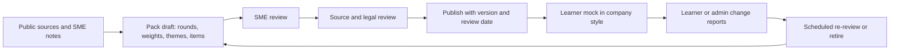

# Company Pack to Curriculum Map

## 0. What a pack is, and what it is not

A **company pack** is a configuration of Interview Master (rounds, rubric weights, tag multipliers, persona, time limits) plus a curated set of **style-of-question** practice items, behavioural themes and a suggested course path. It models a *style*, never a hiring promise.

Hard rules (scope 4A.3, G-12, R-C1-3), repeated here because every pack depends on them:
- Built only from **public information**: job descriptions, published engineering blogs, official interview guides, published values or principles, and SME expertise.
- **No confidential, leaked or NDA-protected material, no recalled "interview experience" questions, no claim that any question is real, recent or asked by the company.**
- Company names are used descriptively (nominative fair use); no endorsement or affiliation is implied.
- Every pack carries a standard disclaimer, a "last reviewed" date and a next-review date; packs are versioned, reviewable and retirable by Admin.

Cluster vocabulary is fixed (G-10): **IT-services, global-IT-consulting, Big4, global-product, Indian-product, AI-startup**. Tags used below are the registry tags owned by the courses (see Interview_Master_Curriculum_Mapping.md section 2).

---

## 1. Cluster overview

Round structures below are **generic, cluster-level descriptions of commonly published formats** that SMEs verify per company at authoring time (`[verify at authoring]`). They are not statements about a specific company's current process.

| Cluster | Interview-style emphasis (from scope 4A.3) | Generic round structure the pack models | Mock-cycle default |
|---|---|---|---|
| **IT-services** (TCS, Infosys, Cognizant, Wipro, HCLTech, Tech Mahindra, LTIMindtree) | Fundamentals, Python and SQL depth, project explanation, delivery and client-facing scenarios, HR, notice period, relocation, onsite-offshore models | 1. Aptitude or online assessment (outside Interview Master). 2. Technical interview: Python, SQL, framework basics, project walkthrough (40-60 min). 3. Practical or coding round (API or SQL or small coding). 4. Managerial or delivery round (client scenarios, escalation, team handling). 5. HR round (compensation, notice period, relocation) | 1 technical-depth voice, 1 practical coding, 1 project deep-dive, 1 managerial behavioural, 1 HR |
| **Global IT and consulting-tech** (Accenture, Capgemini, Genpact, Ericsson, IBM, DXC, NTT Data, EPAM, Thoughtworks) | Role-based technical screens, solution and architecture discussion, cloud and AI delivery, client case-style questions, behavioural and values | 1. Role-based technical screen. 2. Solution or architecture discussion (often whiteboard or verbal). 3. Client or case-style scenario. 4. Behavioural and values round. 5. HR or commercial round | 1 technical screen, 1 solution-architecture design (cluster design profile), 1 case-style scenario, 1 behavioural, 1 HR |
| **Big4** (Deloitte, PwC, EY, KPMG; assumed consulting and advisory, scope open item 1) | Technology consulting and engineering delivery, case-style and stakeholder scenarios, data and AI solution design, structured behavioural | 1. Technical screen. 2. Case or solution-design interview (structured response expected). 3. Stakeholder and delivery scenarios. 4. Partner, director or manager conversation (fit, structured behavioural). 5. HR | 1 technical screen, 1 case or solution design (solution-architecture profile), 1 stakeholder scenario, 1 structured behavioural, 1 HR |
| **global-product** (Google, Microsoft, Amazon, Adobe, Atlassian, Salesforce, Oracle, SAP, Cisco, HPE, Intuit, PayPal, Walmart Global Tech, Uber, Nvidia, Qualcomm) | DSA and coding rounds, deep system design, principles-style behavioural, distributed systems depth, ML and LLM systems for AI roles | 1. Recruiter and online coding screen. 2. Two to three coding rounds (DSA). 3. One or two system-design rounds. 4. Behavioural or values round(s) with heavy probing of personal contribution. 5. Hiring-manager round | 2 coding (timed), 1 design canvas, 1 technical depth, 1 values behavioural, 1 hiring-manager mix |
| **AI-startup** (generic archetype packs; no named companies in scope) | LLM application engineering, RAG and agents design, evals, pragmatic coding, take-home and live build | 1. Founder or hiring-manager conversation. 2. Live build or take-home walkthrough. 3. LLM or RAG or agent design discussion. 4. Evals and safety discussion. 5. Culture and ownership conversation | 1 live build (thin slice), 1 AI design canvas, 1 LLM depth voice, 1 take-home walkthrough, 1 ownership behavioural |

---

## 2. Course emphasis per cluster (MUST, SHOULD, NICE)

`M` = MUST, `S` = SHOULD, `N` = NICE (G-3 multipliers 1.0, 0.6, 0.25). This is the cluster tag for the **Hybrid** target. When a learner has chosen a role target and a pack, the effective tag is `max(role tag, cluster tag)` for study routing, and the route builder drops the lowest-weight `S` and `N` items first if hours exceed the learner's budget. Cluster tags are `[judgement]`, derived from the scope emphasis column and the "Cluster emphasis" lines in the final syllabi (LF-2 and the cluster sentences are authoritative, RUL-01). Module-level cluster notes are in the hot-spot table below; where a module is named there for a `S` or `N` course it is the module the route builder keeps first.

| Course | IT-services | Global-IT consulting | Big4 | Global-product | Indian-product | AI-startup |
|---|---|---|---|---|---|---|
| A1 Python Internals | M | S | N | S | S | S |
| A2 Concurrency and Async | S | S | N | M | M | M |
| A3 DSA | S | S | N | M | M | S |
| A4 Databases | M | M | S | M | M | S |
| A5 API and Backend Architecture | M | M | S | M | M | M |
| A6 System Design | S | M | M | M | M | M |
| A7 Cloud, DevOps, Observability | S | M | S | S | S | S |
| A8 Testing, Quality, Security | S | S | S | S | S | S |
| B1 ML and Data Foundations | N | S | S | S | N | S |
| B2 LLM Application Engineering | S | M | M | S | M | M |
| B3 RAG and Vector Search | N | S | S | S | S | M |
| B4 Agents and Workflows | N | S | S | S | S | M |
| B5 LLM Eval, Safety, LLMOps | N | S | S | S | N | M |
| B6 Real-time and Voice AI | N | N | N | N | N | S |
| B7 Fine-tuning, Model Selection, MLOps | N | N | N | S | N | S |
| C1 Behavioural and Leadership | M | M | M | M | M | M |
| C2 Project Deep-Dive | M | M | M | M | M | M |
| C3 Coding Interview Execution | M | M | S | M | M | M |
| C4 Offer and Career Positioning | S | S | S | S | S | S |

Reading notes: A8's X1 compliance primer is pulled into Big4 and global-IT consulting routes even where A8 is `S` (data governance and client-facing risk are probed more there); B6 stays `N` outside AI-startup because the reference learner's voice-agent work is better showcased through C2 than relearned; role target AI Engineer raises B2 to `M` in every cluster, and role target Backend lowers B3-B7 to `N` (Boss 4.5).

**B3 for Big4 `[judgement]`:** the Big4 cluster tag for B3 is `S` at course level; the B3 syllabus probes M1 (build versus buy), M7 (governance and access control) and M10 (enterprise design) for Big4 and IT-services, so **B3.M1, M7 and M10 carry the `S`** and the remaining B3 modules are `N` for Big4 unless the role target is AI Engineer (then the course is `M`).

**B5 for AI-startup:** the course tag is `M`. B5.M1 to M4 and M7 are the cluster hot spots (B5 LF-2 cluster sentence). B5.M8 (release engineering) is `A:M H:M` in the B5 syllabus, so it is routed as `M` through the role tag on every AI Engineer or hybrid route; it is not a cluster-specific hot spot and the B5 cluster sentence does not list it. Ruling BR-05 below.

**Per-cluster module hot spots** (from the syllabi's own cluster notes; items to prioritise inside an `M` course):

| Cluster | Module hot spots |
|---|---|
| IT-services | A1.M1-M3, M8-M9; A4.M1, M3-M5, M10; A5.M1-M3, M6, M10; A2.M9; A7.M1, M4; A8.M1, M3, M6, M8, M9 (compliance, review process, secret-leak response); B2.M6 (extraction) and M10 (data governance, basics); B3.M1, M7, M10 (when B3 is routed); C1.M5-M7; C2.M3 (non-technical audiences); C3.M7 |
| Global-IT consulting | A5.M2, M8, M10; A6.M1, M4, M5, M10 (solution-architecture); A7.M4-M5, M8-M9; A8.M1, M3, M6, M8, M9; B2.M1, M6, M10, M12; B3.M1 (build versus buy); B5.M9 (governance); C1.M6; C2.M3 |
| Big4 | A6.M1, M5, M10 (roadmap, build versus buy, non-functionals); B2.M6, M10, M12 (multi-tenant); B3.M1, M7, M10 (these three carry the `S`); B5.M5, M9; A8.M7-M9 (X1 at M9); C1.M5-M6; C2.M3 |
| Global-product | A3.M2-M11; C3.M1-M5, M10; A6.M2-M7, M10; A2.M4-M6; A4.M3-M6; A1.M3, M11; A8.M1, M4, M5, M7, M10; C1.M2-M4, M6; for AI roles B2 (core), B3.M3-M5, M8-M9, B4.M3, M5, M8-M9, B5.M1-M3 |
| Indian-product | C3.M7 (machine-coding, LLD); A3 core; A6.M4, M6-M7 (payments, notifications, booking); A5.M4, M5; A4.M5-M6; A2.M6, M9; A8.M4, M7, M10; B2.M9 (cost); B3.M5 (hybrid, Hinglish) and M9 (cost); C1.M4 |
| AI-startup | B2.M2, M4-M5, M7, M9; B3.M3-M5, M8-M9; B4.M1-M2, M3, M5, M7-M9; B5.M1-M4, M7 (and M8 through its `A:M` role tag, see above); A6.M8; A8.M7, M9 (pointer); C3.M7, M9 (thin slice, take-home); A2.M7, M9; C2.M5 |

B2 seed cluster tags (final B2 syllabus, seed lines and LF-2 sentence): IT-services seeds sit on B2.M1-M3, M5, M6, M8, M10, with emphasis M6 and M10; global-IT consulting seeds on M1-M3, M6, M7, M9, M10, M12, with emphasis M1 and M12 and the shared M6 and M10 seeds; Big4 seeds on M1, M2, M4, M6, M9-M12, with emphasis M10 and M12. Hot spots above follow the emphasis sentence plus the shared M6 and M10 seeds (BR-06).

---

## 3. Rubric weight overrides per cluster

All overrides sum to 100 per rubric. They are **profiles** in admin config (R-A6-5 pattern), never second rubrics. Defaults are in Interview_Master_Curriculum_Mapping.md section 3. The pack stamps the profile ID and version on each session. Weights are `[judgement]` pending calibration.

### 3.1 R-TD technical depth (Correctness / Depth / Trade-offs / Production / Structure / Probe resilience)

| Profile | Corr | Depth | Trade | Prod | Struct | Probe | Sum | Rationale |
|---|---|---|---|---|---|---|---|---|
| Default | 25 | 20 | 20 | 15 | 10 | 10 | 100 | |
| IT-services | 30 | 15 | 15 | 10 | 20 | 10 | 100 | Fundamentals accuracy and clear explanation |
| Global-IT consulting | 25 | 15 | 20 | 15 | 15 | 10 | 100 | Solution fit and clarity |
| Big4 | 20 | 15 | 25 | 10 | 20 | 10 | 100 | Structured, trade-off-led answers |
| Global-product | 20 | 25 | 20 | 15 | 5 | 15 | 100 | Mechanism depth and probing |
| Indian-product | 25 | 20 | 20 | 20 | 5 | 10 | 100 | Production realism |
| AI-startup | 20 | 20 | 25 | 15 | 5 | 15 | 100 | Pragmatic trade-offs |

### 3.2 R-CODE coding

| Profile | Under | Appr | Corr | Cplx | Qual | Test | Comm | Hint | Time | Pract | Sum |
|---|---|---|---|---|---|---|---|---|---|---|---|
| Default | 8 | 12 | 25 | 12 | 10 | 10 | 10 | 5 | 8 | 0 | 100 |
| IT-services (practical API or SQL) | 5 | 10 | 25 | 0 | 10 | 10 | 10 | 0 | 5 | 25 | 100 |
| Global-IT consulting and Big4 | 10 | 10 | 20 | 0 | 10 | 10 | 15 | 0 | 5 | 20 | 100 |
| Global-product (DSA) | 8 | 12 | 25 | 15 | 8 | 10 | 10 | 4 | 8 | 0 | 100 |
| Indian-product (machine coding, DSA) | 8 | 10 | 25 | 10 | 12 | 10 | 8 | 5 | 12 | 0 | 100 |
| AI-startup (live build) | 0 | 10 | 20 | 0 | 10 | 10 | 10 | 0 | 10 | 30 | 100 |

Switches: global-product and Indian-product DSA segments use the **strict from-scratch import allowlist** (R-A3-4); IT-services and AI-startup segments allow the standard library shortcuts and show the importable-library list; the take-home mode (C3.M9) adds an advisory README review (R-C3-5).

### 3.3 R-DESIGN D1-D11 (default 10, 10, 10, 15, 15, 10, 10, 5, 5, 5, 5)

| Profile | D1 | D2 | D3 | D4 | D5 | D6 | D7 | D8 | D9 | D10 | D11 | Sum |
|---|---|---|---|---|---|---|---|---|---|---|---|---|
| Default (global-product) | 10 | 10 | 10 | 15 | 15 | 10 | 10 | 5 | 5 | 5 | 5 | 100 |
| **Solution-architecture** (Global-IT consulting, Big4; A6 7.2) | 15 | 5 | 10 | 15 | 10 | 10 | 10 | 5 | 5 | 10 | 5 | 100 |
| IT-services architecture discussion | 10 | 5 | 10 | 15 | 10 | 10 | 10 | 10 | 10 | 5 | 5 | 100 |
| Indian-product (payments and commerce) | 5 | 10 | 10 | 10 | 20 | 15 | 10 | 5 | 5 | 5 | 5 | 100 |
| AI-startup | 10 | 5 | 10 | 15 | 10 | 5 | 10 | 10 | 10 | 10 | 5 | 100 |

Under the solution-architecture profile the evaluator also asks for a phased roadmap, build-versus-buy statement and client-facing non-functional commitments (A6.M10 lesson 4). Under the global-product profile the **probing depth multiplier** is raised (more canvas-delta probes) rather than D weights moved.

### 3.4 R-BEH behavioural (Relevance / Structure / Specificity and ownership / Depth / Impact / Reflection / Probes)

| Profile | Rel | Struct | Own | Depth | Impact | Refl | Probe | Sum |
|---|---|---|---|---|---|---|---|---|
| Default | 10 | 10 | 20 | 15 | 20 | 10 | 15 | 100 |
| IT-services | 15 | 15 | 15 | 10 | 20 | 10 | 15 | 100 |
| Global-IT consulting | 15 | 15 | 15 | 10 | 20 | 10 | 15 | 100 |
| Big4 | 15 | 20 | 15 | 10 | 20 | 10 | 10 | 100 |
| Global-product | 7 | 8 | 25 | 15 | 20 | 10 | 15 | 100 |
| Indian-product | 10 | 10 | 20 | 15 | 20 | 10 | 15 | 100 |
| AI-startup | 10 | 5 | 20 | 20 | 15 | 15 | 15 | 100 |

Strict-mode caps (R-C1-2) apply in every profile.

---

## 4. Behavioural themes per cluster

Themes are neutral wording. Where a company publishes its principles, the pack lists **the published principle titles as facts with a link to the primary source** and uses neutral themes; it copies no descriptive text beyond a short phrase and is subject to legal review (R-C1-3). No pack asserts that a company asks a given question.

**Neutral theme labels (R-C1-3).** The theme labels in the table are generic competency names written for this product. They are not any company's published principle titles and must not be edited back into a single company's phrasing. Where a pack lists a company's published principle titles as facts with a primary-source link, that list sits in the pack's link table and goes through legal review under checklist item S6 (section 6) before publish.

| Cluster | Themes | Course support |
|---|---|---|
| IT-services | Delivery under client pressure; escalation and SLAs; onsite-offshore coordination; team handling and mentoring; learning new tech quickly; adaptability; notice period, expectation and relocation honesty | C1.M4-M7; C2.M3 |
| Global-IT consulting | Client communication; ambiguity in solutioning; cross-cultural teams; delivery risk; values and integrity; "tell me about a time you changed a client's mind" | C1.M5-M6; C2.M3 |
| Big4 | Structured responses (situation, structure, answer first); stakeholder management; professional scepticism and integrity; learning agility; working across levels | C1.M1, M5-M6 |
| Global-product | Taking ownership and acting without waiting to be asked; customer outcomes first; evidence-based problem solving with data; disagreeing constructively, then aligning; holding a high quality bar; handling failure and learning from it; cross-checks of personal contribution (use of "I" versus "we") | C1.M2-M4, M6 |
| Indian-product | Speed with ownership; practical trade-offs; accountability for outcomes; handling production incidents; scrappiness at scale | C1.M4; A7.M10 incident stories |
| AI-startup | Ambiguity and pace; shipping pragmatic solutions; owning a feature end to end; learning fast on fast-moving technology; honest handling of model limits and failures | C1.M4, M8; B5.M9 stories |

---

## 5. First twelve packs (two per cluster)

### 5.1 Selection and justification

The scope doc (4A.3 and decision 9.2) names the founder's priority employers. Packs are chosen by: (a) named explicitly in decision 9.2 or the first position in the cluster list of 4A.3, (b) fit to the reference profile (Python backend, FastAPI, Django, AWS, LLM APIs, voice agents), and (c) coverage of distinct round styles within the cluster. The scope marks priority order as a suggestion to validate with the founder's target employers; **swap any pack below at no design cost** (the pack is configuration plus items).

| Pack ID | Cluster | Pack | Why now (from the founder's list) |
|---|---|---|---|
| CP-ITS-01 | IT-services | **TCS** | Named in decision 9.2 and first in the 4A.3 IT-services list; highest-volume Python and SQL services style |
| CP-ITS-02 | IT-services | **Infosys** | Named in decision 9.2 and second in the list; second distinct services style (delivery and client scenarios, HR norms) |
| CP-GIC-01 | Global-IT consulting | **Accenture** | Named in decision 9.2 and first in the list; solution and client case style |
| CP-GIC-02 | Global-IT consulting | **Capgemini** | Named in decision 9.2; second solution-architecture style with cloud and AI delivery emphasis |
| CP-B4-01 | Big4 | **Deloitte** | First in the 4A.3 Big4 list; technology consulting and case style |
| CP-B4-02 | Big4 | **PwC** | Second in the list; data and AI solution design and structured behavioural |
| CP-GP-01 | Global-product | **Amazon** | AWS is the reference learner's cloud; the company publishes its leadership-principle titles (listing titles with a primary-source link is allowed after legal review under S6, R-C1-3); strong design and behavioural coverage |
| CP-GP-02 | Global-product | **Microsoft** | Python and AI Engineer demand in a product organisation; distinct style from CP-GP-01 (coding plus design plus values); Google is first in the queue (section 5.3) |
| CP-IP-01 | Indian-product | **Flipkart** | First in the Indian-product list; commerce scale, machine-coding and design style |
| CP-AI-01 | AI-startup | **AI product startup archetype** | Scope defines AI-startup as a generic archetype; live build and take-home with LLM application focus |
| CP-AI-02 | AI-startup | **AI platform and infrastructure archetype** | Second archetype: evals, gateway, voice or agent platform; no named company in scope |

### 5.2 Pack outlines

Each outline lists **round plan** (generic, to be verified from public sources at authoring), **tag multipliers** applied to the role floors (section 4.3 of the mapping file), **rubric profiles**, **course path**, **special switches** and **first item sets** (style-of-question; counts are targets for closed beta). Multipliers not listed are 1.0.

**CP-ITS-01 TCS and CP-ITS-02 Infosys (IT-services profile; two packs differ in item sets and managerial emphasis)**
- Rounds: technical interview (voice, 45 min); practical API or SQL task (coding, 35 min); project deep-dive (25 min); managerial scenarios (behavioural, 30 min); HR (20 min).
- Multipliers: `python.*` 1.5, `db.*` 1.5, `api.*` 1.5, `concurrency.*` 1.0, `design.*` 0.5 (a short architecture discussion, not a full canvas), `dsa.*` 0.5, `hr.*` 2.0, `behav.*` 1.0, `project.*` 1.5.
- Profiles: TD IT-services, CODE IT-services, DESIGN IT-services architecture discussion, BEH IT-services.
- Course path (MUST): A1, A4, A5, C1, C2, C3; SHOULD: A2, A3, A6, A7, A8, B2; first drills: DR-A1-M1, DR-A4-M3, DR-A5-M4, DR-C1-M7, DR-C2-M3.
- Differentiators: CP-ITS-01 leans on volume fundamentals and onsite-offshore; CP-ITS-02 leans on client-scenario and delivery-ownership questions. Item sets: 40 technical, 12 practical tasks, 10 managerial scenarios, 12 HR prompts per pack.
- Switches: stdlib shortcuts allowed; notice-period and relocation role-play uses C1.M7 without any real pay data.

**CP-GIC-01 Accenture and CP-GIC-02 Capgemini (solution-architecture profile)**
- Rounds: technical screen (voice, 40 min); solution discussion (design canvas in solution-architecture profile, 45 min); client case scenario (voice, 30 min); behavioural and values (30 min); HR (20 min).
- Multipliers: `design.*` 1.5 with D1 and D4 emphasis, `cloud.*` 1.5, `api.*` 1.0, `llm.*` 1.5 (delivery of AI solutions), `rag.architecture` 1.5, `llm.governance` 1.0, `behav.stakeholder` 1.5, `comm.multi-depth` 1.5, `dsa.*` 0.5.
- Profiles: TD Global-IT consulting, CODE Global-IT consulting, DESIGN solution-architecture, BEH Global-IT consulting.
- Course path (MUST): A4, A5, A6, B2, C1, C2, C3; SHOULD: A1, A2, A7, A8, B3, B4, B5; first drills: DR-A6-M1, DR-A6-M5, DR-B2-M12, DR-C2-M3, DR-C1-M6.
- Differentiators: CP-GIC-01 stresses large-programme delivery and client communication; CP-GIC-02 stresses cloud migration and AI delivery with engineering depth.
- Items: 12 solution designs (A6 library items re-skinned as client briefs), 10 case scenarios, 30 technical.

**CP-B4-01 Deloitte and CP-B4-02 PwC (Big4; solution-architecture and structured behavioural)**
- Rounds: technical screen (voice, 40 min); case or solution design (canvas, 45 min, answer-first structure scored); stakeholder scenario (voice, 30 min); manager or director conversation (structured behavioural, 35 min); HR (20 min).
- Multipliers: `design.framework` 1.5, `design.cost` 1.5, `sec.threat-modelling` 1.0 with X1 compliance items 1.5, `rag.architecture` 1.5, `llm.governance` 1.5, `behav.stakeholder` 1.5, `behav.structure` 1.5, `dsa.*` 0.5.
- Profiles: TD Big4, CODE Global-IT consulting and Big4, DESIGN solution-architecture, BEH Big4.
- Course path (MUST): A5, A6, B2, C1, C2; SHOULD: A4, A7, A8 (with X1), B1, B3, B5, C3; first drills: DR-A6-M1, DR-A6-M5, DR-A8-M9, DR-C1-M1, DR-C2-M3.
- Differentiators: CP-B4-01 technology consulting and delivery case style; CP-B4-02 data and AI solution design. EY and KPMG are served by the same core items plus a firm overlay (section 5.3).
- Items: 10 case prompts, 12 solution designs, 10 stakeholder scenarios; each answer scored for structure and build-versus-buy reasoning.

**CP-GP-01 Amazon and CP-GP-02 Microsoft (global-product profile)**
- Rounds: online-coding-style screen (coding, 35 min); two timed coding rounds (45 min each); one system design (canvas, 60 min); values behavioural with deep probing (voice, 45 min); hiring-manager mix (voice, 45 min).
- Multipliers: `dsa.*` 2.0, `coding.*` process items 1.5, `design.*` 1.5, `concurrency.*` 1.5, `db.*` 1.0, `behav.*` 2.0 (personal contribution probing), `llm.*` 1.0 (2.0 if AI Engineer target), `design.ai-systems` 1.5 for AI Engineer target.
- Profiles: TD global-product, CODE global-product (strict from-scratch DSA on at least one item per session), DESIGN default with raised probing depth, BEH global-product.
- Course path (MUST): A2, A3, A4, A5, A6, C1, C2, C3; SHOULD: A1, A7, A8, B2; AI Engineer target adds B2, B3, B4, B5 as MUST; first drills: DR-A3-M11, DR-A6-M3, DR-A6-M4, DR-C3-M1, DR-C1-M4.
- Differentiators: CP-GP-01 stresses published leadership-principle themes (titles listed as facts with a source link, neutral theme paraphrase) and design with cloud-service fluency; CP-GP-02 stresses coding plus design plus values with growth-oriented behavioural themes.
- Items: 60 DSA items across pattern families, 8 canvas designs, 24 behavioural prompts per pack.

- Rounds: machine-coding or LLD round (coding, 60-90 min); DSA round (45 min); system design (canvas, 60 min); hiring-manager ownership round (45 min); culture or HR (20 min).
- Multipliers: `coding.lld` 2.0, `dsa.*` 1.5, `design.messaging` 1.5, `design.consistency` 1.5, `api.reliability` 1.5, `db.transactions` and `db.locking` 1.5, `concurrency.backpressure` 1.0, `behav.ownership` 1.5, `llm.*` 1.0 (AI-feature engineering).
- Profiles: TD Indian-product, CODE Indian-product, DESIGN Indian-product, BEH Indian-product.
- Course path (MUST): A2, A3, A4, A5, A6, C1, C2, C3; SHOULD: A1, A7, A8, B2; first drills: DR-C3-M7, DR-A5-M4, DR-A6-M4, DR-A6-M7, DR-A4-M5.
- Differentiators: CP-IP-01 commerce scale (catalogue, orders, inventory, search, notifications; A6 #8, #10, #12); CP-IP-02 payments (ledger, idempotency, reconciliation, webhooks; A6 #11, A5.M4, A5.M8).
- Items: 12 machine-coding briefs (A5.M10 LLD seeds), 8 canvas designs, 40 technical.

**CP-AI-01 AI product startup and CP-AI-02 AI platform and infrastructure (AI-startup profile; generic archetypes)**
- Rounds (AI product): hiring-manager conversation; live build (coding in practical profile, 60 min); AI design canvas (45 min); take-home walkthrough (voice, 30 min); ownership behavioural (30 min).
- Rounds (AI platform): technical conversation on LLM depth; design canvas on a platform (gateway, evals, voice or agent orchestration, 60 min); evals and safety discussion (voice, 30 min); coding (practical, 45 min); culture and ownership (30 min).
- Multipliers: `llm.*` 1.5, `rag.*` 1.5, `agents.*` 1.5, `design.ai-systems` 2.0, `llm.eval-design` and `llm.security` 1.5, `voice.*` 1.0 for platform archetype only, `coding.take-home` and `coding.practical-*` 1.5, `dsa.*` 0.5.
- Profiles: TD AI-startup, CODE AI-startup (practical delivery), DESIGN AI-startup, BEH AI-startup.
- Course path (MUST): A2, A5, A6, B2, B3, B4, B5, C1, C2, C3; SHOULD: A1, A3, A4, B1, B6, B7; first drills: DR-B2-M4, DR-B2-M9, DR-B3-M5, DR-B4-M1, DR-B5-M1, DR-A6-M8.
- Differentiators: AI product emphasises shipping a thin slice with trade-offs; AI platform emphasises evals, reliability, cost and multi-tenant controls (A6 #15, #16, #17).
- Items: 10 live-build briefs on the LLM Lab Harness (recorded fixtures), 6 AI canvas designs, 40 depth questions. Archetype packs have **no company names**; named startups require a separate pack and a legal check.

### 5.3 Build queue after the first twelve (Admin adds these without code changes)

| Cluster | Next in queue (from the founder's list) |
|---|---|
| IT-services | Cognizant (named in decision 9.2; swap with CP-ITS-02 if the founder prefers), Wipro, HCLTech, Tech Mahindra, LTIMindtree |
| Global-IT consulting | Ericsson and Genpact (named in decision 9.2), IBM, DXC, NTT Data, EPAM, Thoughtworks |
| Big4 | EY and KPMG (firm overlay on the shared Big4 core) |
| Global-product | Google (DSA-heavy variant), Adobe, Atlassian, Salesforce, Oracle, SAP, Cisco, HPE, Intuit, PayPal, Walmart Global Tech, Uber, Nvidia, Qualcomm |
| Indian-product | Swiggy, Zomato, PhonePe, Zoho, Freshworks, CRED, Meesho |
| AI-startup | A third archetype (applied-ML or data-heavy startup) after beta feedback |

---

## 6. Source-compliance checklist (every pack, before publish and at each review)

A pack cannot move from Draft to Published until every row is ticked by the named reviewer. The checklist is stored with the pack version.

| # | Check | Reviewer | Evidence stored |
|---|---|---|---|
| S1 | **Public sources only.** Each fact (round structure, stack, culture theme) cites a public source: official careers page, published engineering blog, official interview guide, job description, regulator or annual report. URL and access date recorded | SME | Source table |
| S2 | **No confidential, leaked or NDA-protected material.** The author attests that no question, round detail or rubric was obtained under NDA, from a current or former employee in confidence, or from a leak | SME and legal | Signed attestation |
| S3 | **No recalled or crowd-sourced "interview experience" questions** are copied, adapted line by line or used as seed material in 1.0 (conservative rule; revisit only with legal sign-off) | SME | Provenance field per item |
| S4 | **Style-of-question labelling.** Every item is labelled "style-of-question, not an actual company question" and carries an authored-by and derived-from field (own authorship or syllabus item ID) | Content lead | Item metadata |
| S5 | **No claims of reality, recency or frequency.** No wording such as "asked in 2025", "most asked at", "real question", "guaranteed", "cracks"; no hiring-rate, salary or success-rate statistics (G-12) | Legal | Text scan plus review |
| S6 | **Published principles handling (R-C1-3).** Principle titles listed as facts with a primary-source link; neutral-theme paraphrase; no copying of descriptive text beyond a short phrase | Legal | Link table |
| S7 | **Disclaimer present** in the pack header, mock start screen and report footer (text below) | Legal | Screenshot |
| S8 | **Names used descriptively**; no logos, trade dress or endorsement or affiliation implication; brand-owner takedown contact and process documented | Legal | Pack metadata |
| S9 | **Stack and culture facts dated "as of"** with source; AI and vendor facts reviewed every 3 months, others every 6 (G-12) | SME | Review date |
| S10 | **Rubric profile and multipliers** are stored as admin config with version, and the pack never presents weights as the company's real weights | Content lead | Config diff |
| S11 | **SME review and legal review** both completed; reviewer names and dates recorded | Pack owner | Review log |
| S12 | **Last-reviewed date and next-review date** set; retirement criteria defined (for example no review in 2 cycles) | Pack owner | Pack metadata |
| S13 | **Learner-facing neutrality:** readiness shown as "style practice readiness"; no "you will clear" language; no comparison with other learners | Product | UI copy review |
| S14 | **Change and takedown path:** a brand owner or learner can report an issue; Admin can unpublish a pack immediately; audit log retained | Admin | Runbook link |
| S15 | **No personal data of interviewers or employees** appears in any pack | Legal | Review |

**Standard disclaimer (draft, for legal review):** "This practice pack models a general interview style using public information and expert judgement. It is not affiliated with, endorsed by or based on confidential information from the named company. Questions are original practice items and are not actual interview questions. Real interviews vary and change. Using this pack does not predict or improve the chance of any hiring decision. Last reviewed: <date>."

**Review cadence defaults:** AI-startup packs and any pack with AI or LLM content every 3 months; Global-product, Indian-product and consulting packs every 6 months; retire or hide a pack that has missed two review dates.

---

## 7. Open items

| # | Item | Needed from |
|---|---|---|
| 1 | Confirm or swap the first twelve packs (especially TCS, Infosys versus Cognizant; Amazon, Microsoft versus Google) | Founder |
| 2 | Confirm "Big 4" means Deloitte, PwC, EY, KPMG (scope open item 1) | Founder |
| 3 | Legal review process for pack text and the principle-title policy | Legal counsel |
| 4 | Round structures marked `[verify at authoring]` must be rebuilt from public sources per company before publish | Pack SMEs |
| 5 | Calibrate cluster weights after the 3-learner pilot; admin-editable | Interview Master team |
| 6 | Legal review of the global-product theme wording and of any principle-title link table under S6 | Legal counsel |
| 7 | Boss to ratify local rulings BR-05 (B5.M8 for AI-startup) and BR-06 (B2 seed-cluster hot spots), recorded below | Boss |

*Last reviewed 2026-10-06 (boss reconciliation).*

---

## Boss final reconciliation (2026-10-06)

Status line set to "Reconciled with final syllabi v1.0 (boss, 2026-10-06)". Sources: TrackLead_A_Report section 3, TrackLead_B_Report section 3, TrackLead_C_Report section 4, final syllabi cluster sentences and LF-2 tags.

### Rulings applied

| Ruling | What changed in this file |
|---|---|
| RUL-01 | Hot-spot table regenerated from the final syllabi cluster sentences (B2, B3, B4, B5, A8); cluster-tag notes for B3 and B5 added in section 2 |
| RUL-04 | Tag spellings in this file use registry forms (`design.framework`, `sec.threat-modelling`, `llm.eval-design`, `llm.security`, `rag.architecture` and so on); no `aws.*` or `sec.llm-app` tags are used, and `llm.security` stays B5-owned. `python.concurrency-basics` is not referenced |
| RUL-13 | Pack names, course names, module IDs and hours agree with the syllabus module tables; scripted check below |
| R-C1-3 | Global-product themes rewritten in neutral wording; principle titles confined to a source-linked list under legal review S6 |
| BR-05 (local) | AI-startup and B5.M8: the B5 syllabus marks M8 `A:M H:M` and its cluster sentence lists M1-M4 and M7. Ruling: M8 stays routed as `M` through the role tag; it is not added as a cluster hot spot. Consistent with B5 LF-2 and LF-5 |
| BR-06 (local) | B2 seed cluster tags: hot spots follow the B2 emphasis sentence plus the shared M6 and M10 seeds |

### Discrepancies resolved

| Report item | Resolution |
|---|---|
| B: B2 cluster tags (IT-services M6; Big4 and global-IT M6 and M10; global-IT M1 and M12) | Hot-spot rows extended: IT-services B2.M6 and M10; global-IT B2.M1, M6, M10, M12; Big4 B2.M6, M10, M12; plus B2 seed-tag note |
| B: AI-startup B5.M8 | Resolved by BR-05 |
| B: B3 cluster tags `[judgement]` | Section 2 note: B3.M1, M7, M10 carry `S` for Big4 (also IT-services hot spots) |
| C: Global-product themes | Neutral wording and S6 routing |
| A: lines 85-90 and A6 references | Verified: all A module references resolve; library item references (#8, #10, #11, #12, #15 to #17) match A6 section 3.1 (notification #8, news feed #10, payment #11, booking #12, RAG service #15, LLM gateway #16, voice-agent platform #17). A8 hot spots added from A8 8.1a |

### Scripted checks
Every `Xn.Mn` reference and module range in this file, and every `DR-Xn-Mn` drill ID, resolved against the final syllabus module tables; mermaid fence balanced and parsed (1 flowchart).

### What remains
- Legal review of theme wording and principle-title link tables (S6); round structures marked `[verify at authoring]`; cluster-weight calibration after the pilot.
- Boss ratification of BR-05 and BR-06.
- Course-level cluster tags in the section 2 matrix are unchanged `[judgement]` values; they differ from per-course route tags in Boss 4.5 by design (cluster tag is combined with role tag by `max`).
