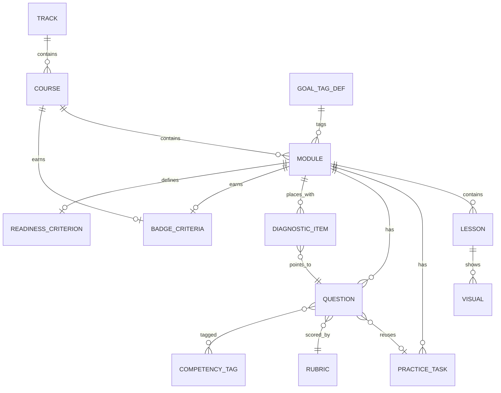
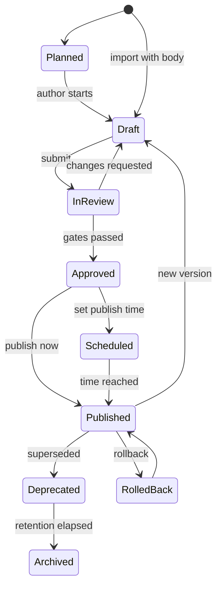

# Content Data Model and Import Schema

## 1. SCOPE AND DESIGN RULES

This document defines **one canonical bundle format** with two interchangeable serialisations: a JSON bundle (validated by the schema in section 5) and a set of CSV files (section 6). The Admin Portal importer (Admin spec section 5.3, "curriculum files (CSV/JSON)") accepts either, normalises to the same internal model, runs the validation rules in section 9, shows a **dry-run impact report**, and commits everything as **Draft** (never straight to Published).

| Rule | Rationale |
|---|---|
| **One owner, `ref` by ID** | G-1 and G-10: every topic and question has one owner course; other courses carry a pointer lesson or a `ref_of` question, never a copy. The schema forbids a payload on a `ref_of` question. |
| **Stable permanent IDs** | Learner progress, mastery, placement estimates and badges attach to IDs (Admin spec section 11). IDs are never reused. |
| **Coding questions reuse practice tasks** | Hidden tests are authored once as a `PracticeTask`; a `coding` question points at it (`payload.task_id`). Avoids the 768-task duplication between practice and bank. |
| **Diagnostics are links, not copies** | A `DiagnosticItem` points at an existing MCQ or code-output question and carries the slot and form (G-5, G-10). |
| **Registries, not free text** | Competency tags (G-9), rule IDs (A6 registry, boss section 7), goal tiers (G-3), clusters (G-10) are enumerations or registries validated on import. |
| **Practice only** | Question `purpose` is always `practice`; hiring banks do not exist in 1.0. |
| **Everything dated** | `as_of`, `last_reviewed`, `review_due` on every content entity (G-12). |
| **Track = Branch** | The Admin spec hierarchy `Branch -> Course -> Module -> Lesson` maps one to one: Track A, B, C are three Branches. Admin level labels (Beginner to Senior) map to L1 to L4 (G-4). |

## 2. ENTITY MODEL



| Entity | Count driver | Notes |
|---|---|---|
| Track | 3 | A, B, C |
| Course | 19 | A1 to A8, B1 to B7, C1 to C4 |
| Module | 192 | 9 to 12 per course (G-2 range) |
| Lesson | about 3 to 6 per module | Two variants each (Simpler, Deeper); pointer, preview and shared kinds |
| Visual | at least 1 per lesson plus a canonical module visual | Mermaid, SVG, step-through or interactive; alt text mandatory |
| PracticeTask | 3 to 8 per module; one `is_lab` per module | Mode `ide`, `sql` or `design` |
| Question | 33 per module target | Seven types (section 4.7) |
| Rubric, CompetencyTag, GoalTagDef, BadgeCriteria, DiagnosticItem, ReadinessCriterion | see section 10 | Registries and criteria |

## 3. IDENTIFIER CONVENTIONS AND NORMALISATION

| Entity | Canonical ID | Example | Legacy forms the importer maps (stored in `legacy_ids`) |
|---|---|---|---|
| Track | `A`, `B`, `C` | `A` | none |
| Course | `<track><n>` | `A1` | none |
| Module | `<course>.M<n>` | `A5.M4` | local `M4` inside a syllabus file |
| Lesson | `<module>.<n>` | `A5.M4.2` | A4 `L1`..`L5` renamed to `.1`..`.5` (boss rule 3); alias only for any remaining short form (`M1.1`, `Lesson 3`); A1, A3, A4 and A8 now state `Cn.Mn.k` IDs (for example `A1.M1.1`, `A8.M9.4`) |
| Visual | `V-<course>-M<n>-<nn>` | `V-A1-M1-01` | none (new) |
| Practice task / lab | `T-<course>-M<n>-<nn>` or `LAB-<course>-<NAME>` | `LAB-A5-TOKENBUCKET` | Lab names already used in syllabi are kept verbatim |
| Question | `Q-<course>-M<n>-<nn>` (two or three digits, opaque) | `Q-A5-M4-07` | **Seeds (RUL-05):** `Mn-Qk` (A1, A4, A6, A7, C1; C1 maps `M1-Q1` -> `Q-C1-M1-01`), `Qn.k` (A8) and `Qm.k` (A2; `Q3.2` -> `Q-A2-M3-02`) all map to `Q-<course>-M<n>-<nn>`. **Diagnostics:** A1 `Q-A1-Mn-D1..D5`; A2 `Q-A2-Mx-P1..P6`; A3 `Q-A3-Mx-P1..P8`; A4 `Q-A4-Mn-D1..`; A5 `P-A5-Mn-k` -> `Q-A5-Mn-P1..Pk`; A6 `Q-A6-Mn-P01..`; A7 `Q-A7-Mn-D1..Dk`; A8 `Q-A8-Mn-D1..Dk`; B2 `P1..P6` -> `Q-B2-Mn-P1..`; B5 now `Q-B5-Mn-p01..p06` (and B7 `Q-B7-Mn-p01..`); B6 `Q-B6-Mn-nn` (old `PL-B6-`); C1 `Q-C1-Mn-P1..Pk`; C3 `Q-C3-Mn-nn`; C4 `Q-C4-Mn-Pk`. The importer holds these as an **alias table** (legacy form -> canonical ID, kept in `legacy_ids`); the slot string keeps `D2`, `P3`, ... |
| Diagnostic item | `DG-<course>-M<n>-<nn>` | `DG-A1-M1-02` | the legacy diagnostic IDs above (the question keeps the legacy ID; the slot string keeps `D2`, `P3`, ...) |
| Rubric | `RB-<NAME>` | `RB-DESIGN-D1-D11` | rubric names in syllabi |
| Badge | `BD-<course>` or `BD-<course>-M<n>` | `BD-A1-M1` | none |
| Readiness criterion | `RD-<course>-M<n>` or `RD-<course>` | `RD-A1-M1` | none |
| Competency tag | `<domain>.<topic>` lower case, hyphens | `python.core` | underscores replaced by hyphens (A8 `eng.test_strategy`); `security.api` -> `sec.api`; `sd.ai-feature` and `system-design.ai-systems` -> `design.ai-systems`; `llm.model-routing` (B7) separate from `llm.model-selection` (B2); `hr.*` owned by C1 |
| Shared lesson | normal lesson ID plus `shared_key` X1 to X6 | `A8.M9.4` with `shared_key: X1` | X1 to X6 as written in G-13 |

Difficulty mapping (RUL-05): the schema stores integers 1 to 5. Word labels in syllabi map as follows.

| Syllabus label | Integer |
|---|---|
| easy | 1 |
| easy-medium | 2 |
| medium | 3 |
| medium-hard | 4 |
| hard | 5 |
| A8 seniority labels: Mid / Mid-Senior / Senior / Senior-Staff | 2 / 3 / 4 / 5 |
| B7 `senior` | 4 |

Notes: question numbers are **opaque**; type is a field, not a number range. Seeds keep their wording, receive the next free number, and keep the legacy ID. Parsers for compact notations:

| Source notation | Parsed to |
|---|---|
| `B:M A:S H:M` (A and B tracks) | `{"B":"M","A":"S","H":"M"}` |
| `N/M/M` or `M/M/M` (B3, C3, C1 style: order Backend / AI / Hybrid) | same, in B, A, H order |
| `12 / 11 / 12` (weights) | `interview_weight {B:12, A:11, H:12}`; each course column must sum to 100 (+/- 1) |
| `(S 2.25 h / D 1.5 h)` | `hours {simpler:2.25, deeper:1.5}` |
| `> = 85 / 70-84 / 50-69 / < 50` | band thresholds (not stored per module; G-5 defaults in platform config, per-module override allowed) |

## 4. FIELD-LEVEL SPECIFICATION (SUMMARY)

The JSON Schema in section 5 is authoritative. This summary lists the important fields and their meaning.

### 4.1 Common envelope (every content entity)

`version` (semver), `state`, `last_reviewed`, `review_due` (computed from cadence), `review_cadence_months` (3 for AI/LLM and vendor content, 6 for security, standards and fast-moving language features, 12 for stable theory, G-12), `as_of` (date of version claims), `owner_course`, `sme_reviewer`, `provenance` (source file, anchor, import batch, licence note), `review` (the six template quality gates plus `human_professional`), `content_hash` (computed `sha256:` of canonical JSON), `legacy_ids`.

### 4.2 Track, Course, Module

Track: id, title, target roles. Course: header fields from template section 1 (audience, prerequisites, 5 to 8 outcomes each tied to competency tags, effort `simpler_h/deeper_h/assessment_h`, owned and secondary tags, goal tags `{B,A,H}`, badge, final assessment definition, version baseline). Module: outcome, `hours`, goal tags, `interview_weight`, `primer_for`, `owns`/`points` (G-1 Ownership notes row), `remediation_modules` (LF-5), `defer_until` (A6.M8), `gated` (C4 M5 to M9), `rehearsal_modes`, `applied_lab_id`, `readiness_criterion_id`, `badge_id`, pitfalls, misconceptions, `staff_probes`, `question_targets` (defaults 12/6/4/8/3).

### 4.3 Lesson and Lesson variants

Every lesson has **two variants**, `simpler` and `deeper`, each with summary, minutes and ordered blocks (markdown, code, callout, worked example, step-through, visual reference, provider note, checkpoint). `kind`: `owner` (full depth), `pointer` (at most 20 minutes, no lab, no new code task, at most one `ref` question, must set `points_to`, G-1), `preview` (pointer whose owner is later in the route, must be self-contained), `shared` (X1 to X6, `shared_key` required). `level_map` states per L1 to L4 whether the lesson is full, skim, skip or challenge (maps the Simpler/Deeper switch and the placement bands: skim band keeps `deeper_only` lessons).

### 4.4 Visual

`kind` mermaid (rendered to SVG at publish, ADR-013), svg, step_through, interactive (needs `interactive_spec`). `alt_text` (minimum 10 characters) and `text_equivalent` are required for accessibility. One visual per module may be `canonical` (the memorable visual or analogy of LF-7).

### 4.5 Practice task

`mode`: `ide` (Python and harness runtimes), `sql` (dialect-aware, PostgreSQL 18, MySQL 8.4), `design` (canvas). `runtime`: python, sql-postgres, sql-mysql, sql-portable, design-canvas, python-llm-harness, python-voice-harness, notebook, multi-file, artefact. `runtime_image` is a key into the platform pin manifest (G-8), never a free image tag. Tests carry a `category` (basic, empty, large, duplicates, edge, concurrency, security, perf) so the hidden-test engine can report per-category catch rates (P-15); large cases carry an `op_budget` (operation-count proxy). Labs (`is_lab`) carry a one-line `production_frame` (LF-6).

### 4.6 Diagnostic item

`question_id` (an MCQ or code-output question), `slot` (the trap, for example `D2` or `P3`), `difficulty`, `form` (A or B for parallel forms), `must_know` (a miss caps the band at skim, see Placement_Test_Blueprint.md section 5.2). The linked question also carries `placement.eligible` so it can be found without a join.

### 4.7 Question types and payloads

| Type | Admin spec type(s) | Payload essentials | Scored by |
|---|---|---|---|
| `mcq` | MCQ, multi-select | options with feedback, correct set, multi-select, partial credit, shuffle | Auto |
| `code_output` | Code output (and exception prediction) | code, language, runtime image, expected output or expected exception, reasoning rubric, trace | Auto plus optional rubric |
| `coding` | Coding, debugging (B6 and B7 harness or calculator tasks live here) | `task_id` (a practice task), complexity expectation, reference solution, follow-ups, `strict_from_scratch` | Hidden tests (>= 70 percent) plus stated complexity |
| `sql` | SQL | dialect, engine version, dataset and hidden datasets, validation mode (result exact or unordered, state, schema, structure rules, plan check), permission profile, limits, reference solution | Auto per dialect |
| `verbal` | Short answer, behavioural, resume and JD-driven templates | ideal outline, weak answers, 2 to 3 probes, up to 2 staff probes, rubric, common mistakes, model answer for PASS or reveal, `senior_bar_note` (required) | LLM rubric with evidence quotes |
| `scenario_design` | System design, code review scenarios | prompt, constraints, `canvas_required`, reference graph, `rule_ids` from the registry only, rubric, probing tree, estimation inputs | Deterministic rules plus rubric |
| `artefact` | none in the Admin spec; **new** (Track C relabel G-10, for example script rewrite, worksheet, story-card audit, thesis) | instructions, artefact kind, rubric, ledger and sensitivity flags | Rubric |

Gap note: `artefact` is not in the Admin spec question model (section 6.1). It is required for C1, C2 and C4 (G-10 relabel) and is listed as a new requirement in Platform_Capability_Requirements.md. `debugging` and `code_review` (Admin spec) have no target counts in the template; they stay available as admin types but are outside the 1.0 volume targets.

Common question fields: difficulty 1 to 5, `est_seconds`, `competency_tags` (at least one, from the registry), `goal_tags` `{B,A,H}` (G-10, amended by RUL-06: the importer reads the per-seed tag where the syllabus states one, otherwise inherits the module row tag; inheritance is used by A3, A4 and A8 and by the B5 and B7 tables), `cluster_tags` (IT-services, global-IT-consulting, Big4, global-product, Indian-product, AI-startup), `senior_bar_note` (what mid, senior and staff add), `ref_of`, `placement` flag, `purpose: practice`.

### 4.8 Rubric

`dimensions[]` with weight (sum to 1.0 by validation), anchors per score level (0 to 5), evidence sources, `pass_rules` (Meets: average >= 3.0 and none < 2; Senior bar: average >= 3.5 and none < 3, G-6 and G-7), critical-finding block for designs, `level_mapping` for behavioural rubrics (C1 L1 to L4 on the 5-point scale), `release_numeric_scores` (false until calibration passes, R-C2-4), `calibration_set_id`. The design rubric D1 to D11 (A6 section 1.2) ships as one canonical rubric `RB-DESIGN-D1-D11`; D12 is not added (boss section 7).

### 4.9 Competency tag, goal tag, badge criteria, readiness criterion

- **CompetencyTag:** id, title, owner course (the only course that issues credit), secondary courses, aliases and replaces (normalisation), deprecation flag.
- **GoalTagDef:** registry rows for goals (B, A, H), tiers (M, S, N with multipliers 1.0, 0.6, 0.25) and clusters.
- **BadgeCriteria:** scope module, course or program; `mastery_pct` (80); required tasks; `all_module_badges`; timed task (>= 70 percent hidden tests with stated complexity); voice mock (Meets: 3.0 and none < 2); canvas block (rubric overall >= 3.5, no dimension < 3, no critical findings); evidence types; certificate template. Publishing a course is **blocked until its badge criteria exist** (Admin spec section 4.1).
- **ReadinessCriterion:** G-6 parameterised: mastery check >= 85 on a retake spaced >= 7 days; timed task rule; strict-mode voice drill average >= 3.5 and none < 3 in two sessions at least 48 hours apart; blocked while any prerequisite remediation flag is open; free-text extra conditions from the syllabus LF-2 row.

## 5. JSON SCHEMA (BUNDLE, DRAFT 2020-12)

```json
{
  "$schema": "https://json-schema.org/draft/2020-12/schema",
  "$id": "https://skillora.example/schemas/curriculum-bundle-1.0.json",
  "title": "Skillora Curriculum Bundle 1.0",
  "type": "object",
  "required": ["schema_version", "tracks", "courses", "modules"],
  "additionalProperties": false,
  "properties": {
    "schema_version": { "const": "1.0" },
    "curriculum_release": { "type": "string", "description": "Release label, for example 1.0.0-rc1" },
    "generated_at": { "type": "string", "format": "date-time" },
    "source_files": { "type": "array", "items": { "type": "string" } },
    "tracks": { "type": "array", "items": { "$ref": "#/$defs/Track" } },
    "courses": { "type": "array", "items": { "$ref": "#/$defs/Course" } },
    "modules": { "type": "array", "items": { "$ref": "#/$defs/Module" } },
    "lessons": { "type": "array", "items": { "$ref": "#/$defs/Lesson" } },
    "visuals": { "type": "array", "items": { "$ref": "#/$defs/Visual" } },
    "practice_tasks": { "type": "array", "items": { "$ref": "#/$defs/PracticeTask" } },
    "questions": { "type": "array", "items": { "$ref": "#/$defs/Question" } },
    "rubrics": { "type": "array", "items": { "$ref": "#/$defs/Rubric" } },
    "competency_tags": { "type": "array", "items": { "$ref": "#/$defs/CompetencyTag" } },
    "goal_tag_defs": { "type": "array", "items": { "$ref": "#/$defs/GoalTagDef" } },
    "badges": { "type": "array", "items": { "$ref": "#/$defs/BadgeCriteria" } },
    "diagnostic_items": { "type": "array", "items": { "$ref": "#/$defs/DiagnosticItem" } },
    "readiness_criteria": { "type": "array", "items": { "$ref": "#/$defs/ReadinessCriterion" } }
  },
  "$defs": {
    "CourseId": { "type": "string", "pattern": "^[ABC][1-9]$" },
    "ModuleId": { "type": "string", "pattern": "^[ABC][1-9]\\.M[0-9]{1,2}$" },
    "LessonId": { "type": "string", "pattern": "^[ABC][1-9]\\.M[0-9]{1,2}\\.[0-9]{1,2}$" },
    "QuestionId": { "type": "string", "pattern": "^Q-[ABC][1-9]-M[0-9]{1,2}-[0-9]{2,3}$" },
    "TaskId": { "type": "string", "pattern": "^(T-[ABC][1-9]-M[0-9]{1,2}-[0-9]{2}|LAB-[ABC][1-9]-[A-Z0-9-]+)$" },
    "VisualId": { "type": "string", "pattern": "^V-[ABC][1-9]-M[0-9]{1,2}-[0-9]{2}$" },
    "RubricId": { "type": "string", "pattern": "^RB-[A-Z0-9-]+$" },
    "BadgeId": { "type": "string", "pattern": "^BD-[A-Z0-9-]+$" },
    "ReadinessId": { "type": "string", "pattern": "^RD-[A-Z0-9-]+$" },
    "DiagnosticId": { "type": "string", "pattern": "^DG-[ABC][1-9]-M[0-9]{1,2}-[0-9]{2}$" },
    "Tag": { "type": "string", "pattern": "^[a-z]+(\\.[a-z0-9]+(-[a-z0-9]+)*)+$", "description": "Competency tag, G-9 namespace, hyphens only" },
    "RuleId": { "type": "string", "pattern": "^R-[A-Z]+-[0-9]+$" },
    "Semver": { "type": "string", "pattern": "^[0-9]+\\.[0-9]+\\.[0-9]+$" },
    "State": { "enum": ["planned", "draft", "in_review", "approved", "scheduled", "published", "deprecated", "archived", "rolled_back"] },
    "Date": { "type": "string", "format": "date" },
    "Level": { "enum": ["L1", "L2", "L3", "L4"] },
    "Tier": { "enum": ["M", "S", "N"], "description": "MUST, SHOULD, NICE (G-3)" },
    "Cluster": { "enum": ["IT-services", "global-IT-consulting", "Big4", "global-product", "Indian-product", "AI-startup"] },
    "RehearsalMode": { "enum": ["voice-drill", "coding", "canvas", "behavioural", "project-deep-dive"] },
    "GoalTags": {
      "type": "object",
      "required": ["B", "A", "H"],
      "additionalProperties": false,
      "properties": { "B": { "$ref": "#/$defs/Tier" }, "A": { "$ref": "#/$defs/Tier" }, "H": { "$ref": "#/$defs/Tier" } }
    },
    "Weights": {
      "type": "object",
      "required": ["B", "A", "H"],
      "additionalProperties": false,
      "properties": {
        "B": { "type": "number", "minimum": 0, "maximum": 100 },
        "A": { "type": "number", "minimum": 0, "maximum": 100 },
        "H": { "type": "number", "minimum": 0, "maximum": 100 }
      }
    },
    "Provenance": {
      "type": "object",
      "properties": {
        "source_file": { "type": "string" },
        "source_anchor": { "type": "string" },
        "imported_at": { "type": "string", "format": "date-time" },
        "import_batch": { "type": "string" },
        "licence_note": { "type": "string" }
      }
    },
    "ReviewGates": {
      "type": "object",
      "description": "Template section 4 quality gates 1 to 6",
      "properties": {
        "sme_technical": { "type": "boolean" },
        "pedagogy": { "type": "boolean" },
        "visual": { "type": "boolean" },
        "question_bank": { "type": "boolean" },
        "pilot": { "type": "boolean" },
        "version_stamped": { "type": "boolean" },
        "human_professional": { "type": "boolean", "description": "Required for gated content such as C4 M5 to M9 (R-C4-3)" }
      }
    },
    "Envelope": {
      "type": "object",
      "required": ["version", "state"],
      "properties": {
        "version": { "$ref": "#/$defs/Semver" },
        "state": { "$ref": "#/$defs/State" },
        "last_reviewed": { "$ref": "#/$defs/Date" },
        "review_due": { "$ref": "#/$defs/Date" },
        "review_cadence_months": { "enum": [3, 6, 12] },
        "as_of": { "$ref": "#/$defs/Date", "description": "Date of the version/fact claims in the content" },
        "owner_course": { "$ref": "#/$defs/CourseId" },
        "sme_reviewer": { "type": "string" },
        "provenance": { "$ref": "#/$defs/Provenance" },
        "review": { "$ref": "#/$defs/ReviewGates" },
        "content_hash": { "type": "string", "pattern": "^sha256:[0-9a-f]{64}$" },
        "legacy_ids": { "type": "array", "items": { "type": "string" } }
      }
    },
    "Track": {
      "allOf": [{ "$ref": "#/$defs/Envelope" }],
      "type": "object",
      "required": ["id", "title"],
      "unevaluatedProperties": false,
      "properties": {
        "id": { "enum": ["A", "B", "C"] },
        "title": { "type": "string" },
        "summary": { "type": "string" },
        "seq": { "type": "integer" },
        "target_roles": { "type": "array", "items": { "enum": ["backend", "ai-engineer", "hybrid"] } }
      }
    },
    "Outcome": {
      "type": "object",
      "required": ["id", "text"],
      "additionalProperties": false,
      "properties": {
        "id": { "type": "string", "pattern": "^O[0-9]{1,2}$" },
        "text": { "type": "string" },
        "competency_tags": { "type": "array", "items": { "$ref": "#/$defs/Tag" } }
      }
    },
    "Course": {
      "allOf": [{ "$ref": "#/$defs/Envelope" }],
      "type": "object",
      "required": ["id", "track_id", "title", "effort", "goal_tags", "outcomes", "owned_tags"],
      "unevaluatedProperties": false,
      "properties": {
        "id": { "$ref": "#/$defs/CourseId" },
        "track_id": { "enum": ["A", "B", "C"] },
        "title": { "type": "string" },
        "audience": { "type": "string" },
        "prerequisites": { "type": "array", "items": { "$ref": "#/$defs/CourseId" } },
        "recommended_before": { "type": "array", "items": { "$ref": "#/$defs/CourseId" } },
        "outcomes": { "type": "array", "minItems": 5, "maxItems": 8, "items": { "$ref": "#/$defs/Outcome" } },
        "effort": {
          "type": "object",
          "required": ["simpler_h", "deeper_h", "assessment_h"],
          "additionalProperties": false,
          "properties": {
            "simpler_h": { "type": "number", "exclusiveMinimum": 0 },
            "deeper_h": { "type": "number", "exclusiveMinimum": 0 },
            "assessment_h": { "type": "number", "minimum": 0 }
          }
        },
        "goal_tags": { "$ref": "#/$defs/GoalTags" },
        "owned_tags": { "type": "array", "items": { "$ref": "#/$defs/Tag" } },
        "secondary_tags": { "type": "array", "items": { "$ref": "#/$defs/Tag" } },
        "badge_id": { "$ref": "#/$defs/BadgeId" },
        "final_assessment": {
          "type": "object",
          "additionalProperties": false,
          "properties": {
            "mastery_pct": { "type": "number", "default": 80 },
            "timed_task_id": { "$ref": "#/$defs/TaskId" },
            "voice_mock_bar": { "enum": ["meets", "senior"] },
            "canvas_task_ids": { "type": "array", "items": { "$ref": "#/$defs/TaskId" } }
          }
        },
        "authoring_owner": { "type": "string" },
        "version_baseline": { "type": "object", "additionalProperties": { "type": "string" } }
      }
    },
    "Module": {
      "allOf": [{ "$ref": "#/$defs/Envelope" }],
      "type": "object",
      "required": ["id", "course_id", "seq", "title", "outcome", "hours", "goal_tags", "interview_weight"],
      "unevaluatedProperties": false,
      "properties": {
        "id": { "$ref": "#/$defs/ModuleId" },
        "course_id": { "$ref": "#/$defs/CourseId" },
        "seq": { "type": "integer", "minimum": 1 },
        "title": { "type": "string" },
        "outcome": { "type": "string" },
        "hours": {
          "type": "object",
          "required": ["simpler", "deeper"],
          "additionalProperties": false,
          "properties": { "simpler": { "type": "number", "minimum": 0 }, "deeper": { "type": "number", "minimum": 0 } }
        },
        "goal_tags": { "$ref": "#/$defs/GoalTags" },
        "primer_for": { "type": "array", "items": { "enum": ["B", "A", "H"] }, "description": "Goals for which this module is the NICE-tier primer" },
        "interview_weight": { "$ref": "#/$defs/Weights" },
        "competency_tags": { "type": "array", "items": { "$ref": "#/$defs/Tag" } },
        "owns": { "type": "array", "items": { "type": "string" } },
        "points": {
          "type": "array",
          "items": {
            "type": "object",
            "required": ["topic", "owner_id"],
            "additionalProperties": false,
            "properties": { "topic": { "type": "string" }, "owner_id": { "type": "string" } }
          }
        },
        "remediation_modules": { "type": "array", "items": { "$ref": "#/$defs/ModuleId" } },
        "defer_until": { "type": "array", "items": { "$ref": "#/$defs/ModuleId" }, "description": "Unlock only after these modules pass (for example A6.M8)" },
        "gated": { "type": "boolean", "description": "Publication or unlock gated on human review or stage (C4 M5 to M9)" },
        "rehearsal_modes": { "type": "array", "items": { "$ref": "#/$defs/RehearsalMode" } },
        "applied_lab_id": { "$ref": "#/$defs/TaskId" },
        "readiness_criterion_id": { "$ref": "#/$defs/ReadinessId" },
        "mastery_pct": { "type": "number", "default": 80 },
        "badge_id": { "$ref": "#/$defs/BadgeId" },
        "pitfalls": { "type": "array", "items": { "type": "string" } },
        "misconceptions": { "type": "array", "items": { "type": "string" } },
        "staff_probes": { "type": "array", "maxItems": 4, "items": { "type": "string" } },
        "question_targets": {
          "type": "object",
          "additionalProperties": false,
          "properties": {
            "mcq": { "type": "integer", "default": 12 },
            "code_output": { "type": "integer", "default": 6 },
            "coding": { "type": "integer", "default": 4 },
            "verbal": { "type": "integer", "default": 8 },
            "scenario_design": { "type": "integer", "default": 3 }
          }
        }
      }
    },
    "Block": {
      "type": "object",
      "required": ["type"],
      "properties": {
        "type": { "enum": ["markdown", "code", "callout", "worked_example", "step_through", "visual_ref", "provider_note", "checkpoint"] },
        "text": { "type": "string" },
        "language": { "type": "string" },
        "runnable": { "type": "boolean" },
        "runtime_ref": { "type": "string" },
        "expected_output": { "type": "string" },
        "visual_id": { "$ref": "#/$defs/VisualId" },
        "as_of": { "$ref": "#/$defs/Date" }
      }
    },
    "LessonVariant": {
      "type": "object",
      "required": ["summary", "blocks", "minutes"],
      "additionalProperties": false,
      "properties": {
        "summary": { "type": "string" },
        "minutes": { "type": "number", "exclusiveMinimum": 0 },
        "blocks": { "type": "array", "minItems": 1, "items": { "$ref": "#/$defs/Block" } }
      }
    },
    "Lesson": {
      "type": "object",
      "required": ["id", "module_id", "seq", "title", "kind", "variants", "visual_ids"],
      "unevaluatedProperties": false,
      "properties": {
        "id": { "$ref": "#/$defs/LessonId" },
        "module_id": { "$ref": "#/$defs/ModuleId" },
        "seq": { "type": "integer", "minimum": 1 },
        "title": { "type": "string" },
        "kind": { "enum": ["owner", "pointer", "preview", "shared"] },
        "shared_key": { "enum": ["X1", "X2", "X3", "X4", "X5", "X6"] },
        "points_to": { "$ref": "#/$defs/LessonId", "description": "Required when kind is pointer or preview" },
        "variants": {
          "type": "object",
          "required": ["simpler", "deeper"],
          "additionalProperties": false,
          "properties": { "simpler": { "$ref": "#/$defs/LessonVariant" }, "deeper": { "$ref": "#/$defs/LessonVariant" } }
        },
        "level_map": {
          "type": "object",
          "additionalProperties": false,
          "properties": {
            "L1": { "enum": ["full", "skim", "skip", "challenge"] },
            "L2": { "enum": ["full", "skim", "skip", "challenge"] },
            "L3": { "enum": ["full", "skim", "skip", "challenge"] },
            "L4": { "enum": ["full", "skim", "skip", "challenge"] }
          }
        },
        "deeper_only": { "type": "boolean", "description": "Included in skim band (Deeper-only lessons)" },
        "challenge": { "type": "boolean" },
        "visual_ids": { "type": "array", "minItems": 1, "items": { "$ref": "#/$defs/VisualId" } },
        "practice_task_ids": { "type": "array", "items": { "$ref": "#/$defs/TaskId" } },
        "competency_tags": { "type": "array", "items": { "$ref": "#/$defs/Tag" } }
      },
      "allOf": [
        { "$ref": "#/$defs/Envelope" },
        { "if": { "properties": { "kind": { "enum": ["pointer", "preview"] } }, "required": ["kind"] }, "then": { "required": ["points_to"] } },
        { "if": { "properties": { "kind": { "const": "shared" } }, "required": ["kind"] }, "then": { "required": ["shared_key"] } }
      ]
    },
    "Visual": {
      "allOf": [{ "$ref": "#/$defs/Envelope" }],
      "type": "object",
      "required": ["id", "module_id", "kind", "alt_text"],
      "unevaluatedProperties": false,
      "properties": {
        "id": { "$ref": "#/$defs/VisualId" },
        "module_id": { "$ref": "#/$defs/ModuleId" },
        "lesson_id": { "$ref": "#/$defs/LessonId" },
        "kind": { "enum": ["mermaid", "svg", "step_through", "interactive"] },
        "source": { "type": "string", "description": "Mermaid text, SVG markup, or step-through JSON string" },
        "interactive_spec": { "type": "string", "description": "Path to the interactive component spec; required when kind is interactive" },
        "alt_text": { "type": "string", "minLength": 10 },
        "caption": { "type": "string" },
        "canonical": { "type": "boolean", "description": "The module's canonical memorable visual (LF-7)" },
        "level_variants": { "type": "object", "propertyNames": { "$ref": "#/$defs/Level" }, "additionalProperties": { "type": "string" } },
        "text_equivalent": { "type": "string" }
      }
    },
    "TestCase": {
      "type": "object",
      "required": ["id"],
      "additionalProperties": false,
      "properties": {
        "id": { "type": "string" },
        "category": { "enum": ["basic", "empty", "large", "duplicates", "edge", "concurrency", "security", "perf"] },
        "input": {},
        "expected": {},
        "weight": { "type": "number", "default": 1 },
        "timeout_s": { "type": "number" },
        "op_budget": { "type": "integer", "description": "Operation-count proxy for complexity-aware large cases (P-15)" },
        "file": { "type": "string" }
      }
    },
    "Limits": {
      "type": "object",
      "additionalProperties": false,
      "properties": {
        "wall_s": { "type": "number", "default": 10 },
        "memory_mb": { "type": "integer", "default": 2048 },
        "vcpu": { "type": "number", "default": 1 },
        "processes": { "type": "integer" },
        "threads": { "type": "integer" },
        "repeat_runs": { "type": "integer" },
        "network": { "enum": ["none", "allowlist", "gateway"], "default": "none" }
      }
    },
    "PracticeTask": {
      "allOf": [{ "$ref": "#/$defs/Envelope" }],
      "type": "object",
      "required": ["id", "module_id", "mode", "runtime", "title", "brief", "difficulty"],
      "unevaluatedProperties": false,
      "properties": {
        "id": { "$ref": "#/$defs/TaskId" },
        "module_id": { "$ref": "#/$defs/ModuleId" },
        "lesson_id": { "$ref": "#/$defs/LessonId" },
        "mode": { "enum": ["ide", "sql", "design"] },
        "runtime": { "enum": ["python", "sql-postgres", "sql-mysql", "sql-portable", "design-canvas", "python-llm-harness", "python-voice-harness", "notebook", "multi-file", "artefact"] },
        "runtime_image": { "type": "string", "description": "Key into the platform pin manifest, for example py-3.14" },
        "title": { "type": "string" },
        "brief": { "type": "string" },
        "is_lab": { "type": "boolean" },
        "production_frame": { "type": "string", "description": "One line: backend, IoT, SaaS, AI assistant, voice, enterprise (LF-6)" },
        "difficulty": { "type": "integer", "minimum": 1, "maximum": 5 },
        "est_minutes": { "type": "integer" },
        "starter_files": { "type": "array", "items": { "type": "object", "required": ["path"], "properties": { "path": { "type": "string" }, "locked": { "type": "boolean" }, "content_ref": { "type": "string" } } } },
        "visible_tests": { "type": "array", "items": { "$ref": "#/$defs/TestCase" } },
        "hidden_tests": { "type": "array", "items": { "$ref": "#/$defs/TestCase" } },
        "limits": { "$ref": "#/$defs/Limits" },
        "hints": { "type": "array", "items": { "type": "string" } },
        "dataset_id": { "type": "string" },
        "permission_profile": { "enum": ["select", "dml", "ddl", "transactions", "two-session"] },
        "rubric_id": { "$ref": "#/$defs/RubricId" },
        "rule_ids": { "type": "array", "items": { "$ref": "#/$defs/RuleId" } },
        "fixture_ids": { "type": "array", "items": { "type": "string" } },
        "import_allowlist": { "type": "array", "items": { "type": "string" } },
        "modes_enabled": { "type": "array", "items": { "enum": ["learn", "practice", "interview", "challenge", "review"] } }
      }
    },
    "McqPayload": {
      "type": "object",
      "required": ["options", "correct"],
      "additionalProperties": false,
      "properties": {
        "options": {
          "type": "array", "minItems": 2, "maxItems": 8,
          "items": { "type": "object", "required": ["key", "text"], "additionalProperties": false, "properties": { "key": { "type": "string" }, "text": { "type": "string" }, "feedback": { "type": "string" } } }
        },
        "correct": { "type": "array", "minItems": 1, "items": { "type": "string" } },
        "multi_select": { "type": "boolean", "default": false },
        "partial_credit": { "type": "boolean", "default": false },
        "shuffle": { "type": "boolean", "default": true },
        "explanation": { "type": "string" }
      }
    },
    "CodeOutputPayload": {
      "type": "object",
      "required": ["code", "language", "expected_output"],
      "additionalProperties": false,
      "properties": {
        "code": { "type": "string" },
        "language": { "enum": ["python", "sql", "bash", "yaml", "json"] },
        "runtime_image": { "type": "string" },
        "expected_output": { "type": "string" },
        "exception_expected": { "type": "string" },
        "reasoning_rubric_id": { "$ref": "#/$defs/RubricId" },
        "trace": { "type": "string", "description": "Shown after answering" }
      }
    },
    "CodingPayload": {
      "type": "object",
      "required": ["task_id"],
      "additionalProperties": false,
      "properties": {
        "task_id": { "$ref": "#/$defs/TaskId", "description": "Coding questions reuse a PracticeTask so tests are authored once" },
        "complexity_expectation": {
          "type": "object", "additionalProperties": false,
          "properties": { "time": { "type": "string" }, "space": { "type": "string" } }
        },
        "reference_solution_ref": { "type": "string" },
        "follow_ups": { "type": "array", "items": { "type": "string" } },
        "strict_from_scratch": { "type": "boolean" }
      }
    },
    "SqlPayload": {
      "type": "object",
      "required": ["dialect", "dataset_id", "validation"],
      "additionalProperties": false,
      "properties": {
        "dialect": { "enum": ["postgresql", "mysql", "portable"] },
        "engine_version": { "type": "string", "description": "Key into the pin manifest, for example pg-18, mysql-8.4" },
        "dataset_id": { "type": "string" },
        "hidden_dataset_ids": { "type": "array", "items": { "type": "string" } },
        "starter_sql": { "type": "string" },
        "validation": {
          "type": "object", "required": ["mode"], "additionalProperties": false,
          "properties": {
            "mode": { "enum": ["result-exact", "result-unordered", "state-check", "schema-check", "structure-rules", "plan-check"] },
            "float_tolerance": { "type": "number" },
            "null_handling": { "enum": ["strict", "ignore-order"] },
            "structure_rules": { "type": "array", "items": { "type": "string" } },
            "plan_assertions": { "type": "array", "items": { "type": "string" } }
          }
        },
        "expected_result_ref": { "type": "string" },
        "permission_profile": { "enum": ["select", "dml", "ddl", "transactions", "two-session"] },
        "limits": { "$ref": "#/$defs/Limits" },
        "reference_solution_ref": { "type": "string" },
        "hints": { "type": "array", "items": { "type": "string" } },
        "show_plan": { "type": "boolean" }
      }
    },
    "VerbalPayload": {
      "type": "object",
      "required": ["ideal_outline", "weak_answers", "probes", "rubric_id"],
      "additionalProperties": false,
      "properties": {
        "ideal_outline": { "type": "array", "minItems": 2, "items": { "type": "string" } },
        "weak_answers": { "type": "array", "minItems": 1, "items": { "type": "string" } },
        "probes": { "type": "array", "minItems": 2, "maxItems": 3, "items": { "type": "string" } },
        "staff_probes": { "type": "array", "maxItems": 2, "items": { "type": "string" } },
        "rubric_id": { "$ref": "#/$defs/RubricId" },
        "common_mistakes": { "type": "array", "items": { "type": "string" } },
        "model_answer": { "type": "string", "description": "Senior-level answer revealed on PASS or reveal (Master Spec section 23)" },
        "evidence_requirements": { "type": "array", "items": { "type": "string" } },
        "max_answer_seconds": { "type": "integer" }
      }
    },
    "ScenarioDesignPayload": {
      "type": "object",
      "required": ["prompt", "rubric_id"],
      "additionalProperties": false,
      "properties": {
        "prompt": { "type": "string" },
        "constraints": { "type": "array", "items": { "type": "string" } },
        "canvas_required": { "type": "boolean", "default": false },
        "reference_graph_ref": { "type": "string" },
        "rule_ids": { "type": "array", "items": { "$ref": "#/$defs/RuleId" }, "description": "Registry IDs only; courses may not invent rules" },
        "rubric_id": { "$ref": "#/$defs/RubricId" },
        "probing_tree": {
          "type": "array",
          "items": { "type": "object", "required": ["probe"], "additionalProperties": false, "properties": { "probe": { "type": "string" }, "expected_delta": { "type": "string" }, "children": { "type": "array", "items": { "type": "string" } } } }
        },
        "estimation_inputs": { "type": "object", "additionalProperties": { "type": "number" } },
        "model_answer": { "type": "string" }
      }
    },
    "ArtefactPayload": {
      "type": "object",
      "required": ["instructions", "artefact_kind", "rubric_id"],
      "additionalProperties": false,
      "properties": {
        "instructions": { "type": "string" },
        "artefact_kind": { "enum": ["script", "worksheet", "story-card", "thesis", "profile-section", "design-doc", "calculator", "harness-run"] },
        "rubric_id": { "$ref": "#/$defs/RubricId" },
        "uses_profile_ledger": { "type": "boolean" },
        "sensitive": { "type": "boolean", "description": "Stores pay or personal data, session-scoped by default (P-20)" }
      }
    },
    "PlacementFlag": {
      "type": "object",
      "additionalProperties": false,
      "properties": {
        "eligible": { "type": "boolean" },
        "diag_slot": { "type": "string", "description": "The trap this item catches, for example D1 or P3" },
        "must_know": { "type": "boolean" },
        "form": { "enum": ["A", "B"] }
      }
    },
    "Question": {
      "type": "object",
      "required": ["id", "module_id", "type", "title", "difficulty", "competency_tags", "goal_tags"],
      "unevaluatedProperties": false,
      "properties": {
        "id": { "$ref": "#/$defs/QuestionId" },
        "module_id": { "$ref": "#/$defs/ModuleId" },
        "type": { "enum": ["mcq", "code_output", "coding", "sql", "verbal", "scenario_design", "artefact"] },
        "title": { "type": "string" },
        "stem": { "type": "string" },
        "difficulty": { "type": "integer", "minimum": 1, "maximum": 5 },
        "est_seconds": { "type": "integer" },
        "competency_tags": { "type": "array", "minItems": 1, "items": { "$ref": "#/$defs/Tag" } },
        "goal_tags": { "$ref": "#/$defs/GoalTags" },
        "cluster_tags": { "type": "array", "items": { "$ref": "#/$defs/Cluster" } },
        "senior_bar_note": { "type": "string" },
        "ref_of": { "$ref": "#/$defs/QuestionId", "description": "Pointer courses reference the owner item by ID and never copy (G-1, G-10)" },
        "placement": { "$ref": "#/$defs/PlacementFlag" },
        "purpose": { "const": "practice", "description": "Practice banks only, never hiring banks" },
        "payload": { "type": "object" }
      },
      "allOf": [
        { "$ref": "#/$defs/Envelope" },
        { "if": { "properties": { "type": { "const": "mcq" } }, "required": ["type"] }, "then": { "properties": { "payload": { "$ref": "#/$defs/McqPayload" } }, "required": ["payload"] } },
        { "if": { "properties": { "type": { "const": "code_output" } }, "required": ["type"] }, "then": { "properties": { "payload": { "$ref": "#/$defs/CodeOutputPayload" } }, "required": ["payload"] } },
        { "if": { "properties": { "type": { "const": "coding" } }, "required": ["type"] }, "then": { "properties": { "payload": { "$ref": "#/$defs/CodingPayload" } }, "required": ["payload"] } },
        { "if": { "properties": { "type": { "const": "sql" } }, "required": ["type"] }, "then": { "properties": { "payload": { "$ref": "#/$defs/SqlPayload" } }, "required": ["payload"] } },
        { "if": { "properties": { "type": { "const": "verbal" } }, "required": ["type"] }, "then": { "properties": { "payload": { "$ref": "#/$defs/VerbalPayload" } }, "required": ["payload", "senior_bar_note"] } },
        { "if": { "properties": { "type": { "const": "scenario_design" } }, "required": ["type"] }, "then": { "properties": { "payload": { "$ref": "#/$defs/ScenarioDesignPayload" } }, "required": ["payload"] } },
        { "if": { "properties": { "type": { "const": "artefact" } }, "required": ["type"] }, "then": { "properties": { "payload": { "$ref": "#/$defs/ArtefactPayload" } }, "required": ["payload"] } },
        { "if": { "required": ["ref_of"] }, "then": { "not": { "required": ["payload"] } } }
      ]
    },
    "Rubric": {
      "allOf": [{ "$ref": "#/$defs/Envelope" }],
      "type": "object",
      "required": ["id", "name", "scale", "dimensions"],
      "unevaluatedProperties": false,
      "properties": {
        "id": { "$ref": "#/$defs/RubricId" },
        "name": { "type": "string" },
        "applies_to": { "enum": ["verbal", "design", "behavioural", "coding-process", "artefact", "code-output-reasoning"] },
        "scale": {
          "type": "object", "required": ["min", "max"], "additionalProperties": false,
          "properties": { "min": { "enum": [0, 1] }, "max": { "const": 5 } }
        },
        "dimensions": {
          "type": "array", "minItems": 1,
          "items": {
            "type": "object", "required": ["id", "name", "weight", "anchors"], "additionalProperties": false,
            "properties": {
              "id": { "type": "string" },
              "name": { "type": "string" },
              "weight": { "type": "number", "minimum": 0, "maximum": 1 },
              "anchors": { "type": "object", "propertyNames": { "enum": ["0", "1", "2", "3", "4", "5"] }, "additionalProperties": { "type": "string" } },
              "evidence_sources": { "type": "array", "items": { "enum": ["transcript", "canvas", "code", "calculator", "artefact", "graph-rules"] } }
            }
          }
        },
        "pass_rules": {
          "type": "object", "additionalProperties": false,
          "properties": {
            "meets": { "type": "object", "properties": { "avg_min": { "type": "number", "default": 3.0 }, "none_below": { "type": "number", "default": 2 } } },
            "senior_bar": { "type": "object", "properties": { "avg_min": { "type": "number", "default": 3.5 }, "none_below": { "type": "number", "default": 3 } } },
            "critical_rule_block": { "type": "boolean", "description": "Critical registry findings block the design badge" }
          }
        },
        "level_mapping": {
          "type": "object", "propertyNames": { "$ref": "#/$defs/Level" },
          "additionalProperties": { "type": "array", "items": { "type": "number" }, "minItems": 2, "maxItems": 2 }
        },
        "release_numeric_scores": { "type": "boolean", "description": "False until calibration passes (qualitative only), R-C2-4" },
        "calibration_set_id": { "type": "string" }
      }
    },
    "CompetencyTag": {
      "allOf": [{ "$ref": "#/$defs/Envelope" }],
      "type": "object",
      "required": ["id", "title", "owner_course"],
      "unevaluatedProperties": false,
      "properties": {
        "id": { "$ref": "#/$defs/Tag" },
        "title": { "type": "string" },
        "domain": { "type": "string" },
        "secondary_courses": { "type": "array", "items": { "$ref": "#/$defs/CourseId" } },
        "aliases": { "type": "array", "items": { "type": "string" } },
        "replaces": { "type": "array", "items": { "type": "string" } },
        "deprecated": { "type": "boolean" }
      }
    },
    "GoalTagDef": {
      "type": "object",
      "required": ["id", "kind", "label"],
      "additionalProperties": false,
      "properties": {
        "id": { "type": "string" },
        "kind": { "enum": ["goal", "cluster", "tier"] },
        "label": { "type": "string" },
        "multiplier": { "type": "number", "description": "Tier hours multiplier (G-3): M 1.0, S 0.6, N 0.25" },
        "description": { "type": "string" }
      }
    },
    "BadgeCriteria": {
      "allOf": [{ "$ref": "#/$defs/Envelope" }],
      "type": "object",
      "required": ["id", "scope", "target_id", "name", "mastery_pct"],
      "unevaluatedProperties": false,
      "properties": {
        "id": { "$ref": "#/$defs/BadgeId" },
        "scope": { "enum": ["module", "course", "program"] },
        "target_id": { "type": "string", "description": "Module, course or program ID" },
        "name": { "type": "string" },
        "mastery_pct": { "type": "number", "default": 80 },
        "required_task_ids": { "type": "array", "items": { "$ref": "#/$defs/TaskId" } },
        "all_module_badges": { "type": "boolean" },
        "timed_task": {
          "type": "object", "additionalProperties": false,
          "properties": { "task_id": { "$ref": "#/$defs/TaskId" }, "min_hidden_pct": { "type": "number", "default": 70 }, "complexity_required": { "type": "boolean" } }
        },
        "voice_mock": {
          "type": "object", "additionalProperties": false,
          "properties": { "bar": { "enum": ["meets", "senior"] }, "avg_min": { "type": "number" }, "none_below": { "type": "number" }, "rubric_id": { "$ref": "#/$defs/RubricId" } }
        },
        "canvas": {
          "type": "object", "additionalProperties": false,
          "properties": { "rubric_id": { "$ref": "#/$defs/RubricId" }, "overall_min": { "type": "number", "default": 3.5 }, "no_dimension_below": { "type": "number", "default": 3 }, "no_critical_findings": { "type": "boolean", "default": true } }
        },
        "evidence_types": { "type": "array", "items": { "enum": ["mastery-check", "hidden-tests", "voice-mock", "canvas-rubric", "artefact-rubric", "spaced-retake"] } },
        "certificate_template_id": { "type": "string" }
      }
    },
    "DiagnosticItem": {
      "type": "object",
      "required": ["id", "module_id", "question_id", "slot", "difficulty"],
      "additionalProperties": false,
      "properties": {
        "id": { "$ref": "#/$defs/DiagnosticId" },
        "module_id": { "$ref": "#/$defs/ModuleId" },
        "question_id": { "$ref": "#/$defs/QuestionId" },
        "slot": { "type": "string" },
        "title": { "type": "string", "description": "Trap description as written in the syllabus LF-2 row" },
        "difficulty": { "type": "integer", "minimum": 1, "maximum": 5 },
        "form": { "enum": ["A", "B"] },
        "must_know": { "type": "boolean" },
        "band_effect": { "type": "string", "description": "Optional note on how a miss affects the band (cap at skim)" }
      }
    },
    "ReadinessCriterion": {
      "allOf": [{ "$ref": "#/$defs/Envelope" }],
      "type": "object",
      "required": ["id", "topic_tag", "mastery", "voice_drill"],
      "unevaluatedProperties": false,
      "properties": {
        "id": { "$ref": "#/$defs/ReadinessId" },
        "topic_tag": { "$ref": "#/$defs/Tag" },
        "module_id": { "$ref": "#/$defs/ModuleId" },
        "course_id": { "$ref": "#/$defs/CourseId" },
        "mastery": {
          "type": "object", "required": ["min_pct", "retake_spacing_days"], "additionalProperties": false,
          "properties": { "min_pct": { "type": "number", "default": 85 }, "retake_spacing_days": { "type": "integer", "default": 7 } }
        },
        "timed_task": {
          "type": "object", "additionalProperties": false,
          "properties": { "task_id": { "$ref": "#/$defs/TaskId" }, "rule": { "enum": ["hidden-tests-70", "rubric-3.5"] }, "time_limit_min": { "type": "integer" } }
        },
        "voice_drill": {
          "type": "object", "required": ["avg_min", "none_below", "sessions_min", "min_gap_hours"], "additionalProperties": false,
          "properties": {
            "avg_min": { "type": "number", "default": 3.5 },
            "none_below": { "type": "number", "default": 3 },
            "sessions_min": { "type": "integer", "default": 2 },
            "min_gap_hours": { "type": "integer", "default": 48 },
            "mode": { "const": "strict" },
            "rubric_id": { "$ref": "#/$defs/RubricId" }
          }
        },
        "blocked_by_open_remediation": { "type": "array", "items": { "$ref": "#/$defs/ModuleId" } },
        "extra_conditions": { "type": "array", "items": { "type": "string" } }
      }
    }
  }
}
```

### 5.1 Payload snippets validated against the schema

SQL question payload (A4 style, PostgreSQL plan check):

```json
{
  "dialect": "postgresql",
  "engine_version": "pg-18",
  "dataset_id": "DS-ORDERS-01",
  "hidden_dataset_ids": [
    "DS-ORDERS-01-H1"
  ],
  "starter_sql": "-- write the query",
  "validation": {
    "mode": "plan-check",
    "plan_assertions": [
      "uses Index Scan on orders_customer_id_idx"
    ]
  },
  "permission_profile": "select",
  "limits": {
    "wall_s": 10
  },
  "show_plan": true
}
```

Scenario/design payload (canvas, registry rule IDs only):

```json
{
  "prompt": "Design the Skillora rate limiter for an LLM gateway.",
  "canvas_required": true,
  "rule_ids": [
    "R-RATE-1",
    "R-COST-2"
  ],
  "rubric_id": "RB-DESIGN-D1-D11",
  "probing_tree": [
    {
      "probe": "What if Redis fails?",
      "expected_delta": "fail-open or local fallback node added"
    }
  ]
}
```

## 6. CSV SPECIFICATION

**File rules:** UTF-8 without BOM, RFC 4180 quoting, header row required, one entity per file, ISO dates (`YYYY-MM-DD`), booleans `true`/`false`, **list columns use the pipe `|`**, nested structures use a `*_json` column holding minified JSON. Unknown columns are rejected. Empty cell means "not set". A bundle directory contains the files below; any file may be omitted, but references must resolve across files or against already-imported content.

Common columns on every file: `version`, `state`, `last_reviewed`, `as_of`, `owner_course`, `sme_reviewer`, `source_file`, `source_anchor`, `legacy_ids` (pipe list).

| File | Primary key | Columns (R = required) |
|---|---|---|
| `tracks.csv` | `id` | `id`R, `title`R, `summary`, `seq`, `target_roles` |
| `courses.csv` | `id` | `id`R, `track_id`R, `title`R, `audience`, `prerequisites`, `recommended_before`, `simpler_h`R, `deeper_h`R, `assessment_h`R, `goal_B`R, `goal_A`R, `goal_H`R, `owned_tags`R, `secondary_tags`, `badge_id`, `final_mastery_pct`, `final_timed_task_id`, `final_voice_bar`, `canvas_task_ids`, `authoring_owner`, `version_baseline_json` |
| `course_outcomes.csv` | `course_id`+`id` | `course_id`R, `id`R, `text`R, `competency_tags` |
| `modules.csv` | `id` | `id`R, `course_id`R, `seq`R, `title`R, `outcome`R, `hours_simpler`R, `hours_deeper`R, `goal_B`R, `goal_A`R, `goal_H`R, `weight_B`R, `weight_A`R, `weight_H`R, `primer_for`, `competency_tags`, `owns`, `points_json`, `remediation_modules`, `defer_until`, `gated`, `rehearsal_modes`, `applied_lab_id`, `readiness_criterion_id`, `badge_id`, `mastery_pct`, `pitfalls`, `misconceptions`, `staff_probes`, `target_mcq`, `target_code_output`, `target_coding`, `target_verbal`, `target_scenario` |
| `lessons.csv` | `id` | `id`R, `module_id`R, `seq`R, `title`R, `kind`R, `shared_key`, `points_to`, `level_L1`..`level_L4`, `deeper_only`, `challenge`, `visual_ids`R, `practice_task_ids`, `competency_tags` |
| `lesson_variants.csv` | `lesson_id`+`variant` | `lesson_id`R, `variant`R (`simpler` or `deeper`), `summary`R, `minutes`R, `blocks_json`R (array of block objects) |
| `visuals.csv` | `id` | `id`R, `module_id`R, `lesson_id`, `kind`R, `source` or `source_file`, `interactive_spec`, `alt_text`R, `caption`, `canonical`, `text_equivalent` |
| `practice_tasks.csv` | `id` | `id`R, `module_id`R, `lesson_id`, `mode`R, `runtime`R, `runtime_image`, `title`R, `brief`R, `is_lab`, `production_frame`, `difficulty`R, `est_minutes`, `starter_files_json`, `visible_tests_json`, `hidden_tests_json`, `limits_json`, `hints`, `dataset_id`, `permission_profile`, `rubric_id`, `rule_ids`, `fixture_ids`, `import_allowlist`, `modes_enabled` |
| `questions.csv` | `id` | `id`R, `module_id`R, `type`R, `title`R, `stem`, `difficulty`R, `est_seconds`, `competency_tags`R, `goal_B`R, `goal_A`R, `goal_H`R, `cluster_tags`, `senior_bar_note` (R for verbal), `ref_of`, `placement_eligible`, `diag_slot`, `must_know`, `form`, **either** `payload_json` **or** the flattened convenience columns below |
| flattened question columns | | MCQ: `mcq_options` (`key=text` pipe list), `mcq_correct`, `mcq_multi`, `mcq_explanation`; code-output: `co_code_file`, `co_language`, `co_expected`; coding: `coding_task_id`, `coding_time_complexity`, `coding_space_complexity`; verbal: `v_ideal_outline`, `v_weak_answers`, `v_probe_1`..`v_probe_3`, `v_staff_probe_1`..`v_staff_probe_2`, `v_rubric_id`, `v_model_answer`; scenario: `sd_prompt`, `sd_constraints`, `sd_canvas_required`, `sd_rule_ids`, `sd_rubric_id`. Supplying both `payload_json` and flattened columns is an error. |
| `rubrics.csv` | `id` | `id`R, `name`R, `applies_to`, `scale_min`R, `scale_max`R, `meets_avg`, `meets_none_below`, `senior_avg`, `senior_none_below`, `critical_rule_block`, `release_numeric_scores`, `calibration_set_id`, `level_mapping_json` |
| `rubric_dimensions.csv` | `rubric_id`+`id` | `rubric_id`R, `id`R, `name`R, `weight`R, `anchors_json`R, `evidence_sources` |
| `competency_tags.csv` | `id` | `id`R, `title`R, `owner_course`R, `domain`, `secondary_courses`, `aliases`, `replaces`, `deprecated` |
| `goal_tag_defs.csv` | `id` | `id`R, `kind`R, `label`R, `multiplier`, `description` |
| `badges.csv` | `id` | `id`R, `scope`R, `target_id`R, `name`R, `mastery_pct`R, `required_task_ids`, `all_module_badges`, `timed_task_id`, `timed_min_hidden_pct`, `timed_complexity_required`, `voice_bar`, `voice_avg_min`, `voice_none_below`, `voice_rubric_id`, `canvas_rubric_id`, `canvas_overall_min`, `canvas_no_dim_below`, `evidence_types`, `certificate_template_id` |
| `diagnostics.csv` | `id` | `id`R, `module_id`R, `question_id`R, `slot`R, `title`, `difficulty`R, `form`, `must_know`, `band_effect` |
| `readiness.csv` | `id` | `id`R, `topic_tag`R, `module_id`, `course_id`, `mastery_min_pct`R, `retake_spacing_days`R, `timed_task_id`, `timed_rule`, `time_limit_min`, `voice_avg_min`R, `voice_none_below`R, `voice_sessions_min`R, `voice_min_gap_hours`R, `voice_rubric_id`, `blocked_by_open_remediation`, `extra_conditions` |

## 7. WORKED EXAMPLE (SMALL)

The JSON below is a complete, valid bundle: one track, one course (A1, abridged), one module (A1.M1), one lesson with both variants, one visual, one lab, three questions (MCQ placement item, verbal seed with rubric and probes, planned scenario stub), two rubrics, one competency tag, goal and tier registries, two badges, one diagnostic item and one readiness criterion.

```json
{
  "schema_version": "1.0",
  "curriculum_release": "1.0.0-example",
  "generated_at": "2026-10-05T10:00:00Z",
  "source_files": ["03_Curriculum_Syllabi/A1_Python_Internals_for_Interviews.md"],
  "tracks": [
    { "id": "A", "title": "Senior Python Backend Mastery", "seq": 1, "version": "1.0.0", "state": "draft", "target_roles": ["backend", "hybrid"] }
  ],
  "courses": [
    {
      "id": "A1", "track_id": "A", "title": "Python Internals for Interviews", "version": "2.0.0", "state": "draft",
      "last_reviewed": "2026-10-05", "review_cadence_months": 6, "as_of": "2026-10-05",
      "audience": "L1 to L4; reference learner is a senior engineer with about 4 years of Python",
      "prerequisites": [], "recommended_before": ["A3", "A8"],
      "outcomes": [
        { "id": "O1", "text": "Trace names, objects, mutability, hashing and copying and predict output of unseen code.", "competency_tags": ["python.core"] },
        { "id": "O2", "text": "Explain refcounting, the cyclic GC and diagnose a leak with tracemalloc.", "competency_tags": ["python.memory"] },
        { "id": "O3", "text": "State what the GIL guarantees and does not, and choose a concurrency model.", "competency_tags": ["python.concurrency-basics"] },
        { "id": "O4", "text": "Build lazy pipelines with iterators and generators.", "competency_tags": ["python.oop-datamodel"] },
        { "id": "O5", "text": "Find a bottleneck with measurement and fix it at the right level.", "competency_tags": ["python.performance"] }
      ],
      "effort": { "simpler_h": 22, "deeper_h": 15, "assessment_h": 2 },
      "goal_tags": { "B": "M", "A": "S", "H": "M" },
      "owned_tags": ["python.core", "python.memory", "python.concurrency-basics", "python.oop-datamodel", "python.performance"],
      "secondary_tags": ["api.fastapi-async"],
      "badge_id": "BD-A1",
      "authoring_owner": "SME-A1",
      "version_baseline": { "python": "3.14", "postgresql": "18", "mysql": "8.4" }
    }
  ],
  "modules": [
    {
      "id": "A1.M1", "course_id": "A1", "seq": 1, "title": "Object model and identity",
      "version": "2.0.0", "state": "draft", "owner_course": "A1", "last_reviewed": "2026-10-05",
      "outcome": "Predict the behaviour of references, mutation, hashing and copying in unseen code.",
      "hours": { "simpler": 2.25, "deeper": 1.5 },
      "goal_tags": { "B": "M", "A": "S", "H": "M" },
      "interview_weight": { "B": 12, "A": 11, "H": 12 },
      "competency_tags": ["python.core"],
      "owns": ["container internals", "hashing", "str and int representation"],
      "points": [{ "topic": "complexity cost model", "owner_id": "A3.M1" }],
      "remediation_modules": [],
      "rehearsal_modes": ["voice-drill", "coding"],
      "applied_lab_id": "LAB-A1-ALIASING",
      "readiness_criterion_id": "RD-A1-M1",
      "badge_id": "BD-A1-M1",
      "pitfalls": ["Saying Python is pass by value or pass by reference as a flat statement"],
      "question_targets": { "mcq": 12, "code_output": 6, "coding": 4, "verbal": 8, "scenario_design": 3 }
    }
  ],
  "lessons": [
    {
      "id": "A1.M1.1", "module_id": "A1.M1", "seq": 1, "title": "Names, objects and references",
      "version": "2.0.0", "state": "draft", "kind": "owner", "level_map": { "L1": "full", "L2": "full", "L3": "skim", "L4": "skip" },
      "visual_ids": ["V-A1-M1-01"], "practice_task_ids": ["LAB-A1-ALIASING"], "competency_tags": ["python.core"],
      "variants": {
        "simpler": {
          "summary": "A name is a label stuck on an object; assignment moves the label, mutation changes the object.",
          "minutes": 25,
          "blocks": [
            { "type": "markdown", "text": "Think of names as sticky labels on boxes. `b = a` sticks a second label on the same box." },
            { "type": "visual_ref", "visual_id": "V-A1-M1-01" },
            { "type": "worked_example", "text": "Trace `a = b = []` then `a.append(1)`; print `b`." },
            { "type": "code", "language": "python", "runnable": true, "runtime_ref": "py-3.14", "text": "a = b = []\na.append(1)\nprint(b)", "expected_output": "[1]" }
          ]
        },
        "deeper": {
          "summary": "Explain aliasing, rebinding versus mutation and argument passing by assignment at interview depth.",
          "minutes": 15,
          "blocks": [
            { "type": "markdown", "text": "Argument passing is assignment of object references; rebinding inside a function never affects the caller." },
            { "type": "code", "language": "python", "runnable": true, "runtime_ref": "py-3.14", "text": "t = ([1], 2)\ntry:\n    t[0] += [3]\nexcept TypeError as e:\n    print(type(e).__name__, t)", "expected_output": "TypeError ([1, 3], 2)" }
          ]
        }
      }
    }
  ],
  "visuals": [
    {
      "id": "V-A1-M1-01", "module_id": "A1.M1", "lesson_id": "A1.M1.1", "kind": "mermaid", "version": "1.0.0", "state": "draft",
      "canonical": true,
      "source": "flowchart LR\n  a((a)) --> L[list object]\n  b((b)) --> L",
      "alt_text": "Two names a and b both point to the same list object.",
      "caption": "Two labels, one box"
    }
  ],
  "practice_tasks": [
    {
      "id": "LAB-A1-ALIASING", "module_id": "A1.M1", "lesson_id": "A1.M1.1", "mode": "ide", "runtime": "python",
      "runtime_image": "py-3.14", "version": "1.0.0", "state": "draft", "title": "Find the aliasing bug in a request-context cache",
      "brief": "A FastAPI-style service shares a default list across requests. Fix it and prove the fix with tests.",
      "is_lab": true, "production_frame": "backend service with per-request context", "difficulty": 3, "est_minutes": 20,
      "starter_files": [{ "path": "ctx.py" }, { "path": "test_ctx.py", "locked": true }],
      "visible_tests": [{ "id": "v1", "category": "basic" }],
      "hidden_tests": [{ "id": "h1", "category": "edge", "weight": 2 }, { "id": "h2", "category": "duplicates" }],
      "limits": { "wall_s": 10, "memory_mb": 2048, "vcpu": 1, "network": "none" },
      "hints": ["Where is the list created: at definition time or call time?"],
      "modes_enabled": ["learn", "practice", "interview"]
    }
  ],
  "questions": [
    {
      "id": "Q-A1-M1-01", "module_id": "A1.M1", "type": "mcq", "version": "1.0.0", "state": "draft",
      "title": "Mutable default across calls", "difficulty": 3, "est_seconds": 75, "owner_course": "A1",
      "stem": "What does f() return the second time it is called, given def f(x=[]): x.append(1); return x ?",
      "competency_tags": ["python.core"], "goal_tags": { "B": "M", "A": "S", "H": "M" },
      "legacy_ids": ["Q-A1-M1-D2"],
      "placement": { "eligible": true, "diag_slot": "D2", "must_know": false, "form": "A" },
      "purpose": "practice",
      "payload": {
        "options": [
          { "key": "a", "text": "[1]" },
          { "key": "b", "text": "[1, 1]", "feedback": "The default list is created once at definition time." },
          { "key": "c", "text": "An error" }
        ],
        "correct": ["b"], "multi_select": false, "shuffle": true
      }
    },
    {
      "id": "Q-A1-M1-23", "module_id": "A1.M1", "type": "verbal", "version": "1.0.0", "state": "draft",
      "title": "Explain a = b = [] and how Python passes arguments", "difficulty": 3, "owner_course": "A1",
      "competency_tags": ["python.core"], "goal_tags": { "B": "M", "A": "S", "H": "M" }, "cluster_tags": ["IT-services"],
      "senior_bar_note": "Mid answers state the rule; senior answers predict aliasing bugs in code review; staff answers set team lint rules.",
      "legacy_ids": ["M1-Q1"],
      "payload": {
        "ideal_outline": ["Names are bindings to objects; a and b refer to one list", "Mutation is visible through both names; rebinding is not", "Arguments are passed by assignment of object references"],
        "weak_answers": ["Python is pass by reference", "Python is pass by value"],
        "probes": ["What does x += [1] do for a list versus a tuple?", "How do mutable default arguments relate?"],
        "staff_probes": ["How would you detect aliasing bugs automatically in code review?"],
        "rubric_id": "RB-VERBAL-TECH"
      }
    },
    {
      "id": "Q-A1-M1-31", "module_id": "A1.M1", "type": "scenario_design", "version": "1.0.0", "state": "planned",
      "title": "Cache shared across requests leaks tenant data", "difficulty": 4, "owner_course": "A1",
      "competency_tags": ["python.core"], "goal_tags": { "B": "M", "A": "S", "H": "M" },
      "payload": {
        "prompt": "A module-level dict caches per-request context and users occasionally see another tenant's data. Diagnose and redesign.",
        "canvas_required": false,
        "rule_ids": ["R-TENANT-1"],
        "rubric_id": "RB-SCENARIO-TECH"
      }
    }
  ],
  "rubrics": [
    {
      "id": "RB-VERBAL-TECH", "name": "Technical verbal answer", "version": "1.0.0", "state": "draft", "applies_to": "verbal",
      "scale": { "min": 1, "max": 5 },
      "dimensions": [
        { "id": "correctness", "name": "Correctness", "weight": 0.4, "anchors": { "1": "Mostly wrong", "3": "Correct, minor gaps", "5": "Correct with nuance and caveats" }, "evidence_sources": ["transcript"] },
        { "id": "depth", "name": "Depth", "weight": 0.3, "anchors": { "1": "Names terms only", "3": "Explains mechanism", "5": "Explains mechanism, failure modes and trade-offs" }, "evidence_sources": ["transcript"] },
        { "id": "communication", "name": "Communication", "weight": 0.3, "anchors": { "1": "Unstructured", "3": "Structured", "5": "Structured, concise, adapts to probes" }, "evidence_sources": ["transcript"] }
      ],
      "pass_rules": { "meets": { "avg_min": 3.0, "none_below": 2 }, "senior_bar": { "avg_min": 3.5, "none_below": 3 } }
    },
    {
      "id": "RB-SCENARIO-TECH", "name": "Scenario diagnosis", "version": "1.0.0", "state": "draft", "applies_to": "design",
      "scale": { "min": 1, "max": 5 },
      "dimensions": [
        { "id": "diagnosis", "name": "Diagnosis", "weight": 0.5, "anchors": { "1": "Misses cause", "3": "Finds cause", "5": "Finds cause and side effects" } },
        { "id": "redesign", "name": "Redesign", "weight": 0.5, "anchors": { "1": "No fix", "3": "Workable fix", "5": "Fix with tests and guardrails" } }
      ]
    }
  ],
  "competency_tags": [
    { "id": "python.core", "title": "Python core object model", "domain": "python", "owner_course": "A1", "version": "1.0.0", "state": "published", "aliases": ["python.object-model"] }
  ],
  "goal_tag_defs": [
    { "id": "B", "kind": "goal", "label": "Senior Python Backend" },
    { "id": "A", "kind": "goal", "label": "AI Engineer" },
    { "id": "H", "kind": "goal", "label": "Python plus AI hybrid" },
    { "id": "M", "kind": "tier", "label": "MUST", "multiplier": 1.0 },
    { "id": "S", "kind": "tier", "label": "SHOULD", "multiplier": 0.6 },
    { "id": "N", "kind": "tier", "label": "NICE", "multiplier": 0.25 },
    { "id": "IT-services", "kind": "cluster", "label": "Indian IT services majors" }
  ],
  "badges": [
    {
      "id": "BD-A1-M1", "scope": "module", "target_id": "A1.M1", "name": "Object model and identity", "version": "1.0.0", "state": "draft",
      "mastery_pct": 80, "required_task_ids": ["LAB-A1-ALIASING"], "evidence_types": ["mastery-check", "hidden-tests"]
    },
    {
      "id": "BD-A1", "scope": "course", "target_id": "A1", "name": "Python Internals", "version": "1.0.0", "state": "draft",
      "mastery_pct": 80, "all_module_badges": true,
      "timed_task": { "task_id": "LAB-A1-ALIASING", "min_hidden_pct": 70, "complexity_required": true },
      "voice_mock": { "bar": "meets", "avg_min": 3.0, "none_below": 2, "rubric_id": "RB-VERBAL-TECH" },
      "evidence_types": ["mastery-check", "hidden-tests", "voice-mock"]
    }
  ],
  "diagnostic_items": [
    { "id": "DG-A1-M1-02", "module_id": "A1.M1", "question_id": "Q-A1-M1-01", "slot": "D2", "title": "mutable default across calls", "difficulty": 3, "form": "A", "must_know": false }
  ],
  "readiness_criteria": [
    {
      "id": "RD-A1-M1", "topic_tag": "python.core", "module_id": "A1.M1", "version": "1.0.0", "state": "draft",
      "mastery": { "min_pct": 85, "retake_spacing_days": 7 },
      "timed_task": { "task_id": "LAB-A1-ALIASING", "rule": "hidden-tests-70", "time_limit_min": 20 },
      "voice_drill": { "avg_min": 3.5, "none_below": 3, "sessions_min": 2, "min_gap_hours": 48, "mode": "strict", "rubric_id": "RB-VERBAL-TECH" },
      "blocked_by_open_remediation": []
    }
  ]
}
```

Equivalent CSV rows for the module, question and diagnostic files (shortened to the key columns; other columns empty):

```csv
# modules.csv
id,course_id,seq,title,outcome,hours_simpler,hours_deeper,goal_B,goal_A,goal_H,weight_B,weight_A,weight_H,competency_tags,rehearsal_modes,applied_lab_id,readiness_criterion_id,badge_id,version,state,owner_course
A1.M1,A1,1,Object model and identity,"Predict the behaviour of references, mutation, hashing and copying in unseen code.",2.25,1.5,M,S,M,12,11,12,python.core,voice-drill|coding,LAB-A1-ALIASING,RD-A1-M1,BD-A1-M1,2.0.0,draft,A1

# questions.csv
id,module_id,type,title,difficulty,competency_tags,goal_B,goal_A,goal_H,placement_eligible,diag_slot,form,mcq_options,mcq_correct,legacy_ids,version,state,owner_course
Q-A1-M1-01,A1.M1,mcq,Mutable default across calls,3,python.core,M,S,M,true,D2,A,"a=[1]|b=[1, 1]|c=An error",b,Q-A1-M1-D2,1.0.0,draft,A1

# diagnostics.csv
id,module_id,question_id,slot,title,difficulty,form,must_know,version,state
DG-A1-M1-02,A1.M1,Q-A1-M1-01,D2,mutable default across calls,3,A,false,1.0.0,draft
```

## 8. IMPORT FROM THE EXISTING SYLLABI

The 19 syllabi are prose tables, not machine files. The importer is therefore a **parser plus mapping preview** (Admin spec section 5.3: mapping preview before commit, per-import rollback, resumable large imports, duplicate detection).

| Syllabus section | Becomes | Parsing notes |
|---|---|---|
| Course header table | Course, course outcomes, owned and secondary tags, badge criteria draft | Effort line parsed for S, D and assessment hours; deviations above 10 percent from the boss section 5 table are errors (G-2) |
| Module table | Modules, hours, `owns`/`points` from the Ownership notes row | `M<n>` made global (`A1.M1`) |
| Per-module detail blocks | Lessons (kind and level map where stated), visuals (titles), practice tasks (titles) | Lesson IDs are now `Cn.Mn.k` in all syllabi; only the importer alias (section 3) remains for legacy short forms |
| Seed interview questions | `verbal` questions (draft) with ideal outline, weak answers, probes, tags, goal tag and senior-bar note | About 3 per module (588 seeds in total). Per-seed goal tags live in different places (A1 5.1, A2 inline per seed, A4 4.1, A5 7.1, A6 section 8 table, A7 4.1, B5 and B7 tables) and are joined by seed ID; **A3, A4 and A8 inherit the module-row tag by design (RUL-06)**: per-seed tag where present, else module tag. A2 carries 6 incident-style items (36 = 30 + 6); B4 carries 27 seeds plus 18 staff probes and 3 incidents; legacy labels and difficulty words map per section 3 (RUL-05) |
| Final assessment | Course `final_assessment`, timed task, voice-mock bar, canvas task IDs | |
| LF-2 module matrix | Goal tags, `interview_weight`, `rehearsal_modes`, diagnostic stubs (title only, `planned`), readiness criterion draft | Diagnostic titles become `planned` MCQ stubs with `placement.eligible = true` |
| LF-3, LF-4 | Module experience bridge and senior-bar notes (stored as module text fields, not entities) | Carry-over for the learner UI and for `senior_bar_note` defaults |
| LF-5 | `remediation_modules`, `defer_until`, challenge flags | |
| LF-6 | `applied_lab_id` (practice task, `is_lab`, `production_frame`) | |
| LF-7 | Canonical visual title, misconceptions | |
| Section 7 rehearsal link | `rehearsal_modes` | |
| Boss compliance log | Provenance note only | |

**Not present in the syllabi (so created as `planned` or left to authors):** the other ~90 percent of the question bank (MCQ, code-output, coding, scenario items), visuals' sources, lesson bodies, hidden tests, datasets and fixtures. The importer records per-module **targets** and a **coverage ledger** rather than thousands of empty rows; only diagnostics (titles exist) become `planned` stubs.

**Recommendation to remove parsing risk:** add an optional fenced YAML block labelled `skillora-module` per module (outcome, hours, goal tags, weights, tags, remediation) to syllabus v2.1; the parser prefers it over table scraping. Until then, parsing is table-driven with a human-confirmed mapping preview. (Proposed spike S15, see Platform_Capability_Requirements.md section 14.)

## 9. VALIDATION RULES

Errors block commit; warnings show in the dry-run report.

| ID | Rule | Level |
|---|---|---|
| V-001 | JSON Schema validation (or CSV column and type validation) | Error |
| V-002 | All IDs unique and match the canonical patterns; legacy IDs resolve to exactly one canonical ID | Error |
| V-003 | Every reference resolves (module, course, task, rubric, badge, visual, tag, rule) | Error |
| V-004 | Module hours sum to the course header (Simpler and Deeper) within 0.01; course hours within 10 percent of the boss section 5 table | Error |
| V-005 | Module Deeper hours within 0.75 to 3.0. Known reference waiver **W-C4-1** (ratified, RUL-02): C4 M3, M4 and M5 sit at 0.5 h Deeper (C4 total 9.0 S / 6.0 D); the importer reports the warning with `waiver: W-C4-1` and does not block | Warning |
| V-006 | Course has 9 to 12 modules and 5 to 8 outcomes | Error |
| V-007 | Interview weights per course column sum to 100 (+/- 1) for each of B, A, H | Warning |
| V-008 | Goal tags complete for course, module and question (a question's tag may be inherited from its module row, RUL-06; the resolved value is stored) | Error |
| V-009 | Each competency tag exists; its `owner_course` equals the course that lists it as owned; pointer courses may only attach it as secondary (G-9) | Error |
| V-010 | Competency tags use hyphens and the registry grammar | Error |
| V-011 | `ref_of` target exists, belongs to a different owner course, and the referencing question has no payload; each pointer lesson has at most one `ref_of` question (G-1) | Error |
| V-012 | Pointer and preview lessons have `points_to`, minutes <= 20, no practice task | Error |
| V-013 | Each lesson has both variants and at least one visual; each visual has alt text | Error |
| V-014 | Verbal questions have a rubric, 2 to 3 probes, a weak-answer list, a senior-bar note, and a goal tag | Error |
| V-015 | Rule IDs used in questions and tasks exist in the canvas rule registry; no locally invented rules (boss section 7) | Error |
| V-016 | Each module has 5 to 8 diagnostics, all pointing at MCQ, multi-select, code-output or quantitative questions of the module's own course, or Track C MCQ-form items (identify-the-flaw, classify-the-level, spot-the-weakness, predict-the-outcome; RUL-07) | Error |
| V-017 | Parallel forms: eligible MCQ and code-output items minus 2 x diagnostic count must be at least 6 (so the mastery check keeps unseen items). Arithmetic: with the template bank of 12 MCQ + 6 code-output = 18 eligible, 5 or 6 diagnostics pass (18 - 12 = 6); 7 diagnostics need 20 eligible (2 extra MCQs) and 8 need 22 (4 extra). A8 (63 diagnostics, 5 to 8 per module, M7 and M9 at the high end) and any other module with 7 or 8 diagnostics are flagged | Warning |
| V-018 | Coding questions reference an existing practice task with at least one hidden test; large-case tests carry `op_budget` for complexity-graded tasks | Error |
| V-019 | SQL questions declare dialect, dataset, validation mode and a permission profile; blocked statement classes are not requested | Error |
| V-020 | Runtime and engine keys exist in the platform pin manifest (G-8); no unpinned versions | Error |
| V-021 | Rubric dimension weights sum to 1.0; anchors cover at least levels 1, 3 and 5; `senior_bar` and `meets` rules present for interview-scored rubrics | Error |
| V-022 | Every module has a readiness criterion, a module badge, an applied lab and a canonical visual (course publish is blocked otherwise) | Error at publish, warning at import |
| V-023 | Gated modules (C4 M5 to M9) have `review.human_professional` before leaving `in_review` | Error at approve |
| V-024 | `as_of`, `last_reviewed` present on every item that makes version claims; `review_due` is computed from cadence | Warning |
| V-025 | No model names in lesson text outside `provider_note` blocks (G-8); prices and limits only from the dated data file | Warning |
| V-026 | Duplicate detection: question stems with similarity above the admin threshold across the bank | Warning |
| V-027 | No copied text: content carries `provenance` and licence note; imported documents are treated as untrusted (prompt-injection safeguards, Admin spec section 5.3) | Error |
| V-028 | Question counts per module versus targets (12/6/4/8/3) reported in the coverage ledger | Info |
| V-029 | D1 to D11 design rubric present and referenced by every canvas task | Error |
| V-030 | Shared lessons X1 to X6 each have exactly one owner lesson | Error |

## 10. VERSIONING, REVIEW STATES AND PUBLISHING

### 10.1 States

States extend the Admin spec lifecycle (section 4.3) with `planned` (a counted stub with title and tags but no body, created by the importer for diagnostics and for authors' backlogs).



Rules (inherited from the Admin spec, restated): a published item is never edited in place; edits create a new version while the live version keeps serving; deprecated content stays visible to learners already enrolled with a migration note; every state change records who, when, why and a diff.

### 10.2 Quality gates (template section 4) as data

Each item carries `review` booleans. `Approved` requires: `sme_technical`, `pedagogy` (lessons, courses), `visual` (visuals and lessons with visuals), `question_bank` (questions: answer keys, rubric clarity, no duplicates), `pilot` (course-level: at least 3 learners or reviewers), `version_stamped`; plus `human_professional` for gated content (C4 M5 to M9, R-C4-3) and legal-sensitive content flagged by owners (B5.M5/M9 and B6.M7 lesson 7.5 reads, from the open items).

### 10.3 Semantic versions and learner-progress safety (Admin spec section 11)

| Bump | When | Learner impact |
|---|---|---|
| **Major** | ID change, merge or split, outcome change, answer-key change on a published question, threshold or rubric-weight change, lesson re-ordering that breaks prerequisites | Requires an explicit migration map (old ID to new ID, keep completed, add delta, or grandfather); learners mid-lesson finish on their version; attempts keep a reference to the question version they saw; placement responses to a changed item are excluded |
| **Minor** | New lesson, new questions, new visual, extended explanation, new fixture | No migration; new content offered |
| **Patch** | Typo, formatting, alt-text fix, clarified wording with no change of meaning | None |

### 10.4 Release snapshot

A **curriculum release** (for example `1.0.0-rc1`) is a frozen set of published versions across entities. The placement engine, route generator, badge evaluation and Interview Master read from one release so routes and scores are reproducible; learners are moved between releases through the migration maps.

### 10.5 Freshness

Review cadence per entity follows G-12 (AI/LLM and vendor content 3 months, security and standards 6, stable theory 12). The portal computes `review_due` and raises **review-due alerts** (P-21). Version baselines (Python 3.14 default, PostgreSQL 18, MySQL 8.4 LTS, Redis-compatible) live in one platform manifest and content references keys, so a baseline change is one data change plus an automated re-run of every example in CI (template section 5).

## 11. EXPECTED TOTAL CONTENT VOLUMES FOR RELEASE 1.0

Basis: module counts read from the 19 syllabi (192 in total: Track A 84, Track B 70, Track C 38); question targets from template section 3 (12 MCQ, 6 code-output, 4 coding or SQL or artefact, 8 verbal, 3 scenario per module); hours from boss section 5 (revised table). Seeds, diagnostics and lessons are the final syllabus counts (2026-10-06); visuals and practice tasks remain planning estimates (`~`) except B1, to be replaced by importer counts. Bank targets are per-module formulas (12 + 6 + 4 + 8 + 3 = 33 per module; 192 x 33 = 6,336).

| Course | Modules | Hours S | Hours D | Assess h | MCQ | Code-output | Coding/SQL/artefact | Verbal | Scenario | Bank total | Seed verbal (final) | Diagnostics (final) | Labs (1 per module) | Lessons (final) | Visuals ~ | Practice tasks ~ |
|---|---|---|---|---|---|---|---|---|---|---|---|---|---|---|---|---|
| A1 | 11 | 22 | 15 | 2.0 | 132 | 66 | 44 | 88 | 33 | 363 | 33 | 55 | 11 | 55 | ~60 | ~55 |
| A2 | 10 | 15.5 | 10.5 | 2.5 | 120 | 60 | 40 | 80 | 30 | 330 | 36 | 60 | 10 | 51 | ~55 | ~50 |
| A3 | 11 | 35 | 23.5 | 3.0 | 132 | 66 | 44 | 88 | 33 | 363 | 33 | 73 | 11 | 47 (+4 challenge) | ~60 | ~55 |
| A4 | 11 | 30 | 22 | 3.0 | 132 | 66 | 44 | 88 | 33 | 363 | 33 | 74 | 11 | 45 | ~60 | ~55 |
| A5 | 11 | 21.5 | 13.5 | 2.5 | 132 | 66 | 44 | 88 | 33 | 363 | 33 | 71 | 11 | 54 | ~60 | ~55 |
| A6 | 10 | 26 | 18 | 4.0 | 120 | 60 | 40 | 80 | 30 | 330 | 30 | 63 | 10 | 50 | ~55 | ~50 |
| A7 | 10 | 24 | 15 | 3.0 | 120 | 60 | 40 | 80 | 30 | 330 | 30 | 70 | 10 | 49 | ~55 | ~50 |
| A8 | 10 | 27 | 17.5 | 3.0 | 120 | 60 | 40 | 80 | 30 | 330 | 30 | 63 | 10 | 50 | ~55 | ~50 |
| B1 | 10 | 19.5 | 13 | 2.0 | 120 | 60 | 40 | 80 | 30 | 330 | 30 | 62 | 10 | 50 | ~45 | ~45 |
| B2 | 12 | 16 | 11.5 | 2.5 | 144 | 72 | 48 | 96 | 36 | 396 | 36 | 72 | 12 | 51 | ~66 | ~60 |
| B3 | 10 | 15.5 | 10.5 | 2.5 | 120 | 60 | 40 | 80 | 30 | 330 | 30 | 60 | 10 | 50 | ~55 | ~50 |
| B4 | 9 | 15.5 | 10.5 | 2.5 | 108 | 54 | 36 | 72 | 27 | 297 | 27 | 54 | 9 | 40 | ~50 | ~45 |
| B5 | 9 | 16 | 11 | 2.0 | 108 | 54 | 36 | 72 | 27 | 297 | 27 | 54 | 9 | 46 | ~50 | ~45 |
| B6 | 11 | 15.5 | 10.5 | 2.0 | 132 | 66 | 44 | 88 | 33 | 363 | 33 | 64 | 11 | 57 | ~60 | ~55 |
| B7 | 9 | 16 | 11 | 2.0 | 108 | 54 | 36 | 72 | 27 | 297 | 27 | 46 | 9 | 41 | ~50 | ~45 |
| C1 | 10 | 12.5 | 8.5 | 2.0 | 120 | 60 | 40 | 80 | 30 | 330 | 32 | 68 | 10 | 51 | ~55 | ~50 |
| C2 | 9 | 12 | 8 | 2.5 | 108 | 54 | 36 | 72 | 27 | 297 | 27 | 53 | 9 | 36 | ~50 | ~45 |
| C3 | 10 | 17.5 | 12 | 2.5 | 120 | 60 | 40 | 80 | 30 | 330 | 31 | 59 | 10 | 51 | ~55 | ~50 |
| C4 | 9 | 9 | 6 | 1.5 | 108 | 54 | 36 | 72 | 27 | 297 | 30 | 54 | 9 | 42 | ~50 | ~45 |
| **Track A** | 84 | 201.0 | 135.0 | 23.0 | 1,008 | 504 | 336 | 672 | 252 | 2,772 | 258 | 529 | 84 | 401 (+4 challenge) | ~462 | ~420 |
| **Track B** | 70 | 114.0 | 78.0 | 15.5 | 840 | 420 | 280 | 560 | 210 | 2,310 | 210 | 412 | 70 | 335 | ~375 | ~345 |
| **Track C** | 38 | 51.0 | 34.5 | 8.5 | 456 | 228 | 152 | 304 | 114 | 1,254 | 120 | 234 | 38 | 180 | ~209 | ~190 |
| **TOTAL** | **192** | **366.0** | **247.5** | **47.0** | **2,304** | **1,152** | **768** | **1,536** | **576** | **6,336** | **588** | **1,175** | **192** | **916 (+4 challenge)** | **~1,046** | **~955** |

Totals check against the boss budget: Deeper 247.5 h plus 47 h assessments = 294.5 h (budget 300 h); Simpler 366 h plus 47 h = 413 h. The 47 h assessment line is a budget allowance (RUL-03); per-course reality may reach about 3 h (for example B5, which lists mastery check, 90-minute timed task, canvas and voice mock) and is calibrated at the pilot, not a build blocker.

Arithmetic notes. Seeds: Track A 33 + 36 + 33 + 33 + 33 + 30 + 30 + 30 = 258; Track B 30 + 36 + 30 + 27 + 27 + 33 + 27 = 210; Track C 32 + 27 + 31 + 30 = 120; total 588 (RUL-12: C1 32, C4 30, A2 36 = 30 + 6 incident, B4 27 plus 18 staff probes and 3 incidents, A8 63 diagnostics). **Seeds versus verbal target:** the verbal bank target is 8 per module (1,536 in all), so seeds cover 588 / 1,536 = 38.3 percent; **B3 has 30 verbal seeds against an 80 target (gap about 50, a bank-build task)**. Diagnostics: Track A 55 + 60 + 73 + 74 + 71 + 63 + 70 + 63 = 529; Track B 62 + 72 + 60 + 54 + 54 + 64 + 46 = 412 (B1 has 62, M6 has 8); Track C 68 + 53 + 59 + 54 = 234; total 1,175 (average 6.1 per module, range 5 to 8). Lessons: A 401 (+4 A3 challenge lessons), B 335, C 180 = 916.

Derived and additional content (planning figures, `[judgement]`):

| Item | Volume | Basis |
|---|---|---|
| Bank questions total | **6,336** | 192 modules x 33 |
| Questions usable in Interview Master mocks (verbal, scenario, coding) | 2,880 | 1,536 + 576 + 768 |
| Verbal follow-up probes | about 3,100 to 4,600 | 2 to 3 probes x 1,536 verbal items |
| Seed questions already authored in syllabi | **588** (9.3 percent of the 6,336 bank; 38.3 percent of the 1,536 verbal target) | 258 + 210 + 120; per-course counts in the table above |
| Diagnostic items (links to existing MCQ or predict items) | **1,175** (A 529, B 412, C 234; range 960 to 1,536 for 5 to 8 per module) | LF-2 per module; no extra authoring; 31 belong to gated C4 M5-M9 and are never served by placement |
| Placement-eligible items for two parallel forms | 1,175 flagged as diagnostics; template eligible pool 18 per module (12 MCQ + 6 code-output = 3,456, plus Track C MCQ-form items per RUL-07); modules with 7 diagnostics need 2 extra MCQs and with 8 need 4 extra (V-017) | placement blueprint section 2 |
| Applied labs | 192 | one per module (LF-6) |
| Final assessments | 19 (each with timed task and voice mock) | one per course |
| Canvas tasks | about 10 (A6 two, capstones in A2, A5, A7, B3, B4, B5, B6, C2.M8) | course finals |
| Competency tags | 234 registered | `_Competency_Tag_Registry.md` footer (verified by count by Track Lead A); per-track split to be taken from the importer report |
| Rubrics | about 80 (shared verbal, behavioural, design D1 to D11, coding-process, artefact, plus per-course variants) | judgement |
| Module badges and course badges | 192 + 19 + 3 role-track programs = about 214 | template and Credentials spec |
| Readiness criteria | 192 module + 19 course = about 211 | LF-2 per module |
| Canvas rule registry | 39 rules (33 base plus 6 amendments), each with good and weak example graphs = 78 test graphs | A6 section 1.3 and 7.1 |
| Design library (scope doc 4A.1) | 25+ designs with model solutions | A6 designs 1 to 18 plus AI-system and IoT designs |
| Company packs | about 12 for 1.0 (2 per cluster) | scope doc 4A.3 |
| Calibration sets | 50 SME-labelled answers (S4), 30 labelled designs (A6), CAL-1 to CAL-3 (B5) | ADR register, A6 and B5 open items |
| Speech fixtures | at least 100 utterances (S1) plus the Indian-English technical fixture set (boss S-4) | ADR register |
| Shared lessons | 6 (X1 to X6) | G-13 |
| Gated modules | 5 (C4 M5 to M9, about 165 bank items held until professional review) | R-C4-3 |

Import size: at about 2 to 6 KB per question and larger lesson bodies, a full bundle is on the order of 30 to 60 MB of JSON; the importer must be **chunked per course**, resumable and rollback-able per batch (Admin spec section 5.3).

## 12. OPEN ITEMS

| # | Item | Owner |
|---|---|---|
| 1 | Confirm the `artefact` question type and the `practice_tasks` reuse for coding questions in the Admin question model (Admin spec section 6.1 and 6.4). | Backend lead |
| 2 | Decide whether syllabus v2.1 adds the machine-readable `skillora-module` block (reduces parser risk). | Content lead |
| 3 | Admin spec mastery thresholds default to 60/85 for module completion and mastery; G-7 sets module mastery at 80 and readiness at 85. Set the 1.0 platform default to 80 and 85 and keep per-branch override. | Product |
| 4 | Admin spec names JavaScript/Node as an initial runtime; the 1.0 curriculum needs Python and SQL only. Mark Node as defer to 1.1 in the runtime registry. | Platform lead |
| 5 | RESOLVED (RUL-05): A1, A3, A4 and A8 now use `Cn.Mn.k` lesson IDs; only the importer alias for legacy forms remains. | Importer team |

---

## Boss final reconciliation (2026-10-06)

Status line set to "Reconciled with final syllabi v1.0 (boss, 2026-10-06)".

| Ruling | What changed |
|---|---|
| RUL-02 | V-005 cites ratified waiver W-C4-1 (C4 M3-M5 at 0.5 h Deeper; 9 modules, 9.0 S / 6.0 D). Section 11 C4 row is 9 modules, 9.0 / 6.0 / 1.5 h. Gated modules are C4 M5-M9 (V-023). |
| RUL-03 | Section 11 states the 47 h assessment line as a budget allowance; per-course reality up to about 3 h is calibrated at pilot. |
| RUL-05 | Section 3 lists all legacy seed and diagnostic ID forms (alias table) and the difficulty-word mapping (easy 1 ... hard 5; A8 seniority labels 2-5; B7 `senior` 4). |
| RUL-06 | G-10 amended in section 4.7 and section 8: per-seed goal tag where present, else module tag (A3, A4, A8, B5, B7). V-008 allows inheritance. |
| RUL-07 | V-016 and section 11 count Track C MCQ-form items as placement-eligible. |
| RUL-11 / RUL-12 | Section 11: B1 62 diagnostics (M6 8); A8 63; seeds C1 32, C4 30, A2 36, B3 30 against an 80 target (gap about 50). Grand totals 588 seeds, 1,175 diagnostics. |
| RUL-13 | Course module counts, hours and lesson counts taken from the syllabi; worked example lesson title now "Names, objects and references" (A1.M1.1). The worked example JSON and CSV were otherwise unchanged and remain valid. |

Numbers corrected in section 11: seeds 576 -> 588 (A2 30 -> 36, C1 30 -> 32, C3 30 -> 31, C4 27 -> 30; all other courses unchanged; 576 + 6 + 2 + 1 + 3 = 588); diagnostics about 1,150 -> 1,175 with per-course finals; lessons ~864 -> 916 (+4 A3 challenge); B1 visuals and practice tasks 55 / 50 -> 45 / 45 (visuals ~1,056 -> ~1,046, practice ~960 -> ~955); competency tags about 220 -> 234; V-017 arithmetic made explicit (the Placement Blueprint's earlier "4 to 6 extra" is now 2 to 4). Bank total 6,336 unchanged (192 x 33).

Remains for humans and engineering: importer alias table and per-seed goal-tag resolution; about 50 more B3 verbal seeds (80 target) and further seed authoring toward the 1,536 verbal target (948 remaining); extra MCQs where modules have 7 or 8 diagnostics; visuals and practice-task counts to be replaced by importer counts; decision on syllabus v2.1 `skillora-module` block (open item 2); Admin spec threshold defaults (open item 3) and Node runtime registration (open item 4).
