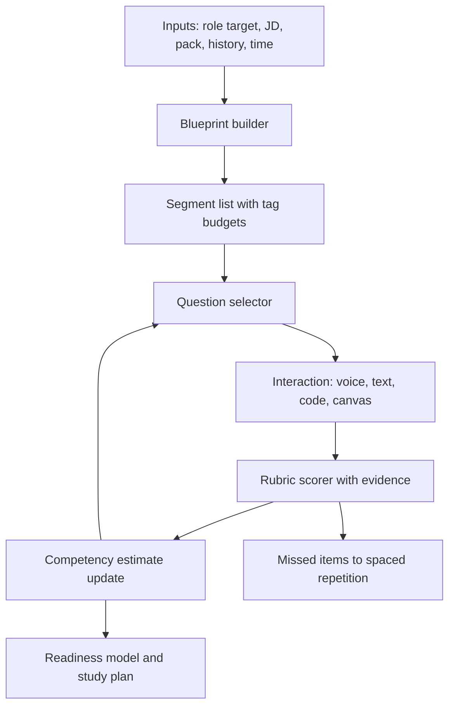
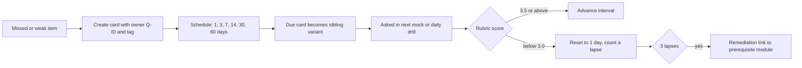

# Interview Master to Curriculum Mapping

All numbers marked `[judgement]` are design defaults to be calibrated after the 3-learner pilot and the scorer-calibration spikes. Nothing here predicts a hiring decision.

## 0. Contents and conventions

| Section | What it fixes |
|---|---|
| 1 | The eight Interview Master modes and how a session is composed |
| 2 | How the competency taxonomy is used by the engine (one namespace, one owner per tag) |
| 3 | Rubric templates per interview type: scale, L1-L4 anchors, mid/senior/staff, evidence rules, default weights |
| 4 | Adaptive engine coverage constraints per role target and the overlay mechanism for company clusters |
| 5 | Readiness score model: formula, weights, thresholds, confidence, display rules |
| 6 | Spaced-repetition feed from missed questions |
| 7 | Drill anatomy and the 10-minute voice drill catalogue, per module, with the module-to-mode map for all 19 courses |
| 8 | Integration findings and open items |

Conventions. Course and module IDs are `A5.M4`. Role targets: **B** Senior Python Backend, **A** AI Engineer, **H** Hybrid. Goal tags `M/S/N` per G-3. Cluster vocabulary (G-10): IT-services, global-IT-consulting, Big4, global-product, Indian-product, AI-startup. Strict mode = no hints, caps apply (R-C1-2); coaching mode = graded hints recorded in a hint ledger.

---

## 1. Interview Master modes

### 1.1 Mode definitions

| Code | Mode | Scope-doc type (section 4.1) | Surfaces used | Primary rubric (section 3) | Typical length | Evidence artefacts |
|---|---|---|---|---|---|---|
| V | **Voice drill** | Quick drills | Voice, optional text fallback | R-TD (technical depth) or topic-specific dimensions | 10 min | Timestamped transcript, delivery stats (coaching only) |
| T | **Text interview** | Role-based, JD-driven, technical depth | Text chat, MCQ, code-output, short answer, rapid-fire | R-TD | 20-45 min | Typed answers, timings |
| C | **Coding** | Coding rounds | Browser IDE (Python, SQL on PostgreSQL and MySQL), hidden tests, think-aloud | R-CODE | 30-45 min | Code, run events, hidden-test categories, hint ledger, transcript |
| D | **Design canvas** | System-design rounds | Canvas typed graph plus voice or text | R-DESIGN | 45-60 min | Graph versions, rule findings by stable rule ID, transcript |
| B | **Behavioural** | Behavioural and HR (India and global) | Voice preferred | R-BEH | 25-45 min | Transcript, story-bank reference |
| P | **Project deep-dive** | Project deep-dive | Voice, optional own-architecture canvas | R-PROJ (qualitative to learner until calibrated, R-C2-4) | 25-40 min | Transcript, Profile Facts Ledger checks, optional graph |
| L | **Last-minute** | Last-minute mode | Mixed, time-boxed | Reuses the rubrics above at reduced evidence weight | 1 to 7 days | Plan, drills, warm-up mock |
| CS | **Company-style** | Company-style practice | Preset over any of the above | Cluster weight overrides (Company_Pack_to_Curriculum_Map.md) | Per pack | Pack ID and version stamped on the session |

### 1.2 Session composition

A session is a **blueprint** (ordered list of segments), not a single mode. Each segment has a mode, a tag budget, a time box and a strictness setting. Voice, text, code and diagram segments can alternate inside one session (Master Spec section 20).

### 1.3 Mode-to-interview-type fit (which courses can feed which round)

| Round type | Voice | Text | Coding | Canvas | Behavioural | Project | Courses that supply questions and rubrics |
|---|---|---|---|---|---|---|---|
| Python or backend technical depth | yes | yes | partial | no | no | partial | A1, A2, A4, A5, A7, A8, B2 core |
| DSA coding | think-aloud | no | yes | no | no | no | A3 (patterns), C3 (process) |
| Practical API, SQL, LLD, debug, review, take-home | partial | no | yes | no | no | no | C3.M7-M9, A4.M1, A5.M10, A8.M6 |
| System design | yes | partial | no | yes | no | no | A6, plus A5, A7, A4 inputs; B3.M10, B4.M9, B6 capstones |
| AI or LLM depth | yes | yes | harness tasks | yes (AI designs) | no | partial | B1-B7, A6.M8 |
| Behavioural and HR | yes | no | no | no | yes | no | C1, C4 (gated modules) |
| Resume and project defence | yes | no | no | optional | no | yes | C2, with C1 stories |
| Rapid-fire and last-minute | yes | yes | no | no | no | no | All, via cram cards and drills |

---

## 2. Competency taxonomy usage

### 2.1 Rules the engine enforces

1. **One namespace** `<domain>.<topic>`, lowercase with hyphens (G-9). The platform tag registry is the only source; the engine rejects unknown tags at question-ingest time.
2. **One owner course per tag issues credit.** Questions authored by a pointer course carry the owner's tag as primary and the pointer course's tag as secondary only. A `ref` item (G-10) is scored once and credited to the owner tag in the owner's bank.
3. **Three tag layers per question:** (a) primary competency tag(s) (1-2), (b) secondary tags (no credit), (c) metadata: `cluster` (one or more of the six cluster values), `goal` (`B:M A:S H:M` style), `difficulty`, `mode`, `owner Q-ID`, `senior-bar note`, and `placement` flag.
4. **Roll-up chain:** `tag -> module -> course -> track -> role target`. Module weights come from each syllabus LF-2 (percent of interview time per target, sums to 100 per course per target). Course weights per role target are defined in section 5.3.
5. **Known drift to normalise before ingest** (G-9, registry normalisation map): A8 underscore tags to hyphens; "sd.ai-feature" and "system-design.ai-systems" to `design.ai-systems`; `security.api` to `sec.api`; "cloud.aws.compute", ".data", ".messaging" and ".security" (dotted legacy forms, including any "aws.x" or "cloud.aws.x" shorthand) to `cloud.aws-compute`, `cloud.aws-data`, `cloud.aws-messaging`, `cloud.aws-security`; "sec.llm-app" to `sec.compliance` (A8.M9 X1, with `llm.security` as B5-owned secondary); `llm.model-routing` is B7, `llm.model-selection` is B2; `hr.*` primary only in C1. `python.concurrency-basics` is owned by A1 (secondary in A2) and is a registry tag in its own right (RUL-04).
6. **Tags mark knowledge areas, never learner traits.** No tag, score or feature may encode emotion, personality or "confidence" (scope 4.3, P-22).

### 2.2 Tag families by course (owner view)

| Course | Owned tags (registry spelling, one owner each; RUL-04) |
|---|---|
| A1 | `python.concurrency-basics`, `python.core`, `python.exceptions-logging`, `python.import-packaging`, `python.memory`, `python.modern`, `python.oop-datamodel`, `python.performance`, `python.serialization` |
| A2 | `api.fastapi-async`, `concurrency.background-jobs`, `concurrency.backpressure`, `concurrency.event-loop`, `concurrency.model-selection`, `concurrency.structured`, `concurrency.sync-primitives`, `concurrency.testing-debugging`, `db.async-drivers` |
| A3 | `dsa.applied-reasoning`, `dsa.arrays-hashing`, `dsa.backtracking`, `dsa.binary-search`, `dsa.bits-design`, `dsa.complexity`, `dsa.dp`, `dsa.graphs`, `dsa.greedy-intervals`, `dsa.linked-lists-trees`, `dsa.pattern-recognition`, `dsa.python-idioms`, `dsa.stacks-heaps`, `dsa.two-pointers-window` |
| A4 | `db.indexing`, `db.locking`, `db.operations`, `db.orm`, `db.scaling`, `db.schema`, `db.sql`, `db.transactions`, `db.tuning` |
| A5 | `api.authn-authz`, `api.caching`, `api.design`, `api.evolution`, `api.reliability`, `backend.architecture`, `backend.async-events`, `backend.frameworks`, `backend.patterns`, `backend.production` |
| A6 | `design.ai-systems`, `design.caching`, `design.canvas`, `design.classic`, `design.consistency`, `design.cost`, `design.estimation`, `design.framework`, `design.messaging`, `design.observability`, `design.probing`, `design.reliability`, `design.scaling`, `design.security` |
| A7 | `cloud.aws-compute`, `cloud.aws-data`, `cloud.aws-messaging`, `cloud.aws-security`, `cloud.containers`, `cloud.cost`, `cloud.k8s`, `cloud.multicloud`, `cloud.networking`, `devops.cicd`, `devops.deploy`, `devops.iac`, `ops.incident`, `ops.linux-triage`, `ops.observability`, `ops.slo` |
| A8 | `eng.code-quality`, `eng.code-review`, `eng.contract-testing`, `eng.integration-testing`, `eng.pytest`, `eng.test-doubles`, `eng.test-quality`, `eng.test-strategy`, `perf.load-testing`, `sec.api`, `sec.authn-authz`, `sec.compliance`, `sec.injection`, `sec.secrets`, `sec.ssrf`, `sec.supply-chain`, `sec.threat-modelling` |
| B1 | `data.numpy-pandas`, `ml.classical-models`, `ml.data-quality`, `ml.deep-learning-basics`, `ml.embeddings`, `ml.experiment-design`, `ml.framing`, `ml.generalisation`, `ml.metrics`, `ml.model-choice`, `ml.transformers` |
| B2 | `llm.architecture`, `llm.context`, `llm.fundamentals`, `llm.model-selection`, `llm.multimodal`, `llm.production`, `llm.prompting`, `llm.safety-basics`, `llm.structured`, `llm.tools` |
| B3 | `rag.agentic`, `rag.architecture`, `rag.debugging`, `rag.embeddings`, `rag.evaluation`, `rag.grounding`, `rag.ingestion`, `rag.production`, `rag.retrieval`, `rag.security`, `rag.vector-db` |
| B4 | `agents.architecture-choice`, `agents.cost`, `agents.eval-observability`, `agents.frameworks`, `agents.hitl`, `agents.loop`, `agents.memory-state`, `agents.multi-agent`, `agents.orchestration`, `agents.protocols-mcp`, `agents.reliability`, `agents.security`, `agents.tool-design` |
| B5 | `llm.eval-design`, `llm.governance`, `llm.grounding`, `llm.guardrails`, `llm.incident`, `llm.judge`, `llm.llmops`, `llm.metrics`, `llm.privacy`, `llm.responsible-ai`, `llm.security` |
| B6 | `voice.architecture`, `voice.cost-privacy`, `voice.eval`, `voice.latency`, `voice.reliability`, `voice.stt-quality`, `voice.telephony`, `voice.transport`, `voice.tts`, `voice.turn-taking` |
| B7 | `llm.eval-tuned`, `llm.ft-vs-rag`, `llm.model-routing`, `ml.alignment-distill`, `ml.data-prep`, `ml.finetune-concepts`, `ml.gpu-cost`, `ml.serving`, `mlops.compliance`, `mlops.lifecycle` |
| C1 | `behav.ambiguity`, `behav.conflict`, `behav.curveball`, `behav.failure`, `behav.global-teams`, `behav.influence`, `behav.mentoring`, `behav.narrative`, `behav.ownership`, `behav.prioritisation`, `behav.quality-ethics`, `behav.stakeholder`, `behav.structure`, `behav.values-fit`, `hr.counter-offer`, `hr.expectations`, `hr.gaps`, `hr.notice-period`, `hr.relocation`, `hr.switch-reason` |
| C2 | `comm.multi-depth`, `design.own-architecture`, `project.confidentiality`, `project.failure`, `project.impact`, `project.narrative`, `project.tradeoffs`, `resume.claim-audit`, `resume.tech-probe` |
| C3 | `coding.ai-policy`, `coding.code-review`, `coding.communication`, `coding.complexity`, `coding.data-manipulation`, `coding.debugging`, `coding.hints`, `coding.live-coding`, `coding.lld`, `coding.pair`, `coding.practical-api`, `coding.practical-sql`, `coding.problem-solving`, `coding.process`, `coding.python-idioms`, `coding.remote-logistics`, `coding.take-home`, `coding.testing`, `coding.time-management`, `coding.trade-offs` |
| C4 | `career.bgv`, `career.domain-switch`, `career.positioning-thesis`, `career.profile`, `career.role-targeting`, `career.search-strategy`, `career.transition`, `offer.evaluation`, `offer.levels`, `offer.negotiation`, `offer.structure` |

### 2.3 Tag to rubric dimension coupling

A rubric dimension scores *how* an answer was given; a tag scores *what* topic it was about. Every scored dimension on a question writes one observation to each primary tag of that question, so a tag estimate is the evidence-weighted mean of its question-level scores (section 5.1). Delivery metrics (pace, fillers, answer length) are shown to the learner but **never** written to any tag.

### 2.4 Cluster and goal tags in selection

`cluster` tags decide which questions a pack may use (a pack for a company in cluster X draws first from items tagged X, then from untagged core items). `goal` tags (`B/A/H` with `M/S/N`) decide the must-cover set for a role target (section 4). A question with goal `N` for the active role target is eligible only as a depth probe or a spaced-repetition card, never as a coverage-satisfying item.

---

## 3. Rubric templates per interview type

### 3.1 Common scale, anchors and evidence rules

**Scale.** Each dimension is scored 1-5 (0 = not attempted or PASS; excluded from averages but recorded). This is the platform 5-point scale of the C1 rubric and G-6/G-7.

| Score band | Anchor level | Meaning | Mid / senior / staff signal |
|---|---|---|---|
| 1.0-1.9 | **L1** not yet | Names topics, wrong or absent mechanism, no trade-offs | Below mid for the target |
| 2.0-2.9 | **L2** developing | Mostly right, mechanism partial, trade-offs named not reasoned; collapses at probe 2 | Mid-level answer |
| 3.0-3.9 | **L3** solid senior | Correct, mechanism explained, trade-offs reasoned, failure modes and operations mentioned, consistent through 2-3 probes. 3.0 = "Meets" (badge), **3.5 = Senior bar** (readiness) | Senior answer |
| 4.0-5.0 | **L4** standout | Adds second-order effects, quantification, alternatives rejected with reasons, scale and cost, mentoring or org implications; consistent through 4+ probes; concedes limits cleanly | Staff-leaning answer |

**Evidence rules (all interview types).**
1. A dimension score of 3 or more needs at least one **verbatim evidence item**: a timestamped transcript quote, a code line or test result, a canvas node or edge ID, or a stable rule ID. A score of 4 or more needs two evidence items, or one plus a probe response that confirms it.
2. No evidence means no score: the scorer returns `insufficient-evidence`, the dimension is excluded from the average and the session confidence is reduced (section 5.4).
3. Quotes are shown to the learner. The learner may edit the transcript before scoring (P-22); edits are logged and the original kept for calibration.
4. The scorer never scores delivery, never infers emotion, personality or confidence, and never judges truthfulness. It flags **internal inconsistency** and mismatch against the learner-confirmed Profile Facts Ledger only.
5. PASS or reveal (Master Spec section 23): the item scores 0 for correctness, the answer, a senior model answer and the missing points are revealed, and a spaced-repetition card is created (section 6). PASS never lowers other items.
6. Strict mode is the only mode that counts for G-6 readiness. Coaching-mode evidence is capped (section 5.2).
7. Human sampling: a configurable share of scored sessions (initial 10 percent `[judgement]`, 100 percent of sessions in the calibration phase) is reviewed; scorer, rubric and prompt versions are stamped on every score.

### 3.2 R-TD: technical-depth verbal or text rubric (A1, A2, A4, A5, A7, A8, B1-B7)

| Dimension | Default weight | A "3" shows | A "5" adds |
|---|---|---|---|
| Correctness | 25 | Facts and mechanism right for the pinned versions (G-8) | Corrects own earlier slip; gives dated status where relevant |
| Depth and mechanism | 20 | Explains why, not only what, one level below the API | Two levels down, names internals and limits |
| Trade-offs and judgement | 20 | Compares at least two options with criteria | Quantified, picks with reasons, says when the answer flips |
| Production and failure awareness | 15 | Names failure modes, monitoring, rollback | Cost, scale, operations, incident story |
| Structure and precision | 10 | Headline first, correct terms | Signposted, adjustable length |
| Probe resilience | 10 | Consistent through 2-3 follow-ups | Holds through 4+, concedes limits |

Item-level rubric = the verbal seed's ideal outline, weak answers and probes from the syllabus (G-10). Weights are overridable per tag family (for example Probe resilience is weighted 15 for design-probing items).

### 3.3 R-CODE: coding rubric (A3 timed items, C3, SQL and API tasks)

Dimensions are C3's ten; weights are `[judgement]`.

| Dimension | Weight | Evidence | L3 shows |
|---|---|---|---|
| Problem understanding | 8 | Clarifying questions, restatement | Constraints and edge semantics clarified before coding |
| Approach and reasoning | 12 | Approach statement time, brute force to optimal | Alternatives compared, chosen with reason |
| Correctness | 25 | Hidden-test pass rate and category catch (R-C3-4) | At least 70 percent hidden tests (G-7) and edge categories handled |
| Complexity and trade-offs | 12 | Verbal statement vs measured behaviour | Correct with variables defined |
| Code quality | 10 | Naming, structure, idioms, known traps | Readable, small functions |
| Testing and self-verification | 10 | Run events, own tests, dry-run | Tests before prompted, finds own bug |
| Communication (think-aloud) | 10 | Transcript structure, silence gaps | Continuous, structured narration |
| Hint handling | 5 | Hint ledger (strict mode: none available) | Hint acknowledged and used quickly |
| Time management | 8 | Checkpoint timeline | Working solution with time to test |

Practical-round profile (API, SQL, take-home, AI-startup live build): Correctness 25, Practical delivery 25, Approach 10, Code quality 10, Testing 10, Communication 10, Understanding 5, Time 5.
Anchors: L1 does not reach a working solution and cannot explain; L2 working for the happy path, no complexity or tests; L3 working, tested, complexity stated and defended; L4 optimal or well-argued trade-off, own edge cases found, clean narration. Senior vs mid: seniors state the approach by about minute 5 and verify before submitting; staff-leaning answers also discuss production shape (API surface, observability, scale) when asked.
Hidden-test display follows R-C3-4. Large-case timeouts use operation-count proxies (P-15).

### 3.4 R-DESIGN: system-design rubric (A6; AI designs; canvas capstones)

Dimensions D1-D11 and default weights are A6 section 1.2, owned by A6.

| Dim | Name | Default weight |
|---|---|---|
| D1 | Requirements and scope | 10 |
| D2 | Estimation and capacity | 10 |
| D3 | API and data model | 10 |
| D4 | High-level architecture and fit | 15 |
| D5 | Scaling and bottlenecks | 15 |
| D6 | Consistency and data integrity | 10 |
| D7 | Reliability and failure modes | 10 |
| D8 | Security and privacy | 5 |
| D9 | Observability and operations | 5 |
| D10 | Cost and trade-offs | 5 |
| D11 | Communication and probing resilience | 5 |

Anchors per A6: 0 absent, 1 named only, 3 competent and consistent, 5 senior (proactive, quantified, trade-offs and failure of own choices stated). **Evidence** is a graph element ID, a transcript span, a calculator entry, or a registry rule ID (`R-<AREA>-<n>`, stable, never invented by other courses). Rule findings are advisory evidence, with "stated non-goal" suppression honoured; **critical findings block the "no critical rule findings" gate** (G-7) but never set a dimension score directly. Profiles: default, solution-architecture (R-A6-5; D1 15, D4 15, D10 10, D2 5, D5 10, rest default), and cluster profiles in Company_Pack_to_Curriculum_Map.md. Evaluator-vs-SME agreement target (initial): within +/-0.5 on at least 80 percent of dimension scores on a labelled set of at least 30 designs, rank correlation at least 0.8 (R-A6-4).

### 3.5 R-BEH: behavioural rubric (C1)

Seven scored dimensions plus delivery as coaching only. The L1-L4 anchors are C1 section 4 and are not restated here.

| Dimension | Weight | Dimension | Weight |
|---|---|---|---|
| Relevance | 10 | Impact and result | 20 |
| Structure | 10 | Reflection and learning | 10 |
| Specificity and ownership | 20 | Responses to probes | 15 |
| Depth and judgement | 15 | Communication (delivery) | 0 (coaching only) |

Rules: overall level is not a simple average; in strict mode a missing result or missing personal contribution caps the impact or specificity dimension at L2 for that answer (R-C1-2); a task-scoped story is capped at L2 on depth for senior targets unless the question is task-scoped. Mapping to 5-point: L1 = 1-1.9, L2 = 2-2.9, L3 = 3-3.9, L4 = 4-5.

### 3.6 R-PROJ: project and resume deep-dive rubric (C2)

Seven risk dimensions per claim, each 1-5 with evidence quotes: Specificity, Depth fit, Consistency, Attribution clarity, Quantification honesty, Boundary honesty, Recoverability. Default weights 15, 15, 15, 15, 15, 10, 15 `[judgement]`, with a **minimum-dimension override** (a Consistency score of 1 makes the claim at least medium risk). Questions are generated only from learner-confirmed ledger entries; the learner may mark a claim "do not probe". **Release policy (R-C2-4): until calibration is met (at least 30 SME-labelled transcripts, band within one band of SME consensus on at least 80 percent of claims), the learner sees qualitative findings only, no numeric score and no band.** Internal scores are stored but excluded from the numeric readiness roll-up until the flag is enabled; project evidence still counts towards coverage ("evidenced, not yet scored").

### 3.7 R-RAPID: rapid-fire and last-minute rubric

Binary or 3-level per item (correct, partial, miss) against the item's key points, mapped to 5 / 3 / 1 for estimates; evidence weight 0.5 (section 5.2); never used for G-6 criteria.

### 3.8 Delivery coaching panel (all voice modes; optional; never scored)

Pace, filler density, answer length against a target band, time-to-approach ("you took 4 minutes before stating the approach"), longest silence. Non-judgemental wording; no emotion, personality or confidence inference; no accent scoring. Indian-English technical vocabulary is supported by custom hotwords (scope 4.2).

---

## 4. Adaptive engine coverage constraints

### 4.1 Selection rule (explainable)

For each candidate question *q* at a decision point, the selector computes

`priority(q) = coverage_need(tag) x information_gain(q, estimate) x due_boost(q) x diversity(q) / cost(q)`

- `coverage_need` = remaining unmet minimum for the tag group in this cycle or session (section 4.2); 0 once the floor is met, so the floor is a minimum, not a quota.
- `information_gain` is highest for questions whose expected score is near the learner's current estimate (about 50 percent success): harder if strong, scaffold or diagnose if weak (scope 4A.4).
- `due_boost` raises items due from spaced repetition (section 6).
- `diversity` penalises same-course runs, same mode runs and repeated question stems; **no repeat of a question ID within 3 mock cycles** unless it is a spaced-repetition card, and then only as a sibling variant.
- `cost` is expected minutes plus AI budget (graceful degradation to rule-based selection if the AI is unavailable, scope 4A.4).

Every selected question stores an "asked because" explanation (for example "tag `db.locking` below the Senior bar after 2 sessions; coverage floor 3 not yet met"), visible to learner and admin.

### 4.2 Mock cycle and coverage floors per role target

A **mock cycle** = six sessions of 45-60 minutes: two technical-depth (voice or text), one coding, one design (canvas), one behavioural plus project, one mixed company-style or JD-driven. Floors are minimum scored items **per cycle** (about 50-60 items total); shorter sessions draw a proportional share. All floors count only strict-mode, in-scope items (goal tag M or S for the active target).

| Tag group | B Backend | A AI Engineer | H Hybrid | Notes |
|---|---|---|---|---|
| `dsa.*` and `coding.problem-solving` | 6 (2 timed coding) | 4 (1 timed) | 5 (2 timed) | A3 patterns; at least 1 problem per pattern family per 2 cycles |
| `python.*` and `concurrency.*` and `api.fastapi-async` | 8 | 5 | 6 | A1 and A2; at least 2 dated-status items (GIL, free-threading, GC) per 2 cycles for B |
| `db.*` | 6 (1 two-session concurrency item) | 3 | 4 | A4 |
| `api.*` and `backend.*` | 6 | 3 | 5 | A5 |
| `design.*` (excluding ai-systems) | 8 incl. 1 full canvas | 4 incl. 0 full canvas | 5 incl. 1 full canvas | A6 M1-M7, M9, M10 |
| `design.ai-systems` | 1 mini-prompt | 2 incl. 1 full canvas | 2 incl. 1 full canvas | A6.M8; unlock rule 4.4 |
| `cloud.*`, `devops.*`, `ops.*` | 2 | 1 | 2 | A7 |
| `eng.*`, `sec.*`, `perf.*` | 3 | 1 (X1 compliance item) | 2 | A8 |
| `llm.*` (B2 plus B5) | 2 (B2 core) | 10 | 6 | B2 M1, M4, M5, M9, M10 are the core for B |
| `rag.*` | 0 | 6 | 4 | B3 |
| `agents.*` | 0 | 5 | 3 | B4 |
| `ml.*`, `data.*` | 0 | 5 | 2 | B1 |
| `voice.*` | 0 | 2 | 2 | B6 (reference learner strength; floor still applies) |
| `llm.ft-vs-rag`, `ml.serving`, `ml.gpu-cost`, `mlops.*` | 0 | 2 | 1 | B7 |
| `behav.*` | 5 | 4 | 4 | C1; at least 3 distinct stories from the story bank |
| `project.*`, `resume.*`, `design.own-architecture` | 4 | 4 | 4 | C2; at least 2 flagship projects per cycle |
| `hr.*` | 2 | 2 | 2 | C1.M7; India HR |
| `coding.*` process items (hint, testing, time) | on all coding sessions | on all coding sessions | on all coding sessions | C3 scores process inside coding segments |

Hard constraints: (1) no single course supplies more than 35 percent of a session's scored items unless the session is a declared topic drill; (2) every `M`-tagged tag group must appear at least once per cycle even when the estimate is high (a light spot check detects drift); (3) at most 3 consecutive segments in the same mode; (4) a session must include at least one probe chain of depth 3 or more per technical segment (follow-up trees are first-class, scope 4.4); (5) an item is **diagnostic first** when uncertainty is high: begin at the learner's estimated level, then escalate until the limit is found; (6) the engine never ends a segment on a PASS without scheduling the revision card.

### 4.3 Overlay for company clusters and JD-driven sessions

A pack or JD analyser output supplies **tag-group multipliers** `m` in {0, 0.5, 1, 1.5, 2} applied to the role floors, then floors are rounded up and renormalised so total items stay within the time box. Constraints on overlays: a group with role tag `M` can be reduced to no lower than 0.5 of its floor; no overlay may add a group the learner's role target marks `N` above 1 item unless the learner confirmed it ("the JD asks for it"); rubric weight overrides come from the pack (Company_Pack_to_Curriculum_Map.md) and are stamped on the session. JD-driven sessions derive multipliers from the extracted required and preferred skills and seniority; an unrecognised skill routes to a nearest registry tag with a visible mapping the learner can correct.

### 4.4 Unlock, prerequisite and gating rules

| Rule | Source |
|---|---|
| A6.M8 AI-system designs are unlocked only after B2.M1-M5 and one of B3, B4, B6 are passed (or the placement bands skip them) | Boss 4.1 note 1 |
| C3 timed mocks begin once A3.M5 is passed; before that only untimed coaching-mode coding | Boss 4.1 note 3 |
| C4 modules M5-M9 (levels, compensation, negotiation, offers, BGV) are **not served to Interview Master role-plays until published after human professional review** (R-C4-3); the engine treats `offer.*` and `career.bgv` tags as unavailable. M6-M8 (pay, negotiation, offers) additionally follow the timing-flag unlock (last 4 weeks of a route or a reported interview pipeline); C1 pointers target C4.M6-M9 (RUL-02) | R-C4-3, RUL-02 |
| Pay-data role-plays require explicit opt-in; session-scoped by default | R-C4-4 |
| Claim-risk numeric band hidden until calibrated | R-C2-4 |
| Placement skip does not remove a tag from coverage floors; skipped tags are verified through the module mastery check | G-5 |
| No band waives a course final assessment | G-5 |

### 4.5 Mode and strictness policy

| Context | Mode default | Counts for readiness |
|---|---|---|
| Learn and Practice drills | Coaching | Yes, capped (section 5.2) |
| Gate mocks and full-loop cycles | Strict | Yes |
| Last-minute plan items | Coaching for new material, strict for the warm-up mock | Reduced weight |
| Company-style mock | Strict by default, learner may switch | Strict only |

---

## 5. Readiness score model

### 5.1 Per-tag competency estimate

For tag *t*, each scored observation *i* has score `s_i` in [1,5], evidence weight `w_i` (table 5.2) and age `a_i` in days. With time-decay `d_i = 0.5 ^ (a_i / H_t)` and a weak prior of 2.5 with pseudo-weight 1.0:

`theta_t = (1.0 x 2.5 + sum_i w_i d_i s_i) / (1.0 + sum_i w_i d_i)`

`n_eff,t = sum_i w_i d_i`, and the standard error `SE_t = sigma / sqrt(1 + n_eff,t)` with `sigma = 0.9` `[judgement]`.

Decay half-life `H_t` (days) `[judgement]`: 60 for stable theory (`python.*, dsa.*, db.*, concurrency.*, behav.*` uses 90), 30 for fast-changing tags (`llm.*, rag.*, agents.*, voice.*`, and the AWS tags `cloud.aws-compute`, `cloud.aws-data`, `cloud.aws-messaging`, `cloud.aws-security`), consistent with the 3-month AI/vendor review cadence (G-12).

### 5.2 Evidence weights

| Source | Weight `w` | Notes |
|---|---|---|
| Strict-mode interview item (any mode) | 1.0 | Counts for G-6 |
| Timed coding or canvas task, strict | 1.0 | Per dimension |
| Module mastery check, retake at least 7 days after first pass | 0.8 | G-6(1) |
| Module mastery check, first attempt | 0.4 | |
| Spaced-repetition cold recall | 0.6 | Sibling variant, no hints |
| 10-minute voice drill (strict) | 0.7 | Counts toward the "two sessions 48 h apart" test only when strict |
| Coaching-mode item | 0.4, and the observation is capped at 3.4 | Cannot lift a tag over the Senior bar |
| Last-minute mode item | 0.5 | Not counted for G-6 |
| PASS or reveal | 0.5 with score 1 | A known gap is evidence |
| Project deep-dive (before calibration) | 0 numeric, coverage only | R-C2-4 |

### 5.3 Role-target roll-up

`R_role = 100 x sum_t W_role(t) x f(theta_t)` with `f(theta) = clip((theta - 1) / 2.5, 0, 1)` so that theta 3.5 (Senior bar) scores 1.0 and theta 3.0 (Meets) scores 0.8.

`W_role(t) = CW_role(course(t)) x MW_role(module(t)) / (number of primary tags of that module)`, where `MW` is the LF-2 module weight (percent, sums to 100 within a course) divided by 100, and `CW` is the course weight below (sums to 100) `[judgement]`:

| Course | CW B | CW A | CW H | | Course | CW B | CW A | CW H |
|---|---|---|---|---|---|---|---|---|
| A1 | 8 | 4 | 6 | | B2 | 4 | 9 | 7 |
| A2 | 8 | 6 | 7 | | B3 | 0 | 8 | 6 |
| A3 | 15 | 8 | 10 | | B4 | 0 | 7 | 5 |
| A4 | 10 | 4 | 7 | | B5 | 0 | 7 | 4 |
| A5 | 10 | 5 | 7 | | B6 | 0 | 4 | 3 |
| A6 | 15 | 12 | 12 | | B7 | 0 | 3 | 2 |
| A7 | 5 | 1 | 2 | | C1 | 8 | 6 | 7 |
| A8 | 5 | 1 | 2 | | C2 | 7 | 5 | 6 |
| B1 | 0 | 6 | 3 | | C3 | 5 | 4 | 4 |
| | | | | | C4 | 0 | 0 | 0 (excluded; informational) |

Column check. CW B: Track A 8+8+15+10+10+15+5+5 = 76, B2 4, Track C 8+7+5 = 20, total 100. CW A: Track A 4+6+8+4+5+12+1+1 = 41, Track B 6+9+8+7+7+4+3 = 44, Track C 6+5+4 = 15, total 100. CW H: Track A 6+7+10+7+7+12+2+2 = 53, Track B 3+7+6+5+4+3+2 = 30, Track C 7+6+4 = 17, total 100. A pointer-course item never counts twice: it credits its owner tag only.

Role readiness is **not** a hiring probability and has no cohort comparison.

### 5.4 Confidence

Session and tag confidence are derived, not asserted:

| Label | Rule per tag | Rule per role target |
|---|---|---|
| Low | `n_eff < 3` or `SE > 0.6` | Under 60 percent of weight with Medium or High tags |
| Medium | `n_eff >= 3` and `SE <= 0.6` | 60-84 percent of weight Medium or High |
| High | `n_eff >= 6` across at least 3 sessions and 2 modes, `SE <= 0.35` | At least 85 percent of weight High or Medium and the gates in 5.5 evaluated |

### 5.5 Thresholds, bands and gates

The learner-facing band uses the **lower bound** `R_low`, computed with `theta_t - 1.0 x SE_t` per tag (an optimistic score cannot be earned by a thin sample).

| Band (learner wording) | Condition |
|---|---|
| Not enough evidence yet | Evidenced weight below 50 percent of `W_role`; show coverage only, no band |
| Early | `R_low < 40` |
| Building | `40 <= R_low < 65` |
| Approaching | `65 <= R_low < 90`, or `R_low >= 90` with any gate unmet |
| Practice bar met | `R_low >= 90` **and all gates** below |

Gates for "Practice bar met" (G-6 and G-7 specialised, all required): (1) no `M`-tagged tag with `theta < 3.0` and per-topic G-6 satisfied on at least 85 percent of `M` weight (retake mastery at least 85 percent after 7 days, timed task passed, strict voice at Senior bar in two sessions at least 48 h apart, no open prerequisite remediation); (2) a full-loop mock cycle completed in the last 21 days containing a voice technical segment, a timed coding segment and a design segment; (3) the last two design mocks have no critical rule findings and every dimension at least 3; (4) hidden-test tasks at least 70 percent with correct stated complexity; (5) overall confidence Medium or better; (6) readiness data not older than the decay window (a 60-day-old band is labelled "stale").

**Calibration status.** Until scorer calibration (SME-labelled sets, R-A6-4, R-C2-4, C3) is met for a mode, that mode's evidence is shown as "provisional" and the top band is unavailable. Numeric `R_role` is shown only as a 15-point range (for example "55 to 70") and only after calibration; before it, show the band only.

### 5.6 What the learner sees, and what they do not

| Shown | Not shown |
|---|---|
| Role band with the words "practice readiness" and the **as-of date** | Any probability of getting an offer or a job |
| Range, not a point; coverage percent ("78 percent of this role's weight has strict evidence") | Percentile or ranking against other learners |
| Confidence label with the reason ("2 of 6 areas have one session only") | Any inference about emotion, personality, stress or "confidence" |
| Competency radar per course with evidence quotes behind each point | Raw internal `theta`, `SE`, decay constants (available in "how this is computed") |
| Top 3 gaps with linked modules and drills; next recommended session | Single "pass" or "fail" verdict on a person |
| Per-round sub-readiness: technical depth, coding, design, behavioural and project | Numeric project claim-risk before calibration (qualitative only) |
| Trend over time and last full-loop date | Company-specific "you will clear X"; pack readiness is labelled "style practice readiness for <pack>" |

Standard footer on every readiness view: "This is a practice-readiness estimate from your own sessions. It depends on the questions and rubrics used, is recalculated as you practise, and does not predict any employer's decision."

### 5.7 Pack readiness

For pack *p* the same formula is used with the pack's multipliers and rubric profile, and it is displayed only as "style practice readiness". The role-target band is always shown first.

---

## 6. Spaced-repetition feed from missed questions

| Aspect | Rule |
|---|---|
| **Trigger** | Item score below 3.0 on any primary-tag dimension, any PASS or reveal, any hint use in coaching mode on a core item, any critical rule finding in design (card = the rule ID plus the corrective concept), any hidden-test category miss (card = the category pattern, not the hidden case) |
| **Card content** | Tag, owner Q-ID (`ref`, never copied), the learner's own wrong or weak phrase (quote), the senior model answer pointer, source module lesson ID, the rubric dimension that failed |
| **Variants** | The due card is asked as a **sibling item** (same tag and difficulty, different stem) or a paraphrase of the owner item; the identical stem is reused only after 60 days. Anti-memorisation: voice cards require explanation, not recognition |
| **Intervals** | 1, 3, 7, 14, 30, 60 days. Score 3.5 or above advances one step; 3.0-3.4 repeats the same interval; below 3.0 resets to 1 day and counts a lapse. `[judgement]`, tune after pilot |
| **Feed into mocks** | Due cards occupy at most 20 percent of items in a mock and have priority when the tag is also under its coverage floor; they are logged as "asked because spaced repetition due" |
| **Daily drill** | The 10-minute drill of the day is built from the learner's due cards first, then the weakest tag, then the next unstarted module (section 7) |
| **Load cap** | At most 15 due cards and 25 minutes of review per day; overflow rolls to the next day by lowest `W_role` first. Learners can snooze a card with a reason, but a snoozed `M` tag still counts in coverage |
| **Lapse handling** | Three lapses on a tag in 30 days opens a remediation flag: the route inserts the module's Simpler-path lessons and its prerequisite links (LF-5 of the owner syllabus) before further drills |
| **Pointer courses** | A card from a pointer course resolves to the owner module for lessons and credit |
| **Decay link** | A successful cold recall updates the tag estimate with weight 0.6 (section 5.2); a lapse enters at its low score, so readiness falls transparently |
| **Retention** | Cards and quotes are learner data: exportable, deletable; no cross-learner use beyond aggregate question-difficulty statistics |

---

## 7. Drill anatomy and the 10-minute voice drill catalogue

### 7.1 Anatomy of a 10-minute drill

| Segment | Minutes | Content |
|---|---|---|
| Prompt | 0:00-0:45 | One scenario or question, spoken by the interviewer voice; "repeat, slower, rephrase" supported |
| Answer | 0:45-3:15 | Learner answers (soft cap 2.5 minutes; a nudge, not a cut-off) |
| Probe ladder | 3:15-7:15 | 2-3 probes from the question's follow-up tree (why not X, 10x load, how would you test it); depth escalates until the limit is found |
| Second item | 7:15-9:15 | A short second prompt (rapid-fire pair or a variant on a weak sub-point) |
| Close | 9:15-10:00 | One-line summary of what was credited; transcript and replay available; missed items become cards |

Strictness: strict by default for readiness drills, coaching for learning drills. Text fallback if the latency budget is breached (scope 4.2).

### 7.2 Prompt style codes and scoring dimension codes

| Style | Meaning | Style | Meaning |
|---|---|---|---|
| EX | Explain aloud as to a colleague | PN | Predict output or behaviour, then narrate why |
| SC | Scenario or incident triage | CD | Compare options and decide with criteria |
| DA | Debug aloud on a short snippet or plan | ET | Estimate aloud with numbers |
| PL | Probe ladder on one topic | WT | Walk through your own experience (ledger-based) |
| RF | Rapid-fire short answers | SB | Deliver a story from the story bank |
| TD | Think-aloud while coding (voice plus IDE) | RP | Role-play (recruiter, manager, interviewer) |

| Dim | Meaning (maps to rubric) | Dim | Meaning |
|---|---|---|---|
| CO | Correctness (R-TD) | PR | Production and failure awareness |
| DE | Depth and mechanism | ST | Structure and precision |
| TR | Trade-offs and judgement | PB | Probe resilience |
| EV | Evidence and specificity (numbers, own role) | ES | Estimation accuracy (within 3x) |
| CQ | Code and process quality (TD only) | OW | Ownership and attribution |

Delivery stats (pace, fillers, length) are shown for every drill and scored in none.

### 7.3 Module to mode map and drill catalogue

Mode letters per section 1.1. **The Modes and Goal columns are regenerated from each syllabus LF-2 table (rehearsal modes and `B:x A:x H:x` goal tags; RUL-01).** LF-2 wording maps to letters as follows: voice drill or voice mock -> V; coding, harness coding, practical -> C; design canvas, canvas, design -> D; behavioural, HR voice drill, full mock -> B (HR voice drill -> B V); project deep-dive -> P. LF-2 wording with no letter of its own maps to the nearest existing mode: `scenario` (A2.M8, B1.M2, M3, M8 and M10), `calculator` (B6.M2) and `applied worksheet` (C4.M6) -> T (text, quantitative or scenario answer); `whiteboard-style explanation` (B1.M9) folds into V. Syllabus LF-2 does not use T for plain text interviews, so T now appears only for those cases. Goal cells are copied verbatim, including qualifiers (A1.M5 L4 skip note, C1.M7 `S outside India`, C4.M6-M8 promotion to M near an offer); B6 and B7 take goals from the B6 seed tags and B7 section 8.3, and A8 from section 8.1. The Hours column is Simpler / Deeper hours from the syllabus module tables (totals 366 S / 247.5 D across 19 courses). The drill itself is always a 10-minute voice drill; the Modes column lists the rehearsal modes the syllabus assigns to the module. `L` in the Modes column marks modules that ship cram cards and rapid-fire sets for last-minute mode (priority modules for most clusters); `L` is an Interview Master flag kept from the earlier draft and is not part of LF-2; any module can still feed last-minute and company-style mode through its tag weights. Module-level tag assignment below is derived from the module outcomes and the owned-tag lists; **the syllabus question tags are authoritative** and a registry validation job must reconcile any difference. Each drill is `ID name (style, duration, dimensions)`; duration is 10 minutes unless stated.

#### Track A

**A1 Python Internals**

| Module | Hours S / D | Goal (B / A / H) | Tags | Modes | Drill |
|---|---|---|---|---|---|
| M1 Object model and identity | 2.25 / 1.5 | B:M A:S H:M | `python.core` | V C L | DR-A1-M1 Hash contract aloud (PN, 10, CO DE PB) |
| M2 Memory management and garbage collection | 2.25 / 1.75 | B:M A:S H:M | `python.memory` | V P L | DR-A1-M2 Hunt the leak (SC, 10, DE EV PR) |
| M3 Execution model, the GIL and free-threading | 2.25 / 2.0 | B:M A:S H:M | `python.concurrency-basics` | V P L | DR-A1-M3 What the GIL does not protect (EX, 10, CO DE PB; dated-status check) |
| M4 Iterators and generators | 1.75 / 1.0 | B:M A:M H:M | `python.core` | C V | DR-A1-M4 Generator lifecycle (PN, 10, CO DE ST) |
| M5 Functions, closures, decorators and context managers | 2.0 / 1.0 | B:S A:S H:S (L4 skip likely) | `python.core` | C V | DR-A1-M5 Decorator under the microscope (TD, 10, CO CQ ST) |
| M6 Classes and the data model | 2.25 / 1.5 | B:S A:S H:S | `python.oop-datamodel` | V C | DR-A1-M6 Attribute lookup order (EX, 10, CO DE PB) |
| M7 Modern Python: dataclasses, enums, pattern matching and typing | 2.25 / 1.25 | B:M A:M H:M | `python.modern` | C V | DR-A1-M7 Hints versus runtime reality (CD, 10, CO TR ST) |
| M8 Exceptions and logging | 1.75 / 1.25 | B:S A:S H:S | `python.exceptions-logging` | C V B | DR-A1-M8 Error handling that survives production (SC, 10, PR TR ST) |
| M9 Import system, packaging and environments | 1.75 / 1.0 | B:S A:S H:S | `python.import-packaging` | V P | DR-A1-M9 Why does this import fail (DA, 10, CO DE PR) |
| M10 Bytes, buffers and serialisation | 1.25 / 0.75 | B:S A:S H:S | `python.serialization` | V C | DR-A1-M10 Pickle or not (CD, 10, TR PR CO) |
| M11 Performance and profiling | 2.25 / 2.0 | B:M A:S H:M | `python.performance` | V C P L | DR-A1-M11 Measure before you fix (SC, 10, EV TR DE) |

**A2 Concurrency and Async**

| Module | Hours S / D | Goal (B / A / H) | Tags | Modes | Drill |
|---|---|---|---|---|---|
| M1 Concurrency foundations and the decision guide | 1.0 / 0.75 | B:M A:S H:M | `concurrency.model-selection` | V L | DR-A2-M1 Pick the concurrency model (CD, 10, TR CO ST) |
| M2 Threads and synchronisation | 1.7 / 1.0 | B:M A:S H:M | `concurrency.sync-primitives` | V C | DR-A2-M2 Race or deadlock (DA, 10, CO DE PR) |
| M3 Processes and multiprocessing | 1.4 / 0.9 | B:S A:S H:S | `concurrency.model-selection` | V | DR-A2-M3 Parallelising a CPU job (SC, 10, TR DE PR) |
| M4 asyncio fundamentals and event loop internals | 2.0 / 1.3 | B:M A:M H:M | `concurrency.event-loop` | V C L | DR-A2-M4 Trace a coroutine to the loop (EX, 10, CO DE PB) |
| M5 Structured concurrency, cancellation, timeouts, graceful shutdown | 2.0 / 1.3 | B:M A:M H:M | `concurrency.structured` | V C D | DR-A2-M5 Cancel it correctly (PN, 10, CO DE PR) |
| M6 In-process async pitfalls, backpressure and limits | 1.5 / 1.0 | B:M A:M H:M | `concurrency.backpressure` | V C | DR-A2-M6 Bounded pipeline (SC, 10, TR PR ST) |
| M7 FastAPI and ASGI async patterns, streaming | 1.9 / 1.3 | B:M A:M H:M | `api.fastapi-async` | V C D L | DR-A2-M7 def versus async def under load (CD, 10, CO TR PR) |
| M8 Async data access | 1.6 / 1.1 | B:M A:S H:M | `db.async-drivers` | V T | DR-A2-M8 Pool math (ET, 10, ES PR CO) |
| M9 Background jobs and worker semantics | 1.5 / 1.0 | B:M A:M H:M | `concurrency.background-jobs` | V D | DR-A2-M9 Celery or DB queue (CD, 10, TR PR DE) |
| M10 Testing, debugging, observability and capstone | 0.9 / 0.85 | B:M A:S H:M | `concurrency.testing-debugging` | V D | DR-A2-M10 The stall that only happens in prod (SC, 10, DE EV PR) |

**A3 DSA and Problem Solving**

| Module | Hours S / D | Goal (B / A / H) | Tags | Modes | Drill |
|---|---|---|---|---|---|
| M1 Foundations: complexity, Python cost model, communication protocol | 2 / 1 | B:M A:S H:M | `dsa.complexity` | V C | DR-A3-M1 State the complexity (PN, 10, CO ST DE) |
| M2 Arrays, strings, hashing and prefix sums | 3 / 2 | B:M A:S H:M | `dsa.arrays-hashing` | C V L | DR-A3-M2 Hash it down (TD, 10, CO CQ ST) |
| M3 Two pointers and sliding window | 3 / 2 | B:M A:S H:M | `dsa.two-pointers-window` | C V | DR-A3-M3 Window invariant (TD, 10, CO CQ ST) |
| M4 Stacks, queues, monotonic stacks and heaps | 3.5 / 2.5 | B:M A:S H:M | `dsa.stacks-heaps` | C V | DR-A3-M4 Top-k or monotonic (CD, 10, CO TR CQ) |
| M5 Binary search and sorting-based thinking | 3 / 2 | B:M A:S H:M | `dsa.binary-search` | C | DR-A3-M5 Search the answer space (TD, 10, CO CQ ST) |
| M6 Linked lists, trees, BST and tries | 3.5 / 2.5 | B:M A:S H:M | `dsa.linked-lists-trees` | C V | DR-A3-M6 Tree recursion contract (TD, 10, CO CQ ST) |
| M7 Graphs: traversal, topological sort, union-find, shortest paths | 5 / 3 | B:M A:S H:M | `dsa.graphs` | C V D L | DR-A3-M7 Model it as a graph (CD, 10, CO TR ST) |
| M8 Recursion and backtracking | 2.5 / 1.5 | B:M A:S H:M | `dsa.backtracking` | C | DR-A3-M8 Prune the search (TD, 10, CO CQ TR) |
| M9 Dynamic programming | 4 / 3 | B:M A:S H:M | `dsa.dp` | C V L | DR-A3-M9 State and recurrence aloud (TD, 10, CO ST DE) |
| M10 Greedy, intervals, bit manipulation and design-a-data-structure | 3 / 2 | B:M A:S H:M | `dsa.greedy-intervals`, `dsa.bits-design` | C V B | DR-A3-M10 Defend the greedy choice (PL, 10, CO DE PB) |
| M11 Pattern recognition capstone and integrated timed practice | 2.5 / 2 | B:M A:S H:M | `dsa.pattern-recognition`, `dsa.applied-reasoning` | C V L | DR-A3-M11 Which pattern is this (RF, 10, CO ST TR) |

**A4 Databases**

| Module | Hours S / D | Goal (B / A / H) | Tags | Modes | Drill |
|---|---|---|---|---|---|
| M1 SQL fluency refresh | 1.5 / 1 | B:M A:S H:M | `db.sql` | C V | DR-A4-M1 Window function walkthrough (TD, 10, CO CQ ST) |
| M2 Schema design | 2.5 / 2 | B:M A:S H:M | `db.schema` | D V | DR-A4-M2 Model it and defend denormalisation (CD, 10, TR DE ST) |
| M3 Indexing | 3.5 / 2.5 | B:M A:S H:M | `db.indexing` | V C L | DR-A4-M3 Which index and why (CD, 10, CO TR DE) |
| M4 Query plans and tuning | 3.5 / 2.5 | B:M A:S H:M | `db.tuning` | V C P L | DR-A4-M4 Read the plan aloud (DA, 10, CO DE EV) |
| M5 Transactions, isolation and MVCC | 4 / 3 | B:M A:S H:M | `db.transactions` | V C L | DR-A4-M5 Name the anomaly (PN, 10, CO DE PB) |
| M6 Locking and concurrency patterns | 3 / 2.5 | B:M A:S H:M | `db.locking` | V C D | DR-A4-M6 Diagnose the blocking chain (DA, 10, CO DE PR) |
| M7 Scaling: replication, partitioning, pooling | 3.5 / 2.5 | B:M A:N H:M | `db.scaling` | D V | DR-A4-M7 Growth plan with lag (SC, 10, TR PR ES) |
| M8 Migrations and online DDL | 2.5 / 2 | B:M A:S H:M | `db.operations` | D V B | DR-A4-M8 Ship a risky migration (SC, 10, PR TR ST) |
| M9 Operations: maintenance, observability, backup | 2.5 / 2 | B:M A:N H:S | `db.operations` | V D P | DR-A4-M9 Bloat and PITR plan (SC, 10, PR DE EV) |
| M10 ORMs and data access | 2 / 1 | B:M A:S H:M | `db.orm` | C V | DR-A4-M10 Find the N+1 (DA, 10, CO PR EV) |
| M11 PostgreSQL vs MySQL decision | 1.5 / 1 | B:S A:N H:S | `db.scaling` | V | DR-A4-M11 Engine recommendation (CD, 10, TR CO ST) |

**A5 API and Backend Architecture**

| Module | Hours S / D | Goal (B / A / H) | Tags | Modes | Drill |
|---|---|---|---|---|---|
| M1 Resource modelling and HTTP semantics | 1.25 / 0.75 | B:S A:N H:S | `api.design` | V | DR-A5-M1 Model the resource (CD, 10, CO TR ST) |
| M2 Contracts, errors, OpenAPI and versioning | 2 / 1 | B:S A:N H:S | `api.evolution` | V D | DR-A5-M2 Breaking or not (PN, 10, CO TR PR) |
| M3 Collections: pagination, filtering, sorting, bulk and long-running operations | 1.75 / 0.75 | B:S A:N H:S | `api.design` | V C | DR-A5-M3 Cursor design (CD, 10, CO TR DE) |
| M4 Reliability: idempotency, retries, rate limiting, timeouts | 3.5 / 2.25 | B:M A:S H:M | `api.reliability` | V C D L | DR-A5-M4 Make the payment endpoint safe (SC, 10, CO PR TR) |
| M5 Caching: HTTP caching and Redis | 2.25 / 1.5 | B:M A:S H:M | `api.caching` | V C | DR-A5-M5 Stampede and invalidation (SC, 10, DE PR TR) |
| M6 Authentication and authorization | 2.75 / 1.75 | B:M A:S H:M | `api.authn-authz` | V D L | DR-A5-M6 Token design review (DA, 10, CO DE TR) |
| M7 API security: design-time controls | 1 / 0.75 | B:S A:N H:S | `api.authn-authz` | V | DR-A5-M7 Controls checklist (RF, 10, CO ST PR) |
| M8 Async APIs, webhooks, background processing and events | 2.5 / 1.75 | B:M A:S H:M | `backend.async-events` | V C D | DR-A5-M8 Webhook delivery guarantees (SC, 10, CO PR TR) |
| M9 Other API styles: GraphQL, gRPC, streaming | 1.25 / 0.75 | B:S A:N H:S | `api.design` | V | DR-A5-M9 Choose the API style (CD, 10, TR CO ST) |
| M10 Architecture: clean/hexagonal, monolith vs microservices, frameworks | 2.25 / 1.5 | B:M A:S H:M | `backend.architecture`, `backend.patterns`, `backend.frameworks` | V D C L | DR-A5-M10 Defend your layering (PL, 10, TR DE PB) |
| M11 Production concerns: multi-tenancy, uploads, observability, performance | 1 / 0.75 | B:S A:N H:S | `backend.production` | V D | DR-A5-M11 Multi-tenant API gotchas (SC, 10, PR TR EV) |

**A6 System Design**

| Module | Hours S / D | Goal (B / A / H) | Tags | Modes | Drill |
|---|---|---|---|---|---|
| M1 The design framework and estimation | 2.5 / 1.5 | B:M A:M H:M | `design.framework`, `design.estimation` | V D L | DR-A6-M1 Requirements and numbers in 10 (ET, 10, ES ST CO) |
| M2 Scaling reads and caching | 2.5 / 1.5 | B:M A:M H:M | `design.scaling`, `design.caching` | D V | DR-A6-M2 Product page at 50x (SC, 10, TR ES PR) |
| M3 Data: partitioning, replication, consistency | 3 / 2 | B:M A:M H:M | `design.consistency`, `design.scaling` | V D L | DR-A6-M3 Pick the shard key (CD, 10, TR DE PB) |
| M4 Async, messaging, idempotency, rate limiting | 3.5 / 2.5 | B:M A:M H:M | `design.messaging` | V D C L | DR-A6-M4 Exactly-once, honestly (PL, 10, CO DE PB) |
| M5 Reliability, observability, security, cost | 2.5 / 1.5 | B:M A:M H:M | `design.reliability`, `design.observability`, `design.security`, `design.cost` | V D | DR-A6-M5 What breaks first (SC, 10, PR TR EV) |
| M6 Classic designs I: read-heavy and infrastructure | 3 / 2 | B:M A:S H:M | `design.classic` | D V L | DR-A6-M6 Short-link and limiter in 10 (SC, 10, ST TR ES) |
| M7 Classic designs II: write-heavy, real-time, transactional | 3 / 2.25 | B:M A:S H:M | `design.classic` | D C | DR-A6-M7 Payment or booking under concurrency (PL, 10, CO PR PB) |
| M8 AI-system designs | 2 / 1.75 | B:S A:M H:M | `design.ai-systems` | D V L | DR-A6-M8 RAG or gateway latency and cost (ET, 10, ES TR PR) |
| M9 IoT ingestion and multi-tenant SaaS | 2 / 1.5 | B:S A:S H:S | `design.classic`, `design.scaling` | D V | DR-A6-M9 Device ingestion backpressure (SC, 10, PR TR ES) |
| M10 Canvas craft, probing, and capstone | 2 / 1.5 | B:M A:M H:M | `design.probing`, `design.canvas` | D V | DR-A6-M10 Survive the probe (PL, 10, PB TR ST) |

**A7 Cloud, DevOps and Observability**

| Module | Hours S / D | Goal (B / A / H) | Tags | Modes | Drill |
|---|---|---|---|---|---|
| M1 Containers and Docker for production | 2 / 0.75 | B:S A:S H:S | `cloud.containers` | V C | DR-A7-M1 Production Dockerfile review (DA, 10, CO PR TR) |
| M2 Compose essentials and container supply-chain security | 1.5 / 1 | B:S A:N H:N | `cloud.containers` | V D | DR-A7-M2 Trust the image (SC, 10, PR TR ST) |
| M3 Kubernetes essentials | 3 / 2 | B:S A:N H:S | `cloud.k8s` | V C D | DR-A7-M3 Pod will not start (DA, 10, CO DE PR) |
| M4 AWS compute and serverless | 2.5 / 1.5 | B:M A:S H:M | `cloud.aws-compute` | V D C | DR-A7-M4 Lambda or ECS (CD, 10, TR PR ES) |
| M5 AWS data, messaging and integration | 2.5 / 1.5 | B:M A:S H:S | `cloud.aws-data`, `cloud.aws-messaging` | V C D | DR-A7-M5 SQS versus SNS versus streams (CD, 10, CO TR PR) |
| M6 AWS identity, networking, secrets and Linux network triage | 3.5 / 2.25 | B:S A:N H:S | `cloud.aws-security`, `cloud.networking`, `ops.linux-triage` | V C D | DR-A7-M6 Request times out, find the layer (DA, 10, CO DE PR) |
| M7 Infrastructure as Code with Terraform | 2.25 / 1.5 | B:S A:N H:N | `devops.iac` | V C P | DR-A7-M7 Plan review (DA, 10, CO PR TR) |
| M8 CI/CD, pipeline security gates and deployment strategies | 2 / 1.25 | B:M A:N H:S | `devops.cicd`, `devops.deploy` | V D B | DR-A7-M8 Safe rollout and rollback (SC, 10, PR TR ST) |
| M9 Observability: logs, metrics, traces and SLOs | 2.75 / 1.75 | B:S A:S H:S | `ops.observability`, `ops.slo` | V C P L | DR-A7-M9 SLO and burn alert (ET, 10, ES TR PR) |
| M10 Reliability, incident response, infrastructure cost (FinOps) and multi-cloud awareness | 2 / 1.5 | B:S A:N H:S | `ops.incident`, `cloud.cost`, `cloud.multicloud` | V B D | DR-A7-M10 Incident narrative (WT, 10, EV PR OW) |

**A8 Testing, Quality and Security**

| Module | Hours S / D | Goal (B / A / H) | Tags | Modes | Drill |
|---|---|---|---|---|---|
| M1 Test strategy and the pyramid | 2 / 1.5 | B:S A:N H:S | `eng.test-strategy` | V P | DR-A8-M1 Defend your test pyramid (CD, 10, TR ST PR) |
| M2 Pytest in depth | 2.5 / 1 | B:S A:N H:S | `eng.pytest` | C | DR-A8-M2 Fixture design (DA, 10, CO CQ DE) |
| M3 Mocking, fakes and contract testing | 2.5 / 2 | B:S A:N H:S | `eng.test-doubles`, `eng.contract-testing` | V C D | DR-A8-M3 Mock or fake (CD, 10, TR CO DE) |
| M4 Testing async code, APIs and databases | 3 / 2 | B:S A:N H:S | `eng.integration-testing` | C V | DR-A8-M4 Make the flaky test deterministic (DA, 10, CO DE PR) |
| M5 Coverage, mutation and property-based testing | 2.5 / 1.5 | B:S A:N H:S | `eng.test-quality` | V | DR-A8-M5 What does 90 percent coverage miss (PL, 10, DE TR PB) |
| M6 Code quality, review and refactoring | 2.5 / 1.5 | B:S A:N H:S | `eng.code-quality`, `eng.code-review` | B V C | DR-A8-M6 Review this diff aloud (DA, 10, CO TR ST) |
| M7 API security: OWASP, authN/authZ, injection, SSRF | 4.5 / 3 | B:M A:S H:M | `sec.api`, `sec.authn-authz`, `sec.injection`, `sec.ssrf` | V C P L | DR-A8-M7 Exploit and fix (DA, 10, CO DE PR) |
| M8 Secure coding in Django/FastAPI, secrets and supply chain | 2.5 / 2 | B:S A:N H:S | `sec.secrets`, `sec.supply-chain` | V C | DR-A8-M8 Leaked key response (SC, 10, PR ST TR) |
| M9 Threat modelling and LLM-app security pointers | 2.5 / 1.5 | B:S A:S H:S | `sec.threat-modelling`, `sec.compliance` (secondary `llm.security`) | D V | DR-A8-M9 STRIDE a service (SC, 10, ST DE PR) |
| M10 Performance and load testing basics | 2.5 / 1.5 | B:S A:N H:S | `perf.load-testing` | D V | DR-A8-M10 Reading a latency curve (DA, 10, EV DE PR) |

#### Track B

**B1 ML and Data Foundations**

| Module | Hours S / D | Goal (B / A / H) | Tags | Modes | Drill |
|---|---|---|---|---|---|
| M1 ML framing, paradigms and the workflow | 1.25 / 0.75 | B:N A:M H:S | `ml.framing` | V D | DR-B1-M1 Frame the problem (SC, 10, ST TR CO) |
| M2 Generalisation: bias-variance, overfitting, regularisation, cross-validation | 2 / 1.25 | B:N A:M H:S | `ml.generalisation` | V T L | DR-B1-M2 Overfit diagnosis (DA, 10, CO DE TR) |
| M3 Classical models and when to use them over LLMs | 2 / 1.5 | B:N A:M H:S | `ml.classical-models`, `ml.model-choice` | V T | DR-B1-M3 When not to use an LLM (CD, 10, TR CO ST) |
| M4 Evaluation metrics | 2 / 1.75 | B:N A:M H:S | `ml.metrics` | V C L | DR-B1-M4 Pick the metric (CD, 10, CO TR DE) |
| M5 Data quality, leakage and feature engineering | 2 / 1.25 | B:N A:M H:S | `ml.data-quality` | V C D | DR-B1-M5 Spot the leak (DA, 10, CO DE PR) |
| M6 NumPy and Pandas fluency | 2 / 0.75 | B:N A:M H:S | `data.numpy-pandas` | C | DR-B1-M6 Vectorise it (TD, 10, CO CQ ST) |
| M7 Neural network basics and training mechanics | 1.75 / 0.75 | B:N A:M H:S | `ml.deep-learning-basics` | V | DR-B1-M7 Why training diverges (EX, 10, CO DE PB) |
| M8 Embeddings and tokenisation | 1.25 / 0.75 | B:N A:M H:M | `ml.embeddings` | V C T L | DR-B1-M8 Embeddings to an engineer (EX, 10, CO ST DE) |
| M9 Transformers, attention, training versus inference at interview depth | 2.25 / 1.5 | B:N A:M H:M | `ml.transformers` | V L | DR-B1-M9 Attention and KV-cache (EX, 10, CO DE PB) |
| M10 Experiment design, A/B testing and the ML-versus-LLM decision | 3 / 2.75 | B:N A:M H:S | `ml.experiment-design` | V D T | DR-B1-M10 Design the experiment (SC, 10, TR DE PR) |

**B2 LLM Application Engineering**

| Module | Hours S / D | Goal (B / A / H) | Tags | Modes | Drill |
|---|---|---|---|---|---|
| M1 How LLMs behave | 1.25 / 0.75 | B:S A:M H:M | `llm.fundamentals` | V L | DR-B2-M1 Tokens, context, determinism (EX, 10, CO DE ST) |
| M2 Model landscape and reasoning models | 1.5 / 1 | B:S A:M H:M | `llm.model-selection` | V D | DR-B2-M2 Choose the model tier (CD, 10, TR ES CO) |
| M3 Prompting patterns | 1.25 / 0.75 | B:S A:M H:M | `llm.prompting` | V | DR-B2-M3 Prompt regression plan (SC, 10, TR PR ST) |
| M4 Structured outputs | 1.5 / 1.25 | B:S A:M H:M | `llm.structured` | C V L | DR-B2-M4 Guarantee valid JSON (SC, 10, CO PR TR) |
| M5 Tool use / function calling | 1.5 / 1 | B:S A:M H:M | `llm.tools` | C V L | DR-B2-M5 Harden the tool loop (SC, 10, PR TR DE) |
| M6 Multimodal inputs | 1 / 0.75 | B:N A:S H:S | `llm.multimodal` | V P | DR-B2-M6 Invoice extraction pipeline (SC, 10, TR PR ES) |
| M7 Context and memory management | 1.5 / 1 | B:S A:M H:M | `llm.context` | D V | DR-B2-M7 Context budget (ET, 10, ES TR CO) |
| M8 Streaming and API plumbing | 1.5 / 1 | B:S A:M H:M | `llm.production` | C V | DR-B2-M8 Streaming failure modes (SC, 10, CO PR DE) |
| M9 Cost, latency, caching and fallbacks | 1.75 / 1.5 | B:S A:M H:M | `llm.production` | C V D L | DR-B2-M9 Halve the bill (ET, 10, ES TR PR) |
| M10 Reliability and safety basics | 1.25 / 1 | B:S A:M H:M | `llm.safety-basics` | V | DR-B2-M10 Output validation (SC, 10, PR CO TR) |
| M11 Observability and eval basics | 1 / 0.75 | B:N A:S H:S | `llm.production` | V | DR-B2-M11 What to log (CD, 10, PR TR ST) |
| M12 Feature architecture patterns | 1 / 0.75 | B:N A:S H:S | `llm.architecture` | D V | DR-B2-M12 LLM feature architecture (CD, 10, TR ST PR) |

**B3 RAG and Vector Search**

| Module | Hours S / D | Goal (B / A / H) | Tags | Modes | Drill |
|---|---|---|---|---|---|
| M1 RAG architecture and when to use it | 1.25 / 0.75 | B:N A:M H:M | `rag.architecture` | V D L | DR-B3-M1 RAG, long context or fine-tune (CD, 10, TR CO ST) |
| M2 Ingestion, parsing and chunking | 1.5 / 1 | B:N A:M H:M | `rag.ingestion` | C V | DR-B3-M2 Chunking strategy (CD, 10, TR DE PR) |
| M3 Embeddings | 1.5 / 1 | B:N A:M H:M | `rag.embeddings` | C V | DR-B3-M3 Choose and evaluate embeddings (CD, 10, TR CO ES) |
| M4 Vector databases and indexes | 2.25 / 1.25 | B:N A:M H:M | `rag.vector-db` | C V L | DR-B3-M4 pgvector at scale (SC, 10, TR ES DE) |
| M5 Retrieval quality: hybrid, reranking, query rewriting, metadata filters | 2 / 1.5 | B:N A:M H:M | `rag.retrieval` | C V L | DR-B3-M5 Fix poor recall (DA, 10, CO DE TR) |
| M6 Generation, grounding and citations | 1.5 / 1 | B:N A:M H:M | `rag.grounding` | C V | DR-B3-M6 Make it cite (SC, 10, CO PR TR) |
| M7 Multi-tenant RAG, access control and freshness | 1.5 / 1 | B:N A:M H:S | `rag.security` | D C V | DR-B3-M7 Tenant leak in retrieval (SC, 10, PR CO TR) |
| M8 Evaluation and failure analysis | 1.75 / 1.25 | B:N A:M H:M | `rag.evaluation`, `rag.debugging` | C V | DR-B3-M8 Golden set and metrics (SC, 10, CO DE EV) |
| M9 Production: cost, latency, caching and operations | 1.5 / 1 | B:N A:M H:S | `rag.production` | C V | DR-B3-M9 RAG cost and latency (ET, 10, ES TR PR) |
| M10 Agentic RAG and capstone architecture | 0.75 / 0.75 | B:N A:S H:S | `rag.agentic` | D V | DR-B3-M10 Design the RAG service (PL, 10, TR PR PB) |

**B4 Agents and Workflows**

| Module | Hours S / D | Goal (B / A / H) | Tags | Modes | Drill |
|---|---|---|---|---|---|
| M1 Workflows vs agents and the agent loop | 1.5 / 1 | B:N A:M H:M | `agents.architecture-choice`, `agents.loop` | V L | DR-B4-M1 Workflow or agent (CD, 10, TR CO ST) |
| M2 Tool design, error handling and protocols (MCP) | 1.75 / 1.25 | B:N A:M H:M | `agents.tool-design`, `agents.protocols-mcp` | C V | DR-B4-M2 Design the tool set (SC, 10, TR PR DE) |
| M3 Planning, reflection and reasoning control | 1.5 / 1 | B:N A:M H:M | `agents.loop` | V | DR-B4-M3 When planning helps (CD, 10, TR DE CO) |
| M4 Memory and state | 1.5 / 1 | B:N A:M H:M | `agents.memory-state` | D V | DR-B4-M4 What to remember (CD, 10, TR PR DE) |
| M5 Orchestration patterns | 1.75 / 1.25 | B:N A:M H:M | `agents.orchestration` | C D V | DR-B4-M5 Fan-out orchestration (SC, 10, TR PR CO) |
| M6 Multi-agent systems and human-in-the-loop | 1.5 / 1 | B:N A:M H:M | `agents.multi-agent`, `agents.hitl` | D V | DR-B4-M6 When not to use many agents (CD, 10, TR PR ST) |
| M7 Reliability and durable execution | 2.5 / 1.5 | B:N A:M H:M | `agents.reliability` | C V D | DR-B4-M7 Resume after a crash (SC, 10, CO PR DE) |
| M8 Observability, evaluation and cost control | 1.75 / 1.25 | B:N A:M H:M | `agents.eval-observability`, `agents.cost` | V C | DR-B4-M8 Evaluate an agent (SC, 10, CO EV TR) |
| M9 Security, framework landscape and capstone | 1.75 / 1.25 | B:N A:M H:M | `agents.security`, `agents.frameworks` | D V | DR-B4-M9 Tame excessive agency (SC, 10, PR TR DE) |

**B5 LLM Evaluation, Safety and LLMOps**

| Module | Hours S / D | Goal (B / A / H) | Tags | Modes | Drill |
|---|---|---|---|---|---|
| M1 Eval design and golden sets | 2 / 1.5 | B:N A:M H:M | `llm.eval-design` | V D L | DR-B5-M1 Build the eval (SC, 10, ST TR CO) |
| M2 Metrics and task-specific evaluation | 1.5 / 1 | B:N A:M H:M | `llm.metrics` | V C | DR-B5-M2 Metric for this task (CD, 10, CO TR DE) |
| M3 LLM-as-judge and human evaluation | 2 / 1.5 | B:N A:M H:S | `llm.judge` | V C | DR-B5-M3 Trust the judge (PL, 10, DE TR PB) |
| M4 Red-teaming, prompt injection and jailbreak defence | 2.5 / 1.5 | B:N A:M H:M | `llm.security` | V D C L | DR-B5-M4 Injection defence in depth (SC, 10, PR TR CO) |
| M5 PII, privacy and hallucination mitigation | 1.5 / 1 | B:N A:M H:S | `llm.privacy`, `llm.grounding` | V D | DR-B5-M5 PII path in an LLM app (SC, 10, PR CO TR) |
| M6 Guardrails and content safety architecture | 1.5 / 1 | B:N A:M H:S | `llm.guardrails` | V D C | DR-B5-M6 Guardrail layering (CD, 10, TR PR ST) |
| M7 Observability, monitoring and drift | 1.75 / 1.25 | B:N A:M H:S | `llm.llmops` | V D | DR-B5-M7 Detect quality drift (SC, 10, PR EV DE) |
| M8 Versioning, rollout and LLMOps pipelines | 2 / 1.5 | B:N A:M H:M | `llm.llmops` | V D C | DR-B5-M8 Ship a prompt change safely (SC, 10, PR TR ST) |
| M9 Incident response, governance and responsible AI | 1.25 / 0.75 | B:N A:S H:S | `llm.incident`, `llm.governance`, `llm.responsible-ai` | V B | DR-B5-M9 LLM incident review (WT, 10, PR EV OW) |

**B6 Real-time and Voice AI**

| Module | Hours S / D | Goal (B / A / H) | Tags | Modes | Drill |
|---|---|---|---|---|---|
| M1 Voice agent anatomy: cascaded vs speech-to-speech | 1.25 / 0.75 | B:N A:S H:S | `voice.architecture` | V P L | DR-B6-M1 Cascaded versus speech-to-speech (CD, 10, TR CO ST) |
| M2 Audio fundamentals: capture, formats, codecs | 1.25 / 0.75 | B:N A:S H:S | `voice.stt-quality`, `voice.transport` | V T | DR-B6-M2 Formats and codecs (EX, 10, CO DE ST) |
| M3 Transport and streaming architecture | 2 / 1.75 | B:N A:S H:S | `voice.transport` | V C | DR-B6-M3 WebSocket or WebRTC (CD, 10, TR CO PR) |
| M4 VAD, endpointing, turn-taking and barge-in | 1.5 / 1 | B:N A:S H:S | `voice.turn-taking` | V C | DR-B6-M4 Make barge-in work (SC, 10, CO DE PR) |
| M5 STT and TTS in depth, Indian English and multilingual | 1.5 / 1 | B:N A:S H:S | `voice.stt-quality`, `voice.tts` | V | DR-B6-M5 Accuracy on technical terms (SC, 10, EV TR DE) |
| M6 Latency budgets: where latency hides | 1.5 / 1 | B:N A:S H:S | `voice.latency` | V D L | DR-B6-M6 Build the latency budget (ET, 10, ES TR PR) |
| M7 Telephony basics: SIP, PSTN, gateways | 1.25 / 0.75 | B:N A:S H:S | `voice.telephony` | V | DR-B6-M7 SIP path in plain words (EX, 10, CO DE ST) |
| M8 Reliability, error recovery and scaling stateful real-time services | 1.5 / 1 | B:N A:S H:S | `voice.reliability` | V D C | DR-B6-M8 Scale stateful sessions (SC, 10, PR TR DE) |
| M9 Cost, privacy, consent and security for voice | 1.25 / 0.75 | B:N A:S H:S | `voice.cost-privacy` | V D | DR-B6-M9 Cost per voice minute and consent (ET, 10, ES PR TR) |
| M10 Evaluation and testing of voice systems | 1.25 / 0.75 | B:N A:S H:S | `voice.eval` | V C | DR-B6-M10 Evaluate a voice agent (SC, 10, CO EV TR) |
| M11 Latency-budget workbook and generic interview-voice-agent case study | 1.25 / 1 | B:N A:S H:S | `voice.architecture` (ref `design.ai-systems`) | V P B | DR-B6-M11 Defend your voice project (WT, 10, EV DE OW) |

**B7 Fine-tuning, Model Selection and MLOps**

| Module | Hours S / D | Goal (B / A / H) | Tags | Modes | Drill |
|---|---|---|---|---|---|
| M1 Prompt vs RAG vs fine-tune: the decision | 2.5 / 1.8 | B:N A:M H:S | `llm.ft-vs-rag` | V D L | DR-B7-M1 The decision (CD, 10, TR CO ST) |
| M2 Dataset preparation | 1.5 / 1 | B:N A:S H:N | `ml.data-prep`, `mlops.compliance` (Q2.3) | V C | DR-B7-M2 Dataset for tuning (SC, 10, PR TR DE) |
| M3 SFT, LoRA, QLoRA and PEFT | 2 / 1.4 | B:N A:S H:N | `ml.finetune-concepts` | V | DR-B7-M3 LoRA in plain words (EX, 10, CO DE ST) |
| M4 Preference tuning and distillation (overview) | 1 / 0.75 | B:N A:S H:N | `ml.alignment-distill` | V | DR-B7-M4 Align or distil (CD, 10, TR CO ST) |
| M5 Evaluating tuned models | 1.5 / 1 | B:N A:S H:N | `llm.eval-tuned` | V D | DR-B7-M5 Prove the tuned model is better (SC, 10, CO TR EV) |
| M6 Model selection, routing, open-weight vs hosted | 2.5 / 1.8 | B:N A:M H:S | `llm.model-routing`, `mlops.compliance` | V D L | DR-B7-M6 Routing policy (CD, 10, TR ES PR) |
| M7 Serving and inference optimisation | 2 / 1.4 | B:N A:S H:S | `ml.serving` | V | DR-B7-M7 Serving trade-offs (CD, 10, TR DE ES) |
| M8 GPU and cost basics | 1.5 / 1.1 | B:N A:S H:S | `ml.gpu-cost` | V C | DR-B7-M8 Memory arithmetic aloud (ET, 10, ES CO TR) |
| M9 MLOps basics: model-artefact lifecycle (registry, lineage, reproducibility, classical drift) | 1.5 / 0.75 | B:N A:S H:N | `mlops.lifecycle` | V D | DR-B7-M9 Registry and drift (SC, 10, PR TR DE) |

#### Track C

**C1 Behavioural and Leadership**

| Module | Hours S / D | Goal (B / A / H) | Tags | Modes | Drill |
|---|---|---|---|---|---|
| M1 How behavioural interviews work and answer frameworks | 1.25 / 0.75 | B:M A:M H:M | `behav.structure` | B V | DR-C1-M1 Headline-first in 90 seconds (SB, 10, ST OW EV) |
| M2 The senior competency map | 1 / 0.75 | B:M A:M H:M | `behav.ownership` | B | DR-C1-M2 Read the question behind the question (RF, 10, ST OW TR) |
| M3 Story bank construction | 1.5 / 1 | B:M A:M H:M | `behav.narrative` | B P | DR-C1-M3 Story card delivery (SB, 10, ST EV OW) |
| M4 Delivery competencies: ownership, ambiguity, prioritisation, failure, quality and ethics | 1.5 / 1 | B:M A:M H:M | `behav.ownership`, `behav.ambiguity`, `behav.prioritisation`, `behav.failure`, `behav.quality-ethics` | B L | DR-C1-M4 Failure and ambiguity stories (SB, 10, OW EV PB) |
| M5 People competencies: mentoring, conflict, influence without authority, stakeholder management | 1.5 / 1 | B:M A:M H:M | `behav.mentoring`, `behav.conflict`, `behav.influence`, `behav.stakeholder` | B | DR-C1-M5 Conflict without villains (SB, 10, OW TR PB) |
| M6 Company-style rounds: product values, services and Big 4 client-facing, global teams | 1 / 0.75 | B:S A:S H:S | `behav.values-fit`, `behav.global-teams` | B | DR-C1-M6 One story, three framings (SB, 10, ST TR OW) |
| M7 The India HR round | 1.25 / 0.75 | B:M (S outside India) A:M H:M | `hr.notice-period`, `hr.expectations`, `hr.relocation`, `hr.gaps`, `hr.switch-reason`, `hr.counter-offer` | B V L | DR-C1-M7 Notice, expectations, switch (RP, 10, ST EV PB) |
| M8 Delivery in voice, handling curveballs and probing | 1 / 0.75 | B:M A:M H:M | `behav.curveball`, `behav.structure` | V | DR-C1-M8 Curveball recovery (RP, 10, ST PB OW) |
| M9 Worked example: turning an 11-year career with domain changes into stories | 1.5 / 1 | B:M A:M H:M | `behav.narrative` | V B L | DR-C1-M9 Tell me about yourself and the 4-years probe (WT, 10, ST EV PB) |
| M10 Rubrics, Interview Master scoring and mock cycles | 1 / 0.75 | B:M A:M H:M | all C1 `behav.*` tags (see C1 header) | B | DR-C1-M10 Mini behavioural loop (RP, 10, OW EV PB) |

**C2 Project Deep-Dive and Resume Defence**

| Module | Hours S / D | Goal (B / A / H) | Tags | Modes | Drill |
|---|---|---|---|---|---|
| M1 Claim inventory and project selection | 1 / 0.75 | B:M A:M H:M | `resume.claim-audit` | P B | DR-C2-M1 Defend one resume line (WT, 10, EV OW PB) |
| M2 Narrative spine: the project story | 1 / 0.75 | B:M A:M H:M | `project.narrative` | V P | DR-C2-M2 The 3-minute project story (WT, 10, ST EV OW) |
| M3 Multi-depth delivery: 30 s, 3 min, 10 min | 1.5 / 1 | B:M A:M H:M | `comm.multi-depth` | V L | DR-C2-M3 30 seconds, 3 minutes, 10 minutes (WT, 10, ST EV TR) |
| M4 Decisions, trade-offs and the 5 levels of "why" | 1.75 / 1.25 | B:M A:M H:M | `project.tradeoffs` | V P | DR-C2-M4 Five levels of why (PL, 10, TR DE PB) |
| M5 Technology probes on listed skills | 2 / 1.25 | B:M A:M H:M | `resume.tech-probe` | V P L | DR-C2-M5 One level below the API (PL, 10, DE CO PB) |
| M6 Quantifying impact honestly | 1 / 0.75 | B:M A:M H:M | `project.impact` | V B | DR-C2-M6 Honest metrics (WT, 10, EV OW PB) |
| M7 Contribution, failure, NDA and ownership | 1.25 / 0.75 | B:M A:M H:M | `project.failure`, `project.confidentiality` | B P | DR-C2-M7 What went wrong, what is confidential (WT, 10, EV OW PB) |
| M8 Own-architecture whiteboard and canvas | 1.25 / 0.75 | B:M A:M H:M | `design.own-architecture` | D V | DR-C2-M8 Draw it and defend it (WT, 10, EV DE PB) |
| M9 Archetype workshops and Interview Master integration | 1.25 / 0.75 | B:M A:M H:M | `project.narrative`, `resume.claim-audit` | P V | DR-C2-M9 Cold probe on a flagship (PL, 10, EV PB OW) |

**C3 Coding Interview Execution**

| Module | Hours S / D | Goal (B / A / H) | Tags | Modes | Drill |
|---|---|---|---|---|---|
| M1 The execution loop | 2.5 / 1.75 | B:M A:M H:M | `coding.process` | C V L | DR-C3-M1 Seven steps in 10 minutes (TD, 10, ST CQ CO) |
| M2 Think-aloud, voice delivery and time management | 2 / 1.25 | B:M A:M H:M | `coding.communication`, `coding.time-management` | V C | DR-C3-M2 Narrate without going silent (TD, 10, ST CQ) |
| M3 Python in interviews: traps and fluency drills | 1.5 / 0.75 | B:M A:M H:M | `coding.python-idioms` | C | DR-C3-M3 Idiomatic rewrite (TD, 10, CO CQ) |
| M4 Testing your own code and edge cases | 1.5 / 1 | B:M A:M H:M | `coding.testing` | C | DR-C3-M4 Find your own bug (TD, 10, CO CQ EV) |
| M5 Hints, being stuck, trade-offs | 1.5 / 1 | B:M A:M H:M | `coding.hints`, `coding.trade-offs` | C V | DR-C3-M5 Stuck, recover, trade off (TD, 10, TR ST CQ) |
| M6 Live coding, shared editors, remote logistics and AI-assistant policy | 1.5 / 1 | B:M A:M H:M | `coding.live-coding`, `coding.remote-logistics`, `coding.ai-policy` | C V | DR-C3-M6 AI-assistant etiquette (RP, 10, ST TR) |
| M7 Practical rounds: API building, SQL and data manipulation | 3.5 / 2.5 | B:M A:S H:M | `coding.practical-api`, `coding.practical-sql`, `coding.data-manipulation`, `coding.lld` | C D L | DR-C3-M7 Thin slice delivery (TD, 10, CO CQ TR) |
| M8 Pair-programming, debugging and code-review rounds | 1.5 / 1.25 | B:S A:S H:S | `coding.pair`, `coding.debugging`, `coding.code-review` | C V | DR-C3-M8 Debug a stranger's code (DA, 10, CO ST CQ) |
| M9 Take-home assignments | 1.25 / 0.75 | B:S A:S H:S | `coding.take-home` | P V | DR-C3-M9 Walk through your take-home (WT, 10, TR EV ST) |
| M10 Interview Master coding mode and integrated mock cycles | 0.75 / 0.75 | B:M A:M H:M | `coding.problem-solving`, `coding.complexity` | C V | DR-C3-M10 Complexity defence (PL, 10, CO TR PB) |

**C4 Offer and Career Positioning** (9 modules after the M2+M3 merge, RUL-02; M5-M9 gated on professional review, R-C4-3, drills served only after unlock; M6-M8 also follow the timing-flag unlock). Hours 9.0 S / 6.0 D (M3-M5 at 0.5 D) under waiver W-C4-1. DR-C4-M2 is backed by the C4.M2 single-take read-aloud check and DR-C4-M3 by the C4.M3 60-second recruiter pitch; scoring for both is structure-only (length, clarity, structure, unsupported-metric flags) and never scores narrative delivery, which stays with C1.M9.

| Module | Hours S / D | Goal (B / A / H) | Tags | Modes | Drill |
|---|---|---|---|---|---|
| M1 Role targeting: Senior Python Backend vs AI Engineer vs hybrid | 1 / 0.75 | B:S A:S H:S | `career.role-targeting` | B P | DR-C4-M1 Why this role (WT, 10, ST EV TR) |
| M2 Positioning thesis and domain-switch rationale | 1.25 / 0.75 | B:S A:S H:S | `career.positioning-thesis`, `career.domain-switch` | B P L | DR-C4-M2 The one-paragraph thesis aloud (WT, 10, ST EV) |
| M3 Profile and portfolio positioning | 0.75 / 0.5 | B:S A:S H:S | `career.profile` | B | DR-C4-M3 Recruiter pitch in 60 seconds (RP, 10, ST EV) |
| M4 Job search strategy in India | 0.75 / 0.5 | B:S A:S H:S | `career.search-strategy` | B | DR-C4-M4 Referral ask (RP, 10, ST OW) |
| M5 Levels, titles and scope across company types | 0.75 / 0.5 | B:S A:S H:S | `offer.levels` | B V | DR-C4-M5 Read the level (CD, 10, TR EV CO) |
| M6 Compensation structure in India | 1.25 / 0.75 | B:S A:S H:S (promoted to M once an offer is in sight, G-3) | `offer.structure` | V T | DR-C4-M6 Decompose an offer (PN, 10, CO EV TR) |
| M7 Negotiation scripts and ethics | 1.25 / 0.75 | B:S A:S H:S (promoted to M once an offer is in sight) | `offer.negotiation` | V | DR-C4-M7 Negotiation script role-play (RP, 10, ST EV TR) |
| M8 Evaluating offers, counter-offers and multiple offers | 1 / 0.75 | B:S A:S H:S (promoted to M once an offer is in sight) | `offer.evaluation` | B V | DR-C4-M8 Compare two offers (CD, 10, CO TR EV) |
| M9 Notice period, BGV and the first 90 days | 1 / 0.75 | B:S A:S H:S | `career.transition`, `career.bgv` | B | DR-C4-M9 Resignation and BGV plan (SC, 10, ST PR OW) |

### 7.4 How drills are scheduled

1. **Daily drill:** one 10-minute drill per active day, built as in section 6. A weekly set is three to five drills (the pace plans in Learner_Journey_and_Study_Routes.md).
2. **Module exit drill:** after a module's mastery check passes, its drill runs once in strict mode and is the first strict-voice session for G-6(3); a second strict session at least 48 hours later completes the criterion.
3. **Last-minute packs:** the drills flagged `L` are the cram set; rapid-fire variants (RF, 3 items of 3 minutes) replace the second item.
4. **Authoring rule:** each drill is a thin wrapper over existing seed questions and follow-up trees (G-10); no extra authoring beyond a prompt, a probe ladder reference and the dimension set. Drill prompts are style-of-question items, never tied to a company's real interview.

---

## 8. Integration findings and open items

| # | Finding | Proposed action | Owner |
|---|---|---|---|
| 1 | Tag drift: A8 underscore form, "cloud.aws.x" spellings, `sec.llm-app`, "sd.ai-feature" and "system-design.ai-systems" variants, C4 `hr.*` secondary use (G-9). The earlier `python.concurrency-basics` alias claim is withdrawn (RUL-04) | Registry validation job rejects unregistered tags; this file lists only normalised tags | Platform, content lead |
| 2 | LF-2 module weights are percent of interview time within a course; course weights `CW` in section 5.3 are new `[judgement]` values | Pilot calibration; admin-editable table | Interview Master team |
| 3 | C4 has 9 modules after the M2 and M3 merge (R-C1-1); older text may still say ten | Resolved 2026-10-06: section 7.3 module IDs, names and hours re-validated against the final syllabi for all 19 courses (RUL-02, RUL-13); drill IDs follow module IDs | closed |
| 4 | B6.M11 and A6 #17 overlap risk | B6.M11 drill is a project defence plus latency workbook; the platform design drill lives under A6.M8 (R-A6-6, R-B6-5) | B6, A6 |
| 5 | Project deep-dive numeric scoring cannot feed readiness until calibration (R-C2-4) | Handled in 3.6 and 5.2 | Interview Master team |
| 6 | Voice evidence weights (drills 0.7, strict items 1.0) assume transcript quality is acceptable for Indian-English technical speech; this is unproven until the provider bake-off | Keep voice evidence "provisional" until the voice spike closes and STT error on technical terms is measured | Voice team |

*Last reviewed 2026-10-06 (boss reconciliation). Next review: after the 3-learner pilot, or when any of G-5, G-6, G-7 or an LF-2 weight table changes.*

---

## Boss final reconciliation (2026-10-06)

Status: reconciled with final syllabi v1.0 (boss, 2026-10-06). Section 7.3 was regenerated by script from the 19 syllabi (LF-2 tables; A8 section 8.1 and 8.9; B7 section 8.3 and 8.10) and validated against `03_Curriculum_Syllabi/_Competency_Tag_Registry.md`.

### Rulings applied

- **RUL-01** LF-2 authoritative: the Modes column and a new Goal column (`B:x A:x H:x`) in all 19 module tables (192 module rows) are regenerated from each syllabus; mapping of LF-2 wording to letters is stated in the 7.3 intro, including the legend for words with no letter (`calculator`, `scenario`, `applied worksheet` -> T; `whiteboard-style explanation` -> V; `full mock` -> B).
- **RUL-02** C4 has 9 modules (M2+M3 merged; old M4-M10 now M3-M9); gated M5-M9; timing-flag unlock M6-M8 added to the section 4.4 gating row; C1 pointers target C4.M6-M9; hours 9.0 S / 6.0 D (M3-M5 at 0.5 D) under W-C4-1; grand total 366 S / 247.5 D / 47 assessment = 294.5 h (hours column sums to 366 / 247.5).
- **RUL-04** Registry spellings: AWS tags `cloud.aws-compute/-data/-messaging/-security`; A8.M9 `sec.compliance` (X1) with `llm.security` as B5-owned secondary; `python.concurrency-basics` owned by A1 (secondary A2), alias claim deleted from 2.1 item 5 and finding 1; section 2.2 now lists full registry tags per owner course (the earlier shorthand lists such as "`ml.framing, generalisation`" and ""aws.compute"" are gone).
- **RUL-13** Module names, IDs and hours in 7.3 equal the syllabus module tables for all 19 courses (abbreviated names replaced by the syllabus titles; Hours S / D column added).
- **RUL-06 / RUL-08 / RUL-05** No change needed in this file (seed-tag inheritance, placement bands and legacy-ID aliasing are handled in the import-schema and placement documents).

### What changed

- Front matter: date 2026-10-06, status "Reconciled with final syllabi v1.0 (boss, 2026-10-06)".
- Section 2.1 item 5 (drift list) rewritten; 2.2 table regenerated; 5.1 half-life wildcard "cloud.aws.*" replaced by explicit hyphenated AWS tags; 4.4 gating row extended; 7.3 intro and C4 header rewritten; section 8 findings 1 and 3 updated; last-reviewed line updated.
- Tag fixes in 7.3: A7.M4-M6 (hyphenated AWS tags); A8.M9 (`sec.compliance`, secondary `llm.security`); B6.M2 added `voice.transport`; B6.M11 now `voice.architecture` (ref `design.ai-systems`); B7.M2 added `mlops.compliance` (Q2.3; M6 keeps it); C1.M7 explicit six `hr.*` tags; C1.M10 wildcard text removed. B1 uses registry `ml.`/`data.` spelling (verified, no module row needed change). B4.M3 named "Planning, reflection and reasoning control".
- C4: DR-C4-M2 and DR-C4-M3 stated as backed by the C4.M2 single-take read-aloud and the C4.M3 60-second recruiter pitch, structure-only scoring, no narrative delivery scoring (that stays C1.M9); DR-C4-M2 dimension set trimmed to ST EV.
- Modes corrected (module rows whose letter set changed): A1 4, A2 7, A3 5, A4 10, A5 10, A6 1, A7 10, A8 7, B1 8, B2 9, B3 8, B4 6, B5 8, B6 8, B7 9, C1 7, C2 5, C3 4, C4 8. Goal tags added to all 192 rows. Tag cells corrected: A7 3, A8 1, B6 2, B7 1, C1 2.
- Totals quoted for reference and equal to the brief: 192 modules (Track A 84, B 70, C 38); 588 seeds (A 258, B 210, C 120); 1,175 diagnostics (A 529, B 412, C 234; includes B1 62, A8 63). This file quotes no other counts.
- Registry check (scripted): every backticked tag in the file exists in the registry; wildcard families (`dsa.*` etc.) resolve to registry domains; no unregistered tag remains. Both Mermaid fences are balanced (2 diagrams, 4 fence lines) and use plain flowchart syntax.

### Left for humans

- `L` (last-minute) flags in 7.3 are retained from the earlier draft; no syllabus LF-2 carries them, so content leads should confirm which modules ship cram cards.
- T (text) is now used only for mapped LF-2 words (`scenario`, `calculator`, `applied worksheet`); if the Interview Master wants a text mode for those, product should confirm or add an LF-2 code.
- DR-C4-M2 keeps the WT style code although the check is a read-aloud; confirm whether a read-aloud style code is wanted.
- Module-level tag cells show primary owned tags; several syllabi also carry secondary tags on seeds (for example C1 and A5 modules). The registry validation job should read per-seed tags (RUL-06), not this table. C3.M10 lists `coding.problem-solving` while its seeds use `coding.process` as secondary; SME to confirm.
- Section 5.3 course weights (`CW`) and section 4.2 floors remain `[judgement]` values for pilot calibration (RUL-03 assessment allowance is outside this file).
