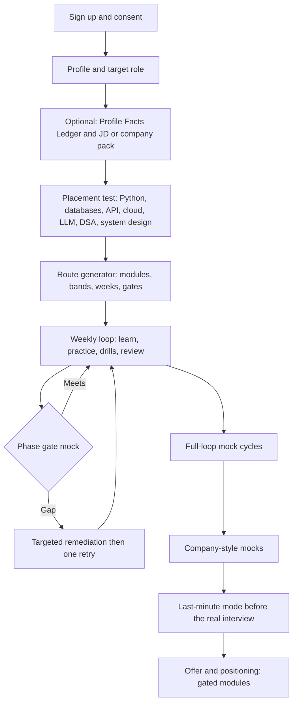

# Learner Journey and Study Routes

## 0. Summary

| Goal | Route hours (after G-3 multipliers, includes assessment allowance) | Source |
|---|---|---|
| Senior Python Backend | about **210 h** | Boss section 5 |
| AI Engineer | about **215 h** | Boss section 5 |
| Python + AI hybrid | about **250 h** | Boss section 5 |
| Reference learner on the hybrid route after skip-ahead | about **217 h** (Boss estimate about 215; recomputed in 7.3 against final syllabi) | Boss G-2; section 7 here |
| Everything, Deeper path | **294.5 h** (247.5 h modules plus 47 h assessments, budget 300; C4 at 6.0 h Deeper under waiver W-C4-1, RUL-02) | Boss G-2, section 5 |

The three paces in this document are **12 weeks (Sprint)**, **16 weeks (Standard)** and **24 weeks (Steady)**. Weekly hours are **derived**, not assumed: weekly hours = route hours / weeks, plus a 10 percent overlay for Interview Master practice that is not counted in route hours (gate mocks and daily drills; see 1.2).

---

## 1. Assumptions behind the calendar plans

### 1.1 Where the weekly hours come from

1. The full Deeper path is about 294 h (G-2). Taking all 19 courses at 12, 16 and 24 weeks would need about 24.5, 18.4 and 12.3 h per week; that is the reference ceiling, not the plan.
2. Goal routes apply G-3 multipliers (MUST 1.0, SHOULD 0.6, NICE 0.25) and the assessment allowance, giving 210, 215 and 250 h. "Deeper" hours are already **net of typical skip-ahead** (G-2); the placement test can reduce them further.
3. Weekly route hours = route hours / weeks.

| Route (hours) | 12 weeks | 16 weeks | 24 weeks |
|---|---|---|---|
| Backend (210) | 17.5 h/week | 13.1 h/week | 8.8 h/week |
| AI Engineer (215) | 17.9 h/week | 13.4 h/week | 9.0 h/week |
| Hybrid (250) | 20.8 h/week | 15.6 h/week | 10.4 h/week |
| Reference learner, hybrid after skip (217.3) | 18.1 h/week | 13.6 h/week | 9.1 h/week |

Cross-check with the Boss note: the hybrid route at about 10 h per week takes about 25 weeks and at 15 h per week about 17 weeks.

### 1.2 Interview Master overlay (not in route hours)

Route hours include module practice and the per-course assessment allowances (voice mock, final assessment, revision loops). They do **not** include the repeated gate mocks, the full-loop mock cycles and the daily 10-minute drills. The plans add an **overlay of about 10 percent** (about 21 to 25 h across a route) `[judgement]`: a daily 10-minute drill on most days (about 12 h over 16 weeks), plus 8 to 10 gate and cycle sessions at 1 to 2.5 h each. Weekly hours with overlay:

| Route | 12 weeks | 16 weeks | 24 weeks |
|---|---|---|---|
| Backend | 19.3 | 14.4 | 9.6 |
| AI Engineer | 19.7 | 14.8 | 9.9 |
| Hybrid | 22.9 | 17.2 | 11.5 |
| Reference learner | 19.9 | 14.9 | 10.0 |

### 1.3 Who each pace suits (guidance, not a prescription)

| Pace | Weekly hours (with overlay) | Typical situation | Risk |
|---|---|---|---|
| Sprint, 12 weeks | about 19 to 23 | Notice period, career break or a deadline | Fatigue; retention suffers; spaced repetition (section 6 of the mapping file) matters more; fewer days between the two strict drills needed for G-6 |
| Standard, 16 weeks | about 14 to 17 | Working professional with protected evenings and one weekend block | The default recommendation |
| Steady, 24 weeks | about 9.6 to 11.5 | Full-time job and family commitments | Momentum and decay; the daily drill and weekly review are the safeguards |

### 1.4 Weekly rhythm template (Standard, about 15 h)

| Block | Hours | Content |
|---|---|---|
| Learn | 5.0 | 3 sessions of module lessons (visual-first, level switch) |
| Practice | 5.0 | IDE and SQL tasks, canvas tasks, labs; the A3 DSA thread (3 sessions per week) and C1 story thread are scheduled here |
| Interview Master | 2.5 | 3 to 5 ten-minute drills (due cards first) plus one 45 to 60 minute mock or gate |
| Review | 1.0 | Missed-item review, flashcard-style due cards, weekly readiness check |
| Buffer | 1.5 | Overruns, remediation inserted by the engine |

Scale blocks proportionally for other paces; **never drop the drills and the weekly review first** because they carry the retention and the evidence for readiness.

---

## 2. End-to-end learner journey

| Stage | What the learner does | System behaviour | Courses |
|---|---|---|---|
| Onboard | Accounts (email, Google), consent for microphone and recording, target role, optional pack or JD | Stores consent; JD analyser proposes skills and probable question areas | none |
| Facts | Confirms projects, roles, dates, metrics (optional, deletable) | Profile Facts Ledger used by C1 consistency, C2 claim-risk, C4 role-plays | C2.M1 |
| Placement | Time-boxed adaptive test; DSA section has a fixed 4-item adaptive core (15 to 25 min, R-A3-5); system-design section from A6 placement items; C3 coding-process probe | Per-module bands (G-5: 85 skip, 70 to 84 skim, 50 to 69 study, below 50 deep-study) | All |
| Route | Reviews and accepts route map | Orders modules by prerequisites, weakest first inside independent sets; two continuous threads (A3, C1); defers A6.M8 until prerequisites | |
| Weekly loop | Learn, practise, drill, review | Spaced repetition cards, readiness updates | |
| Gates | Mock sessions at phase ends | Section 4 | |
| Pack and JD practice | Picks a company-style pack or pastes a JD | Overlays tag multipliers and rubric profile | Company packs |
| Last-minute | Enters date and available hours | Section 5 | |
| Offer | Positioning thesis early; compensation and negotiation modules **when published** | C4.M5 to M9 gated on human professional review (R-C4-3) | C4 |

### 2.1 Route generator (what it computes)

1. **Select** modules by goal tag (`M`, `S`, `N`) for the chosen target, raising tags by the pack cluster rule `max(role tag, cluster tag)` (Company_Pack_to_Curriculum_Map.md section 2). `SHOULD` modules are limited to the core modules chosen from the diagnostic; `NICE` are primers only.
2. **Time per module** = Deeper hours x multiplier (1.0, 0.6, 0.25) x band factor, with a floor of 0.25 h for a mastery check:

| Band (G-5) | Action | Band factor `[judgement]` |
|---|---|---|
| 85 or above | Skip lessons, take mastery check, optional Challenge | 0.2 |
| 70 to 84 | Skim (Deeper-only lessons plus check) | 0.55 |
| 50 to 69 | Study (standard path) | 1.0 |
| Below 50 | Deep-study (Simpler path plus prerequisite remediation) | 1.45 (about Simpler / Deeper) |

3. **Order** respecting prerequisites (Boss 4.1 graph): A1 before A2; A4 and A5 before A6; B2 before B3, B4, B5, B6; C1 before C2; unlock A6.M8 only after B2.M1 to M5 and one of B3, B4, B6; C3 timed mocks only after A3.M5.
4. **Pack** into weeks at the learner's pace, with phases, two threads (A3 and C1 at three sessions per week) and the daily drill.
5. **Insert** gates, assessments, spaced-repetition review and a buffer of about 7 percent of weeks.
6. **Re-plan** weekly: failed gates, lapses and early finishers change the plan; the engine explains each change ("moved A4.M6 earlier because `db.locking` is below the Senior bar").
7. No band waives a course final assessment. Whole-course test-out needs final mastery at 85 percent plus a Senior-bar voice mock (G-5).
8. **Tags (RUL-01, RUL-06).** The course-level goal tag (Boss 4.5) sets the multiplier used for route and course totals in this document, so the headline figures reproduce Boss section 5. The module-level tag in each syllabus LF-2 (for example A2.M3 `H:S`, B1.M8 and M9 `H:M`) decides **which modules the engine routes inside a SHOULD or NICE course** and may lower the multiplier of single modules inside a MUST course. A module-tag cross-check of the hybrid route is in 3.3 (about 245.5 h versus 250.2 h; within 2 percent). Seed questions use their own per-seed tag where the syllabus gives one, otherwise the module tag (RUL-06).
9. **Skip limits that the syllabi set.** A skip means "mastery check only". Skip needs at least 4 answered items in the module (placement blueprint 5.2). A8.M1, M6, M9 also need the written item to pass. B7.M1 and M6 are never fully skipped (RUL-08: at 85 or above treat as skim). B2.M2, M5, M9, M10 and B4.M7 to M9 are never skipped without passing the module mastery check. B3.M4 lesson 4 (pgvector in practice) is never skipped. C3 process-rubric threshold stays 75 percent (R-C3-1).

---

## 3. Calendar plans: three goals at three paces

Phase hours are the sum of module time plus its share of assessment allowances. Weeks are proportional, rounded to whole weeks. The Interview Master overlay (section 1.2) is added on top. Skip-ahead from the placement test only **shortens** phases; it never removes a gate.

### 3.1 Goal 1: Senior Python Backend (about 210 h)

MUST: A1, A2, A3, A4, A5, A6, C1, C2, C3. SHOULD: A7, A8, B2 core (M1, M4, M5, M9, M10), C4. NICE: B1, B3 to B7 primers only (B3.M1 lessons 1 to 3; B4.M1.2 to M1.3, M2.3, M7.1 to M7.2 per the B4 syllabus; B5.M4 and M5 per B5 LF-2; B6.M1 lessons 1 to 3). Ruling BR-04: the B4 NICE slice replaces the earlier "B4.M1 only" wording; slice hours are lesson-level and sit inside the Boss 4.2 primer allowance, so the Backend total of about 210 h is unchanged.

| Phase | Content | Hours | 12 weeks | 16 weeks | 24 weeks |
|---|---|---|---|---|---|
| P1 Foundations | Placement; A1; A3 first half (thread); C1 first half (thread); baseline mock G0 | 33.5 | W1 to 2 | W1 to 3 | W1 to 4 |
| P2 Core depth | A2; A4 | 38 | W3 to 4 | W4 to 5 | W5 to 8 |
| P3 Breadth | A5; A8; A7 gap modules | 39 | W5 to 6 | W6 to 8 | W9 to 13 |
| P4 Design and integration | A6; B2 core; C3 timed mocks; A3 second half | 59.5 | W7 to 10 | W9 to 13 | W14 to 19 |
| P5 Defence and finish | C2; C4 (positioning part); NICE primers; C1 second half; full-loop cycles; company packs | 40 | W11 to 12 | W14 to 16 | W20 to 24 |

Gates: G1 end of P1, G2 end of P2, G3 end of P3, G4 end of P4, G5 end of P5 (section 4). Hours per week with overlay: about 19.3, 14.4, 9.6.

### 3.2 Goal 2: AI Engineer (about 215 h)

MUST: A2, A6, B1, B2, B3, B4, B5, C1, C2, C3. SHOULD: A1, A3, A4, A5, B6, B7, C4. NICE: A7, A8 (X1 compliance primer still pulled in).

| Phase | Content | Hours | 12 weeks | 16 weeks | 24 weeks |
|---|---|---|---|---|---|
| P1 Foundations | Placement; B1; A2; A1 gap modules; C1 first half (thread) | 41.5 | W1 to 2 | W1 to 3 | W1 to 5 |
| P2 LLM core | B2; B3 | 27 | W3 to 4 | W4 to 5 | W6 to 8 |
| P3 Agents, evals, backend core | B4; B5; A5 core; A4 gaps | 50.6 | W5 to 7 | W6 to 9 | W9 to 13 |
| P4 Systems | A6 with M8; B6; B7 core | 37.3 | W8 to 9 | W10 to 12 | W14 to 17 |
| P5 Defence and finish | A3 core; C3; C2; C4; C1 second half; A7 and A8 primers; full-loop cycles; company packs | 59.6 | W10 to 12 | W13 to 16 | W18 to 24 |

Hours per week with overlay: about 19.7, 14.8, 9.9. The adaptive engine will likely band B6 at "skim" for a learner with voice-agent experience (Boss 4.3).

### 3.3 Goal 3: Python + AI hybrid (about 250 h)

MUST: A1 to A6, B2, B3, B4, C1, C2, C3. SHOULD: A7, A8, B1, B5, B6, C4. NICE: B7.

| Phase | Content | Hours | 12 weeks | 16 weeks | 24 weeks |
|---|---|---|---|---|---|
| H1 Python and concurrency | Placement; A1; A2; A3 first half (thread); C1 first half (thread) | 46.5 | W1 to 2 | W1 to 3 | W1 to 4 |
| H2 Backend core and LLM entry | A4; A5; B2 | 55 | W3 to 5 | W4 to 6 | W5 to 10 |
| H3 RAG, agents, ops | B3; B4; A8; A7 gap modules | 49.1 | W6 to 7 | W7 to 10 | W11 to 14 |
| H4 Design and AI depth | A6 with M8; B5; B6 skim; B1 gaps | 46.3 | W8 to 9 | W11 to 13 | W15 to 19 |
| H5 Defence and finish | B7 core; C3; C2; C4; A3 second half; C1 second half; full-loop cycles; company packs | 53.3 | W10 to 12 | W14 to 16 | W20 to 24 |

Phase hours sum to 250.2 (46.5 + 55.0 + 49.1 + 46.3 + 53.3); the earlier 250.3 carried a C4 baseline of 4.6 h, whereas 0.6 x (6.0 + 1.5) = 4.5 h (W-C4-1, RUL-02). This reconciles with Boss "about 250". Backend (about 210 h) and AI Engineer (about 215 h) are the Boss section 5 figures and are not changed by this reconciliation.

Module-tag cross-check for the hybrid route (RUL-01; module Deeper hours x LF-2 `H` tag, plus assessment x course tag): A1 14.1, A2 12.6, A3 26.5, A4 23.8, A5 14.1, A6 20.7, A7 10.5, A8 13.5, B1 9.9, B2 13.1, B3 11.9, B4 13.0, B5 10.0, B6 7.5, B7 5.4, C1 10.2, C2 10.5, C3 13.7, C4 4.5 = **about 245.5 h**, 1.9 percent below the course-tag figure of 250.2 h. Both round to "about 250"; the course-tag figure stays the headline because it is the Boss G-3 method.

Hours per week with overlay: about 22.9, 17.2, 11.5. Sprint pace on the hybrid route is demanding; the generator should recommend Standard or Steady unless the learner confirms the weekly hours.

---

## 4. Milestone checkpoints and mock-interview gates

Gates are design targets, not predictions. A failed gate triggers targeted remediation (3 to 5 days of the weakest tags plus the module's Simpler-path lessons, via LF-5 of the owner syllabus) and **one retry**; the route is never blocked indefinitely and the engine always shows why. Passing criteria use platform thresholds: "Meets" = average at least 3.0 and no dimension below 2 (G-7); "Senior bar" = average at least 3.5 and no dimension below 3 (G-6); design rubric overall at least 3.5 with no critical rule findings at the final gate; hidden-test coding at least 70 percent with correct stated complexity.

| Milestone | When (share of route hours) | Gate | Pass criteria | Readiness target (band from mapping section 5.5) |
|---|---|---|---|---|
| LM0 Onboarded | Week 1 | None | Profile, consent, target role, placement done; route accepted | Not enough evidence yet |
| LM1 Baseline | End of week 2 to 3 | **G0** baseline mock (30 min voice plus text mini-loop) | No pass or fail; seeds the competency estimates and the first weak-tag list | Early or Building |
| LM2 Foundations | End of P1, about 15 to 20 percent | **G1** two strict 10-minute drills on `python.*` and `concurrency.*` (or `ml.*` for AI route), plus an A1 mastery check | Meets on both drills; module badges for passed modules; first story card (C1.M3) drafted | Building |
| LM3 Core depth | End of P2, about 35 to 40 percent | **G2** technical-depth mock (45 min) plus a timed coding task | Technical depth Meets; coding at least 70 percent hidden tests with complexity; C3 loop used (process dimension at least 3.0) | Building |
| LM4 Breadth | End of P3, about 50 to 55 percent | **G3** first design-canvas mock (45 to 60 min) | Design overall at least 3.0, no dimension below 2, no more than 2 critical rule findings; AI route: LLM depth voice mock Meets | Building to Approaching |
| LM5 Integration | End of P4, about 75 to 80 percent | **G4** first full mock cycle (six sessions) | Cycle average at least 3.2 with no `M` tag below 2.5; two flagship projects pass the deep-dive qualitatively (no numeric band until calibrated, R-C2-4) | Approaching |
| LM6 Finish | End of P5 | **G5** full-loop cycle at strict settings plus one company-style mock if a pack is chosen | Per readiness gates in mapping section 5.5: Senior bar on at least 85 percent of `M` weight, hidden tests at least 70 percent, design with no critical findings and every dimension at least 3, confidence Medium or better | Practice bar met (if earned) |
| LM7 Maintain | After the route | Monthly drill refresh | Cold-recall cards due; readiness shows "stale" after the decay window | n/a |

Mock-session budget across a route (indicative, all paces): baseline 1; G1 2 drills; G2 2; G3 1 to 2; G4 6; G5 6; company-style 2 to 4; total about 20 to 23 sessions. Each full-loop cycle is separated from the previous by at least a week so spaced repetition can act.

---

## 5. Last-minute plans (1-day, 3-day, 7-day)

Last-minute mode (scope 4A.2) builds a **time-boxed triage plan** from mastery data. It never claims guaranteed outcomes and states which gaps remain.

### 5.1 Planning rule

For each tag `t` the engine ranks by
`yield(t) = W_role(t) x max(0, 3.5 - theta_t) x recoverable(t) / minutes_needed(t)`,
where `recoverable` is high for decision frameworks, formulae, dated facts and rehearsed stories, medium for tag-specific mechanics, and low for new algorithmic patterns that need many hours (for example learning dynamic programming from scratch in a day). The plan fills the time box top-down, keeps the learner's own stories and project defence at fixed priority, and reserves a warm-up mock and the checklist. **No new deep topics start in the 1-day plan.**

### 5.2 One-day plan (about 7 h the day before, plus 30 minutes in the morning)

| Block | Duration | Content |
|---|---|---|
| Intake | 0:30 | Confirm round types, company pack or JD, current band and top 5 gaps; engine states what it will not cover |
| Project stories | 1:00 | Two flagship projects at 30 s and 3 min (DR-C2-M3), five-level why on one decision (DR-C2-M4), ledger consistency check |
| Behavioural | 1:00 | Five stories from the story bank, 90-second career narrative and the "4 years Python" probe (DR-C1-M9), India HR answers if relevant (DR-C1-M7) |
| Top weak tags | 1:00 | Three 10-minute drills on the three highest-yield weak `M` tags plus cram cards (modules flagged `L` in the mapping catalogue) |
| Break | 0:30 | |
| Round-specific rehearsal | 1:00 | Coding round: one timed problem in the learner's weakest pattern family plus complexity defence. Design round: one 25-minute mini-canvas with probes. AI round: one RAG or LLM design aloud |
| Rapid-fire | 0:45 | Style-of-question rapid-fire set per role and pack (most-probed topics by tag weight; labelled practice items, not real questions) |
| Warm-up mock | 0:45 | 30-minute strict mock of the likeliest round, then a 10-minute read of the report |
| Checklist | 0:30 | Questions to ask, logistics (browser, microphone, IDE, shared-editor etiquette per C3.M6), sleep |
| Morning of | 0:30 | Cheat-sheet recaps, one 10-minute drill, no new material |

### 5.3 Three-day plan (about 5 h per day)

| Day | Focus | Content |
|---|---|---|
| Day 1 | Diagnose and fix | 30 min intake; top 5 weak tags: one drill each plus skim of Deeper-only lessons (about 2 h); story bank and project defence (1.5 h); one timed coding or canvas item (1 h) |
| Day 2 | Round rehearsal | Full strict mock of the most likely round (about 1 h) and report review (30 min); second pass on the three worst tags (1.5 h); rapid-fire sets (45 min); HR and behavioural drill (45 min) |
| Day 3 | Consolidate and rest | Warm-up mock (45 min); stories aloud (45 min); cram cards and cheat sheets (1 h); checklist (30 min); stop by early evening |

### 5.4 Seven-day plan (about 2.5 h per day, about 17.5 h)

| Day | Content |
|---|---|
| 1 | Baseline mini-mock (45 min); choose targets; story bank audit (45 min); 10-minute drill |
| 2 | Weak tag A: skim lessons and two drills (1.5 h); project narrative (1 h) |
| 3 | Weak tag B: same; one timed task (1 h) |
| 4 | Mid mock of one round (1 h) and report; fix the top two findings (1 h) |
| 5 | Weak tag C and spaced-repetition due cards (1.5 h); behavioural and HR drills (1 h) |
| 6 | Condensed full loop: two segments back to back (1.5 h) and report (30 min); checklist draft (30 min) |
| 7 | Light: cram cards, stories aloud, one drill, logistics; stop early |

### 5.5 Goal-specific yield lists (starting points; the engine re-ranks from mastery)

| Goal | Highest-yield modules to cram first (flag `L` in the mapping catalogue) |
|---|---|
| Backend | A3.M2, M7, M9 (if coding rounds); A2.M4; A4.M3 to M5; A5.M4; A6.M1, M3, M4; A1.M3, M11; C1.M4, M7; C2.M3 |
| AI Engineer | B2.M1, M4, M5, M9; B3.M1, M4, M5; B4.M1; B5.M1, M4; A6.M8; B1.M8, M9; C1.M4; C2.M3 (B5.M1 and M4 are the highest AI-weight B5 modules, 14 and 16 percent in B5 LF-2; this is a last-minute yield list, not the Backend NICE primer slice, which is B5.M4 and M5) |
| Hybrid | The union limited to the five highest `W_role x gap` modules per domain; A6.M1, M4, M8 are default picks |

Honest-limits statement shown with every last-minute plan: "This plan focuses your remaining time on the highest-value gaps. It cannot teach you a new topic in depth in this time, and it does not predict the outcome. The areas not covered are listed below."

---

## 6. Journey differences by goal (what the learner experiences)

| Aspect | Backend | AI Engineer | Hybrid |
|---|---|---|---|
| First two weeks | Python internals and DSA thread | ML foundations and async | Python internals, concurrency and DSA thread |
| Typical stretch points | DSA patterns under time, isolation and locking, design under probes | Evals and judge bias, retrieval quality, fine-tuning versus RAG | Breadth load; combining design with AI systems |
| Strongest interview practice lever | Timed DSA and canvas with probes | AI canvas designs and LLM depth voice | Mixed cycle; AI designs plus backend depth |
| Company packs to try first | IT-services, global-IT consulting, Indian-product, global-product | AI-startup, global-product | Any; Global-IT consulting and Indian-product |
| C4 offer content | Positioning early (C4.M1 to M4); gated modules near an offer | Same | Same |

---

## 7. Worked example: the reference learner (illustrative hypothesis only)

**This section is an illustration of the route generator, not an assessment of any person.** The profile below is the hypothesis recorded in the scope doc (section 2) and Boss section 4.4: a senior engineer with 11+ years in software and about 4 years in Python, strong in FastAPI, Django, Flask, SQL (PostgreSQL and MySQL), Redis, Docker, AWS Lambda and S3, LLM APIs and voice agents. **Every band, skip and skim below is a hypothesis to be replaced by the placement test and mastery checks.** If placement disagrees, placement wins, and the route is regenerated.

Inputs for the example: goal Hybrid, Standard pace 16 weeks (about 14.9 h per week with overlay) or Steady 24 weeks (about 10.0 h per week), no company pack selected.

### 7.1 Hypothesised profile by course (skip, skim, deep-study)

Bands: SKIP = lessons skipped, take mastery check (band 85 or above); SKIM = Deeper-only lessons plus check (70 to 84); STUDY = standard path (50 to 69); DEEP = deep-study (below 50). Module IDs for skip and skim follow the Boss 4.4 skip-ahead list where it applies and the per-syllabus reference-learner expectations in LF-1 and LF-2 (final syllabi win where they differ, RUL-01 and RUL-13). "Skip" always means mastery check only.

| Course | Hypothesis: skip | Hypothesis: skim | Hypothesis: study or deep-study | Why (experience bridge) |
|---|---|---|---|---|
| A1 Python Internals | M5 (decorators, closures) | M1, M4, M7, M8, M9, M10 | **M2, M3, M6, M11** | Daily use of the language; "use versus explain": GIL, memory, descriptors and profiling are where senior probes bite |
| A2 Concurrency and Async | M7 (FastAPI async patterns; A2 expected L4 skip) | M2, M3 (A2 LF-1 L4 skim or skip on measured score; M2 is a standing skip candidate), M8, M9 (worker basics) | **M1 (the decision-guide lesson is explain-depth, kept as a gap), M4, M5, M6, M10** | Uses async daily; cancellation, structured concurrency, backpressure and stall diagnosis are explain-depth gaps. M4, M5, M6, M8 to M10 are never banded skip from inference (A2 prerequisites row) |
| A3 DSA | none | M2 (hashing), M3 | **M5 to M11 (graphs, DP, greedy) DEEP possible** | Recent-years DSA practice is the common gap for 11+ year engineers; strongest candidate for deep-study, to be confirmed by the 4-item placement core |
| A4 Databases | M1 lessons (SQL fluency) | M2, M10 (ORM) | **M3 to M9** | Heavy SQL use; plans, isolation, locking, replication and online DDL need explain depth |
| A5 API and Architecture | M1, M3 | M2, M5 (Redis caching), M7, M11 | **M4, M6, M8, M10** | Builds APIs daily; idempotency, OAuth2 and OIDC depth, outbox and architecture trade-offs |
| A6 System Design | none | M8 voice-platform design item (#17) | **M1 to M7, M9, M10** | Senior bar; canvas and probing are new skills |
| A7 Cloud, DevOps, Observability | M1 lessons 1 to 2, M4 (Lambda basics), M5 (S3 basics) | M2, M8 (Bitbucket basics) | **M3 (Kubernetes), M6, M7 (Terraform), M9, M10** | Docker, Lambda and S3 known; Kubernetes, Terraform, SLOs are gaps |
| A8 Testing, Quality, Security | none (M2 skip or skim per A8 8.2; hours use skim) | M1 (A8 8.2 is silent; assumed skim, written item must pass for any skip), M2, M3, M4, M6, M8, M10 | **M5, M7, M9 (with X1)** | Follows A8 8.2 reference-learner expectation: M2 skip or skim, M3 skim, M4 skim, M5 study, M6 skim, M7 study, M8 skim, M9 study, M10 skim. M7 owns OWASP depth (resumes under-cover it); M5 mutation and Hypothesis, M9 threat modelling and X1 are likely new |
| B1 ML Foundations | none by inference; M6 reduced to its mastery check (standalone test-out, B1 LF-1) | M1 (skimmed, not skipped); the Pandas parts of M5 | **M2 to M5, M7 to M10 (deep-study likely on M2 to M4, M7, M9, M10)** | Reference learner is L4 in backend contexts but L1 to L2 in ML (B1 LF-1): expect about 15 h plus 2.0 h assessment (RUL-11) at full multiplier, not 8.5 h |
| B2 LLM Application Engineering | M1, M3 (B2 header: expected skip or skim; mastery check taken) | M4, M5 (mastery check mandatory, never skipped), M6, M8, M12 | **M2, M7, M9, M10, M11** | Uses LLM APIs; reasoning models (M2), context and memory budgeting (M7, bridge row: passing chat history), cost (M9) and safety (M10) are explain-depth. M2, M5, M9, M10 are never skipped without passing the module mastery check |
| B3 RAG and Vector Search | none at module level (L4 may skip lessons M2.1 to M2.2 and M4.1; M4.4 pgvector in practice is never skipped) | M1, M2, M3, M6 | **M4, M5, M7, M8, M9, M10** | Chatbot work; retrieval quality, pgvector in practice, ACLs and evaluation are gaps (B3 LF-1 L3 study list M4, M5, M7, M8) |
| B4 Agents and Workflows | none | M1 | **M2, M5, M7, M8, M9** | Some agent-style work; durable execution, eval and security design |
| B5 Eval, Safety, LLMOps | none | M1 | **M2 to M9** | Mostly new at interview depth |
| B6 Voice and Real-time AI | none (M1 is skim and defend, not skip: B6 LF-1 L4 and LF-5; the Boss 4.4 list had it as a skip candidate, the syllabus wins) | M1 to M5, M7 | **M6, M8, M9, M10, M11 (showcase, Defend-your-numbers and measurement)** | Voice-agent experience is a strength to showcase; M9 cost stack and consent and M11 case study are the gaps between using and explaining (B6 LF-3) |
| B7 Fine-tuning and MLOps | none | primers only (NICE) | M1, M6 primers | NICE for hybrid |
| C1 Behavioural | none | M2 | **M3 to M5, M7, M9** | 11 years of stories need structure; the "4 years Python" probe and domain-switch narrative |
| C2 Project Deep-Dive | none | none | **M1 to M9 (flagship projects)** | Resume claims need to survive five levels of why |
| C3 Coding Execution | none | M3 | **M1, M2, M4, M5, M7** | Process and think-aloud under time are trainable skills |
| C4 Offer and Positioning | none | none | M1 to M4 (M5 to M9 are gated on professional review; M6 to M8 unlock on the timing flag; when published and needed) | Domain-switch positioning; 6.0 h Deeper under waiver W-C4-1 |

### 7.2 Route-generator arithmetic on one module family (illustration using A1 Deeper module hours)

A1 module Deeper hours (syllabus): M1 1.5, M2 1.75, M3 2.0, M4 1.0, M5 1.0, M6 1.5, M7 1.25, M8 1.25, M9 1.0, M10 0.75, M11 2.0 (sum 15.0). Hybrid tag `M` (multiplier 1.0).

| Module | Band hypothesis | Factor | Computed hours |
|---|---|---|---|
| M1 | SKIM | 0.55 | 0.83 |
| M2 | STUDY | 1.0 | 1.75 |
| M3 | STUDY | 1.0 | 2.00 |
| M4 | SKIM | 0.55 | 0.55 |
| M5 | SKIP | 0.2, floor 0.25 | 0.25 (mastery check) |
| M6 | STUDY | 1.0 | 1.50 |
| M7 | SKIM | 0.55 | 0.69 |
| M8 | SKIM | 0.55 | 0.69 |
| M9 | SKIM | 0.55 | 0.55 |
| M10 | SKIM | 0.55 | 0.41 |
| M11 | STUDY | 1.0 | 2.00 |
| **Module time** | | | **11.2 h** (versus 15.0 baseline) |
| Assessment allowance (not waived) | | | 2.0 h |
| **A1 total** | | | **about 13 h** (versus 17 h baseline) |

### 7.3 Expected hours by course (hybrid route, hypothesis)

Baseline = hybrid route hours from section 3.3 (course-tag multiplier x Deeper module hours plus multiplier x assessment allowance). Expected = after the hypothesised bands in 7.1, recomputed for the rows marked with an asterisk using band factors 0.2 / 0.55 / 1.0 (floor 0.25 h per mastery check), the course-tag multiplier (1.0 MUST, 0.6 SHOULD, 0.25 NICE) and the assessment allowance, which no band waives. Unmarked rows are unchanged from the 2026-10-05 draft and remain hand-estimated. Sum of expected is about **217 h** (217.3), within 1 percent of the Boss estimate of about 215 h.

| Course | Baseline h | Expected h | Course | Baseline h | Expected h |
|---|---|---|---|---|---|
| A1 | 17.0 | 13.0 | B1 * | 9.0 | 10.2 |
| A2 * | 13.0 | 10.2 | B2 * | 14.0 | 10.9 |
| A3 | 26.5 | 23.0 | B3 * | 13.0 | 11.3 |
| A4 | 25.0 | 21.5 | B4 | 13.0 | 11.0 |
| A5 | 16.0 | 12.5 | B5 | 7.8 | 7.8 |
| A6 | 22.0 | 21.0 | B6 * | 7.5 | 5.9 |
| A7 | 10.8 | 7.5 | B7 | 3.3 | 3.3 |
| A8 * | 12.3 | 9.2 | C1 | 10.5 | 10.5 |
| C2 | 10.5 | 10.5 | C3 | 14.5 | 13.5 |
| C4 * | 4.5 | 4.5 | **Total** | **250.2** | **about 217 (217.3)** |

B1 is the only course whose expected hours now exceed its baseline: the baseline assumes a Deeper-path learner (13 h), whereas the reference learner is L1 to L2 in ML, so most modules sit in the study band (midpoint of Simpler and Deeper hours), M6 at its mastery check and M1 skimmed (B1 LF-1). The C4 baseline is 0.6 x (6.0 + 1.5) = 4.5 h; the 4.6 in the earlier draft was an arithmetic slip.

**Arithmetic for the recomputed rows** (module term = Deeper hours x band factor):

| Course | Module terms (h) | Module sum | x multiplier | + assessment | Expected |
|---|---|---|---|---|---|
| A2 (M, 1.0) | M1 0.75 study; M2 0.55 skim; M3 0.495 skim; M4 1.3; M5 1.3; M6 1.0; M7 0.26 skip (1.3 x 0.2); M8 0.605 skim; M9 0.55 skim; M10 0.85 | 7.66 | 1.0 = 7.66 | 2.5 | 10.16, **10.2** |
| A8 (S, 0.6) | M1 0.825; M2 0.55; M3 1.1; M4 1.1 (all skim); M5 1.5 study; M6 0.825 skim; M7 3.0 study; M8 1.1 skim; M9 1.5 study; M10 0.825 skim | 12.325 | 0.6 = 7.395 | 0.6 x 3.0 = 1.8 | 9.195, **9.2** |
| B1 (S, 0.6) | LF-1 estimate "about 15 h" for the reference learner (midpoints of Simpler and Deeper, M6 at 0.25, M1 skim: 14.5 h computed) | 15.0 | 0.6 = 9.0 | 0.6 x 2.0 = 1.2 | **10.2** |
| B2 (M, 1.0) | M1 0.25 and M3 0.25 skip floors; M2 1.0; M4 0.6875; M5 0.55; M6 0.4125 (skims); M7 1.0; M8 0.55 skim; M9 1.5; M10 1.0; M11 0.75; M12 0.4125 skim | 8.363 | 1.0 = 8.363 | 2.5 | 10.863, **10.9** |
| B3 (M, 1.0) | M1 0.4125; M2 0.55; M3 0.55 (skims); M4 1.25; M5 1.5; M6 0.55 skim; M7 1.0; M8 1.25; M9 1.0; M10 0.75 | 8.8125 | 1.0 = 8.8125 | 2.5 | 11.31, **11.3** |
| B6 (S, 0.6) | M1 0.4125; M2 0.4125; M3 0.9625; M4 0.55; M5 0.55 (skims); M6 1.0; M7 0.4125 skim; M8 1.0; M9 0.75; M10 0.75; M11 1.0 | 7.8 | 0.6 = 4.68 | 0.6 x 2.0 = 1.2 | 5.88, **5.9** |
| C4 (S, 0.6) | Deeper 0.75 + 0.75 + 0.5 + 0.5 + 0.5 + 0.75 + 0.75 + 0.75 + 0.75 = 6.0 (W-C4-1) | 6.0 | 0.6 = 3.6 | 0.6 x 1.5 = 0.9 | **4.5** |

Totals: 13.0 + 10.2 + 23.0 + 21.5 + 12.5 + 21.0 + 7.5 + 9.2 = 117.9 (Track A); 10.2 + 10.9 + 11.3 + 11.0 + 7.8 + 5.9 + 3.3 = 60.4 (Track B); 10.5 + 10.5 + 13.5 + 4.5 = 39.0 (Track C); grand total 217.3 (117.9 + 60.4 + 39.0), quoted as about 217. Cross-checks: A2 module sum 7.66 h is inside the A2 L4 band of about 7 to 9 h; B6 module sum 7.8 h matches the B6 L4 "about 7 to 8 h"; B2 8.4 h is slightly below the B2 L4 "about 9 to 10 h" because M1 and M3 are at skip floors.

**Waiver W-C4-1 sensitivity (RUL-02).** C4 module Deeper hours of 0.5 for M3 to M5 sit below the 0.75 h floor; the waiver is ratified. If it were declined (C4 Deeper 6.75 h): C4 hybrid baseline 0.6 x (6.75 + 1.5) = 4.95 h, hybrid route 250.65 h, full Deeper path 248.25 + 47 = 295.25 h (still under the 300 h budget). Grand total as ruled: 247.5 + 47 = **294.5 h**.

### 7.4 Resulting calendar (hybrid, hypothesis)

Phase hours after skip-ahead (recomputed from 7.3; A3 thread split 11.0 / 12.0 h and C1 thread 5.0 / 5.5 h between H1 and H5): H1 39.2 (A1 13.0, A2 10.2, A3 first half 11.0, C1 first half 5.0), H2 44.9 (A4 21.5, A5 12.5, B2 10.9), H3 39.0 (B3 11.3, B4 11.0, A8 9.2, A7 7.5), H4 44.9 (A6 21.0, B5 7.8, B6 5.9, B1 10.2), H5 49.3 (B7 3.3, C3 13.5, C2 10.5, C4 4.5, A3 second half 12.0, C1 second half 5.5); total 217.3.

| Phase | Content | 16 weeks (about 14.9 h per week) | 24 weeks (about 10.0 h per week) |
|---|---|---|---|
| H1 | A1, A2, A3 first half (thread), C1 first half (thread); placement; G0 | W1 to 3 | W1 to 4 |
| H2 | A4, A5, B2; G2 at the end | W4 to 6 | W5 to 9 |
| H3 | B3, B4, A8, A7 gaps | W7 to 9 | W10 to 14 |
| H4 | A6 with M8, B5, B6 skim, B1 gaps (about 10 h of B1 now that ML is a study-band course); G3 canvas mock | W10 to 12 | W15 to 18 |
| H5 | B7 core, C3, C2, C4, A3 second half, C1 second half; G4 and G5 | W13 to 16 | W19 to 24 |

```mermaid
gantt
    title Reference learner hybrid route at 24-week pace (illustrative hypothesis)
    dateFormat X
    axisFormat W%s
    section Phases
    H1 Python and concurrency          :0, 4
    H2 Backend core and LLM entry      :4, 9
    H3 RAG agents and ops              :9, 14
    H4 Design and AI depth             :14, 18
    H5 Defence and finish              :18, 24
    section Threads
    A3 DSA thread                      :0, 20
    C1 story thread                    :0, 22
    section Gates
    G0 baseline mock                   :2, 3
    G1 foundations                     :4, 5
    G2 core depth                      :9, 10
    G3 design canvas                   :14, 15
    G4 first full cycle                :18, 19
    G5 final cycle                     :22, 24
```

### 7.5 What the example shows, and what it does not

- It shows the generator mechanics (selection, band factors, floors, prerequisites, threads, gates) end to end on one learner shape.
- It reproduces the Boss expectation that skip-ahead concentrates on A1.M5, A2.M7, A4.M1, A5.M1 and M3, A7.M1, M4 and M5, and B2.M1 and M3. Boss 4.4 also lists B6.M1; the B6 syllabus (LF-1 L4, LF-5) treats it as skim and defend, so it appears under skim in 7.1 and the syllabus wins (RUL-01).
- It shows that the largest gaps against the baseline are in B1 (ML is a study-band course for this learner, RUL-11) and that skip-ahead savings come mainly from Track A and B2 to B3.
- It does **not** assert that this learner will skip, skim or struggle where hypothesised. Placement bands, mastery checks and strict-mode evidence decide; the generator will regenerate the route when they differ, and the first re-plan after G0 is expected to move several modules.
- The profile is the founder's resume summary used as an illustrative persona; the product never seeds a real learner's projects into shared content (R-C2-5), and the Profile Facts Ledger is optional and learner-owned.

---

## 8. Open items

| # | Item | Needed from |
|---|---|---|
| 1 | Band factors (0.2, 0.55, 1.0, 1.45), the 10 percent overlay and gate targets are `[judgement]`; calibrate after the 3-learner pilot | Pilot analysis |
| 2 | Placement test duration and the final item allocation per section (placement spec owns the engine) | Placement spec owner |
| 3 | C4 gated modules M5 to M9 cannot be served until professional review (R-C4-3); journey text references them as "when published" | C4 SME, founder |
| 4 | Pace guidance wording (for example discouraging Sprint on the hybrid route) needs founder confirmation | Founder |
| 5 | Done 2026-10-06: module hours, names and IDs re-checked against the final syllabi by script (see Boss final reconciliation); re-check again if any syllabus module table changes | INT-C |
| 6 | Pilot to calibrate the assessment allowance: per-course reality can be up to about 3 h (for example B5), while the 47 h budget line stays (RUL-03); not a build blocker | Pilot analysis |
| 7 | Expected hours for unmarked rows in 7.3 (A1, A3 to A7, B4, B5, B7, C1 to C3) are still hand-estimates from the 2026-10-05 draft; a full band-by-band recomputation can be generated by the route engine once placement bands exist | INT-C, engine team |

*Last reviewed 2026-10-06 (boss reconciliation).*

---

## Boss final reconciliation (2026-10-06)

Status line set to "Reconciled with final syllabi v1.0 (boss, 2026-10-06)". Sources: TrackLead_A_Report section 3, TrackLead_B_Report section 3, TrackLead_C_Report section 4, and the final syllabi (LF-1 and LF-2 authoritative).

### Rulings applied

| Ruling | What changed in this file |
|---|---|
| RUL-01 | Section 2.1 points 8 and 9 added: course-level tag drives headline hours, LF-2 module tags select modules inside a course and cross-check the hybrid total (about 245.5 h versus 250.2 h). Band and skip limits stated per syllabus. Section 7.1 rows A2, A8, B1, B2, B3, B6 aligned to LF-1 and LF-2 |
| RUL-02 | C4 at 6.0 h Deeper under waiver W-C4-1; C4 baseline corrected from 4.6 to 4.5 h (0.6 x 7.5); hybrid baseline 250.2 h; grand total stays 294.5 h; decline sensitivity (4.95 h, 250.65 h, 295.25 h) recorded in 7.3; gated modules M5 to M9 and timing flag M6 to M8 stated in 7.1 |
| RUL-03 | Assessment allowance stays 47 h; per-course reality up to about 3 h noted as a pilot calibration item (open item 6) |
| RUL-06 | Seed tags: per-seed tag where the syllabus gives one, else module tag (2.1 point 8) |
| RUL-08 | B7 M1 and M6 never fully skipped (at 85 or above treated as skim); C3 75 percent process-rubric threshold unchanged (2.1 point 9) |
| RUL-11 | B1 reference-learner estimate about 15 h plus 2.0 h assessment at full multiplier (10.2 h at the hybrid SHOULD multiplier), replacing 8.5 h; B1 skim not skip on M1 |
| RUL-13 | Module names, IDs and hours taken from the syllabus module tables; scripted check below |
| BR-04, BR-05 | Local rulings recorded by the reconciliation agent for boss ratification (not in the RUL list): BR-04 B4 NICE slice; BR-05 B5 Backend NICE slice versus AI crash list. Details below |

### Discrepancies resolved (Track Lead reports)

| Report item | Resolution |
|---|---|
| A: 7.1 A8 row | Skim M1 (assumed), M2, M3, M4, M6, M8, M10; study M5, M7, M9; M2 skip or skim per A8 8.2 |
| A: 7.1 A2 row | M1 kept as explain-depth gap; M2 and M3 moved to skim (A2 LF-1 L4 and LF-2); M7 skip kept |
| A: 7.2 and 7.3 A1, A7, A8 baselines | Verified: A1 15.0 h Deeper, A7 10.8, A8 12.3 baselines unchanged; A8 expected recomputed to 9.2 h |
| B: B1 hours | Recomputed: 10.2 h expected versus 9.0 baseline (7.3 arithmetic table); totals 217.3 and 250.2 |
| B: B2 M7 and M5 | M7 study (bridge row: passing chat history; no B2 band stated, rule recorded); M5 skim with mastery check mandatory |
| B: B3 | Skim M1 and M2 with M2.1 to M2.2 lesson-level skip; no module skip; M4.4 pgvector in practice never skipped |
| B: B6 | M1 skim and defend (not skip); M9 and M11 placed in study; M2 to M5 and M7 skim |
| B: B4 NICE slice | BR-04 ruling: Backend primer is B4.M1.2 to M1.3, M2.3, M7.1 to M7.2 (B4 syllabus audience row and LF-2 tag note); 3.1 updated |
| B: B5 Backend NICE slice versus AI crash list | BR-05 ruling: both are correct for different purposes. Backend NICE primer = B5.M4 and M5 (B5 LF-2, LF-5). The AI last-minute yield list B5.M1 and M4 reflects the highest AI interview weights (14 and 16 percent). Not a conflict; clarified in 5.5 |
| C: C4 4.6 h baseline | Corrected to 4.5 h under W-C4-1; sensitivity recorded |
| C: 294.5 grand total | Retained: 366.0 S, 247.5 D, 47 assessment |

### Scripted checks
Every `Xn.Mn` module reference, range (for example `M5 to M9`) and every course-module name used in this file was resolved against the final syllabus module tables; mermaid fences were balanced and parsed (2 fences: one flowchart, one gantt).

### What remains
- Unmarked rows of 7.3 are still hand-estimates (open item 7); the three route totals (Backend about 210, AI about 215, Hybrid about 250) are the Boss section 5 figures and were not recomputed here except hybrid (250.2).
- Calibration of band factors, overlay and gate targets after the 3-learner pilot (open item 1).
- Sprint-pace guidance wording and C4 gated-module publication (open items 3 and 4) need founder and SME action.
