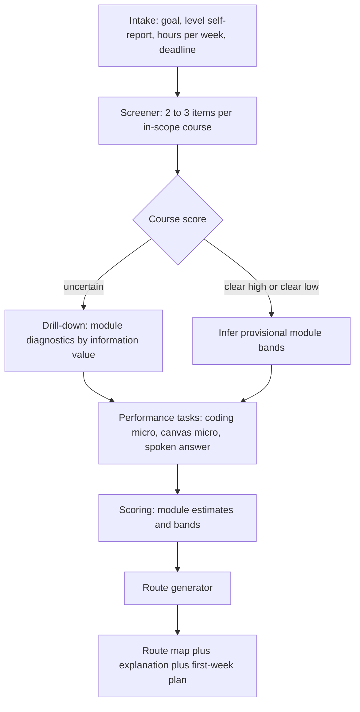
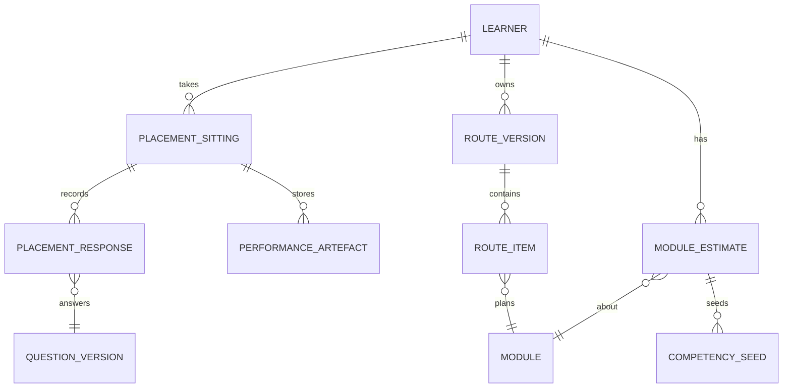

# Placement Test Blueprint

## 1. PURPOSE, PRINCIPLES AND NON-GOALS

The placement test turns a learner's goal and demonstrated knowledge into a **personalised route map**: for every module of the 19 courses, an action (skip, skim, study, deep-study, or primer) and a planned number of hours, ordered by the boss dependency graph.

| Principle | Consequence |
|---|---|
| **Placement is an estimate, the mastery check is the proof** | G-5: no band waives a course final; a module is "mastered by placement" only after its mastery check passes at 80 percent. A wrong placement is self-correcting (section 9.4). |
| **No new authoring** | Diagnostics are the 5 to 8 `placement` items per module already tagged inside each syllabus's MCQ and predict-the-output buckets (G-5, G-10). The test only adds an engine, parallel-form rules and three short performance tasks. |
| **Never skip on inference** | A module may only be banded "skip" from items answered in that module. Modules not drilled get a provisional band capped at "skim". |
| **Time-boxed and resumable** | Sittings are capped (default 45 minutes), the test can be split, paused and resumed, and always ends with a usable route. |
| **Explainable** | Every route line carries reason codes ("Skimmed because 4 of 5 A5.M3 items correct, high interview weight for Backend"). |
| **Honest about uncertainty** | Bands show confidence; provisional bands are labelled; no claim of certified skill. |

Non-goals: no proctoring or identity verification (practice platform, not a hiring test); no emotion or "confidence" inference from voice; no use of placement items as hiring questions; no ranking against other learners.

## 2. DOMAINS AND ITEM POOLS

The eight requested domains cover all 192 modules of the 19 courses. Pool sizes are the final syllabus counts (5 to 8 diagnostics per module, 1,175 in total, about 6.1 per module; the importer reports real counts, see Content_Data_Model_and_Import_Schema.md section 9). Per-section arithmetic is stated explicitly in the table and re-added below it.

| Domain | Courses (modules) | Diagnostic style (from the syllabi) | Pool size est. | Performance component |
|---|---|---|---|---|
| **Python** | A1 (11), A2 (10) | Predict-the-output with a subtle trap (A1 `Q-A1-Mn-D1..D5`), concurrency decision items | 115 (A1 55 = 5 per module; A2 60 = 6 per module) | none by default (optional 5-minute micro-task in sitting 3) |
| **Databases** | A4 (11) | Dialect-aware SQL reading, plan reading, isolation anomalies (PostgreSQL 18 and MySQL 8.4) | 74 (A4, 6 to 7 per module) | optional SQL micro-task (one query, dialect chosen by learner) |
| **API and backend** | A5 (11), A8 (10) | HTTP semantics, idempotency, auth flows, test-strategy and security triage MCQs | 134 (A5 71 + A8 63; A8 has 5 to 8 per module) | none |
| **Cloud and DevOps** | A7 (10) | Docker, Kubernetes, AWS service choice, observability and SLO reading | 70 (A7) | none |
| **DSA and coding** | A3 (11), C3 (10) | Complexity and pattern-recognition MCQs; four A3 "family" cores F-HASH, F-WINDOW, F-GRAPH, F-DP; C3 process probes (M1, M2, M4, M5) | 132 (A3 73 + C3 59) | **two IDE micro-problems** (one Easy, one Medium) with hidden tests and op-count complexity checks (P-15) |
| **System design** | A6 (10) | Estimation, caching, consistency, messaging and reliability items (6 to 7 per module) | 63 (A6) | **one 12-minute canvas micro-design** exported as a typed graph and checked by deterministic rules only |
| **LLM and AI** | B1 (10), B2 (12), B3 (10), B4 (9), B5 (9), B6 (11), B7 (9) | Cost and latency arithmetic, retrieval trade-offs, agent failure analysis, eval design | 412 (B1 62 with M6 = 8, B2 72, B3 60, B4 54, B5 54, B6 64, B7 46) | none (all items are MCQ/predict; lab-like estimation items are calculators) |
| **Behavioural basics** | C1 (10), C2 (9), C4 (4 of 9) | Competency-mapping MCQs plus one 3-minute spoken answer scored on the L1 to L4 behavioural rubric (C1 header) | 144 usable (C1 68 + C2 53 + C4 M1-M4 23); C4 M5-M9 carry 31 further bank diagnostics that the test never serves | **one spoken (or typed) answer**, qualitative L1 to L4 only |

Pool arithmetic: 115 + 74 + 134 + 70 + 132 + 63 + 412 + 144 = 1,144 servable diagnostics; plus 31 gated C4 M5-M9 items = 1,175 (A 529, B 412, C 234). The 'about 1,2xx placement items' wording elsewhere means this 1,175 total.

Rules for the pool:

1. C4 modules M5 to M9 are **gated** (human professional review, R-C4-3) and unlock near the offer stage; their 31 diagnostics (M5 5, M6 7, M7 7, M8 6, M9 6) exist in the bank but are never served by the test, and the modules are never "skipped" by it.
2. A diagnostic item is a normal bank question flagged `placement_eligible` (Content_Data_Model section 4.6). Eligible types (RUL-07): MCQ, multi-select, code-output, short quantitative, **and the Track C MCQ-form items** (identify-the-flaw, classify-the-level, spot-the-weakness, predict-the-outcome; G-10 relabel of the predict bucket). Without the Track C forms C1, C2 and C4 would fall below the 10-item parallel-form minimum. Verbal, coding and design items never are.
3. **Parallel forms.** Each module needs at least 10 eligible items so that form A (first sitting) and form B (retake) share no item. The bank already holds 18 MCQ plus code-output items per module (12 + 6); with about 6 diagnostics per form this leaves about 6 unseen items, and placement-used items are **excluded from that learner's mastery check** for the module (the check can also draw coding, verbal and scenario items). Modules with 7 or 8 diagnostics (for example A8.M7 and A8.M9, A5 and A6 modules with 7) need extra authored MCQs for two parallel forms (18 eligible per module minus 2 x diagnostics must leave 6 unseen: 7 diagnostics need 2 extra, 8 need 4) (validation rule V-017 in Content_Data_Model_and_Import_Schema.md).
4. Pointer and `ref` items (G-1) are never used; owner-course items only.
5. Each module tag set (competency tags, goal tags) is inherited by its diagnostics, so results also seed the competency estimates used by Interview Master (ADR-009).

## 3. TEST ARCHITECTURE



### 3.1 Stages

| Stage | Content | Items | Purpose |
|---|---|---|---|
| **0 Intake** | Goal (Backend, AI Engineer, Hybrid), per-domain self-report L1 to L4 (G-4 wording with years-of-exposure hints), weekly hours, optional interview date, optional JD, consent | none scored | Sets scope (which courses are screened), the Bayesian prior (section 5) and time plan. Self-report **never lifts a band by more than one step**. |
| **1 Screener** | 3 items per MUST course, 2 per SHOULD course, 0 per NICE course for the chosen goal (NICE courses inherit primers); items come from different modules of the course, spanning difficulty (staircase) | about 45 to 55 | One cheap course-level estimate plus a first reading per module touched |
| **2 Drill-down** | Remaining module diagnostics, ordered by information value (section 3.3); each module starts with 3 items and stops early if clear | up to the sitting budget | Decide skip/skim/study/deep-study for modules that matter |
| **3 Performance tasks** | DSA micro-problems (IDE), canvas micro-design, spoken behavioural answer; optional SQL and Python micro-tasks | 3 to 5 tasks | Separate "recognises" from "can produce"; seed readiness evidence; **not required** for a route (fallback: MCQ-only estimates) |

Two course-specific overrides follow boss rulings: (1) **A3 DSA** uses the fixed **4-item adaptive core** (one item per pattern family F-HASH, F-WINDOW, F-GRAPH, F-DP) plus an adaptive pool, 15 to 25 minutes (R-A3-5), instead of the generic 3-item screener; the family score sets bands for all modules of the family, refined by module diagnostics. (2) **C3** items include a process-scored timed probe for M1, M2, M4 and M5; the placement engine owns the threshold (default skip when process score is at least 75 percent of the rubric `[judgement]`, R-C3-1) and C3 supplies the task pool and process rubric.

### 3.2 Sittings, time boxes and splitting

Item time assumptions [judgement, calibrate in pilot]: MCQ 60 s, predict-the-output 100 s, DSA micro-problem 10 min, canvas micro-design 12 min, spoken answer 4 min (including setup).

| Goal | In-scope screener courses | Screener items | Screener time | Drill-down budget | Performance tasks | Total |
|---|---|---|---|---|---|---|
| Backend | MUST 9 (A1 to A6, C1 to C3), SHOULD 4 (A7, A8, B2, C4); B-track NICE courses covered by one 4-item AI-literacy pool | about 39 | about 50 min | about 35 min | about 36 min | about 125 min, 3 sittings |
| AI Engineer | MUST 10 (A2, A6, B1 to B5, C1 to C3), SHOULD 7 (A1, A3, A4, A5, B6, B7, C4); A7 and A8 pooled | about 46 | about 58 min | about 35 min | about 36 min | about 135 min, 3 sittings |
| Hybrid | MUST 12, SHOULD 6, NICE 1 (B7 inferred from B1 and B2) | about 48 | about 60 min | about 35 min | about 36 min | about 135 min, 3 sittings |

**Sitting rules**

1. **Cap:** 45 minutes per sitting (admin-configurable 30 to 60). Two sittings is the **express** path (screener plus top drill-downs plus one performance task); three sittings is the **full** path. A fourth sitting is never forced: unresolved modules stay provisional and are resolved by their mastery checks.
2. **Split points** fall only at domain boundaries, after the current module's item set is complete; progress is saved after every response. The engine shows "about N minutes left in this sitting".
3. **Order** by goal priority: domains are ranked by the total Deeper hours of MUST courses they contain; the top domains go first. Defaults: sitting 1 "Foundations" (Python, databases, API and backend, cloud for Backend and Hybrid; LLM and AI first for AI Engineer), sitting 2 "Depth" (DSA, system design, LLM and AI or backend), sitting 3 "Performance and craft" (coding micro, canvas micro, spoken answer, optional SQL/Python micro-tasks). Two heavy performance tasks are never placed back to back.
4. **L1 and L2 learners** (A3 open item 2): the four A3 family cores (F-HASH, F-WINDOW, F-GRAPH, F-DP) are split across two sittings and the DSA micro-problems drop to one Easy problem.
5. **Resume window:** 7 days; after that the partial result is frozen as provisional and the learner is offered a fresh short top-up instead of a restart.
6. Canvas micro-design warns on small screens and offers the structured-text mode (P-19 accessible mode, which is the same typed graph).

### 3.3 Item selection

Within a module the engine uses a **difficulty staircase** over items tagged difficulty 1 to 5: start at 3; step up after a correct answer, down after an incorrect one; stop after 3 items if all agree (clear), else continue to the full set of 5 to 8. Between modules the engine picks the next module by **information value**:

`IV(m) = w_goal(m) * D_m * u(m) * tagFactor(m)`

where `w_goal(m)` is the module's interview weight percent for the chosen target (LF-2 weights B/A/H), `D_m` its Deeper hours (the cost of getting it wrong), `u(m)` the current band uncertainty (width of the posterior interval, section 5), and `tagFactor` is 1.0 for MUST, 0.6 for SHOULD, 0.25 for NICE (G-3). Modules whose courses are gated or deferrable (A6.M8 until its prerequisites; C4.M5 to M9) are excluded.

Constraints: content balance (at least one module per owned competency tag in each in-scope course reaches a measured band before drill-down depth is spent elsewhere), no item repeats across forms, exposure control (random pick among equivalent items), and `diag_slot` uniqueness (a module's slots are the traps it exists to catch, so each slot appears once per form).

JD and company-pack input (optional) adjusts weights: a JD that lists Kubernetes as required lifts A7.M3 information value; one that omits it lowers it (A7 open item 3 depends on the JD analyser output format; fallback: no adjustment).

## 4. ITEM PRESENTATION RULES

| Rule | Detail |
|---|---|
| Answer options | Every item has an explicit "I do not know" choice, scored 0 and flagged as a known unknown. Guessing is not penalised beyond 0. |
| Hints, tools, tab policy | No hints, no AI help, no autocomplete (strict mode semantics). Tab-switching and paste events are recorded as low-confidence signals, not accusations. |
| Code items | Read-only code, no execution for predict items; the micro-problems run in the IDE (Learn hints off). |
| Accessibility | Extra-time multiplier 1.5 (admin-grantable to 2.0), keyboard-only canvas alternative, screen-reader friendly code blocks, voice optional with typed fallback. |
| Language | English; Indian-English wording is acceptable; no cultural idioms in items. |
| Feedback | None during the test beyond progress; after scoring the learner sees domain strengths and the route. Answer keys are not revealed (protect pool); per-item explanations appear later inside the module. |
| Version pinning | Each response stores the exact item version and content hash; edits to an item create a new version and never rewrite history. |

## 5. SCORING

### 5.1 Module estimate

For module `m` with answered items `i` (correct `c_i` in [0,1] with partial credit for multi-select; difficulty weight `w_i` = 1.0, 1.25, 1.5 for difficulty 1-2, 3, 4-5) and a prior from the self-report level (prior mean `mu0` = 0.20 / 0.40 / 0.60 / 0.80 for L1 / L2 / L3 / L4; prior strength `k = 2`):

`score(m) = 100 * (k*mu0 + sum(w_i*c_i)) / (k + sum(w_i))`

An 80 percent interval is computed from the equivalent Beta posterior with effective sample size `k + sum(w_i)`. `[judgement]`: k, weights, the prior means, and the one-band cap on self-report influence; all calibrated in S14.

### 5.2 Bands (G-5, defaults, admin-configurable per module)

| Band | Score | Action | Typical hours factor `f` of Deeper hours `D_m` |
|---|---|---|---|
| **Skip** | >= 85 | Skip lessons; take the mastery check; optional Challenge | 0.25 (check plus challenge) |
| **Skim** | 70 to 84 | Deeper-only lessons plus mastery check | 0.60 |
| **Study** | 50 to 69 | Standard path (Deeper lessons) | 1.00 |
| **Deep-study** | < 50 | Simpler path plus linked prerequisite remediation (LF-5) | `S_m / D_m` (about 1.4) plus remediation hours |

Guards:

0. **Defaults everywhere (RUL-08):** the 85 / 70-84 / 50-69 / <50 bands apply to all 19 courses and 192 modules. Accepted exceptions: B7 M1 and M6 have 'skip not allowed' (a score >= 85 is treated as skim); C3 uses its own process-rubric skip threshold of 75 percent (R-C3-1) for M1 and M2 lesson skip. Both are per-module admin overrides.
1. **Skip needs measurement:** score >= 85 and at least 4 answered items in the module and the interval's lower bound >= 70. Otherwise the band is "skim" (labelled provisional).
2. **Provisional bands** (module not drilled) come from the course screener score and neighbours in the same family (A3 families; module clusters in LF-5), shrunk toward the self-report prior, and are capped at "skim"; deep-study is allowed only when the screener is clearly low.
3. **Critical-miss flag:** modules can declare `must_know` diagnostic slots (for example A1.M3 "race that survives the GIL"). Missing a must-know slot caps the band at "skim" even at >= 85, because the syllabus identified it as the separator between "uses it" and "can explain it".
4. **Course bands** are derived for display: hours-weighted mean of module scores for measured modules. No course-level skip exists; whole-course test-out is only via the course final at 85 percent plus the voice mock at the Senior bar (G-5).

### 5.3 Performance tasks

| Task | Scored by | Effect on bands |
|---|---|---|
| DSA micro-problems | Hidden tests >= 70 percent and stated complexity correct (G-7); category catch rate (empty, large, duplicates) | Adjusts A3.M2 to M5 and C3.M1 bands (+/- one step at most); fails reveal "recognises but cannot produce" and generate remediation notes |
| Canvas micro-design | Deterministic rule findings from the registry (for example R-SPOF-1, R-CACHE-1, R-IDEMP-1), estimation within 3x of reference, and nothing from LLM-only scoring until calibration passes (consistent with R-C2-4) | Adjusts A6.M1 to M5 bands (+/- one step); feeds `design.canvas` competency |
| Spoken or typed behavioural answer | Rubric L1 to L4 (C1 mapping L1 = 1 to 1.9 ... L4 = 4 to 5), qualitative feedback; numeric band only after calibration | Adjusts C1.M1, M2, M8 only; delivery metrics (pace, fillers) shown, never scored for emotion |
| Optional SQL / Python micro-tasks | Hidden tests, plan check for SQL | Adjusts A4.M1 to M4 and A1.M5 bands |

## 6. ROUTE GENERATION

### 6.1 Inputs and data

- **Goal** g in {Backend, AI Engineer, Hybrid}; **weekly hours** h; optional **deadline** (interview date) and optional **company pack/JD**.
- **Course tag** for g from the boss goal-weighted table (section 4.5 of the boss matrix) and **module tags** from each syllabus's LF-2 matrix (`B:M A:S H:M`).
- **Band** per module from section 5, **hours** S_m and D_m per module, **assessment allowance** per course.
- **Dependency graph**: hard prerequisite edges (solid) and recommended edges (dotted) from boss section 4.1; remediation links from LF-5; shared-lesson IDs X1 to X6 (G-13).

### 6.2 Algorithm

**Step 1. Course budget (this reproduces the boss route totals exactly).** For each course `c`: `budget(c) = mult(tag_g(c)) * D_c`, with mult MUST = 1.0, SHOULD = 0.6, NICE = 0.25 (G-3). Check: Backend gives A-track 122.0 h, B-track 23.5 h, C-track 32.1 h = 177.6 h plus about 30 h assessments, about 210 h; AI Engineer about 215 h; Hybrid about 250 h (boss section 5).

**Step 2. Module selection inside each course.** Rank the course's modules by priority `(tag_g(m) desc, weight_g(m) desc, band-need desc)` where tag order is MUST > SHOULD > NICE and band-need is higher for study/deep-study. For MUST courses all modules are selected. For SHOULD and NICE courses add modules in rank order until `budget(c)` is consumed; NICE courses prefer modules flagged `primer_for` the goal (boss notes: B3.M1, B4.M1, B5.M4-M5, B6.M1 for Backend). Unselected modules stay in the map as "optional, not on route".

**Step 3. Band adjustment.** For every selected module: `hours(m) = D_m * f(band(m))` (section 5.2), plus remediation inserts. Because boss hours are already stated net of typical skip-ahead (G-2), the factors are tuned so that an all-"study" learner reproduces the boss totals and the reference learner lands near 215 h hybrid (boss section 5).

**Step 4. Remediation.** For each deep-study module, insert its LF-5 remediation prerequisite module(s) at band study if not already on the route (depth cap 2 levels, hours added to the plan). Mismatch flags from the Profile Facts Ledger route to C4.M3 (C4 LF-5).

**Step 5. Dependency and ordering.** Build a DAG of selected modules. Hard edges force order (A1 before A2, A4 and A5 before A6, A2 before B2, B2 before B3/B4/B5/B6/B7, B1 before B7, C1 before C2, C1 and C2 and C3 before C4). A hard edge to a course not on the route is **satisfied** when that course's relevant modules are skim or skip, or when it is NICE-pointered. Soft (dotted) edges become tie-breaking weights. Special rules:

- **Threads:** A3 and C1 run as a parallel lane of 3 sessions per week, not as blocks.
- **A6.M8** unlocks only after B2.M1 to M5 and one of B3/B4/B6 are passed; before that it is deferred, other A6 modules continue.
- **C3 timed mocks** begin once A3.M5 is passed.
- **X1 Compliance primer** (A8.M9.4) is pulled into the AI route even if A8 is NICE.
- **Shared lessons** (X1 to X6) are deduplicated by stable lesson ID across the route.
- **Stage templates** from boss sections 4.2 to 4.4 give the default lane order per goal; the sorter places modules in the earliest stage whose prerequisites are met.

**Step 6. Time fit.** Weeks = ceil(total hours / h). If a deadline exists and capacity is short, the route switches to **last-minute mode**: rank remaining modules by value density `w_g(m) * (1 - score(m)/100) / hours(m)`, take greedily within capacity, always include the voice drill and a final checklist, and **list the gaps left**. No guarantee of outcomes is claimed.

**Step 7. Checkpoints.** Insert module mastery checks (80 percent), course finals, voice mocks (Meets for badge, Senior bar for readiness), canvas tasks, and the readiness re-test spaced at least 7 days (G-6).

**Step 8. Emit** the route object (section 8) and a plain-language explanation per line.


### 6.3 Pseudocode

```text
route(learner, goal, bands, hours_per_week, deadline):
  selected = []
  for c in courses:
    budget = mult(goal_tag(c, goal)) * D[c]
    mods = sort(modules(c), key=(tag(m, goal), weight(m, goal), need(band[m])), desc)
    used = 0
    for m in mods:
      if goal_tag(c, goal) == MUST or used + hours(m) <= budget or (NICE and m.primer_for(goal)):
        selected.append(m); used += hours(m)
  for m in selected where band[m] == deep_study: add remediation(m)
  dag = build_dag(selected, hard_edges, soft_edges)
  order = topo_sort(dag, lane_templates[goal], threads={A3, C1}, deferred={A6.M8 unless unlocked})
  plan = schedule(order, hours_per_week)
  if deadline and plan.end > deadline: plan = last_minute(order, capacity, value_density)
  return RouteVersion(plan, reasons, totals, checkpoints)
```

### 6.4 Worked examples (illustrative, [judgement])

| Learner | Goal | Expected outcome |
|---|---|---|
| Reference learner (11+ years, about 4 years Python, strong FastAPI/Django/Postgres/Redis/Docker/Lambda/S3/LLM APIs/voice) | Hybrid | Skip candidates A1.M5, A2.M7, A4.M1, A5.M1 and M3, A7.M1 and M4 and M5, B2.M1 and M3, B6.M1; B6 mostly skim; about 215 h versus 250 h unplaced (boss section 4.4 and 5). DSA (A3) and system design (A6) screen as gaps; they get the most weight for product clusters. |
| Career-switching junior (L1 Python, L1 databases) | Backend | Deep-study A1 and A4, remediation inserted, about 210 h scope but hours inflate toward Simpler (S_m) so the calendar stretches; A7 and A8 shortened to SHOULD budget. |
| Data scientist moving to AI Engineer (L3 Python, L1 distributed systems) | AI Engineer | B1 skim, B2 to B5 MUST, A2 and A6 MUST with deep-study on A6.M3 and M4, A6.M8 deferred until prerequisites pass. |

### 6.5 Reconciliation tests (CI, blocks publishing a curriculum release)

1. With all bands = study, route hours per goal are within 10 percent of 210, 215 and 250 (boss tolerance language in G-2).
2. Every MUST module is on every route for its goal; every selected module has a prerequisite path satisfied or a pointer.
3. No cycles; A6.M8 never precedes B2.M1 to M5 on the route.
4. Hours per course on a route never exceed S_c.

## 7. EDGE CASES

| # | Case | Rule |
|---|---|---|
| 7.1 | **Retake of the whole test** | Allowed after 14 days or after 30 percent of the route is complete, whichever is first; uses form B items (no overlap with form A). The newer measured score replaces the older for placement; mastery passes and badges are never revoked. |
| 7.2 | **Domain retake** | Anytime after 72 hours with alternate items for that domain only. Rate-limited to 2 per domain per 30 days. |
| 7.3 | **Retake scores lower (regression)** | If a module with a passed mastery check shows a band drop of at least one step after 30 or more days, do not demote; flag `decay_suspected` and schedule spaced revision (ADR-009 revision loop) instead of re-teaching. |
| 7.4 | **Contradiction: self-report vs measured** | Measured wins; bands move at most one step away from self-report only when 4 or more items agree; otherwise provisional with a "we need more evidence" prompt. |
| 7.5 | **Contradiction inside a course** (screener high, module low or vice versa) | Module items outrank the screener for that module; the screener updates the other modules in the same family with reduced weight; the engine adds one more item per conflicted module (cap 2). |
| 7.6 | **Contradiction inside a module** (hard item right, easy item wrong) | Treated as noise or luck: staircase continues to the full set; if still inconsistent, band = study (never skip) and a `inconsistent` flag is stored. |
| 7.7 | **MCQ strong, spoken or coding weak** (the L3 "uses it but cannot explain it" profile) | MCQ bands are not lowered, but interview readiness (G-6) is untouched and the route attaches voice drills and unguided timed tasks to the module; shown as "knows the terms, practise producing". |
| 7.8 | **Placement says skip, mastery check fails (<80)** | Demote to study, add remediation from LF-5, record `placement_overestimate` for calibration. Conversely a deep-study module that passes its check cold is upgraded and the rest of its family is re-estimated. |
| 7.9 | **Abandoned or partial sittings** | Section 3.2 rule 5; completed domains are fully valid; others provisional. |
| 7.10 | **Very fast or patterned answering** | Response time below the item's floor (admin) lowers that item's weight to 0.5 and sets `low_effort_suspected`; never blocks or accuses; the route still uses provisional rules. |
| 7.11 | **Item defect reported** | Learner can flag an item; flagged items are excluded from that learner's score immediately and enter the content review queue. |
| 7.12 | **Goal change** | Bands persist; the route is regenerated (new RouteVersion) with the new tags; no re-test needed. |
| 7.13 | **Curriculum version change** | Bands attach to stable module IDs and item versions; if an item is substantively changed (major version), its response is excluded and the module is flagged `needs_topup`. |
| 7.14 | **Gated content (C4 M5 to M9)** | Never placed or skipped; unlocked by route stage or by reported offer stage (C4 open item 3 timing mechanics). |
| 7.15 | **Learner opts out of performance tasks** | Allowed; MCQ-only estimate; no penalty; the performance-dependent modules remain provisional. |
| 7.16 | **Accommodations and low bandwidth** | Extra time, text-only mode, no audio; the spoken answer becomes a typed answer. |

## 8. DATA PRODUCED



| Entity | Key fields |
|---|---|
| `PlacementSitting` | id, learner_id, goal, mode (express/full), sitting_no, started_at, ended_at, time_cap_min, extra_time_factor, form (A/B), engine_version, status (in_progress, paused, complete, expired) |
| `PlacementResponse` | sitting_id, question_id, question_version, content_hash, module_id, diag_slot, answer, correct (0 to 1), difficulty, weight, time_ms, dont_know (bool), flags (low_effort_suspected, tab_switch, paste) |
| `PerformanceArtefact` | sitting_id, kind (dsa_micro, canvas_micro, spoken, sql_micro, python_micro), artefact_ref (code, typed graph, transcript), scores, rule_findings, rubric_id and version, consent_audio |
| `ModuleEstimate` | learner_id, module_id, score, ci_low, ci_high, n_items, band (skip, skim, study, deep_study), provisional (bool), basis (measured, inferred), prior_level, source_sitting_ids, updated_at, decay_suspected |
| `CourseEstimate` | learner_id, course_id, score (hours-weighted), measured_coverage_pct |
| `CompetencySeed` | learner_id, competency_tag (G-9 registry), mean, uncertainty, evidence_count (initialises the Interview Master per-competency estimate, ADR-009) |
| `RouteVersion` | id, learner_id, goal, created_from (sitting ids, goal change, retake), total_hours, hours_by_track, weeks, deadline, algorithm_version, config_snapshot (bands, factors), explanation |
| `RouteItem` | route_id, seq, module_id, action (skip, skim, study, deep_study, primer, remediation, deferred, optional), planned_hours, lane (main, thread), unlock_condition, reason_codes, checkpoint_type |
| Events | `placement_started`, `placement_item_answered`, `placement_sitting_paused`, `placement_completed`, `route_generated`, `route_regenerated`, `placement_overestimate`, `placement_item_flagged` |

Example `ModuleEstimate` and `RouteItem` (JSON):

```json
{
  "module_estimate": {
    "learner_id": "L-0001", "module_id": "A1.M5", "score": 88.0, "ci_low": 74.0, "ci_high": 96.0,
    "n_items": 5, "band": "skip", "provisional": false, "basis": "measured", "prior_level": "L4",
    "decay_suspected": false
  },
  "route_item": {
    "route_id": "R-0001-v1", "seq": 12, "module_id": "A1.M5", "action": "skip",
    "planned_hours": 0.25, "lane": "main", "unlock_condition": null,
    "reason_codes": ["PLACEMENT_SKIP", "MASTERY_CHECK_REQUIRED"], "checkpoint_type": "mastery_check"
  }
}
```

**Privacy:** responses and artefacts are learner data under ADR-019 (retention, deletion, export); spoken answers follow the audio consent default (short retention, transcript only); placement data is never used to rank learners or shared with companies.

## 9. ADMIN CONFIGURATION, ANALYTICS AND CALIBRATION

### 9.1 Admin-managed configuration (versioned and simulated before activation, Admin spec section 7)

Band thresholds (85 / 70 / 50), hours factors `f`, prior strength `k`, prior means, difficulty weights, sitting cap, extra-time multipliers, retake cooldowns, per-module `must_know` slots, item eligibility flags, stage templates per goal, JD weight modifiers, gating of performance-task scoring (numeric release flag, qualitative until calibrated).

### 9.2 Analytics

Completion rate per sitting, median time per item and per domain, drop-off by domain, item difficulty and discrimination, band distribution per module, **placement-versus-mastery agreement** (share of skip bands that pass the check first time; target at least 80 percent `[judgement]`), share of study bands that pass the check cold (target at most 15 percent `[judgement]`), route hours versus actual hours, regeneration rate.

### 9.3 Calibration plan

Pilot with 3 learners (template quality gate 5) plus the founder; then at least 30 beta learners. Spike **S14 Placement calibration and route reconciliation** (proposed in the ADR addendum) fixes `k`, weights, band thresholds, time boxes and the information-value ordering, and produces the item statistics that retire weak diagnostics.

### 9.4 Self-correction loop

Each mastery-check result updates the module estimate (check outcome has higher weight than a placement item), regenerates the route if the band category changes, and logs a calibration row. Placement can only err by costing the learner a short check or an extra lesson set, never by silently awarding credit.

## 10. DEPENDENCIES AND OPEN ITEMS

| # | Item | Owner |
|---|---|---|
| 1 | ADR-027 (proposed in the ADR register; see 02_Engineering_Kickoff ADR register ADR-023..035): placement and route engine, v1 rule-based at M2, v2 with DSA and system design at M5 (scope decision 3). | Backend lead |
| 2 | Per-module `must_know` slots and `primer_for` flags are not yet in the syllabi; add as optional import columns (Content_Data_Model_and_Import_Schema.md) and let SMEs fill during review. | Content lead |
| 3 | Diagnostic ID formats differ across syllabi: `Q-A1-Mn-D1..D5`, A2 `Q-A2-Mx-P1..P6`, A3 `Q-A3-Mx-P1..P8`, A4 `Q-A4-Mn-D1..Dk`, A5 `P-A5-Mn-k` (canonical `Q-A5-Mn-P1..Pk`), A6 `Q-A6-Mn-P01..`, A7 `Q-A7-Mn-D1..Dk`, A8 `Q-A8-Mn-D1..Dk`, B2 `P1..P6` (canonical `Q-B2-Mn-P1..`), B5 and B7 `Q-B5-Mn-p01..p06` / `Q-B7-Mn-p01`, B6 `Q-B6-Mn-nn` with a `placement` tag, C1 `Q-C1-Mn-P1..Pk`, C3 `Q-C3-Mn-nn`, C4 `Q-C4-Mn-Pk`. The importer normalises all of them through the RUL-05 alias table (schema document section 8). RESOLVED by RUL-05; remaining work is the importer alias table. | Content lead |
| 4 | Sandboxed micro-tasks need P-15 and the canvas typed-graph export P-19 at placement v2 (M5); placement v1 (M2) is MCQ-only. | Platform lead |
| 5 | JD analyser output format for the Kubernetes weighting rule (A7 open item 3). | AI lead |

---

## Boss final reconciliation (2026-10-06)

Status line set to "Reconciled with final syllabi v1.0 (boss, 2026-10-06)".

Rulings applied:

| Ruling | What changed |
|---|---|
| RUL-01 | Module tags, weights and rehearsal modes are read from LF-2 of each syllabus; no per-course module table is stored here, so counts only were checked (19 courses, 192 modules: A 84, B 70, C 38). |
| RUL-05 | Open item 3 lists every legacy diagnostic ID form and states that the importer alias table normalises them. |
| RUL-07 | Pool rule 2 now lists the Track C MCQ-form types as placement-eligible. |
| RUL-08 | Section 5.2 guard 0: G-5 default bands everywhere; B7 M1/M6 skip-not-allowed and C3 75 percent process threshold recorded as accepted exceptions. |
| RUL-11 / RUL-12 | B1 is 62 items (6 per module, 8 for M6), not 60. A8 is 63 (5 to 8 per module). |
| RUL-13 | Module counts per course checked against the syllabi (A1 11, A2 10, A3 11, A4 11, A5 11, A6 10, A7 10, A8 10, B1 10, B2 12, B3 10, B4 9, B5 9, B6 11, B7 9, C1 10, C2 9, C3 10, C4 9). |

Numbers corrected: pool sizes now exact per section (Python 115, Databases 74, API and backend 134, Cloud 70, DSA and coding 132, System design 63, LLM and AI 412, Behavioural 144 servable); total 1,175 diagnostics (529 + 412 + 234), of which 31 are gated C4 M5-M9 items never served. Previous estimates (126/66/126/60/126/65/420/137 = 1,126) are superseded.

Remains for humans and engineering: S14 calibration of all `[judgement]` values; authoring of 4 to 6 extra MCQs for modules with 7 or 8 diagnostics (V-017); per-module `must_know` and `primer_for` flags (open item 2); importer alias table implementation (open item 3); C3 and B7 per-module threshold overrides in admin config.
