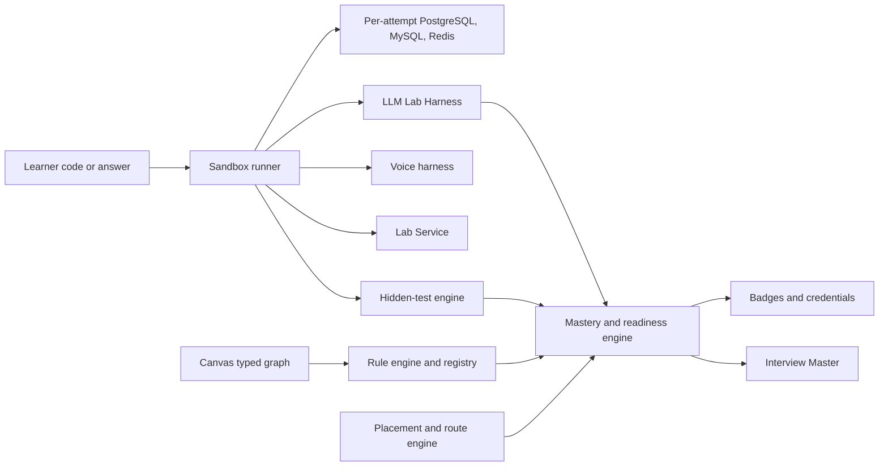

# Platform Capability Requirements

## 1. HOW TO READ THIS DOCUMENT

The boss matrix section 6 lists 25 capabilities (P-01 to P-25, priorities P0 to P2) and 7 engineering spikes (S-1 to S-7). This document **deduplicates and extends** that list: the same capability is stated once (some P-items split into several requirements; some requirements come from syllabus open items that the boss list does not cover). Every boss item maps to at least one requirement (traceability table, section 14).

**Priority definitions**

| Priority | Meaning | Rule used to assign |
|---|---|---|
| **Must for 1.0** | Required to ship the 1.0 curriculum or a 1.0 scope commitment | Blocks a lab, assessment or feature of a course that is MUST on at least one goal route (boss section 4.5), or a scope-document commitment, or a safety/privacy obligation. Boss P0 maps here; boss P1 maps here when a MUST-route course depends on it |
| **Should** | Needed for beta quality, a documented fallback exists | Serves SHOULD or NICE courses only, or has a degraded mode (recorded outputs, static step-through, structured text) that keeps content publishable |
| **Defer to 1.1** | Out of 1.0 | Explicit boss or scope exclusions, or no 1.0 curriculum use |

Release risk R1 (scope too large) already allows B7 and C4 to slip to 1.0.1; requirements used only by those courses are therefore **Should** with the slip noted.

**ID format:** `PCR-nnn`. ADR column: existing ADR-001 to ADR-022 and spikes S1 to S6 come from the register; **NEW** IDs (ADR-023 to ADR-035, S7 to S17; these now also appear as PROPOSED in register sections 2A and 3A) are proposed in section 13.



## 2. SANDBOX CAPABILITIES AND RUNTIMES

| ID | Requirement | Pri | Source courses | Boss ID | ADR / spike | Fallback / notes |
|---|---|---|---|---|---|---|
| PCR-001 | **Python images:** 3.14 default; 3.13 and 3.15 selectable (3.15 selectable only once 3.15.0 final is out, scheduled 2026-10-09; default switches only at 3.15.1 or later with key wheels available); **free-threaded 3.14t selectable for A1.M3 and A2.M1 only** | Must | A1, A2 and every Python lab (A1 to A8, B1 to B4) | P-01 | ADR-005, **ADR-023 NEW** | None; version-difference lessons need 3.13/3.15 images. **Celery compatibility (RUL-09):** Celery 5.6 officially lists CPython 3.9-3.13 only while the default image is 3.14; engineering must either run the A2.M9 and A5.M8 Celery labs (eager, memory broker, Redis) on 3.14 or pin those labs to the selectable 3.13 image with a lab-header note. Blocks M9 and M8 lab authoring only. Python 3.15 only after 3.15.0 final (2026-10-09) and a What's New re-read; default stays 3.14 until the 3.15.1 gate |
| PCR-002 | **One platform pin manifest** (interpreter, NumPy 2.x, pandas, scikit-learn, FastAPI, Pydantic v2, Django 5.2 LTS, Flask 3.x, SQLAlchemy 2.x, psycopg 3/asyncpg, Celery 5.x, pytest 8/9, pytest-asyncio, Hypothesis, mutmut, Locust, respx, time-machine, httpx, tiktoken with offline vocab, small CPU PyTorch) plus **CI that runs every lesson example and every lab reference solution on the pinned images** (template section 5); content references manifest keys only | Must | All | P-01, G-8 | ADR-021, **ADR-023 NEW** | Pins checked `[verify]` at each review (A1 and A4 open items) |
| PCR-003 | **Run limits:** default 10 s wall, 60 s perf/stress, 120 s A8 practical, 2 min B1; 1 to 2 vCPU; 2 GB RAM (4 GB for B1 PyTorch tasks); CPU only, no GPU; at most 4 processes and 64 threads; repeat-run runner (xN) for flakiness; deterministic seeds; hard ceilings in deployment config that the Admin Portal can lower but never raise | Must | All | P-02 | ADR-005, S3 | Per-question overrides within ceilings (Admin spec section 8) |
| PCR-004 | **Isolation:** gVisor or Firecracker-class sandbox, seccomp, cgroups, ephemeral filesystem, no host mounts; unsafe demos (pickle) only inside; abuse logging; execution never inside the API process | Must | All; A1.M10, A8 | P-24 | ADR-005, S3, risk R8 | Escape-attempt test suite is an S3 exit criterion |
| PCR-005 | **Network policy:** no outbound by default; allow-listed internal services; isolated SSRF target; optional AI Gateway egress for live-mode labs; provider keys never visible to learner code | Must | A8, A5.M7, B2 to B6 | P-03 | ADR-005, ADR-012 | |
| PCR-006 | **Hidden-test engine:** test categories (empty, large, duplicates, edge), per-category catch rate; display policy per mode (R-C3-4: Interview mode shows only visible results during the session and aggregate hidden pass/fail with category labels after submission, never inputs or outputs); **complexity-aware large-case timeouts via operation-count proxies plus calibrated multipliers**, memory reading; strict from-scratch import allow-list per task and an importable-library list shown in the IDE; think-aloud recorder; process log (run, edit, test, hint events); hint ledger | Must | A3, C3, every coding task | P-15 | **ADR-026 NEW**, **S11 NEW** (boss S-5) | Calibration of op-count multipliers on sandbox hardware is an engineering measurement `[verify]` (A3) |
| PCR-007 | **Multi-file project workspace** (at most 1 MB) with pytest runner and README rubric-review hook (take-homes, A5 and A8 practicals) | Should | C3.M9, A5, A8 | P-16 | ADR-005 | Single-file tasks plus pasted-module artefacts |
| PCR-008 | **Coverage and mutation runners** (changed-file scope), Hypothesis reproducibility (seed capture) | Should | A8.M5 | P-17 | ADR-005 | Precomputed reports |
| PCR-009 | **Notebook-style cell runner** with SVG plots and precomputed-output fallback | Should | B1 | P-18 | ADR-002, ADR-005 | Scripts in the IDE with static outputs |
| PCR-010 | **Time-control utilities** (fake clock) and deterministic stress runner | Must | A2 (MUST all goals), A8 | P-14 | ADR-005 | |
| PCR-011 | **Celery in eager and in-memory-broker modes; RQ with Redis**; no RabbitMQ, Kafka or SQS live | Must | A2.M9, A5.M8 | P-13 | ADR-005, PCR-001 compatibility check | AWS queue semantics via emulator or design only. **RUL-09:** verify Celery 5.6 (CPython 3.9-3.13 officially) on the 3.14 default image, or pin the labs to the 3.13 image with a lab header note. A5.M8.3 is only a 20-minute API-side pointer to A2.M9 (RUL-10, no lab); worker semantics are A2.M9-owned (O-15) |
| PCR-012 | **Crash-injection API** (kill-and-resume) with SQLite/Postgres state-machine support for durability labs | Must | B4.M7, A2.M9 | P-12 | ADR-005, **ADR-024 NEW** (as part of harness) | B4.M7 degrades to design-only if slipped (B4 is MUST for AI and hybrid, so Must) |
| PCR-013 | **HTTP fault-injection and request-replay harness** (drops, duplicates, delays), webhook receiver, **mocked OIDC token issuer with JWKS** (claims, expiry, key-rotation and replay-with-modified-claims controls) | Must | A5 (M4, M6, M8), A8.M7 | P-09 | ADR-005 | No full IdP in 1.0 (R-A5-4) |
| PCR-014 | **Lab Service:** intentionally vulnerable and slow API plus SSRF target, network-isolated, ephemeral, exploit-style hidden tests; **legal and security review first** | Should | A8, A5.M7, A7 | P-10 | ADR-005, **S12 NEW** (boss S-6) | Stays **Should** (RUL-09); `lab_service.enabled` Off until S-6 (S12) passes. A8 fallback: code-review and static-analysis tasks on vulnerable snippets (A8.M7 labs and timed practical are written around this fallback) |
| PCR-015 | **Cloud/devops simulators:** Dockerfile linter and image-size analyser (no daemon), Kubernetes manifest validator with scripted `kubectl` step-through, Terraform static plan analysis or mocked provider, CI YAML linters, IAM policy evaluator, AWS emulator (moto-style preferred), in-process OTel collector and Prometheus-style metrics evaluator; each lesson states what the emulator does not model | Should | A7 (SHOULD for Backend and Hybrid, NICE for AI) | P-11 | **S7 NEW** (boss S-1), **S13 NEW** (boss S-7), **ADR-035 NEW** | Step-through simulators with recorded outputs |
| PCR-016 | **Explicit exclusions for 1.0:** no GPU, no live replication or multi-node databases, no live Kubernetes or Docker daemon or cloud, no RabbitMQ/Kafka/SQS live, no full identity provider, no real WebRTC or telephony, no bring-your-own API keys | Defer to 1.1 | A4.M7/M9, A7, B6, B7 | G (boss rulings) | ADR-005 | Optional GPU notebooks in 1.1 (R-B7-1) |
| PCR-017 | **JavaScript/Node and other runtimes** listed in the Admin spec section 8 | Defer to 1.1 | none in 1.0 curriculum | n/a | ADR-005 | Register the adapter slot but do not enable |

## 3. DATABASE ENGINES AND DIALECTS

| ID | Requirement | Pri | Source courses | Boss ID | ADR / spike | Notes |
|---|---|---|---|---|---|---|
| PCR-020 | **Per-attempt disposable PostgreSQL 18.x** created from templates in under 5 s; `pgvector` 0.8.2 or later; `pg_stat_statements` enabled; extension allow-list; BM25 via pure-Python library or Postgres full-text (OpenSearch is design-only) | Must | A2, A4, A5, A8, B3 | P-04 | ADR-005, ADR-003, **ADR-033 NEW**, S5 | PG17 differences noted in content; PG19 only after GA and review |
| PCR-021 | **Per-attempt MySQL 8.4 LTS** (9.x innovation notes only; add a 9.7 image only after LTS status and driver support are verified) | Must | A4, C3.M7 | P-04 | ADR-005, ADR-033 NEW | MySQL 8.0 flagged as legacy |
| PCR-022 | **Per-attempt Redis-compatible store** (Redis or Valkey; content says "Redis-compatible") | Must | A2, A5.M5 | P-04 | ADR-005 | Licence note is vendor-risk only |
| PCR-023 | **Two-session database mode:** two connections side by side, scripted interleaving with step control, lock-wait and deadlock visualisation, for PostgreSQL and MySQL | Must | A4.M5 to M6 (MUST Backend and Hybrid), A2 `SKIP LOCKED` lab | P-05 | **S8 NEW** (boss S-2), **ADR-033 NEW** | Mandatory in 1.0 (R-A4-3); no live replication |
| PCR-024 | **SQL IDE:** dialect-aware validation and hidden tests per dialect; plan viewer parsing PostgreSQL `EXPLAIN` / `EXPLAIN ANALYZE` and MySQL `EXPLAIN` / `EXPLAIN ANALYZE` / `FORMAT=TREE` to a common diagram; **limited-privilege role** allowing `VACUUM`, `ANALYZE`, `pg_locks`, `pg_stat_*`, `performance_schema` reads; file, program and extension functions blocked per dialect | Must | A4, C3.M7 | P-06 | ADR-005, **ADR-033 NEW** | Admin spec section 8.1 adopted, with PG 18 and MySQL 8.4 pinned instead of "16+" |
| PCR-025 | **SQL dataset manager:** versioned schemas and seed data, hidden dataset variants, auto-generated ER diagram, sizes, import from SQL/CSV; permission profiles (SELECT, DML, DDL, transactions, two-session) | Must | A4, C3.M7 | P-06 | ADR-013, ADR-033 NEW | |
| PCR-026 | **Guided step-through simulators with recorded outputs** for replication lag, PITR/backup restore, vacuum/bloat/wraparound (single-node demos with the limited role), plan evolution | Must | A4.M7, M9 | R-A4-3 | **ADR-034 NEW** (interactive visual pipeline) | A single-node base-backup-and-restore lab is optional |

## 4. LLM LAB HARNESS, FIXTURES AND AI GATEWAY USE

| ID | Requirement | Pri | Source courses | Boss ID | ADR / spike | Fallback / notes |
|---|---|---|---|---|---|---|
| PCR-030 | **LLM Lab Harness core:** record/replay fixtures plus a **deterministic scripted mock model** (scripted tool calls, refusals, injected-instruction compliance, streaming chunks, 429/5xx/timeout faults, token and latency simulation, reasoning-state round-trip so M2/M5 labs and B4 loops work) | Must | B2 to B6, A6.M8 labs | P-07 | **ADR-024 NEW**, **S9 NEW** (boss S-3), ADR-012 | Graded tasks use recorded mode only (R-B2-4, R-B5-4) |
| PCR-031 | **`LLMClient` protocol adapter** (messages-style and responses-style shapes behind one interface; no heavy abstraction library) used by all code in B2 to B7 | Must | B2 to B7 | P-07, R-B2-1 | ADR-024 NEW | A comparison sidebar names LiteLLM-style libraries |
| PCR-032 | **Fake embeddings and reranker**; **frozen embedding fixture mode as default** plus a small pinned CPU embedding model | Must | B3 (M3 to M5), B1.M8 | P-07, R-B3-3 | ADR-024 NEW, S5 | |
| PCR-033 | **Token counting:** `count_tokens` fixtures (including media-token calculators for B2.M6), tokeniser vocabularies bundled offline; **redistribution licence for the vocab files is unconfirmed** | Must | B1, B2 | P-01 | S9 NEW (licence check in exit criteria) | Fallback: toy-BPE-only lab plus learner-pasted counts (B1 open item) |
| PCR-034 | **Budget meter** (token and cost simulation) and cost-estimation template (X3) shared by B2.M9 and A7.M10 | Must | B2, B3, B6, A7 | P-07, G-13 | ADR-024 NEW, ADR-018 | |
| PCR-035 | **Shared fixture repository:** versioned, contributed by B2 to B6, contract-tested in CI, orientation lesson X5 (B5.M1) | Must | B2 to B6 | P-07, P-21 | ADR-024 NEW | |
| PCR-036 | **Provider Notes and dated price/limits data file** with a named owner and a quarterly update slot; tier language in lessons, model names only in dated sidebars | Must | B2 (X4), B3 to B7, A6 | P-21, G-8, G-12 | **ADR-028 NEW** | B2 open item 2 |
| PCR-037 | **Live mode through the AI Gateway:** per-learner budgets and caps, optional, **never gates a badge**; no bring-your-own keys | Should | B2 to B6 | P-23 | ADR-012, ADR-018 | Recorded mode is graded |
| PCR-038 | **Calibration set store** and labeller workflow: B5 CAL-1 to CAL-3 (60 to 100 items each), the 30-design labelled set (A6), at least 30 SME-labelled transcripts for claim risk (C2), 50 SME-labelled answers (S4) | Must | B5, A6, C2, Interview Master | P-21, P-25 | ADR-008, ADR-022, S4 | Named human labellers needed (B5 and A6 open items) |
| PCR-039 | **Fine-tuning dry-run API** in the harness (create job, poll, evaluate) with provider-shaped fixtures; recorded training logs | Should | B7.M3, M5 | R-B7-4 | ADR-024 NEW | B7 may slip to 1.0.1 (R1) |

## 5. VOICE HARNESS AND SPEECH FIXTURES

| ID | Requirement | Pri | Source courses | Boss ID | ADR / spike | Notes |
|---|---|---|---|---|---|---|
| PCR-040 | **Voice harness:** fake streaming STT, TTS and LLM with configurable latency and seeded jitter, **per-hop timestamps** (needed to make the B6 latency workbook reproducible), audio fixtures, asyncio WebSocket server skeleton, metrics collector; no real WebRTC or telephony in 1.0 | Should | B6, A6 design #17 | P-08 | **ADR-025 NEW**, S1, S2 | Fallback: calculators and recorded traces |
| PCR-041 | **Indian-English technical speech fixture set** (consent-cleared speakers or synthetic speech; at least 100 utterances across accents with FastAPI, asyncio, pgvector, Kubernetes, idempotency and similar terms; reuse licence for B6 labs; **no learner audio**) | Must | B6, Interview Master | boss S-4 | **S10 NEW**, S1 | Shared with the bake-off, scoring calibration and CI STT regression |
| PCR-042 | **Voice scoring inputs:** delivery metrics only (pace, fillers, answer length and structure); **no emotion, personality or confidence inference**; hotword vocabulary for coding and AI terms; transcript edit before scoring | Must | C1, C3, Interview Master | P-22 | ADR-006, ADR-008 | |
| PCR-043 | **Voice test scenarios in CI:** barge-in during TTS, reconnect and resume at last question, text fallback when latency budget is breached, STT WER and term-accuracy regression on the fixture set | Must | Interview Master, B6 | scope 4.2 | ADR-022, S2 | Gates M3 exit |

## 6. CANVAS: TYPED GRAPH, RULE REGISTRY AND EVALUATION

| ID | Requirement | Pri | Source courses | Boss ID | ADR / spike | Notes |
|---|---|---|---|---|---|---|
| PCR-050 | **Canvas vocabulary v0.1+** with typed-graph export (node types and edge attributes in section 9.1); vocabulary is semver-versioned and every saved graph records its vocabulary version | Must | A6, C2.M8, capstones in A2, A5, A7, B3, B4, B5, B6 | P-19, boss section 7 | ADR-010, **ADR-029 NEW**, S2b | Canvas spec must mirror A6 sections 1.1 and 1.3 before visuals are authored (A6 open item 1) |
| PCR-051 | **Accessible structured-text mode** that round-trips to the same typed graph | Must | A6 and all canvas tasks | P-19 | ADR-010, S2b | Also the phone-width fallback |
| PCR-052 | **Estimation calculator panel** (QPS, storage, bandwidth, cost; thresholds feed rules such as R-CACHE-1) | Must | A6.M1 and canvas tasks | P-19 | ADR-010 | |
| PCR-053 | **Rule-engine registry hosting:** stable permanent IDs `R-<AREA>-<n>`, 39 rules (33 base plus 6 amendments), severities (C, M, m) re-weightable in admin, **mandatory "stated non-goal" suppression**, deprecation without reuse, owner A6, each rule with a good and a weak example graph (78 test graphs), evidence links to nodes/edges; other courses cite registry IDs only | Must | A6 (owner), B3.M10, B4.M9, B6, A2/A5/A7 capstones | P-19 | ADR-011, **ADR-029 NEW**, **S17 NEW** | Schema in section 9.2 |
| PCR-054 | **Probing-delta versioning:** graph version history, interactive probes using the graph as context, scored deltas, undo | Must | A6.M10 | P-19, scope 4A.1 | ADR-011 | |
| PCR-055 | **Free-form "my architecture" mode** on the same vocabulary with graph export; **diagram-vs-story consistency hook** (rubric-based, rubric owner C2; not a deterministic rule) | Must | C2.M8 | P-19, R-C2-3 | ADR-010, ADR-011 | If the date slips, C2.M8 uses structured-text diagram entry |
| PCR-056 | **Overlay-to-reference** and admin-managed **design library** with decision cards, estimation sheets, rule expectations and probing trees: 20 designs for closed beta, 26 for public 1.0 | Must | A6 | P-19, R-A6-3 | ADR-014, ADR-013 | Scope doc says 25+; 26 meets it |
| PCR-057 | **Design evaluation pipeline:** deterministic rule findings first, LLM rubric (D1 to D11) second, evidence-linked report; **numeric canvas score hidden behind a calibration-gated flag** until agreement with SME scoring is met (30-design set, two independent scorers) | Must | A6, Interview Master | scope 4A.1 | ADR-011, ADR-008, ADR-032 NEW | Rubric D12 is not added (boss section 7) |

## 7. CONTENT PLATFORM

| ID | Requirement | Pri | Source courses | Boss ID | ADR / spike | Notes |
|---|---|---|---|---|---|---|
| PCR-060 | **Curriculum importer** (JSON and CSV per Content_Data_Model_and_Import_Schema.md): validation V-001 to V-030, mapping preview, dry-run impact report, per-batch rollback, resumable, chunked per course | Must | All | P-21 | ADR-013, **ADR-028 NEW**, **S15 NEW** | Admin spec section 5.3 |
| PCR-061 | **Lesson model** with Simpler/Deeper variants, L1 to L4 level map, pointer/preview/shared kinds, **cross-course reuse by stable ID** (X1 to X6) | Must | All; G-13 | P-21 | ADR-013 | ADR-013 covers course/module/lesson only |
| PCR-062 | **Competency tag registry:** owner course issues credit, secondary tags carry none, aliases and deprecation | Must | All | P-21, G-9 | ADR-014, ADR-028 NEW | |
| PCR-063 | **Question IDs with owner and `ref` items**, ownership and pointer integrity checks (a pointer lesson has at most one `ref` item) | Must | All | P-21, G-1, G-10 | ADR-014, ADR-028 NEW | |
| PCR-064 | **Placement item bank:** eligibility flag, diagnostic slot, parallel forms A/B, must-know slots | Must | All | P-21 | **ADR-027 NEW** | Blueprint section 2. Eligible types (RUL-07): MCQ, multi-select, code-output, quantitative and the Track C MCQ-form items (identify-the-flaw, classify-the-level, spot-the-weakness, predict-the-outcome) |
| PCR-065 | **"Last reviewed" stamps, review-due alerts** (3/6/12 months), version baselines, dated Provider Notes sidebars | Must | All; B-track especially | P-21, G-12 | ADR-013 (partial), ADR-028 NEW | Risk R10 |
| PCR-066 | **Rubric registry** with versions, dimensions, anchors, pass rules and calibration tooling | Must | All interview-scored content | P-21, P-25 | ADR-008, ADR-022 | |
| PCR-067 | **Visual pipeline:** Mermaid rendered to SVG at publish with alt text and text equivalent; **step-through and interactive visuals** (hash-table probe animation, lock timelines, latency waterfalls, plan evolution) | Must (static) / Should (interactive) | All; A1, A4, B6 | template, LF-7 | ADR-013, **ADR-034 NEW**, **S16 NEW** | Fallback: image sequences |
| PCR-068 | **Curriculum release snapshots** and learner-progress migration maps (merge, split, replace; grandfathering) | Must | All | Admin section 11 | ADR-013, ADR-028 NEW | |
| PCR-069 | **Gated publication:** content flagged `gated` needs a human professional review before approval (C4 M5 to M9; B5.M5 and M9 legal reads; B6.M7 lesson 7.5 TRAI read); **calibration-gated feature flags** (numeric claim-risk band, numeric design score) | Must | C4, B5, B6, C2, A6 | R-C4-3, R-C2-4 | **ADR-032 NEW** | Counsel and compensation/tax reviewers must be named |
| PCR-070 | **Coverage ledger:** targets versus authored versus published per module and course; question-type counts; volume dashboard (feeds M5 exit criteria) | Should | All | n/a | ADR-013 | Content volumes in the schema document section 11 |
| PCR-071 | **Hint policy** per mode (Learn, Practice, Interview, Challenge, Review) and hint ledger feeding scoring | Must | All coding; C3 | P-15 | ADR-026 NEW | Admin spec section 7 |

## 8. LEARNER ENGINES AND INTERVIEW MASTER INTEGRATION

| ID | Requirement | Pri | Source courses | Boss ID | ADR / spike | Notes |
|---|---|---|---|---|---|---|
| PCR-080 | **Placement engine:** v1 rule-based MCQ-only for M2, v2 with DSA micro-problems, canvas micro-design and spoken answer for M5; Bayesian-style module estimates, bands, parallel forms, resumable sittings | Must | All; A3, A6, C1, C3 | R-A3-5, R-C3-1 | **ADR-027 NEW**, ADR-009, **S14 NEW** | Placement_Test_Blueprint.md |
| PCR-081 | **Route generator:** goal-weighted course budgets, band hours, dependency DAG, remediation inserts, shared-lesson de-duplication, time fit, last-minute hand-off, CI reconciliation against 210/215/250 h | Must | All | boss sections 4 to 5 | ADR-027 NEW, ADR-009 | |
| PCR-082 | **Mastery and revision loop:** module mastery check 80 percent, revision loop on misses, remediation flags, spaced retake at least 7 days | Must | All | G-6, G-7 | ADR-009, **ADR-031 NEW** | Admin spec default thresholds (60/85) must be set to 80/85 |
| PCR-083 | **Readiness engine** per topic tag (mastery retake, timed task, two strict-mode voice sessions at least 48 hours apart at Senior bar, no open remediation) rolled up per role target | Must | All; Interview Master | G-6 | ADR-031 NEW, ADR-009 | |
| PCR-084 | **Credential evaluation:** module and course badges from evidence (mastery, hidden tests, voice mock at Meets, canvas rubric), publish blocked until criteria exist | Must | All | scope 5.1, Master Spec 9B | ADR-031 NEW, ADR-016 | |
| PCR-085 | **Profile Facts Ledger:** profile-level confirmed claims (roles, dates, team sizes, metrics, projects), consent, deletion, export; **pay-data store** opt-in, encrypted, session-scoped by default, never used for training, aggregate-only for admins | Must | C1, C2, C4, Interview Master | P-20 | ADR-019, **ADR-030 NEW** | Counsel review |
| PCR-086 | **Interview Master hooks:** seed bank mapping, strict mode vs coaching mode, result/ownership L2 cap in strict mode (admin-configurable, R-C1-2), qualitative-only claim-risk feedback until calibrated, "asked because" explanations, hint ledger, JD analyser output (required/nice/absent skills) feeding placement weights | Must | C1 to C4, A7 | P-20, P-22, R-C1-2 | ADR-008, ADR-009, ADR-022 | JD output format is an A7 open item |
| PCR-087 | **Structured compensation worksheet** (in-app, learner formulas, no statutory or tax engine) and pipeline-report UI for C4 timing flags | Should | C4.M6 to M8 | R-C4-1 | ADR-032 NEW | C4 may slip to 1.0.1; tax engine deferred |
| PCR-088 | **Statutory/tax engine and mobile or LinkedIn features** | Defer to 1.1 | C4 | R-C4-1 | n/a | Needs maintained rules source and legal review |

## 9. CANVAS SPECIFICATION DETAILS

### 9.1 Typed-graph vocabulary v0.1+ (mirrors A6 sections 1.1 and 7; A6 owns semantics, the canvas implements)

| Node type | Key attributes |
|---|---|
| `client` | kind (web, mobile, IoT device, partner), expected QPS |
| `edge` | kind (CDN, DNS, WAF, load balancer L4/L7), multi-AZ flag |
| `gateway` | auth mode, rate limit, routing |
| `service` | stateless/stateful, replicas, autoscaling, sync/async, kind (service, worker, scheduler, agent, stream-processor) |
| `datastore` | engine class (relational, KV, document, wide-column, search, graph, time-series, vector), replication, shard key, consistency, backup, tenant-scoped, pii, data-class (public, internal, restricted) |
| `cache` | scope (client, CDN, app-local, distributed), policy, TTL, eviction, tenant-scoped |
| `queue` | kind (queue, log/stream), partitions, ordering key, DLQ flag, retention, delivery, tenant-scoped |
| `objectstore` | durability, lifecycle, versioning |
| `external` | third-party kind (including `mcp-server`), SLA, timeout, circuit-breaker flag |
| `observability` | logs, metrics, traces, alerts |
| `identity` | AuthN/AuthZ provider, token type |
| `ai` | kind (embedding model, LLM, reranker, STT, TTS, vector index), batch/stream, tools (each with side-effect flag), step-budget |
| `boundary` | AZ, region, VPC, tenant cell |

Edge attributes: protocol (HTTP/REST, gRPC, WebSocket, SSE, MQTT, AMQP, Kafka protocol, SQL, internal RPC), mode (sync, async publish, async consume, replicate, cache read, cache fill), idempotent, delivery, ordering-key, `timeout-ms`, `retry-budget`, `human-approval`, retry policy, authenticated, TLS, payload size/rate, `region` for network edges.

Sketch of a serialised graph (illustrative):

```json
{
  "vocabulary": "0.1.1",
  "nodes": [
    { "id": "n1", "type": "client", "attrs": { "kind": "web", "qps": 2000 } },
    { "id": "n2", "type": "gateway", "attrs": { "auth": "oidc", "rate_limit": "100/min" } },
    { "id": "n3", "type": "service", "attrs": { "kind": "service", "replicas": 3, "stateless": true } },
    { "id": "n4", "type": "datastore", "attrs": { "engine_class": "relational", "replication": "primary-replica", "backup": true } }
  ],
  "edges": [
    { "from": "n1", "to": "n2", "protocol": "HTTP/REST", "mode": "sync", "tls": true },
    { "from": "n2", "to": "n3", "protocol": "HTTP/REST", "mode": "sync", "authenticated": true, "timeout_ms": 800 },
    { "from": "n3", "to": "n4", "protocol": "SQL", "mode": "sync" }
  ],
  "annotations": [
    { "target": "n4", "kind": "stated_non_goal", "rule_ids": ["R-SPOF-3"], "text": "Single-AZ accepted for an internal tool" }
  ]
}
```

### 9.2 Rule registry entry (data model hosted in the platform, owned by A6)

```json
{
  "id": "R-IDEMP-1",
  "area": "idempotency",
  "title": "Retried edge into a non-idempotent state-changing consumer",
  "severity": "C",
  "status": "active",
  "owner_course": "A6",
  "predicate": { "kind": "graph-pattern", "ref": "rules/R-IDEMP-1.pattern.json" },
  "params": {},
  "suppressible_by": ["stated_non_goal"],
  "message": "Edge {edge} retries into {node} which is not idempotent.",
  "fix_hint": "Add an idempotency key and a de-duplication store.",
  "good_graph_id": "TG-R-IDEMP-1-GOOD",
  "weak_graph_id": "TG-R-IDEMP-1-WEAK",
  "since_vocabulary": "0.1.0"
}
```

Rule lifecycle: IDs never renumbered or reused; retired rules become `deprecated`; severity weights are re-weightable in the Admin Portal; thresholds that depend on the learner's stated numbers (for example R-CACHE-1 read QPS) read the calculator panel; every rule ships with its two test graphs, and the 78 graphs run in CI as the rule-engine regression suite.

## 10. FIXTURE STRATEGIES

| Fixture family | Used by | Determinism strategy | Storage and versioning | Ownership and licensing |
|---|---|---|---|---|
| LLM recordings and scripted mock turns | B2 to B7, A6.M8 | Recorded responses keyed by (prompt hash, fixture version); scripted model for fault cases; seeds fixed | Fixture repository, semver per fixture set, contract tests in CI | Platform engineering; provider terms checked before recording |
| Embeddings and reranker scores | B3, B1.M8 | Frozen vectors per corpus version; pinned CPU model only for the optional live-embed lab | Versioned artefacts next to datasets | Original or permissively licensed corpora only |
| SQL datasets (schemas, seed data, hidden variants) | A4, C3.M7, A2, A5 | Seeded generators; hidden variants differ in shape and values | Dataset manager, semver | Content lead; no real customer data |
| HTTP replay, webhooks, OIDC/JWKS issuer | A5, A8 | Scripted sequences; fixed keys; clock injected | Test-harness repo | Platform |
| Audio fixtures (Indian-English technical speech) | B6, bake-off, CI STT regression | Fixed files and transcripts; WER computed offline | Object store with manifest | Consent-cleared or synthetic speakers only; reuse licence; no learner audio |
| Fake streaming STT/TTS/LLM scripts | B6, Interview Master tests | Seeded jitter, per-hop timestamps | Harness config | Platform |
| Canvas test graphs (78) and reference designs (20 to 26) | A6, rule engine CI, probing | Static JSON | Registry repo | A6 SME |
| Cloud/devops corpora (Dockerfiles, manifests, Terraform, IAM, CI YAML) | A7 | Static validators; emulator state seeded | Fixtures repo | SME; scrubbed of real accounts |
| Recorded training logs and tuned-model outputs | B7 | Static logs; CPU-only tiny models | Versioned | SME |
| Notebook outputs | B1 | Precomputed cell outputs as fallback | With notebook version | SME |
| Calibration sets (CAL-1 to CAL-3, 30 designs, 30 transcripts, 50 answers) | B5, A6, C2, S4 | Labelled once by two independent scorers | Calibration store, immutable versions | Content lead and SME panel; synthetic or consented; no real user data |
| Provider Notes and price/limits data | B2 and others | Dated files, not code | Data files with owner and quarterly slot | B2 owner |
| Lab Service snapshots | A8, A5.M7, A7 | Ephemeral container per attempt | Image per version | Security reviewed |

## 11. EVALUATION HARNESS (ADR-022 EXPANSION)

| Evaluation | Labelled set | Metric and gate | Needed by |
|---|---|---|---|
| STT accuracy | at least 100 utterances (S1) | WER and technical-term accuracy; regression gate in CI | M3 |
| Interview scoring agreement | at least 50 SME-labelled answers across A, B, C (S4) | Agreement target set with SMEs; run-to-run variance | M2 begun, M4 gate |
| Claim-risk scoring (C2) | at least 30 SME-labelled transcripts | Agreement within one band on at least 80 percent `[judgement]`; band flag enabled only afterwards | M4 |
| Canvas evaluation | 30 labelled designs, two scorers | Agreement within the agreed tolerance; rule-engine suite on 78 graphs | M4 |
| Adaptive coverage | synthetic learner profiles | Must-cover competencies reached; no repeats across mock cycles | M4 |
| Placement versus mastery | pilot learners (3, then 30+) | Skip bands pass the check first time at least 80 percent `[judgement]` | M5 |
| Hidden-test calibration | reference solutions at several complexities | Op-count multipliers separate O(n log n) from O(n^2) on sandbox hardware | M2 |
| Retrieval and tutor quality | labelled query set | Recall@k, latency (S5) | M4 |
| Content examples | every lesson example and lab solution | Pass on pinned images in CI | continuous |

All prompt, rubric and model versions used in a score are stored with the score; human-review sampling is routed through the Admin Portal.

## 12. FEATURE FLAGS, ANALYTICS EVENTS AND ADMIN SCREENS

### 12.1 Feature flags required by the curriculum (extends ADR-016 and ADR-021)

| Flag | Purpose | Default | Source |
|---|---|---|---|
| `scoring.numeric_claim_risk_band` | Show a numeric claim-risk band | Off until calibration (R-C2-4) | C2 |
| `design.numeric_score` | Show a numeric canvas score | Off until calibration | A6 |
| `content.gated_publish` | Hold C4 M5 to M9 and legal-read lessons until human sign-off | On | C4, B5, B6 |
| `sandbox.python_3_15_selectable` | Expose the 3.15 image | Off until 3.15.0 final and review | A1 |
| `sandbox.python_free_threaded` | Expose 3.14t for A1.M3 and A2.M1 only | On for those modules | A1, A2 |
| `sandbox.mysql_9_7_image` | Add a 9.7 image | Off until LTS and driver check | A4 |
| `labs.live_mode_gateway` | Optional live LLM/voice labs via the gateway | Off in closed beta | B2 to B6 |
| `strict_mode.result_cap` | Cap result/ownership dimension at L2 when no result is stated | On in strict mode | C1 |
| `canvas.freeform_mode` | "My architecture" mode | On at closed beta | C2 |
| `canvas.structured_text_mode` | Accessible mode | On | A6 |
| `placement.performance_tasks` | DSA micro-problems, canvas micro-design, spoken answer in placement | Off for v1, on for v2 | Blueprint |
| `route.last_minute_handoff` | Hand over to last-minute mode when the deadline is short | On | Scope 4A.2 |
| `a6.m8_unlock_rule` | Enforce B2.M1 to M5 plus one of B3/B4/B6 before A6.M8 | On | Boss section 4 |
| `voice.provider_primary` / `voice.provider_fallback` | Provider switch | Set after bake-off | ADR-007 |
| `lab_service.enabled` | Network-isolated vulnerable service | Off until review passes | A8 |
| `interview.company_packs` | Company-style mock mode | Per pack | Scope 4A.3 |
| `adaptive.rule_based_fallback` | Degrade to rule-based selection | On as safety net | Scope 4A.4 |

### 12.2 Analytics events (pseudonymous learner ID; every event carries `curriculum_release`, `entity_id`, `entity_version`, `goal`, `level`)

| Group | Events |
|---|---|
| Learning | `lesson_started`, `lesson_completed` (variant), `level_switched`, `visual_viewed`, `step_through_advanced`, `mastery_check_submitted`, `revision_loop_entered`, `module_completed`, `badge_awarded` |
| Placement and routes | `placement_*` and `route_*` events from Placement_Test_Blueprint.md section 8, plus `route_item_skipped`, `route_deadline_exceeded` |
| Coding and sandbox | `code_run` (runtime, wall ms, memory, outcome), `hidden_tests_reported` (categories only), `hint_requested`, `think_aloud_recorded`, `sandbox_abuse_flag`, `two_session_step` |
| LLM harness | `fixture_replayed`, `live_call_made`, `budget_cap_hit` |
| Canvas | `graph_saved`, `rule_finding_shown`, `finding_disputed`, `probe_answered`, `delta_scored` |
| Interview Master | `session_started` (mode, role), `question_asked` (reason code), `answer_scored` (rubric version), `report_generated`, `readiness_updated`, `pass_requested` |
| Voice | `mic_preflight_result`, `barge_in`, `stt_latency_ms`, `tts_first_audio_ms`, `fallback_to_text`, `reconnect`, `session_resumed` |
| Cost | `cost_per_minute_computed`, `session_budget_hit`, `monthly_budget_alert` |
| Content quality | `item_flagged`, `item_dispute`, `review_due_alert`, `content_published`, `import_completed` |
| Privacy | `consent_granted`, `consent_withdrawn`, `audio_deleted`, `export_requested`, `ledger_item_confirmed` |

Rules: no raw answers, audio, pay data or ledger values in analytics events; identifiers only; retention follows ADR-019.

### 12.3 Admin screens implied by the curriculum (extends Admin spec section 3)

| Screen | Pri | Purpose and source |
|---|---|---|
| **Curriculum Import Centre** (mapping preview, dry-run, rollback) | Must | PCR-060 |
| **Coverage ledger and volume dashboard** | Should | PCR-070 |
| **Tag registry manager** (owner, secondary, aliases, deprecation) | Must | PCR-062 |
| **Ownership and `ref` integrity viewer** | Must | PCR-063 |
| **Rubric registry with versions and calibration tooling** | Must | PCR-066, P-25 |
| **Calibration set store and labeller assignment** | Must | PCR-038 |
| **Canvas vocabulary, palette and rule registry manager** (re-weight severities, deprecate, test graphs) | Must | PCR-050, PCR-053 |
| **Model design and probing-tree editor** | Must | PCR-056 |
| **Pin manifest and runtime image manager** (3.14 default, selectable images, extension allow-lists) | Must | PCR-001, PCR-002 |
| **SQL dataset and permission-profile manager** | Must | PCR-025 |
| **Fixture repository manager** (LLM, voice, cloud corpora) | Must | PCR-035, PCR-041 |
| **Provider Notes and price data editor** (dated, owner) | Must | PCR-036 |
| **Placement configuration and simulator** (bands, factors, priors, forms, must-know slots) | Must | PCR-080 |
| **Route stage-template editor** | Should | PCR-081 |
| **Readiness and badge criteria editors** (publish blocked until set) | Must | PCR-083, PCR-084 |
| **Gated-content review queue** (human professional sign-off) | Must | PCR-069 |
| **Review-due alerts and freshness dashboard** | Must | PCR-065 |
| **Release snapshot and migration-map manager** | Must | PCR-068 |
| **Plan, price book and quota editor** (Free, Trial, Sprint, Pro 90, Pro Annual; versioned, audited) | Must | Billing Lite BL-01 |
| **Trial settings and budget pools** (length, extension rules, trial quotas, pool cap, seat limits, waitlist, kill switch) | Must | Billing Lite section 4 |
| **Coupons and founder-price manager** | Should | BL-08 |
| **Orders, payments, refunds and reconciliation** | Must | BL-04 to BL-10 |
| **Cost per learner and margin dashboard** (cost against plan revenue; 80% alert) | Must | Billing Lite section 6 |
| **Invoice settings** (GST details, number series) | Must | BL-07 |
| **Profile moderation queue, reserved and offensive handle lists, credential revocation, share-image templates, profile analytics** | Must | PP-08, PP-09, PP-11 |
| **Age-risk flag queue and reconfirmation flow** (plausibility rules, admin review of existing account data, suspend, delete, refund; no ID documents anywhere) | Must | EL-10 to EL-13, EL-16 |

### 12.4 Billing Lite, plans and trial (added 2026-10-22)

Release 1.0 includes Billing Lite and a 7-day free trial (extendable to 14). Capability requirements, quotas, limits and acceptance criteria BL-01 to BL-14 are in `../01_Scope/Skillora_Learning_Release_1_0_Billing_Lite_and_Trial_Specification.md`. Platform consequences: entitlement service with plans, quotas and credit ledger (ADR-037); billing adapter with hosted checkout and idempotent webhooks (ADR-036); trial policy and abuse controls (ADR-038); separate paid and trial AI budget pools (ADR-039); GST invoicing and refunds (ADR-040); gateway test mode in dev; spikes S18 and S19. Analytics events (identifiers and amounts only, no payment instrument data): `trial_started`, `trial_extended`, `trial_ended`, `plan_viewed`, `checkout_started`, `order_paid`, `order_failed`, `refund_issued`, `quota_warning`, `quota_exhausted`, `upgrade_clicked`.

### 12.5 Public Profile Lite (added 2026-10-22)

Release 1.0 includes an opt-in public profile with verified badges, per-credential verification pages, share images and embeddable badges. Requirements PP-01 to PP-12: `../01_Scope/Skillora_Learning_Release_1_0_Public_Profile_Lite_Specification.md`. Platform consequences: a single visibility-enforcement layer used by the page, share image, embed and JSON endpoint (ADR-041); edge caching with 5-minute purge; on-demand image generation with caching (S20); moderation queue, reserved-handle and profanity lists, credential revocation in the Admin Portal; analytics events (identifiers only): `profile_enabled`, `profile_viewed`, `profile_shared`, `badge_embedded`, `profile_report_created`, `profile_referral_signup`.
| **Cost per attempt / per course dashboards** | Should | P-25 |
| **Sandbox and execution health per adapter** (queue depth, run time, failure rate, image versions) | Must | Admin spec section 8 |
| **Lab Service console** | Should | PCR-014 |
| **Claim-risk and strict-mode flags** | Should | PCR-086 |

### 12.4 Capacity assumptions to validate in S3 `[judgement]`

Closed beta of 20 to 50 learners; peak 20 concurrent sandbox runs; Python run start-up target set by S3; database template start-up under 5 s; repeat-run (xN) tasks run at 5 repetitions; cost per run recorded per attempt and reported per course.

## 13. GAPS AGAINST THE ADR REGISTER AND PROPOSED ADR AND SPIKE ENTRIES

### 13.1 Gap table (curriculum assumes, register does not cover)

| # | Curriculum assumption | Register status | Proposed entry |
|---|---|---|---|
| 1 | One runtime catalogue with pinned images, a platform pin manifest and CI that executes every lesson example (template section 5, G-8) | ADR-005 covers isolation only; ADR-021 covers environments | **ADR-023** |
| 2 | LLM Lab Harness and `LLMClient` contract shared by B2 to B7 | ADR-012 is the production gateway; ADR-022 is eval strategy; nothing for lab fixtures | **ADR-024**, **S9** |
| 3 | Voice harness and speech fixtures for labs and CI | ADR-006/007 and S1/S2 cover the product pipeline, not the lab harness | **ADR-025**, **S10** |
| 4 | Hidden-test engine with categories, op-count proxies, import allow-lists, hint ledger, process log | Not covered | **ADR-026**, **S11** |
| 5 | Placement and route engine (bands, algorithm, parallel forms, reconciliation to boss hours) | ADR-009 is the interview adaptive engine (Month 6); placement is needed at M2 | **ADR-027**, **S14** |
| 6 | Curriculum import, ID/tag registry, ownership and `ref` enforcement, dated data files, release snapshots | ADR-013/014 give a content model but not cross-course reuse, `ref` items, release snapshots or import | **ADR-028**, **S15** |
| 7 | Canvas vocabulary versioning and governed rule registry (39 rules, suppression, deprecation) as a separate contract | ADR-010/011 choose the engine and evaluator, not the registry contract | **ADR-029**, **S17** |
| 8 | Profile Facts Ledger and sensitive pay data | ADR-019 covers audio and transcripts only | **ADR-030** |
| 9 | Mastery, readiness (G-6) and credential evaluation engine | ADR-009 covers interview estimates; Credentials spec exists but no ADR | **ADR-031** |
| 10 | Human-professional publication gates and calibration-gated feature release | Not covered (R-C4-3, R-C2-4) | **ADR-032** |
| 11 | Two-session database labs, limited-privilege roles, dialect plan viewer, engine images | ADR-005 mentions per-attempt databases only | **ADR-033**, **S8** |
| 12 | Interactive visuals (step-throughs, animations) | ADR-013 pre-renders diagrams to SVG only | **ADR-034**, **S16** |
| 13 | Cloud/devops emulation or static simulators (A7) | Not covered | **ADR-035**, **S7**, **S13** |
| 14 | Lab Service legal and security review | Risk R8 only | **S12** |
| 15 | `artefact` question type, structured compensation worksheet | Not in Admin question model | Admin spec update (section 13.3) |

### 13.2 Proposed new ADRs

| ID | Decision | Default (recommended) | Evidence | Needed by |
|---|---|---|---|---|
| ADR-023 | Runtime catalogue, image pin manifest and example CI | One manifest file; images per interpreter; content references keys; CI executes every example | None | Month 1 |
| ADR-024 | LLM Lab Harness architecture and `LLMClient` contract | In-house thin protocol, record/replay plus scripted mock, shared fixture repo | S9 | Month 3 |
| ADR-025 | Voice Lab Harness and speech fixture policy | Fake streaming STT/TTS/LLM with seeded jitter; consent-cleared or synthetic audio | S10, S1 | Month 4 |
| ADR-026 | Hidden-test engine and complexity-aware grading | Op-count proxies plus calibrated multipliers; categories; display policy per mode | S11 | Month 3 |
| ADR-027 | Placement and route engine | Rule-based v1 (M2), Bayesian module estimates v2 (M5), config in Admin, reconciliation tests in CI | S14 | Month 4 |
| ADR-028 | Curriculum import, registries and release snapshots | JSON/CSV bundle per this schema; tags, IDs, `ref` enforcement; dated data files | S15 | Month 2 |
| ADR-029 | Canvas vocabulary and rule registry contract | Semver vocabulary; rules as data with test graphs; A6 owns semantics | S17, S2b | Month 3 |
| ADR-030 | Profile Facts Ledger and sensitive learner data | Learner-controlled ledger; pay data encrypted, session-scoped by default | Counsel review | Month 3 |
| ADR-031 | Mastery, readiness and credential engine | G-6 and G-7 as configuration; evidence-based badges | None | Month 4 |
| ADR-032 | Publication gates and calibration-gated flags | Professional-review state plus flags tied to calibration metrics | None | Month 3 |
| ADR-033 | Database lab engines, two-session mode and SQL IDE | Template-based per-attempt PG 18 and MySQL 8.4; limited roles; common plan view | S8 | Month 2 |
| ADR-034 | Interactive visual pipeline | Declarative step-through spec rendered by a small component set; static fallback | S16 | Month 4 |
| ADR-035 | Cloud/devops lab approach | Static validators plus moto-style emulator; no live cloud | S7, S13 | Month 5 |

### 13.3 Proposed new spikes (continue the register numbering; boss S-1 to S-7 are renamed to avoid a clash with S1 to S6)

| ID | Spike | Time-box | Exit criteria | Maps to |
|---|---|---|---|---|
| S7 | AWS emulation: moto-style versus LocalStack | 1 week | Feature and licence matrix; default chosen before A7.M4 and M5 labs are authored | boss S-1 |
| S8 | Two-session database mode and lock visualisation | 2 weeks | Scripted interleaving for PG and MySQL, deadlock and lock-wait views, cost per session | boss S-2 |
| S9 | LLM Lab Harness build and token-vocab licence check | 2 weeks | Record/replay, scripted mock with faults and streaming, reasoning-state round trip, B2 labs running; tokeniser redistribution answer | boss S-3 |
| S10 | Indian-English technical speech fixture set | 1 week (alongside S1) | At least 100 utterances, consent and licence documented, shared with S1 | boss S-4 |
| S11 | Hidden-test engine: categories, op-count proxies, import allow-lists | 2 weeks | O(n log n) versus O(n^2) separated on sandbox hardware; category catch rates; allow-list enforced | boss S-5 |
| S12 | Lab Service legal and security review | 1 week | Go or no-go; fallback tasks defined | boss S-6 |
| S13 | Static validators for Kubernetes, Terraform, IAM, CI YAML | 2 weeks | Validators run against fixtures; known-bad corpus detected | boss S-7 |
| S14 | Placement calibration and route reconciliation | 2 weeks after pilot | Prior strength, weights and thresholds fixed; all-study routes within 10 percent of 210/215/250 h; time boxes measured | new |
| S15 | Curriculum import dry-run | 1 week | All 19 syllabi parse to the bundle; ID and tag normalisation report; volume ledger matches schema section 11 | new |
| S16 | Mermaid-to-SVG and interactive visual pipeline | 1 week | Publish-time rendering with alt text; three interactive prototypes (hash probe, lock timeline, latency waterfall); web budgets met (with S6) | new |
| S17 | Rule engine on the typed graph | 2 weeks (after S2b) | 39 rules evaluated on 78 test graphs; suppression works; evidence links | new |

Suggested placement in the existing plan: S7 and S13 in weeks 8 to 10 (before A7 authoring), S8 in weeks 2 to 6 beside S3, S9 and S11 in weeks 3 to 8, S10 with S1, S14 after the 3-learner pilot (week 12 onwards), S15 in weeks 2 to 3 (so the content team can import early), S16 with S6, S17 immediately after S2b.

### 13.4 Conflicts to resolve between documents

| # | Conflict | Proposed resolution |
|---|---|---|
| 1 | Spike names: boss S-1 to S-7 versus register S1 to S6 | Rename boss spikes to S7 to S13 in the register (section 13.3); cite both until syllabi are revised |
| 2 | Admin spec mastery defaults 60/85 versus G-7 module mastery 80 and readiness 85 | Platform default 80 and 85 with per-branch override |
| 3 | Admin spec PostgreSQL "16+" and JavaScript/Node runtime versus G-8 pins (PG 18, MySQL 8.4) and Python+SQL only curriculum | Use G-8 pins; Node adapter registered but disabled (PCR-017) |
| 4 | Diagnostic and question ID formats differ across syllabi | RESOLVED by RUL-05: importer alias table (schema document sections 3 and 8); canonical IDs `Q-<course>-M<n>-<nn>`, placement `Q-<course>-Mn-P<k>` |
| 5 | Lesson ID formats differ (A4 `L1`..`L5`, A1 `M1.1`) | RESOLVED: A1, A3, A4 and A8 now state `Cn.Mn.k` lesson IDs (for example `A8.M9.4`); only the importer alias for any legacy form remains (RUL-05) |
| 6 | Scope document says 25+ designs; boss R-A6-3 says 20 at closed beta and 26 at public 1.0 | Use 20 and 26 (26 satisfies 25+) |
| 7 | Milestone M2 (months 5 to 6) expects placement test v1, while the adaptive-engine ADR-009 is due Month 6 | ADR-027 provides the rule-based v1 independent of ADR-009 |

## 14. TRACEABILITY: BOSS ITEMS TO REQUIREMENTS

| Boss item | Requirement(s) |
|---|---|
| P-01 | PCR-001, PCR-002, PCR-033 |
| P-02 | PCR-003 |
| P-03 | PCR-005 |
| P-04 | PCR-020, PCR-021, PCR-022 |
| P-05 | PCR-023 |
| P-06 | PCR-024, PCR-025 |
| P-07 | PCR-030, PCR-031, PCR-032, PCR-034, PCR-035, PCR-039 |
| P-08 | PCR-040, PCR-041, PCR-043 |
| P-09 | PCR-013 |
| P-10 | PCR-014 |
| P-11 | PCR-015 |
| P-12 | PCR-012 |
| P-13 | PCR-011 |
| P-14 | PCR-010 |
| P-15 | PCR-006, PCR-071 |
| P-16 | PCR-007 |
| P-17 | PCR-008 |
| P-18 | PCR-009 |
| P-19 | PCR-050 to PCR-057 |
| P-20 | PCR-085 |
| P-21 | PCR-036, PCR-038, PCR-060 to PCR-066, PCR-068 |
| P-22 | PCR-042 |
| P-23 | PCR-037 |
| P-24 | PCR-004 |
| P-25 | PCR-066, PCR-038, admin cost dashboards (section 12.3) |
| S-1 to S-7 | S7 to S13 |
| G-6, G-7 | PCR-082, PCR-083, PCR-084 |
| Placement and routes | PCR-080, PCR-081 |

## 15. SUMMARY

Counts by priority across the 67 requirements PCR-001 to PCR-088: **54 Must for 1.0, 10 Should, 3 Defer to 1.1** (PCR-067 is split: static visuals Must, interactive Should; it is counted as Must). Must items dominate because the curriculum's MUST routes use most capabilities. Should items are the A7 simulators, the Lab Service, the voice harness, multi-file workspaces, coverage runners, notebooks, live mode, the fine-tuning dry-run API and the C4 worksheet. Defer items are the explicit 1.0 exclusions, the unused runtimes and the tax engine.

The three longest-lead items are the **LLM Lab Harness (S9)**, the **hidden-test engine (S11)** and the **canvas rule registry (S17)**: Track B authoring starts around month 4 and Track A coding labs from month 3. The new ADR and spike set in section 13 should be added to the register before M0 exits.

## 16. Boss final reconciliation (2026-10-06)

Status set to "Reconciled with final syllabi v1.0 (boss, 2026-10-06)".

| Ruling | What changed in this document |
|---|---|
| RUL-05 | Conflict 13.4 item 4 resolved by the importer alias table; item 5 resolved (all lesson IDs now `Cn.Mn.k`, only an importer alias remains). |
| RUL-07 | PCR-064 states the placement-eligible item types including the Track C MCQ-form items. |
| RUL-09 | PCR-001 and PCR-011 carry the Celery 5.6 (CPython 3.9-3.13) versus 3.14 default compatibility check; 3.15 gating restated; MySQL 9.7 image stays gated (flag `sandbox.mysql_9_7_image`). PCR-014 stays Should, `lab_service.enabled` Off until S-6 (S12), A8 fallback recorded. |
| RUL-10 | PCR-011 notes A5.M8.3 is a 20-minute API-side pointer to A2.M9 with no lab. |
| RUL-02 / RUL-12 / RUL-13 | Checked: PCR-069, PCR-087 and flag `content.gated_publish` use C4 M5-M9 (gated) and M6-M8 (timing flag, unlock) as in the 9-module C4. PCR-038 calibration sizes unchanged. No hours, module counts or seed counts are stated in this document except 19 courses; the ADR register's 192 modules and 6,336 bank targets (192 x 33) are consistent with the syllabi (1,175 diagnostics, 588 seeds, 294.5 h incl. 47 h assessment). |

ADR and spike references verified against the 02_Engineering_Kickoff register: ADR-023..035 (13 entries) and S7..S17 (11 entries) match sections 13.2 and 13.3 of this document one to one (the earlier text "ADR-023 to ADR-034" was corrected). Requirement counts re-verified: 67 requirements, 54 Must (PCR-067 counted as Must), 10 Should, 3 Defer to 1.1.

Open items marked resolved: conflicts 13.4 #4 and #5 (RUL-05); PCR-014 priority question (RUL-09).

Remains for humans and engineering: run or pin the Celery labs (PCR-001 and PCR-011) before A2.M9 and A5.M8 lab authoring; S12 (Lab Service legal and security review) outcome; S7, S8, S9, S11 and S17 as scheduled; 3.15 What's New re-read after 2026-10-09 and the 3.15.1 default gate; MySQL 9.7 driver and ORM check; tokeniser vocabulary licence (S9); named reviewers and labellers (PCR-038, PCR-069).
